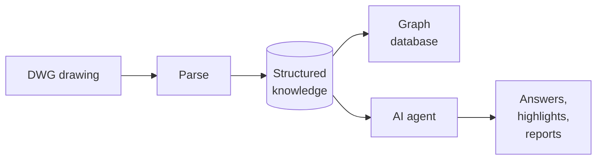
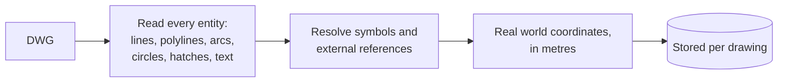
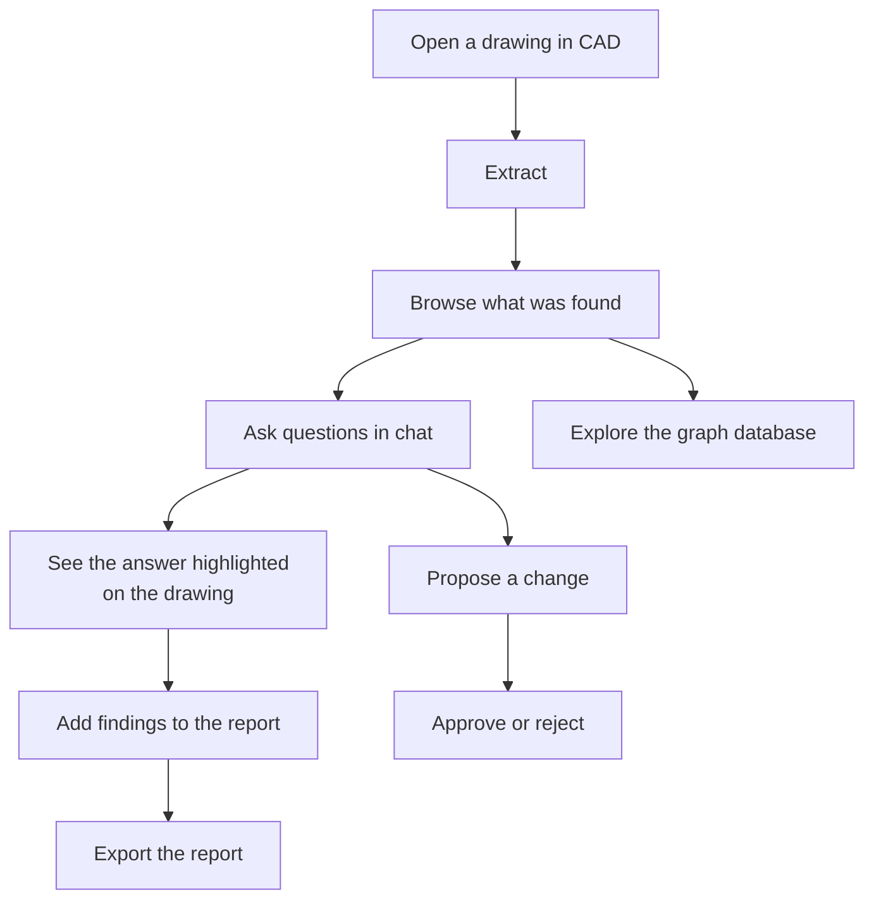
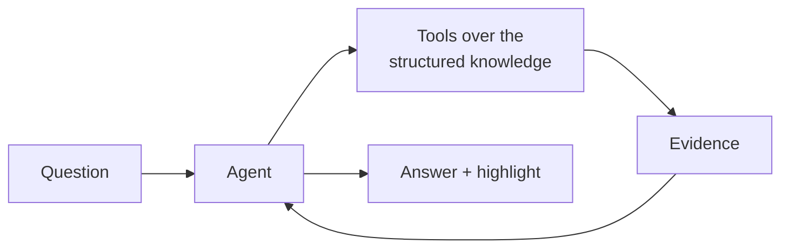
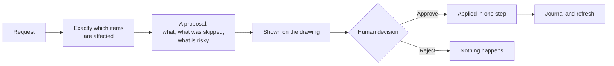
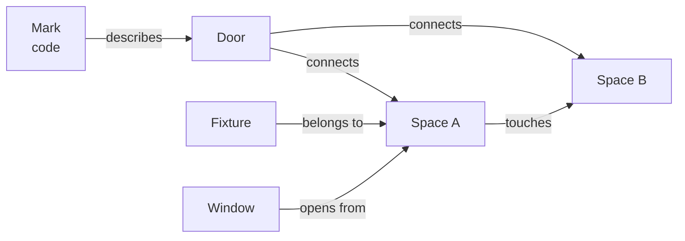

# CAD Parser — turning architectural drawings into answers

An add-on for CADian 2026 that reads a DWG floor plan, works out what is in it, and
answers questions about it. It identifies the spaces and the objects in them, links
doors and windows to the spaces they serve, checks the plan against inspection
rules, and produces a bilingual report.

> **A note on what this document contains.** This is a description of the problem,
> the capabilities and the results. The methods behind them are deliberately left
> out. They are the product.

---

## 1. Introduction

An architectural drawing contains everything a building needs, but a computer does
not see rooms, doors or bathrooms in it. It sees tens of thousands of lines, arcs,
texts and symbols with no meaning attached to any of them. A person reads the plan
in seconds. Software has to rebuild that understanding from nothing.

This project does that rebuilding, and then puts an AI assistant on top of it, so
that a user can simply ask.



Three questions shaped every decision in it:

1. **Does it work on a drawing it has never seen?** A system tuned to one file is a
   demo, not a product.
2. **Can every answer be traced?** An inspection result that cannot be shown on the
   drawing is an opinion.
3. **Can it be wrong safely?** It works on a customer's drawing, so uncertainty must
   be a visible state, and nothing may change without a human decision.

---

## 2. The problem: a drawing is not a model

A DWG file is a picture made of geometry. Nothing in it says "this is a bedroom".
Everything that follows exists because of that one fact.

### 2.1 What the file actually contains

```
A floor plan file
├── Primitives      lines, polylines, arcs, circles, hatches
├── Text            names, sizes, notes, titles, legends, revisions
├── Symbols         reusable blocks: a door, a toilet, an entire flat
│   ├── nested      a symbol inside a symbol inside a symbol
│   └── external    geometry that lives in a different file altogether
├── Layers          groupings chosen by whoever drew it
└── Marks           codes that refer to a door or a window
```

### 2.2 Why that is hard

**Geometry carries no meaning.** The file stores shapes and positions. It does not
store what anything *is*, what belongs to what, or where one thing ends and the next
begins.

**Everything overlaps.** Furniture, tiling, hatching, dimension lines and
annotations sit on top of the structure. Treating all geometry equally produces
nonsense.

**Symbols hide their position.** A symbol's true coordinates exist only after it is
resolved through insertion, rotation, scale and mirroring, sometimes several levels
deep. The usual shortcut, exploding everything, destroys the information about what
each symbol is, which is exactly the information needed.

**Nothing is standardised.** Every office draws differently and names things
differently, in more than one language, and the same project mixes conventions.

**One file, many flats.** A residential plan repeats the same unit several times,
some mirrored, some rotated at an angle. Every name repeats with it, so every answer
must stay unambiguous without the user pointing at coordinates.

**Drawings are not drawn correctly.** Lines that should meet miss by a millimetre.
Content sits on the wrong grouping. Labels sit outside the thing they name. Real
files are the test, not clean ones.

### 2.3 Why the obvious approaches fail

| Approach | Why it is not enough |
|---|---|
| Explode everything and analyse the shapes | Loses the meaning carried by symbols, and multiplies the data |
| Send the drawing to a language model | Far too large, and models cannot do exact geometry or counting |
| Image recognition on a rendered plan | Loses exact coordinates, units and identity; cannot be traced back |
| Manual templates per project | Does not scale, and every customer draws differently |

The system uses none of these alone. It builds a structured understanding first, and
treats the language model as a reader of that structure rather than of the file.

---

## 3. Parsing and storage

The first stage reads the drawing and writes it down in a form a machine can work
with.



```
Parsing
├── Entities          lines, polylines, arcs, circles, hatches, text
├── Symbols           resolved to the leaf, including nested ones
├── External refs     pulled in and marked with their origin
├── Units             normalised, so every later number is in metres
└── Identity          a stable identifier per drawing and per entity
```

Two decisions mattered.

**Nothing is exploded.** Each piece of geometry keeps a path back to the symbol it
belongs to, so a symbol is still recognisable as itself while its geometry sits in
world coordinates.

**Every fact keeps its origin.** The drawing's own identifier for an entity is
carried through the whole pipeline. That is what later lets any number be pointed at
on screen, and lets a reviewer disagree with one line rather than the whole report.

Parsed drawings are stored, not re-read. A drawing is processed once and the result
is reused for every later question, by the assistant, by the inspection, and by the
graph database.

---

## 4. What the system produces

### 4.1 Structured knowledge

```
For one drawing
├── Spaces           name, kind, area, confidence, evidence
├── Objects          kind, position, the space it belongs to, evidence
├── Openings         doors and windows, with sizes and the source of each size
├── Marks            official codes and the openings they describe
├── Relations        opening to spaces, space to space, space to its structure
├── Inventory        what the drawing is made of, and how much of each
└── Provenance       for every item, the exact drawing entities behind it
```

**Provenance is the feature.** Every space, area, size and finding keeps a link back
to the drawing. That is what allows the assistant to highlight its own evidence.

**Confidence is explicit.** A result that was recovered cleanly and one that was
approximated are not presented as the same thing, and anything judged on top of an
approximate result inherits that lower confidence.

### 4.2 From a user's point of view



### 4.3 Capability inventory

```
Capabilities
├── Reading
│   ├── full extraction with stable identity
│   ├── symbol resolution to real world coordinates
│   ├── external references included
│   └── unit handling, so every result is in metres
├── Understanding
│   ├── spaces of every kind, including service and utility spaces
│   ├── objects: doors, windows, sanitary fixtures, kitchen fittings, furniture
│   ├── marks matched to the openings they describe
│   └── relations between spaces, openings and structure
├── Asking
│   ├── find, count and measure anything the system knows about
│   ├── walk the relations
│   ├── answer in the language of the question
│   └── show every answer on the drawing
├── Inspecting
│   ├── a rule set over spaces and their contents
│   ├── a result state per rule per space, including "cannot be judged"
│   └── findings collected into an editable report
├── Reporting
│   ├── one document per drawing, Korean and English together
│   ├── content added straight from the conversation
│   └── export to office formats
└── Changing (always proposed, never automatic)
    ├── create, edit, delete and reorganise drawing content
    ├── move or copy content between groupings
    └── a full journal of everything applied
```

---

## 5. Why an AI agent

A fixed set of reports only answers the questions someone thought of in advance.
Real users ask sideways questions:

- *Which bathrooms have no ventilation?*
- *Make a table of the structure around this kitchen, with lengths.*
- *How many doors of this code are in the drawing, and where?*
- *Is anything missing in the balconies?*
- *Put that in the report, in both languages.*

An agent turns an open question into a short chain of exact lookups and explains the
result. It is not asked to understand the drawing. It is asked to understand the
*question*, and then to use tools that already understand the drawing.



### 5.1 Why not simply give the model the file

| | Model reads the drawing | Model reads the structured knowledge |
|---|---|---|
| Size | far beyond a usable context | a small, relevant slice |
| Exactness | approximate, unstable | exact, repeatable |
| Cost | pays again for every question | processed once, reused |
| Traceability | none | every value carries its origin |
| Reliability | varies per model and per run | the numbers do not depend on the model |

The deterministic work is done deterministically. The model is used for language,
intent and composition, which is what it is actually good at.

### 5.2 What the agent can reach

The assistant works through a small, named set of tools. The names are what a user
sees in the activity log:

| Tool | What the user gets |
|---|---|
| `find` | the items that match a description |
| `count` | how many, with the same filters |
| `measure` | sizes, clear widths, distances, with the source of each number |
| `relate` | how spaces, openings and structure connect |
| `highlight` | the answer shown on the drawing |
| `inspection` | findings written into the report |
| `modify` | a proposed change, never an applied one |
| `create_block` | a new symbol built from a selection |
| `data_scanner` | a raw sweep for anything the structured view missed |

What each tool accepts, and the shape of what it returns, are part of the product
and are not described here.

---

## 6. The agent harness

The model is a small part of an agent. The harness is the rest, and it decides
whether the thing survives real use.

```
Harness
├── Conversation control
│   ├── a working budget per question, and a clear stop
│   ├── partial answers that say what is still missing
│   └── no silent retry of a question already answered
├── Grounding
│   ├── every claim carries the drawing evidence behind it
│   ├── the highlight shows exactly what the answer talked about
│   └── anything that cannot be grounded is reported as unknown
├── Scope discipline
│   ├── "only these" means only these
│   └── a narrowing word in the question narrows the result
├── Context strategy
│   ├── the drawing is introduced once, not repeated
│   ├── tool results are reasoned over as they came back
│   └── history is managed so long sessions stay coherent
├── Determinism
│   ├── the same question twice returns the same numbers
│   └── numbers never depend on which model is configured
├── Idempotence
│   └── repeating an action does not duplicate its result
├── Bilingual operation
│   ├── answers in the language of the question
│   └── report content stored in both languages at once
├── Cost and observability
│   ├── tokens and estimated cost shown per answer
│   ├── every tool call traced with timing and outcome
│   └── failures surfaced as information, not as crashes
├── Model flexibility
│   ├── hosted frontier models
│   └── a self-hosted model for drawings that may not leave the building
└── Safety
    ├── proposal and approval are separate steps
    ├── nothing is written without an explicit human click
    └── everything applied is journalled
```

When an answer is wrong, the trace shows whether the agent asked the wrong question
or a tool returned the wrong thing. That single distinction is most of debugging an
agent system.

---

## 7. Interaction and safety

### 7.1 Showing the work

An answer that cannot be seen is hard to trust. Results are drawn directly on the
CAD canvas without altering the drawing: evidence appears as temporary graphics that
disappear when cleared. Spaces can be shown as outlines or filled with a see-through
mask, so a space reads as an area while the plan stays readable underneath.

### 7.2 Changing a drawing

This is the only irreversible thing the system can do, so it is deliberately slow.



The approval is a button, not a typed word. The assistant cannot propose and apply
in the same breath, and the outcome of the click is fed back, so it knows what
actually happened rather than what it suggested.

---

## 8. Reliability engineering

Correctness on one drawing is luck. The project is built around proving it on
drawings it was not developed against.

```
Quality approach
├── Benchmarks that cannot be gamed
│   ├── no name, identifier or number appears in a test prompt
│   ├── expected results are relations the drawing itself defines
│   ├── every test is run on unrelated drawings, in both languages
│   └── "nothing found" is a correct answer when it is true
├── Staged scope
│   ├── stage one: reading, classifying, counting, relating, grouping
│   └── later stages do not start until stage one passes everywhere
├── Fast measurement
│   ├── the heavy stages can be run outside CAD on exported drawings
│   └── a change can be measured in seconds instead of a manual session
└── Regression discipline
    ├── every result compared before and after a change
    ├── spatial checks that results do not collide with each other
    └── the same drawing re-tested in different units and rotated
```

A concrete example of what this catches: a change meant to improve one result
quietly altered twenty others. The before-and-after comparison showed it in one run.
Without that discipline, the improvement would have shipped with the damage attached.

---

## 9. Results

| Measure | Outcome |
|---|---|
| Entities in a test plan | roughly 25,000 |
| Spaces recovered in it | 66, across six repeated unit types |
| Quality | the large majority recovered cleanly; the rest reported as approximate rather than presented as exact |
| Language coverage | Korean and English, across both test sets |
| Independence | identical results in millimetres, in inches, and with the plan rotated |
| Integrity | results checked against each other on every change |
| Repeatability | the same question returns the same numbers across runs and models |

### 9.1 Visual results

The figures below are illustrative placeholders drawn to the same layout as the
real screens; they will be replaced with CAD screenshots.


*Figure 1. The drawing as it comes from CAD: geometry, text and symbols with no meaning attached.*


*Figure 2. What the system recovered, drawn over the plan: spaces, openings and fixtures, each with a confidence.*


*Figure 3. A space shown with the see-through mask, so it reads as an area while the plan stays readable underneath.*


*Figure 4. The graph database view: a selected node with its direct connections, linked back to the canvas.*


*Figure 5. A page of the inspection report, Korean and English together, with the evidence behind each finding.*

### 9.2 Demonstrations

*(Add demo videos here.)*

- A question asked and answered end to end, with the evidence highlighted.
- A full inspection run, from extraction to exported report.
- A proposed change, reviewed and approved.

---

## 10. Inspection and reporting

The inspection layer asks whether each space contains what it must contain.

```
Inspection
├── Rule set        requirements on a kind of space and its contents
├── Result states   pass, fail, warning, review required,
│                   insufficient data, not applicable, not evaluated
├── Evidence        the drawing entities behind every judgement
├── Confidence      inherited from how well the result itself was recovered
└── Report
    ├── one document per drawing
    ├── Korean and English stored together
    ├── content added directly from the conversation
    ├── editable: update, replace, remove, retitle
    └── exported to office formats
```

The states that are neither pass nor fail matter most. A rule that cannot be judged
on this drawing says so. That is the difference between a tool a reviewer trusts and
one they stop reading.

---

## 11. Graph database

A drawing is not a list. It is a web of things that refer to each other: a mark
describes a door, a door joins two spaces, a space touches another space, a fixture
belongs to a space. Storing that as a graph lets a question be answered by walking
from one thing to the next, instead of scanning everything each time.



### 11.1 What is in it

```
Graph database
├── Nodes       one per meaningful thing: space, opening, mark, fixture,
│               and the structural pieces around a space
│   ├── class   what kind of thing it is
│   ├── origin  the drawing entity it was built from
│   └── values  its own properties, such as a code or a size
├── Edges       directed, named relations between two nodes
│   └── evidence   why the relation exists, kept on the edge itself
└── One graph per drawing, saved and reloaded by drawing identity
```

**Edges carry their evidence.** A relation is not an assertion, it is a claim with a
reason attached. That makes the graph auditable: any connection can be questioned
and traced back to the drawing.

### 11.2 What it is used for

| Use | What it gives |
|---|---|
| Exploration | a window listing every node with its class, origin and how many connections it has |
| Visualisation | a selected node drawn with its direct connections, so the local picture is immediate |
| Linking to the drawing | selecting a node highlights it and its connections on the CAD canvas |
| Answering | the assistant walks the graph to answer questions about how things connect |
| Inspection | rules are evaluated over relations, not only over positions |
| Persistence | the graph is stored per drawing, so a reopened file brings its relations back |

### 11.3 Why a graph rather than tables

Questions in this domain are relational by nature: *which spaces does this door
join*, *what opens off this corridor*, *which spaces have no opening at all*, *what
surrounds this space*. In a table these are joins that grow with every new question.
As a graph they are short walks, and new relation types can be added without
reshaping what is already stored.

---

## 12. Technology and skills

| Area | What this project demanded |
|---|---|
| Language and platform | C#, .NET, Windows desktop application development |
| CAD integration | commercial CAD add-on development, drawing database access, non-destructive on-canvas rendering, document and transaction handling |
| Computational geometry | spatial computation on unstructured drawing data, independence from unit and orientation |
| Data engineering | structured storage per drawing, content-based identity, vector search for free text, change journalling |
| Graph modelling | node and edge design, evidence-carrying relations, persistence, visualisation, traversal for question answering |
| AI engineering | tool-calling agents, multi-round control, grounding and evidence, prompt and configuration design, token and cost accounting, model routing |
| Model operations | hosted frontier models and a self-hosted model server for private data |
| Natural language | Korean and English throughout |
| Documents | bilingual document generation and export |
| Product thinking | confidence as a first-class output, approval gates, traceability, staged delivery |
| Quality engineering | drawing-independent benchmarks, offline measurement harness, regression comparison on every change |

---

## 13. How the work was run

```
Working method
├── One problem at a time, measured before and after
├── Every change verified on more than one drawing
├── Nothing accepted because it looked right in one screenshot
├── Configuration kept in one place, so behaviour is tunable
├── Documentation written alongside, in plain language
└── Scope held: a fix that improves one case and damages another is not a fix
```

---

## 14. Roadmap

- **Recognition without names.** Classify drawing content by what it is, so a file
  with meaningless naming still works.
- **Drawing back into the file.** The system proposes changes today; the next stage
  is generating new geometry to resolve what the inspection found.
- **Learning across projects.** Each drawing read makes the next one easier.
- **Wider rule sets.** Customer-specific and regulation-specific checks on top of
  the same structured knowledge.
- **Richer graph.** More relation types, and queries that span several drawings.

---

## 15. Summary

I built a system that reads an architectural drawing the way a person does: it
parses the raw geometry, resolves the symbols, works out what the drawing is made
of, records how everything connects as a graph, and lets an AI assistant answer
questions about the result with evidence attached to every number. It states its
confidence, it shows its work on the drawing, and it never changes a customer's file
without a human decision.

The hard part was not the AI. It was making the drawing understandable enough that
the AI never has to guess.
