# CAD Parser — 건축 도면을 답으로 바꾸는 시스템

CADian 2026용 애드온이에요. DWG 평면도를 읽고, 그 안에 무엇이 있는지 파악하고,
도면에 대한 질문에 답해요. 공간과 그 안의 객체를 식별하고, 문과 창을 그것이 연결하는
공간에 묶고, 검사 규칙에 따라 도면을 점검한 뒤, 한·영 이중 언어 보고서를 만들어요.

> **이 문서에 담긴 내용에 대하여.** 이 문서는 문제, 기능, 결과를 설명해요. 그 뒤에 있는
> 방법은 의도적으로 적지 않았어요. 방법 자체가 제품이기 때문이에요.

---

## 1. 소개

건축 도면에는 건물에 필요한 모든 것이 담겨 있지만, 컴퓨터는 그 안에서 방, 문, 욕실을
보지 못해요. 컴퓨터가 보는 것은 아무 의미도 붙어 있지 않은 수만 개의 선, 호, 텍스트,
기호뿐이에요. 사람은 도면을 몇 초 만에 읽지만, 소프트웨어는 그 이해를 처음부터 다시
쌓아 올려야 해요.

이 프로젝트는 그 재구성을 해내고, 그 위에 AI 어시스턴트를 올려서 사용자가 그냥 물어볼
수 있게 해요.

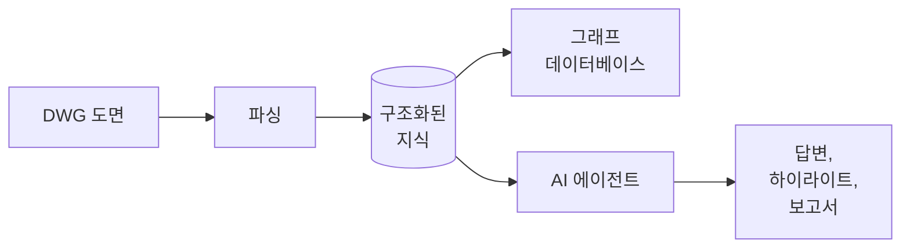

모든 결정은 세 가지 질문을 기준으로 내렸어요.

1. **처음 보는 도면에서도 동작하는가?** 하나의 파일에 맞춰 튜닝된 시스템은 데모일 뿐,
   제품이 아니에요.
2. **모든 답을 추적할 수 있는가?** 도면 위에 보여줄 수 없는 검사 결과는 의견에 불과해요.
3. **틀려도 안전한가?** 고객의 도면 위에서 동작하므로, 불확실함은 눈에 보이는 상태여야
   하고, 사람의 결정 없이는 아무것도 바뀌면 안 돼요.

---

## 2. 문제: 도면은 모델이 아니다

DWG 파일은 기하 요소로 이루어진 그림이에요. 그 안의 어떤 것도 "이것은 침실이다"라고
말해 주지 않아요. 뒤에 나오는 모든 내용은 이 한 가지 사실에서 출발해요.

### 2.1 파일에 실제로 담긴 것

```
평면도 파일
├── 기본 요소      선, 폴리라인, 호, 원, 해치
├── 텍스트         이름, 치수, 메모, 제목, 범례, 개정 이력
├── 기호           재사용되는 블록: 문 하나, 변기 하나, 세대 하나 전체
│   ├── 중첩       기호 안의 기호 안의 기호
│   └── 외부 참조  아예 다른 파일에 들어 있는 기하 요소
├── 레이어         그린 사람이 정한 묶음
└── 마크           특정 문이나 창을 가리키는 코드
```

### 2.2 왜 어려운가

**기하 요소에는 의미가 없어요.** 파일은 형태와 위치를 저장할 뿐, 무엇이 무엇*인지*,
무엇이 무엇에 속하는지, 어디서 하나가 끝나고 다음이 시작되는지는 저장하지 않아요.

**모든 것이 겹쳐 있어요.** 가구, 타일, 해치, 치수선, 주석이 구조 위에 그대로 올라가
있어요. 모든 기하 요소를 똑같이 다루면 말이 안 되는 결과가 나와요.

**기호는 자기 위치를 숨겨요.** 기호의 실제 좌표는 삽입, 회전, 축척, 반전을 거쳐야
비로소 나오고, 그것도 여러 단계가 겹칠 때가 많아요. 흔히 쓰는 지름길인 '모두 분해하기'는
각 기호가 무엇인지에 대한 정보를 파괴하는데, 그 정보가 바로 필요한 정보예요.

**표준화된 것이 없어요.** 사무소마다 그리는 방식과 이름 붙이는 방식이 다르고, 언어도
하나가 아니며, 같은 프로젝트 안에서도 관행이 섞여요.

**파일 하나, 세대 여럿.** 주거 평면도는 같은 세대를 여러 번 반복하고, 일부는 반전되고
일부는 비스듬히 회전돼요. 이름도 함께 반복되므로, 사용자가 좌표를 가리키지 않아도 모든
답이 모호하지 않아야 해요.

**도면은 정확하게 그려져 있지 않아요.** 만나야 할 선이 1mm 어긋나요. 내용이 엉뚱한
묶음에 들어가 있어요. 라벨이 자기가 가리키는 것 바깥에 놓여 있어요. 깨끗한 파일이
아니라 실제 파일이 시험대예요.

### 2.3 뻔한 접근이 실패하는 이유

| 접근 | 충분하지 않은 이유 |
|---|---|
| 모두 분해한 뒤 형태를 분석 | 기호가 지닌 의미를 잃고, 데이터만 몇 배로 불어남 |
| 도면을 언어 모델에 통째로 전달 | 너무 크고, 모델은 정확한 기하 계산과 개수 세기를 못 함 |
| 렌더링한 평면 이미지 인식 | 정확한 좌표, 단위, 식별자를 잃고, 역추적이 불가능 |
| 프로젝트별 수동 템플릿 | 확장이 안 되고, 고객마다 그리는 방식이 다름 |

이 시스템은 이 중 어느 것도 단독으로 쓰지 않아요. 먼저 구조화된 이해를 만들고, 언어
모델은 파일이 아니라 그 구조를 읽는 독자로 다뤄요.

---

## 3. 파싱과 저장

첫 단계는 도면을 읽어 기계가 다룰 수 있는 형태로 적어 두는 일이에요.

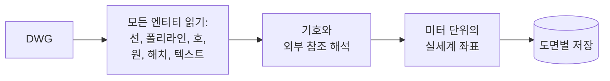

```
파싱
├── 엔티티        선, 폴리라인, 호, 원, 해치, 텍스트
├── 기호          중첩된 것까지 말단까지 해석
├── 외부 참조     가져온 뒤 출처를 표시
├── 단위          정규화해서 이후의 모든 숫자는 미터 단위
└── 식별자        도면마다, 엔티티마다 안정적인 식별자
```

두 가지 결정이 중요했어요.

**아무것도 분해하지 않아요.** 각 기하 요소는 자신이 속한 기호로 돌아가는 경로를
유지해요. 그래서 기호의 기하 요소가 실세계 좌표에 놓여 있어도 기호는 여전히 기호로
인식돼요.

**모든 사실은 출처를 유지해요.** 도면이 엔티티에 부여한 고유 식별자가 파이프라인 전체를
통과해요. 덕분에 나중에 어떤 숫자든 화면에서 가리킬 수 있고, 검토자가 보고서 전체가
아니라 한 줄에 대해서만 이의를 제기할 수 있어요.

파싱된 도면은 저장되며 다시 읽지 않아요. 도면은 한 번 처리되고, 그 결과를 이후의 모든
질문에서 재사용해요. 어시스턴트도, 검사도, 그래프 데이터베이스도 같은 결과를 써요.

---

## 4. 시스템이 만들어 내는 것

### 4.1 구조화된 지식

```
도면 하나에 대해
├── 공간          이름, 종류, 면적, 신뢰도, 근거
├── 객체          종류, 위치, 속한 공간, 근거
├── 개구부        문과 창, 크기와 각 크기의 출처
├── 마크          공식 코드와 그것이 설명하는 개구부
├── 관계          개구부–공간, 공간–공간, 공간–구조
├── 인벤토리      도면이 무엇으로 이루어져 있고 각각 얼마나 있는지
└── 출처          모든 항목에 대해, 그 뒤에 있는 정확한 도면 엔티티
```

**출처가 핵심 기능이에요.** 모든 공간, 면적, 크기, 판정은 도면으로 돌아가는 링크를
유지해요. 그래서 어시스턴트가 자기 근거를 직접 하이라이트할 수 있어요.

**신뢰도는 명시적이에요.** 깨끗하게 복원된 결과와 근사된 결과는 같은 것으로 제시되지
않고, 근사 결과 위에서 내려진 판정은 그 낮은 신뢰도를 그대로 물려받아요.

### 4.2 사용자 관점에서

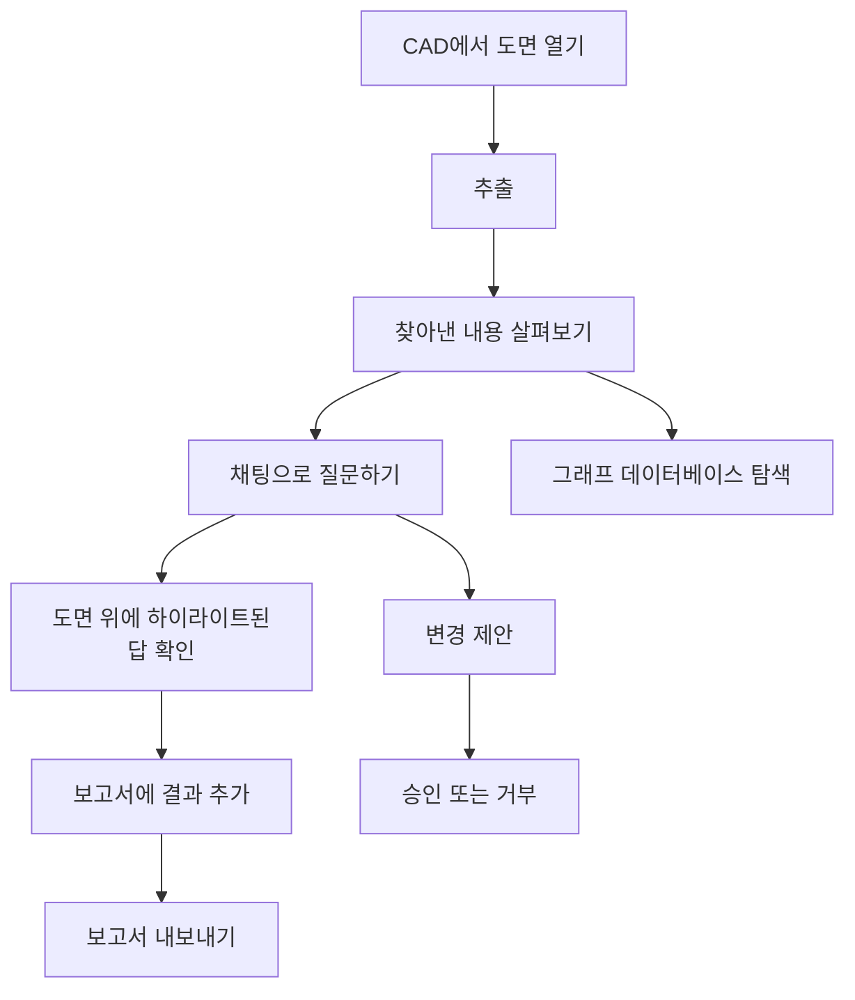

### 4.3 기능 목록

```
기능
├── 읽기
│   ├── 안정적인 식별자를 가진 전체 추출
│   ├── 실세계 좌표로의 기호 해석
│   ├── 외부 참조 포함
│   └── 단위 처리, 모든 결과는 미터 단위
├── 이해
│   ├── 설비·유틸리티 공간을 포함한 모든 종류의 공간
│   ├── 객체: 문, 창, 위생 기구, 주방 설비, 가구
│   ├── 개구부와 짝지어진 마크
│   └── 공간, 개구부, 구조 사이의 관계
├── 질문
│   ├── 시스템이 아는 모든 것을 찾고, 세고, 재기
│   ├── 관계를 따라가기
│   ├── 질문한 언어로 답하기
│   └── 모든 답을 도면 위에 보여주기
├── 검사
│   ├── 공간과 그 내용물에 대한 규칙 집합
│   ├── 규칙별·공간별 결과 상태, "판정 불가" 포함
│   └── 편집 가능한 보고서로 모은 판정
├── 보고
│   ├── 도면당 문서 하나, 한국어와 영어 함께
│   ├── 대화에서 바로 추가되는 내용
│   └── 오피스 형식으로 내보내기
└── 변경 (항상 제안만, 자동 적용 없음)
    ├── 도면 내용의 생성, 편집, 삭제, 재구성
    ├── 묶음 간 이동 또는 복사
    └── 적용된 모든 것의 전체 기록
```

---

## 5. 왜 AI 에이전트인가

고정된 보고서 집합은 누군가 미리 생각해 둔 질문에만 답해요. 실제 사용자는 옆길로 빠지는
질문을 해요.

- *환기가 없는 욕실은 어디예요?*
- *이 주방 주변 구조를 길이와 함께 표로 만들어 줘요.*
- *이 코드의 문이 도면에 몇 개 있고, 어디에 있어요?*
- *발코니에 빠진 게 있어요?*
- *그걸 보고서에 두 언어로 넣어 줘요.*

에이전트는 열린 질문을 정확한 조회의 짧은 연쇄로 바꾸고 결과를 설명해요. 에이전트에게
도면을 이해하라고 요구하지 않아요. *질문*을 이해하고, 이미 도면을 이해하고 있는 도구를
쓰라고 요구해요.

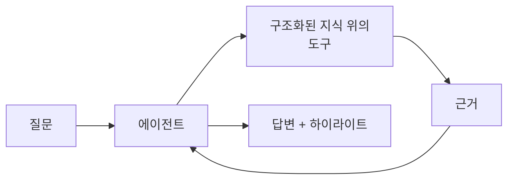

### 5.1 왜 모델에 파일을 그냥 주지 않는가

| | 모델이 도면을 읽음 | 모델이 구조화된 지식을 읽음 |
|---|---|---|
| 크기 | 쓸 수 있는 컨텍스트를 한참 넘어섬 | 작고 관련 있는 조각 |
| 정확성 | 근사적이고 불안정 | 정확하고 반복 가능 |
| 비용 | 질문마다 다시 지불 | 한 번 처리하고 재사용 |
| 추적성 | 없음 | 모든 값이 출처를 지님 |
| 신뢰성 | 모델과 실행마다 달라짐 | 숫자가 모델에 의존하지 않음 |

결정론적인 일은 결정론적으로 처리해요. 모델은 언어, 의도, 구성에 쓰는데, 그것이 모델이
실제로 잘하는 일이에요.

### 5.2 에이전트가 쓸 수 있는 것

어시스턴트는 이름이 정해진 작은 도구 집합을 통해 일해요. 이 이름들이 사용자가 활동
로그에서 보는 것이에요.

| 도구 | 사용자가 얻는 것 |
|---|---|
| `find` | 설명에 맞는 항목들 |
| `count` | 같은 필터로 센 개수 |
| `measure` | 크기, 유효 폭, 거리, 그리고 각 숫자의 출처 |
| `relate` | 공간, 개구부, 구조가 어떻게 연결되는지 |
| `highlight` | 도면 위에 표시된 답 |
| `inspection` | 보고서에 기록된 판정 |
| `modify` | 제안된 변경, 적용된 변경이 아님 |
| `create_block` | 선택 영역으로 만든 새 기호 |
| `data_scanner` | 구조화된 뷰가 놓친 것을 찾는 원시 스캔 |

각 도구가 무엇을 받고 무엇을 돌려주는지는 제품의 일부이므로 여기에 적지 않아요.

---

## 6. 에이전트 하네스

모델은 에이전트의 작은 부분이에요. 나머지가 하네스이고, 실제 사용에서 살아남을지는
하네스가 결정해요.

```
하네스
├── 대화 제어
│   ├── 질문당 작업 예산과 명확한 중단
│   ├── 무엇이 아직 빠졌는지 말하는 부분 답변
│   └── 이미 답한 질문의 조용한 재시도 없음
├── 근거 확보
│   ├── 모든 주장은 뒤에 도면 근거를 지님
│   ├── 하이라이트는 답이 말한 것을 정확히 보여줌
│   └── 근거를 댈 수 없는 것은 모름으로 보고
├── 범위 규율
│   ├── "이것들만"은 이것들만
│   └── 질문의 한정어는 결과를 좁힘
├── 컨텍스트 전략
│   ├── 도면은 한 번만 소개하고 반복하지 않음
│   ├── 도구 결과는 돌아온 그대로 추론
│   └── 긴 세션도 일관되도록 이력 관리
├── 결정론
│   ├── 같은 질문을 두 번 하면 같은 숫자
│   └── 숫자는 어떤 모델이 설정됐는지에 의존하지 않음
├── 멱등성
│   └── 동작을 반복해도 결과가 중복되지 않음
├── 이중 언어 동작
│   ├── 질문한 언어로 답변
│   └── 보고서 내용은 두 언어로 동시에 저장
├── 비용과 관측성
│   ├── 답변마다 토큰과 추정 비용 표시
│   ├── 모든 도구 호출을 시간과 결과와 함께 추적
│   └── 실패는 충돌이 아니라 정보로 드러냄
├── 모델 유연성
│   ├── 호스팅된 최신 모델
│   └── 건물 밖으로 나가면 안 되는 도면을 위한 자체 호스팅 모델
└── 안전
    ├── 제안과 승인은 별개의 단계
    ├── 사람의 명시적 클릭 없이는 아무것도 쓰지 않음
    └── 적용된 모든 것은 기록됨
```

답이 틀렸을 때, 추적 기록은 에이전트가 잘못된 질문을 했는지, 아니면 도구가 잘못된 것을
돌려줬는지 보여줘요. 이 하나의 구분이 에이전트 시스템 디버깅의 대부분이에요.

---

## 7. 상호작용과 안전

### 7.1 작업 보여주기

볼 수 없는 답은 믿기 어려워요. 결과는 도면을 바꾸지 않고 CAD 캔버스 위에 직접
그려져요. 근거는 임시 그래픽으로 나타나고 지우면 사라져요. 공간은 외곽선으로 보여주거나
반투명 마스크로 채울 수 있어서, 공간은 면적으로 읽히면서도 아래의 평면은 계속 읽을 수
있어요.

### 7.2 도면 변경하기

시스템이 할 수 있는 유일하게 되돌릴 수 없는 일이므로, 일부러 느리게 만들었어요.

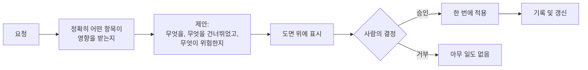

승인은 타이핑한 단어가 아니라 버튼이에요. 어시스턴트는 제안과 적용을 한 호흡에 할 수
없고, 클릭의 결과는 다시 어시스턴트에게 전달돼서, 제안한 것이 아니라 실제로 일어난 일을
알게 돼요.

---

## 8. 신뢰성 엔지니어링

도면 하나에서의 정확성은 운이에요. 이 프로젝트는 개발에 쓰지 않은 도면에서 그것을
증명하는 것을 중심으로 만들어졌어요.

```
품질 접근
├── 속일 수 없는 벤치마크
│   ├── 테스트 프롬프트에 이름, 식별자, 숫자가 등장하지 않음
│   ├── 기대 결과는 도면 자체가 정의하는 관계
│   ├── 모든 테스트는 무관한 도면에서 두 언어로 실행
│   └── 사실이라면 "찾지 못함"도 정답
├── 단계적 범위
│   ├── 1단계: 읽기, 분류, 세기, 관계 짓기, 묶기
│   └── 1단계가 모든 곳에서 통과하기 전에는 다음 단계를 시작하지 않음
├── 빠른 측정
│   ├── 무거운 단계는 내보낸 도면으로 CAD 밖에서 실행 가능
│   └── 수동 세션 대신 몇 초 만에 변경을 측정
└── 회귀 규율
    ├── 모든 결과를 변경 전후로 비교
    ├── 결과끼리 충돌하지 않는지 공간 검사
    └── 같은 도면을 다른 단위와 회전 상태로 재검사
```

이것이 잡아내는 것의 구체적인 예: 한 결과를 개선하려던 변경이 다른 스무 개를 조용히
바꿔 버렸어요. 전후 비교가 한 번의 실행으로 그것을 드러냈어요. 이런 규율이 없었다면
개선은 손상을 달고 출시됐을 거예요.

---

## 9. 결과

| 항목 | 결과 |
|---|---|
| 테스트 평면도의 엔티티 수 | 약 25,000개 |
| 그 안에서 복원된 공간 | 66개, 6가지 반복 세대 유형에 걸쳐 |
| 품질 | 대다수는 깨끗하게 복원, 나머지는 정확한 것처럼 제시하지 않고 근사로 보고 |
| 언어 범위 | 두 테스트 세트 모두 한국어와 영어 |
| 독립성 | 밀리미터, 인치, 회전된 평면에서 동일한 결과 |
| 무결성 | 변경할 때마다 결과를 서로 대조 검사 |
| 반복성 | 실행과 모델이 달라도 같은 질문에 같은 숫자 |

### 9.1 시각적 결과

아래 그림은 실제 화면과 같은 구성으로 그린 설명용 임시 이미지예요. CAD 스크린샷으로
교체할 예정이에요.

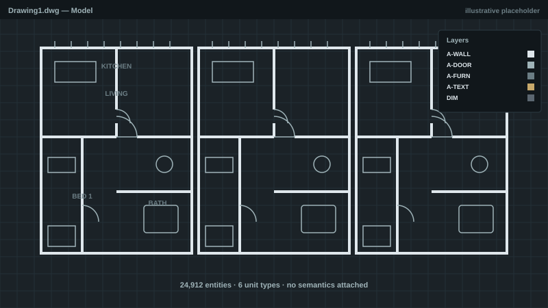
*그림 1. CAD에서 열린 원본 도면: 의미가 붙어 있지 않은 기하 요소, 텍스트, 기호.*

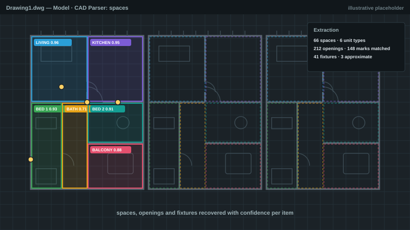
*그림 2. 시스템이 복원한 내용을 평면 위에 그린 모습: 공간, 개구부, 기구, 각각의 신뢰도.*

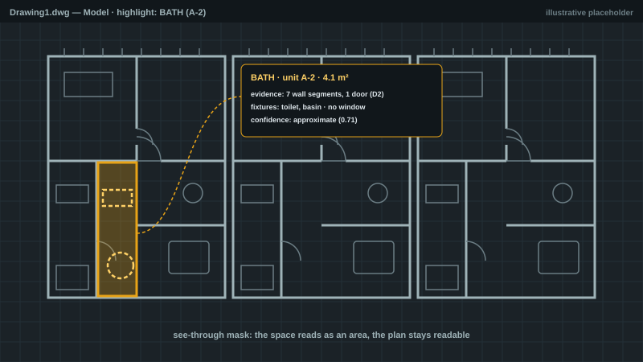
*그림 3. 반투명 마스크로 표시된 공간: 면적으로 읽히면서도 아래 평면은 계속 읽을 수 있어요.*

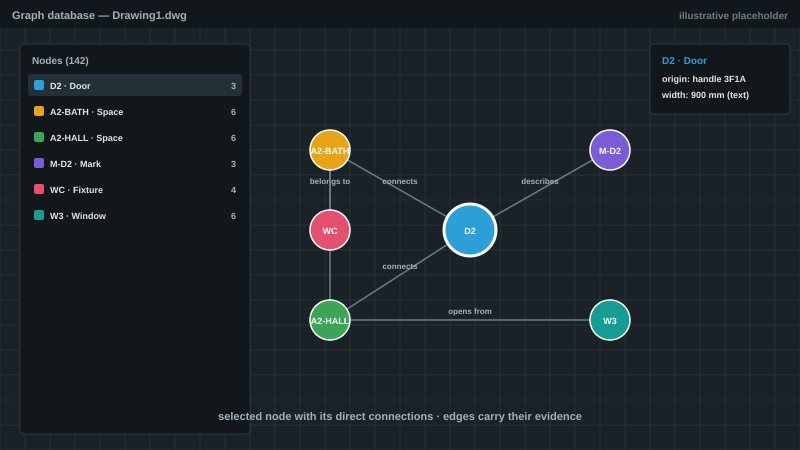
*그림 4. 그래프 데이터베이스 뷰: 선택한 노드와 직접 연결, 캔버스와 연동.*

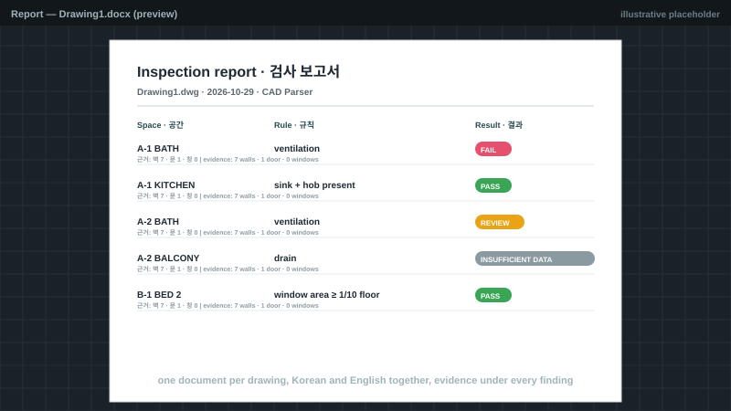
*그림 5. 검사 보고서의 한 페이지: 한국어와 영어 함께, 판정마다 근거 표시.*

### 9.2 시연

*(데모 영상은 추후 추가 예정이에요.)*

- 질문부터 답변까지 처음부터 끝까지, 근거 하이라이트와 함께.
- 추출부터 내보낸 보고서까지 전체 검사 실행.
- 제안된 변경의 검토와 승인.

---

## 10. 검사와 보고

검사 레이어는 각 공간이 반드시 담아야 할 것을 담고 있는지 물어요.

```
검사
├── 규칙 집합     공간 종류와 그 내용물에 대한 요구 사항
├── 결과 상태     통과, 실패, 경고, 검토 필요,
│                 데이터 부족, 해당 없음, 미평가
├── 근거          모든 판정 뒤의 도면 엔티티
├── 신뢰도        결과 자체가 얼마나 잘 복원됐는지에서 물려받음
└── 보고서
    ├── 도면당 문서 하나
    ├── 한국어와 영어를 함께 저장
    ├── 대화에서 바로 추가되는 내용
    ├── 편집 가능: 수정, 교체, 삭제, 제목 변경
    └── 오피스 형식으로 내보내기
```

통과도 실패도 아닌 상태가 가장 중요해요. 이 도면에서 판정할 수 없는 규칙은 그렇다고
말해요. 그것이 검토자가 믿는 도구와 읽기를 그만두는 도구의 차이예요.

---

## 11. 그래프 데이터베이스

도면은 목록이 아니에요. 서로를 참조하는 것들의 그물이에요. 마크는 문을 설명하고, 문은 두
공간을 잇고, 공간은 다른 공간과 맞닿고, 기구는 공간에 속해요. 이것을 그래프로 저장하면,
매번 전체를 훑는 대신 한 것에서 다음 것으로 걸어가며 질문에 답할 수 있어요.

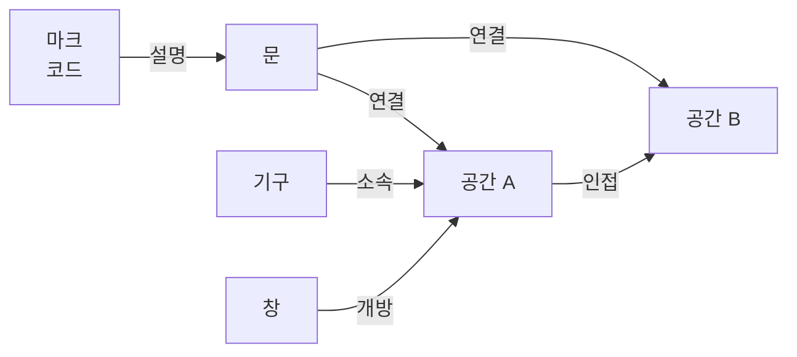

### 11.1 안에 있는 것

```
그래프 데이터베이스
├── 노드        의미 있는 것 하나당 하나: 공간, 개구부, 마크, 기구,
│               그리고 공간 주변의 구조 부재
│   ├── 클래스  어떤 종류의 것인지
│   ├── 출처    만들어진 근원이 된 도면 엔티티
│   └── 값      코드나 크기 같은 고유 속성
├── 엣지        두 노드 사이의 방향 있는, 이름 붙은 관계
│   └── 근거    관계가 존재하는 이유, 엣지 자체에 보관
└── 도면당 그래프 하나, 도면 식별자로 저장하고 다시 불러옴
```

**엣지는 근거를 지녀요.** 관계는 단정이 아니라 이유가 붙은 주장이에요. 그래서 그래프는
감사가 가능해요. 어떤 연결이든 의문을 제기하고 도면까지 거슬러 올라갈 수 있어요.

### 11.2 쓰임새

| 용도 | 제공하는 것 |
|---|---|
| 탐색 | 모든 노드를 클래스, 출처, 연결 수와 함께 나열하는 창 |
| 시각화 | 선택한 노드를 직접 연결과 함께 그려서 국소 구조를 바로 보여줌 |
| 도면 연동 | 노드를 선택하면 그 노드와 연결이 CAD 캔버스에 하이라이트 |
| 답변 | 어시스턴트가 그래프를 걸어가며 연결에 관한 질문에 답함 |
| 검사 | 규칙을 위치뿐 아니라 관계 위에서 평가 |
| 영속성 | 그래프를 도면별로 저장해서 파일을 다시 열면 관계가 돌아옴 |

### 11.3 왜 테이블이 아니라 그래프인가

이 분야의 질문은 본질적으로 관계적이에요. *이 문이 어떤 공간들을 잇는가*, *이 복도에서
무엇이 열리는가*, *개구부가 전혀 없는 공간은 어디인가*, *이 공간을 무엇이 둘러싸는가*.
테이블에서는 새 질문마다 조인이 늘어나요. 그래프에서는 짧은 걸음이고, 이미 저장된 것을
재구성하지 않고도 새 관계 유형을 추가할 수 있어요.

---

## 12. 기술과 역량

| 영역 | 이 프로젝트가 요구한 것 |
|---|---|
| 언어와 플랫폼 | C#, .NET, Windows 데스크톱 애플리케이션 개발 |
| CAD 통합 | 상용 CAD 애드온 개발, 도면 데이터베이스 접근, 비파괴 캔버스 렌더링, 문서와 트랜잭션 처리 |
| 계산 기하 | 비구조화된 도면 데이터 위의 공간 계산, 단위와 방향으로부터의 독립 |
| 데이터 엔지니어링 | 도면별 구조화 저장, 내용 기반 식별자, 자유 텍스트용 벡터 검색, 변경 기록 |
| 그래프 모델링 | 노드·엣지 설계, 근거를 지닌 관계, 영속성, 시각화, 질의응답을 위한 순회 |
| AI 엔지니어링 | 도구 호출 에이전트, 다단계 제어, 근거와 증거, 프롬프트·설정 설계, 토큰·비용 계산, 모델 라우팅 |
| 모델 운영 | 호스팅된 최신 모델과 비공개 데이터용 자체 호스팅 모델 서버 |
| 자연어 | 전 과정 한국어와 영어 |
| 문서 | 이중 언어 문서 생성과 내보내기 |
| 제품 사고 | 신뢰도를 일급 출력으로, 승인 게이트, 추적성, 단계적 전달 |
| 품질 엔지니어링 | 도면에 독립적인 벤치마크, 오프라인 측정 하네스, 모든 변경에 대한 회귀 비교 |

---

## 13. 일하는 방식

```
작업 방식
├── 한 번에 한 문제, 전후를 측정
├── 모든 변경을 둘 이상의 도면에서 검증
├── 스크린샷 하나에서 괜찮아 보인다는 이유로는 아무것도 수용하지 않음
├── 설정은 한곳에 모아 동작을 조정 가능하게
├── 문서는 작업과 나란히, 쉬운 말로
└── 범위 유지: 한 경우를 개선하고 다른 경우를 망치는 수정은 수정이 아님
```

---

## 14. 로드맵

- **이름 없이 인식하기.** 도면 내용을 그것이 무엇인지로 분류해서, 의미 없는 이름이 붙은
  파일에서도 동작하게 해요.
- **파일에 다시 그리기.** 지금은 변경을 제안하는 단계이고, 다음 단계는 검사가 찾아낸
  것을 해결하는 새 기하 요소를 생성하는 거예요.
- **프로젝트 간 학습.** 읽은 도면이 하나 늘 때마다 다음 도면이 더 쉬워져요.
- **더 넓은 규칙 집합.** 같은 구조화된 지식 위에 고객별·규정별 검사를 얹어요.
- **더 풍부한 그래프.** 더 많은 관계 유형과 여러 도면에 걸친 질의.

---

## 15. 요약

사람이 읽는 방식으로 건축 도면을 읽는 시스템을 만들었어요. 원시 기하 요소를 파싱하고,
기호를 해석하고, 도면이 무엇으로 이루어졌는지 알아내고, 모든 것이 어떻게 연결되는지를
그래프로 기록하고, AI 어시스턴트가 모든 숫자에 근거를 붙여 결과에 대한 질문에 답하게
해요. 시스템은 자신의 신뢰도를 밝히고, 도면 위에 작업을 보여주고, 사람의 결정 없이는
고객의 파일을 절대 바꾸지 않아요.

어려운 부분은 AI가 아니었어요. AI가 결코 추측할 필요가 없을 만큼 도면을 이해 가능하게
만드는 일이었어요.
