# Green Energy Analytics — Demand Forecasting and Anomaly Detection

> Two linked pieces of work on energy time series: a Random Forest model that forecasts daily electricity demand up to 30 days ahead, and a multivariate LSTM autoencoder that flags anomalous behaviour in solar inverter and weather data using static and dynamic thresholds.

<div class="fact-grid">
<div class="fact"><span class="fact-label">Forecasting data</span><span class="fact-value">Daily demand, 2014–2018 (MWh)</span></div>
<div class="fact"><span class="fact-label">Forecasting model</span><span class="fact-value">Random Forest, multi-output, 30 days ahead</span></div>
<div class="fact"><span class="fact-label">Anomaly data</span><span class="fact-value">Inverter log + weather, hourly</span></div>
<div class="fact"><span class="fact-label">Anomaly model</span><span class="fact-value">Multivariate LSTM autoencoder</span></div>
<div class="fact"><span class="fact-label">Thresholds</span><span class="fact-value">Static (mean + 3σ) and rolling dynamic</span></div>
<div class="fact"><span class="fact-label">Stack</span><span class="fact-value">pandas · scikit-learn · TensorFlow/Keras · Flask</span></div>
</div>

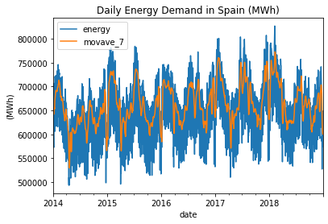
*Daily energy demand in MWh, 2014–2018, with its 7-day moving average.*

---

## 1. Electricity demand forecasting

<div class="callout callout-problem">
<h4>Problems this part addresses</h4>
<ul>
<li>Daily demand carries three overlapping structures at once: weekly and quarterly seasonality, a slow upward trend, and volatility that changes with the season.</li>
<li>Demand depends strongly on weather, so a model must be judged on a held-out period rather than on how well it fits the past.</li>
<li>Operators need forecasts several days ahead, not only the next day, from one model.</li>
</ul>
</div>

The dataset is daily electricity demand for Spain from 2014 to 2018. The work follows a full cycle: exploratory analysis, feature engineering, model building with time-series cross-validation, residual analysis, and multi-period forecasting.

### 1.1 Exploratory analysis

The demand distribution has negative skew and kurtosis below 3, and a Shapiro–Wilk test rejects normality (p = 2.5 × 10⁻¹⁰). Rolling percentiles and the coefficient of variation by month show that short-term volatility changes with the season, while a 365-day rolling standard deviation is comparatively stable.

<div class="figure-row">
<figure>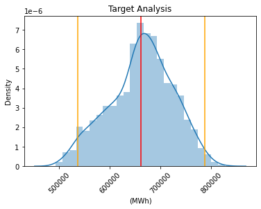<figcaption>Distribution of daily demand: left-skewed and platykurtic.</figcaption></figure>
<figure>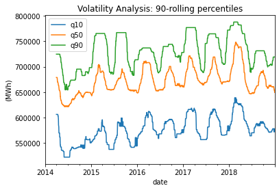<figcaption>Volatility analysis: 90-day rolling percentiles.</figcaption></figure>
</div>

<div class="figure-row">
<figure>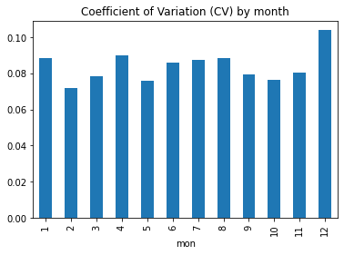<figcaption>Coefficient of variation by month.</figcaption></figure>
<figure>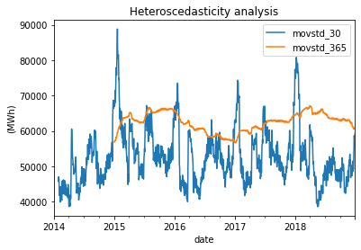<figcaption>Heteroscedasticity: 30-day versus 365-day moving standard deviation.</figcaption></figure>
</div>

### 1.2 Seasonality and trend

Moving averages, quarterly and weekday box plots, and a regression on monthly totals show two clear seasonal patterns (quarters and weekdays, with lower demand at weekends) and a positive, slightly damped trend consistent with economic recovery over the period.

<div class="figure-row">
<figure>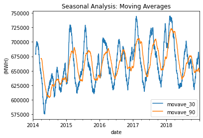<figcaption>Seasonal analysis: 30-day and 90-day moving averages.</figcaption></figure>
<figure>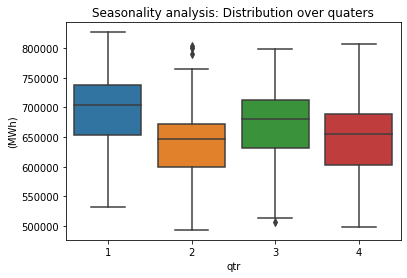<figcaption>Distribution over quarters.</figcaption></figure>
</div>

<div class="figure-row">
<figure>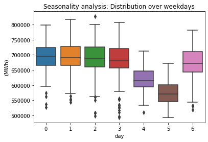<figcaption>Distribution over weekdays (0 is Monday).</figcaption></figure>
<figure>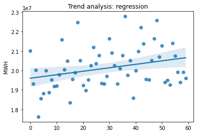<figcaption>Trend analysis: regression on monthly totals.</figcaption></figure>
</div>

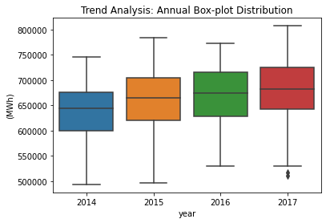
*Trend analysis: annual distribution of daily demand.*

### 1.3 Feature engineering

The target is standardised demand. Features are built automatically so they can absorb seasonality, trend, and changing volatility: lagged values (`feat_ar1` … `feat_ar30`), rolling means (7, 14, 30 days), and 30 forward targets (`target_t1` … `target_t30`) so one model can forecast every horizon at once.

```python
features, targets = [], []
for lag in range(1, 31):
    data[f"feat_ar{lag}"] = data["target"].shift(lag)
    features.append(f"feat_ar{lag}")
for w in (7, 14, 30):
    data[f"feat_movave{w}"] = data["target"].shift(1).rolling(w).mean()
    features.append(f"feat_movave{w}")
for t in range(1, 31):
    data[f"target_t{t}"] = data["target"].shift(-t)
    targets.append(f"target_t{t}")
```

<div class="figure-row">
<figure>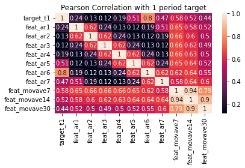<figcaption>Pearson correlation of lag and rolling-mean features with the 1-day-ahead target.</figcaption></figure>
<figure>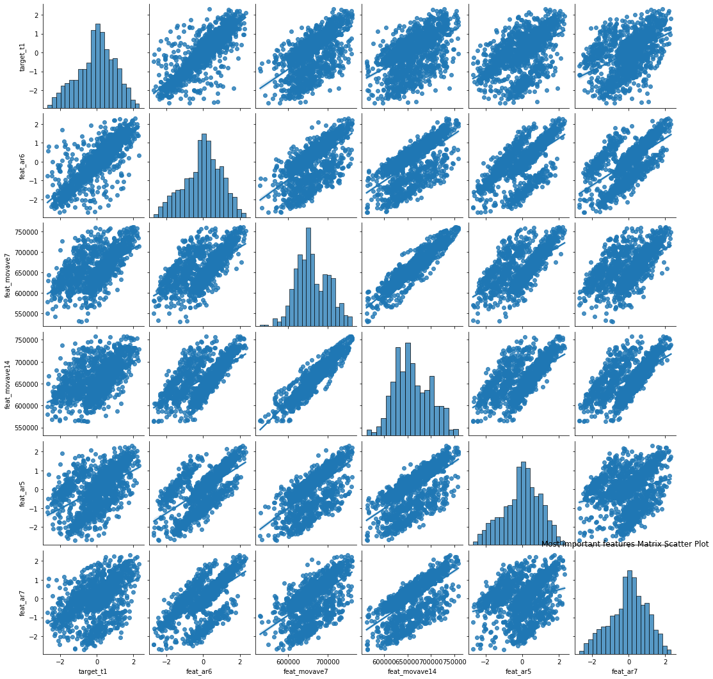<figcaption>Scatter matrix of the most correlated features; AR6 and the 7-day moving average are strongly linear with the target.</figcaption></figure>
</div>

### 1.4 Model building

Data from 2014–2016 trains the model and 2016–2017 is held out. A linear regression sets the baseline (train RMSE 0.319, test RMSE 0.315 on the standardised target). A Random Forest is then tuned with a time-series split of three folds, each training on at most two years.

<figure>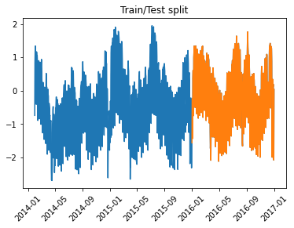<figcaption>Train/test split of the standardised target.</figcaption></figure>

<div class="figure-row">
<figure>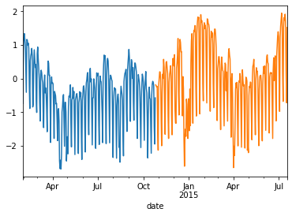<figcaption>Time-series split, fold 1: 268 train / 266 validation days.</figcaption></figure>
<figure>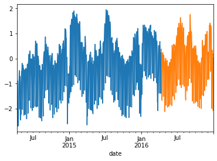<figcaption>Fold 3: 730 train / 266 validation days.</figcaption></figure>
</div>

```python
from sklearn.ensemble import RandomForestRegressor
from sklearn.model_selection import TimeSeriesSplit, ParameterGrid

splits = TimeSeriesSplit(n_splits=3, max_train_size=365 * 2)
grid = ParameterGrid({"n_estimators": [100, 500], "max_depth": [5, 10], "max_features": [20, 59], "random_state": [123]})
for params in grid:
    for train_idx, val_idx in splits.split(X_train):
        model = RandomForestRegressor().set_params(**params).fit(X_train.iloc[train_idx], y_train.iloc[train_idx])
        # keep the parameters with the lowest validation RMSE
```

<div class="callout callout-result">
<h4>Selected model</h4>
<ul>
<li>500 trees, maximum depth 10, all 59 features considered at each split.</li>
<li>Best fold: train RMSE 0.017, validation RMSE 0.458 (standardised units).</li>
<li>Feature importance is dominated by recent lags (AR5, AR13, AR27) and the 7-day moving average.</li>
</ul>
</div>

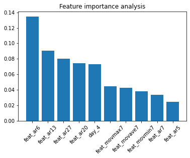
*Feature importance of the tuned Random Forest.*

### 1.5 Assessment and residual analysis

Mean absolute percentage error (MAPE) is used because it is easy to communicate. One-day-ahead forecasts on the test year track the actual series closely, and the residuals are centred on zero with a few large negative outliers on exceptionally cold days.

<div class="figure-row">
<figure>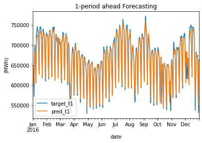<figcaption>1-period-ahead forecast against actual demand on the test year.</figcaption></figure>
<figure>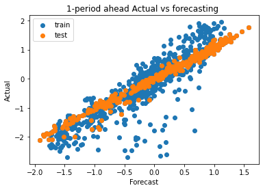<figcaption>Actual versus forecast, train and test.</figcaption></figure>
</div>

<div class="figure-row">
<figure>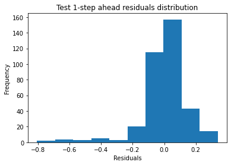<figcaption>Test residual distribution.</figcaption></figure>
<figure>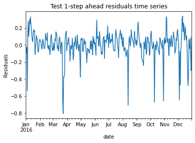<figcaption>Test residuals over time.</figcaption></figure>
</div>

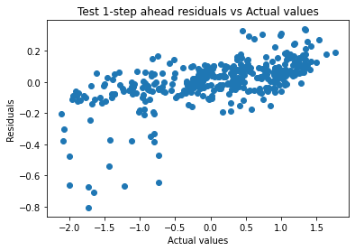
*Residuals against actual values: larger errors occur at the low end of demand.*

### 1.6 Multi-period forecasting

A new Random Forest with the tuned parameters is fitted on the two most recent years and used to forecast 1, 7, 14, and 30 days ahead. Error grows with horizon but stays modest, and the scatter of actual against forecast widens mainly at extreme values.

<div class="callout callout-result">
<h4>Test MAPE by horizon</h4>
<ul>
<li>1 day ahead: 1.13 %</li>
<li>7 days ahead: 1.39 %</li>
<li>14 days ahead: 1.57 %</li>
<li>30 days ahead: 1.73 %</li>
</ul>
</div>

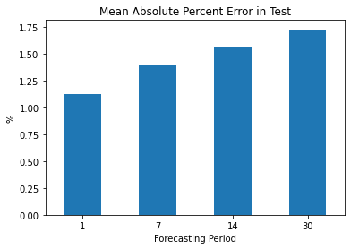
*Mean absolute percentage error on the test year by forecasting horizon.*

<div class="figure-row">
<figure>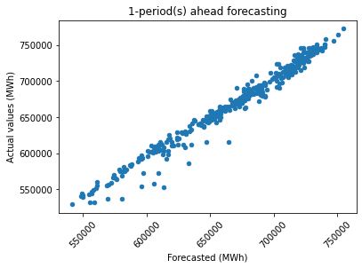<figcaption>1 day ahead.</figcaption></figure>
<figure>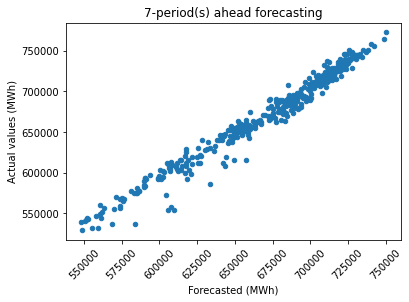<figcaption>7 days ahead.</figcaption></figure>
</div>

<div class="figure-row">
<figure>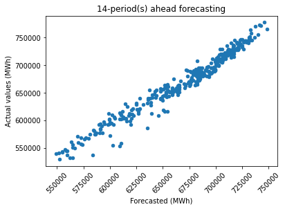<figcaption>14 days ahead.</figcaption></figure>
<figure>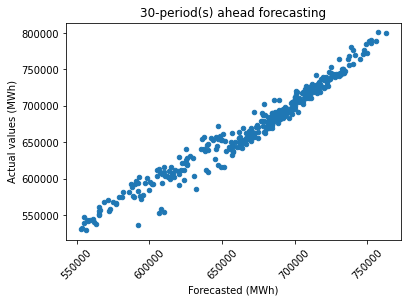<figcaption>30 days ahead.</figcaption></figure>
</div>

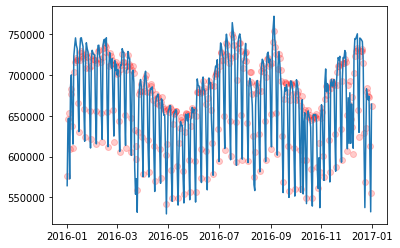
*30-day-ahead forecast (red) over the actual 2016 series.*

---

## 2. Multivariate LSTM anomaly detection

<div class="callout callout-problem">
<h4>Problems this part addresses</h4>
<ul>
<li>Public green-energy data is scarce and depends heavily on weather, so inverter logs and weather records have to be merged into one hourly dataset first.</li>
<li>Several inverter metrics (DC power, AC power, daily yield) and weather variables move together; an anomaly in one of them is only meaningful against the others.</li>
<li>Forecasting a single metric cannot reveal a global anomaly across all metrics; the model has to reconstruct the whole multivariate sequence.</li>
<li>A single fixed threshold either misses slow drifts or floods the operator with alerts, so static and dynamic thresholds are needed together.</li>
</ul>
</div>

Anomaly detection finds unusual behaviour in a dataset. For time series it can be approached with statistical methods (clustering, wavelet transforms, autoregressive models) or with machine learning, in supervised or unsupervised form. This work applies an unsupervised LSTM autoencoder to a green-energy dataset built from solar inverter logs and weather data.

### 2.1 Data preparation

Inverter logs (`invno`, `dckw`, `ackw`, `dayTotal`) and weather records (`wind_spd`, `temp`, `pres`) are merged on their hourly timestamp into one file, missing values are filled with zero, and the memory footprint is reduced by downcasting numeric columns (a 58 % reduction).

```python
inv = pd.read_csv("./data/inverterLog.csv").drop(columns=["mcno"])
weather = pd.read_csv("./data/weather_data.csv")
df = pd.merge(inv, weather, how="outer", on="datetimeAt")
df["datetimeAt"] = pd.to_datetime(df["datetimeAt"], format="%Y-%m-%d %H:%M:%S")
df.fillna(0, inplace=True)
df.to_csv("./combined.csv", index=False)
```

### 2.2 Exploratory analysis

A pandas-profiling report gives the overview, warnings, missing-value map, and three correlation matrices in one pass.

<div class="figure-row">
<figure>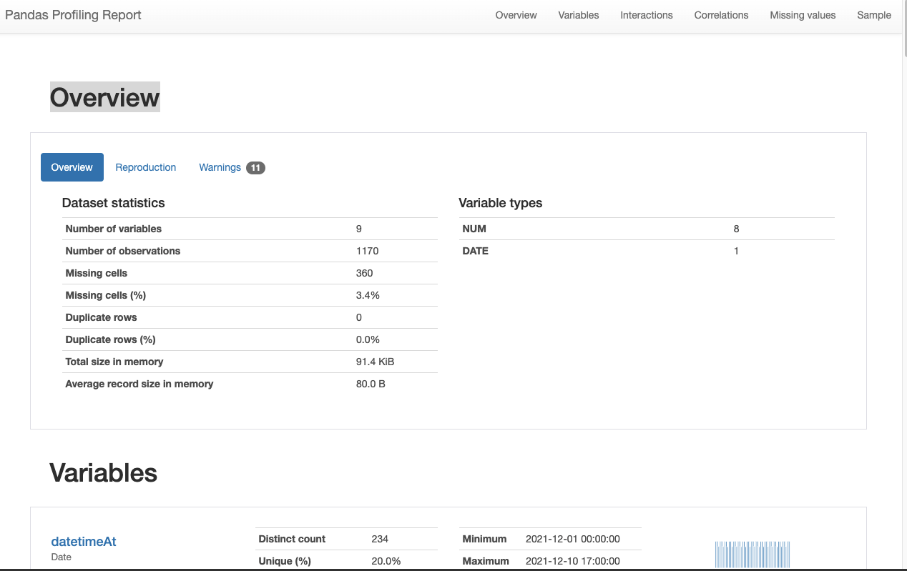<figcaption>Profiling overview: variables, observations, missing cells.</figcaption></figure>
<figure>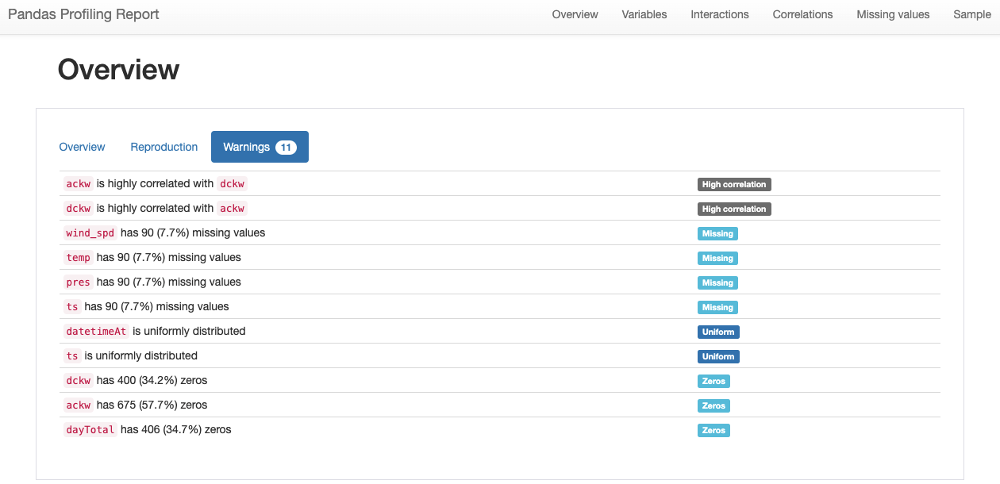<figcaption>Warnings: highly correlated and zero-heavy variables.</figcaption></figure>
</div>

- **Pearson's r** measures linear correlation between two variables.
- **Spearman's ρ** measures monotonic correlation and so catches non-linear monotonic relationships.
- **Phik (φk)** works across categorical, ordinal, and interval variables, captures non-linear dependency, and reduces to Pearson for bivariate normal input.

<div class="figure-row">
<figure>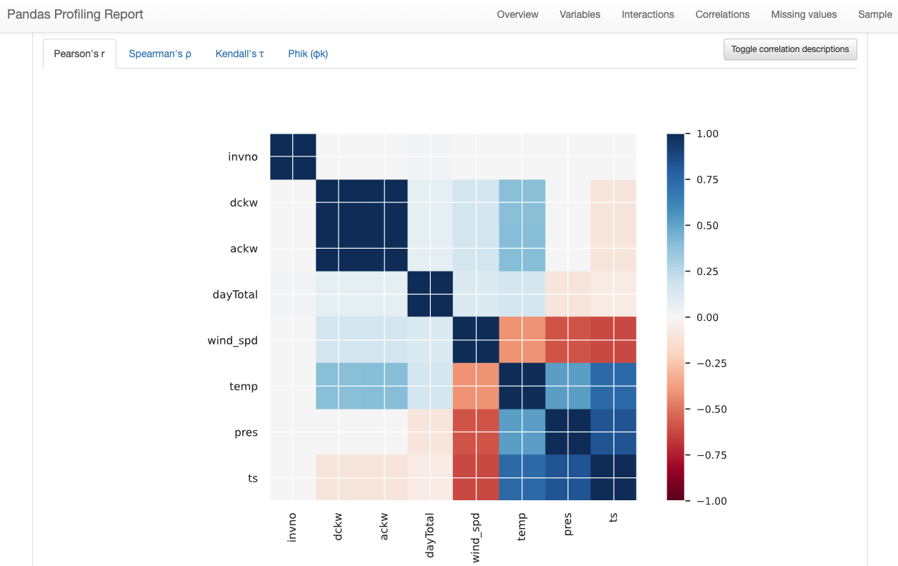<figcaption>Pearson's correlation.</figcaption></figure>
<figure>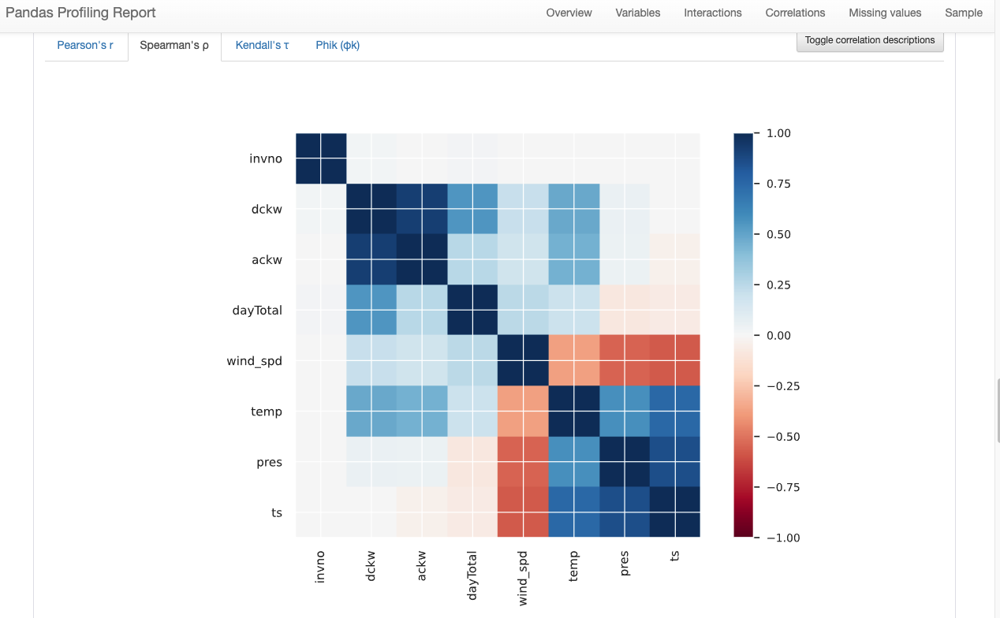<figcaption>Spearman's correlation.</figcaption></figure>
</div>

<div class="figure-row">
<figure>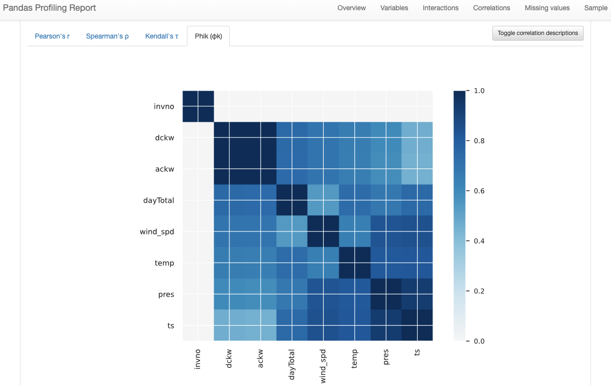<figcaption>Phik correlation.</figcaption></figure>
<figure>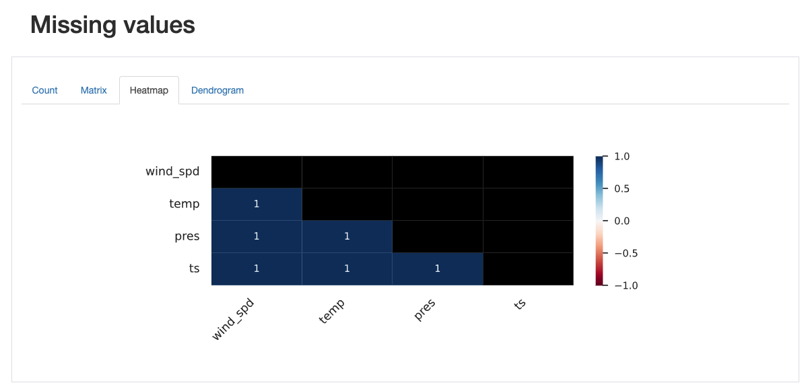<figcaption>Missing values by variable.</figcaption></figure>
</div>

### 2.3 Feature selection

`invno` and `ts` are dropped as identifiers, and `ackw` is dropped because AC power follows directly from DC power at the inverter. Spearman's correlation shows `dckw`, `dayTotal`, `wind_spd`, and `temp` moving together; `pres` is kept for testing.

| Item | Value |
|---|---|
| Features | `datetimeAt`, `dckw`, `ackw`, `dayTotal`, `wind_spd`, `temp`, `pres` |
| Train shape | (819, 6) |
| Test shape | (351, 6) |
| Time steps | 1, 7, or 30 |
| Points to predict | 1, 2, or 3 steps ahead |

```python
def Data():
    dataset = pd.read_csv("./combined.csv").fillna(0)
    dataset = dataset.drop(columns=["invno", "ts"])
    return dataset.set_index("datetimeAt")
```

### 2.4 Model

An LSTM is a recurrent network with forget, input, and output gates, which makes it a natural fit for sequential data. Forecasting one metric with an LSTM alone cannot give a global view across all metrics, so an autoencoder is added: the encoder compresses a window of all features into a 16-unit state, `RepeatVector` expands it back to the window length, and a decoder LSTM with a time-distributed dense layer reconstructs every feature.

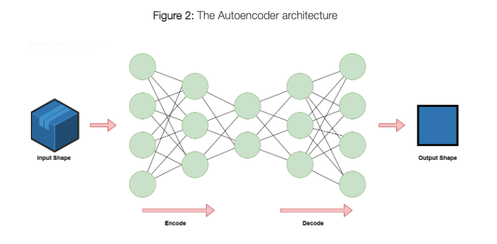
*The autoencoder architecture.*

```python
def build_model(self):
    self.model = Sequential()
    self.model.add(LSTM(units=16, input_shape=(self.X_train.shape[1], self.X_train.shape[2])))
    self.model.add(RepeatVector(n=self.X_train.shape[1]))
    self.model.add(LSTM(units=16, return_sequences=True))
    self.model.add(TimeDistributed(Dense(self.X_train.shape[2])))
    self.model.compile(optimizer=tf.keras.optimizers.Adam(learning_rate=0.005), loss="mse")

def fit_model(self, epochs, batch_size):
    self.history = self.model.fit(self.X_train, self.Y_train, epochs=epochs, batch_size=batch_size,
                                  validation_split=0.1, shuffle=False)
```

All chosen features are used as metrics, the model predicts three data points ahead, and `shuffle=False` keeps the order of time steps. Mean squared error gives the smoothest training.

### 2.5 Training and reconstruction error

<div class="figure-row">
<figure>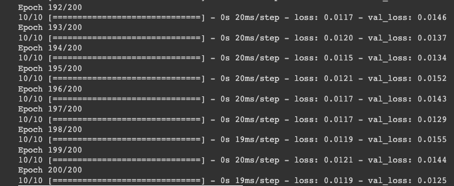<figcaption>Training log: loss and validation loss over the final epochs of 200.</figcaption></figure>
<figure>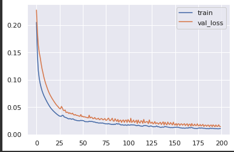<figcaption>Training and validation loss.</figcaption></figure>
</div>

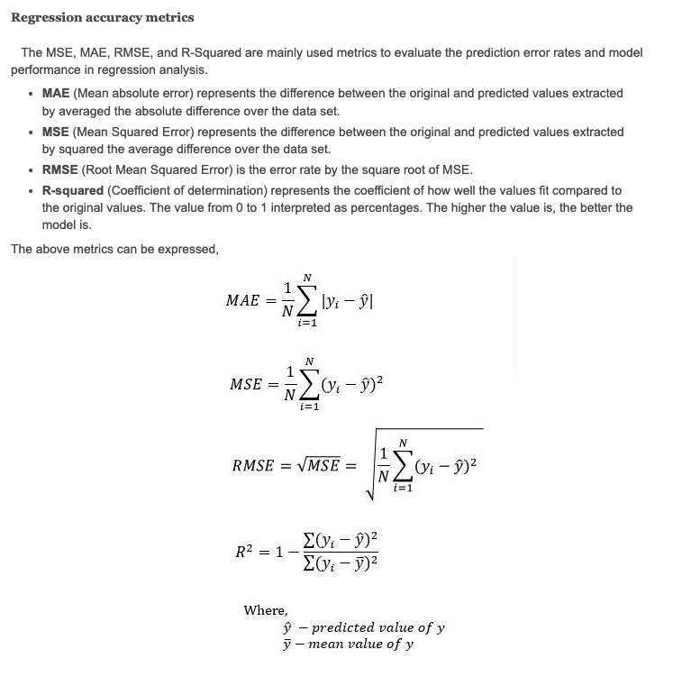
*Error metrics used to evaluate reconstruction.*

<div class="figure-row">
<figure>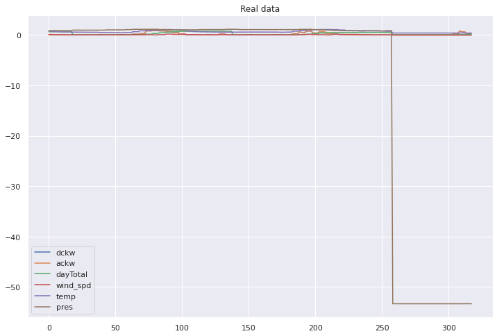<figcaption>Real test data.</figcaption></figure>
<figure>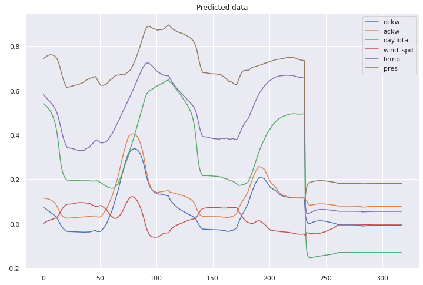<figcaption>Reconstructed data.</figcaption></figure>
</div>

### 2.6 Thresholds

Anything above a threshold is an anomaly. Two kinds are used.

**Static threshold.** The mean of the training MAE plus three standard deviations.

```python
pred_error_threshold = np.mean(train_pred_errors) + 3 * np.std(train_pred_errors)
```

**Dynamic threshold.** A rolling window with its own standard-deviation coefficient, chosen empirically on the training data only (window 40, coefficient 5 for ARIMA, 6 for CNN and LSTM).

```python
train_pred_errors_windowed = pd.Series(train_pred_errors).rolling(window=window, min_periods=1)
train_dynamic_threshold = train_pred_errors_windowed.mean() + std_coef * train_pred_errors_windowed.std()

valid_pred_errors_windowed = pd.Series(valid_pred_errors).rolling(window=window, min_periods=1)
valid_dynamic_threshold = valid_pred_errors_windowed.mean() + std_coef * valid_pred_errors_windowed.std()
```

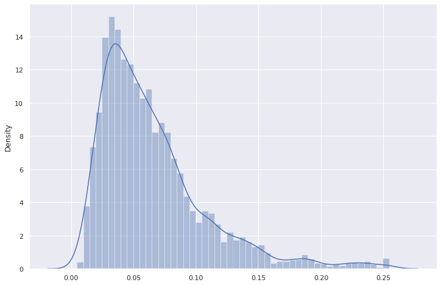
*Distribution of reconstruction loss on the training data.*

<div class="figure-row">
<figure>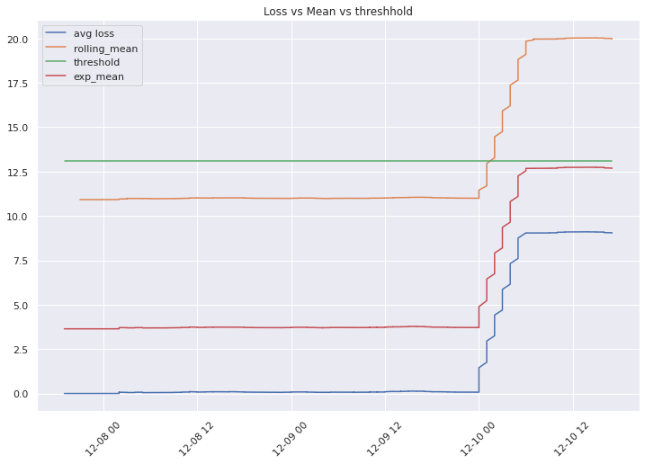<figcaption>Mean loss with the static threshold (green), rolling-mean threshold (orange), and exponential-mean threshold (red).</figcaption></figure>
<figure>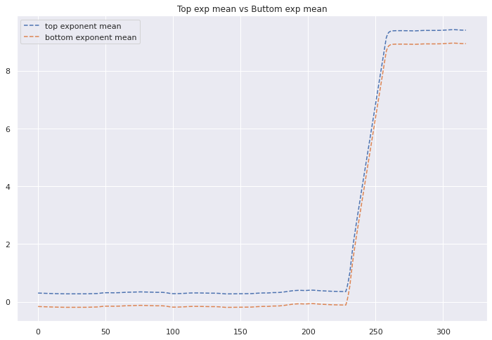<figcaption>Top versus bottom exponential mean.</figcaption></figure>
</div>

A moving average smooths short-term fluctuation to show longer-term structure; the window length trades smoothing against responsiveness.

<div class="figure-row">
<figure>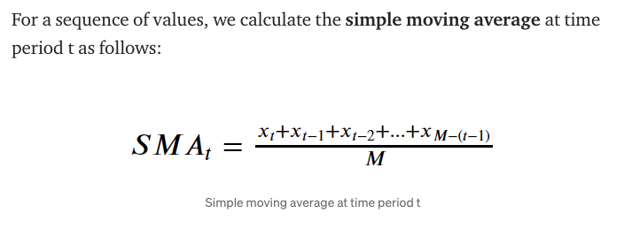<figcaption>Simple moving average.</figcaption></figure>
<figure>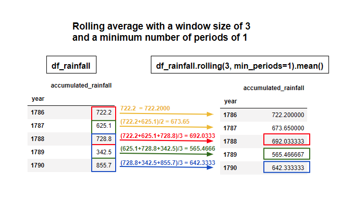<figcaption>Rolling average with a window of 3.</figcaption></figure>
</div>

### 2.7 Global and local anomalies

A **global anomaly** fires when the mean loss over all metrics crosses the lower (dynamic) threshold. A **local anomaly** fires when a single metric's loss crosses its own, higher threshold.

```text
                        loss    rolling_mean  exp_mean   threshold   global_anomaly
datetimeAt
2021-12-07 19:00:00  0.255701     11.056723   3.800142   12.986072   False
2021-12-07 20:00:00  0.254932     11.091915   3.799565   12.986072   False
2021-12-07 20:00:00  0.254157     11.066023   3.798895   12.986072   False
```

```python
is_global_anomaly_exp_mean = abs(mean_exp - loss_mean_vec) > threshold_mean_exp + num_of_std * std
for index, metric in enumerate(self.data.columns):
    threshold = self.train_loss_mean[index] + num_of_std * self.train_loss_std[index]
    is_anomaly = self.test_loss[:, index] > threshold
    # global anomalies are collected from the exponential-mean test,
    # local anomalies from the per-metric threshold
```

<div class="figure-row">
<figure>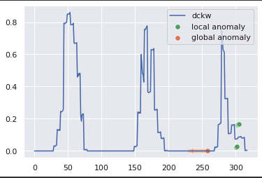<figcaption>DC power (`dckw`) with local (green) and global (orange) anomalies.</figcaption></figure>
<figure>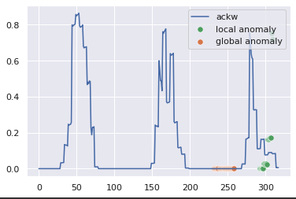<figcaption>AC power (`ackw`).</figcaption></figure>
</div>

<div class="figure-row">
<figure>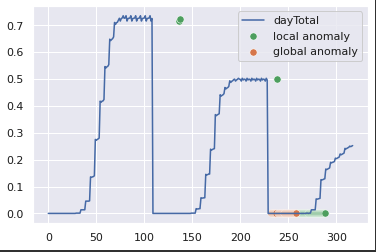<figcaption>Daily total yield.</figcaption></figure>
<figure>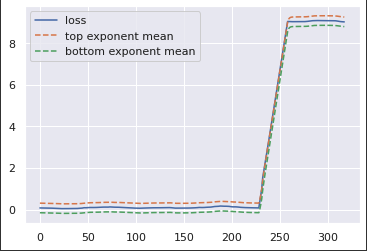<figcaption>Loss against the top and bottom exponential means.</figcaption></figure>
</div>

### 2.8 Results

<div class="figure-row">
<figure>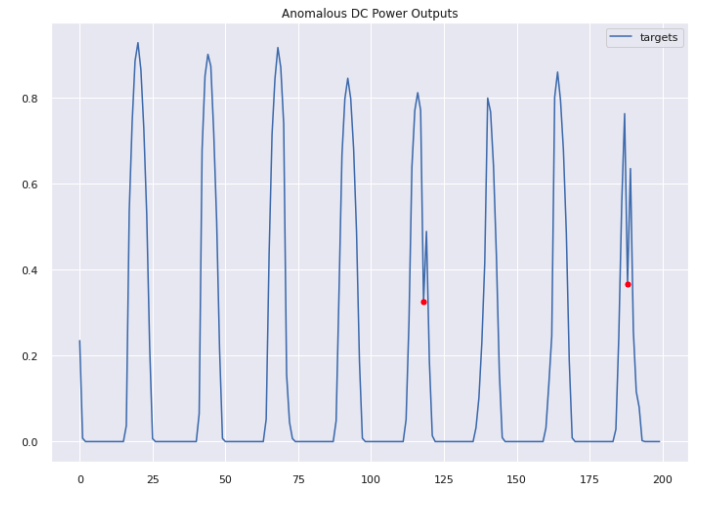<figcaption>Anomalous DC power outputs with a simple LSTM and general loss.</figcaption></figure>
<figure>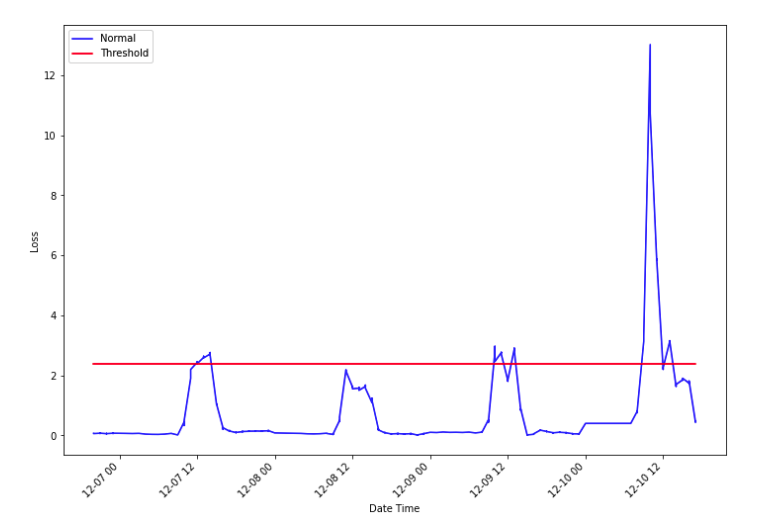<figcaption>Loss against the static threshold.</figcaption></figure>
</div>

```text
Indices of anomaly samples:  (array([147, 192]),)
##################### Details of anomaly ###################
[{'Datetime': Timestamp('2021-12-02 16:00:00'), 'dckw': 4.213291015625, 'invno': 1},
 {'Datetime': Timestamp('2021-12-02 06:00:00'), 'dckw': 0.0,             'invno': 4}]
```

<div class="figure-row">
<figure><figcaption>Anomalies on DC power with the static threshold: too many, so the threshold needs tuning.</figcaption></figure>
<figure><figcaption>The DC power series used for detection.</figcaption></figure>
</div>

<div class="callout callout-result">
<h4>Findings</h4>
<ul>
<li>The autoencoder reconstructs normal inverter behaviour closely; the reconstruction error separates two clear events on 2 December 2021 (inverter 1 at 16:00, inverter 4 at 06:00).</li>
<li>The static mean-plus-3σ threshold alone over-flags on this data; the dynamic rolling threshold is what makes global anomalies usable.</li>
<li>Reporting local and global anomalies separately tells an operator whether one metric or the whole plant is misbehaving.</li>
</ul>
</div>

### 2.9 Serving

A small Flask service loads the trained autoencoder, accepts a CSV upload, scales and reshapes it for the LSTM, scores each row by mean absolute reconstruction error against the threshold, and returns the anomalies as JSON. Planned next steps were importing data from the database, running on the live stream, and hardening the API.

```python
app = flask.Flask(__name__)
model = load_model("./model/anomaly_model.h5")

@app.route("/", methods=["POST"])
def submit():
    df = read_uploaded_csv(flask.request.files["data_file"])
    X = scaler.transform(df).reshape(-1, 1, df.shape[1])
    preds = model.predict(X).reshape(len(df), -1)
    loss = np.mean(np.abs(X.reshape(len(df), -1) - preds), axis=1)
    hits = [{"Anomaly": True, "Value": float(l), "datetime": str(i)} for i, l in zip(df.index, loss) if l > THRESHOLD]
    return flask.jsonify({"Analysis": hits or [{"Anomaly": "No Anomalies Detected"}]})
```

---

## 3. Repository

Both parts are public in the Data-Science repository:

- [Project-3 · Energy data analysis](https://github.com/Laudarisd/Data-Science/tree/main/Project-3.Energy_Data_Analysis): Random Forest demand forecasting notebook and the LSTM anomaly-detection copy.
- [Project-4 · LSTM autoencoder anomaly detection](https://github.com/Laudarisd/Data-Science/tree/main/Project-4.Anomaly_Detection/1.LSTM_AutoEncoder): `explore_data.ipynb`, `lstm_anomaly.py` (the `AutoEncoder` class), and `app.py` (Flask service).
