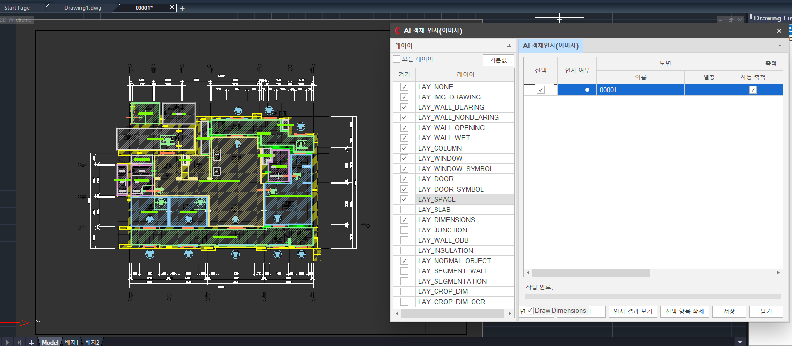
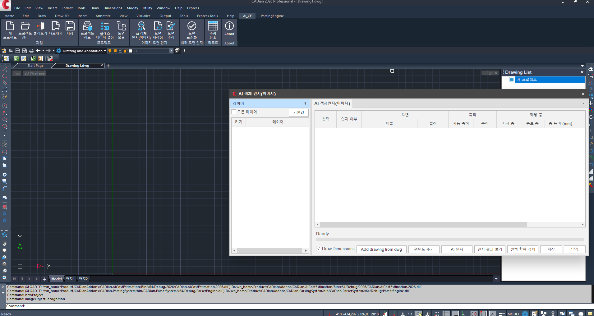
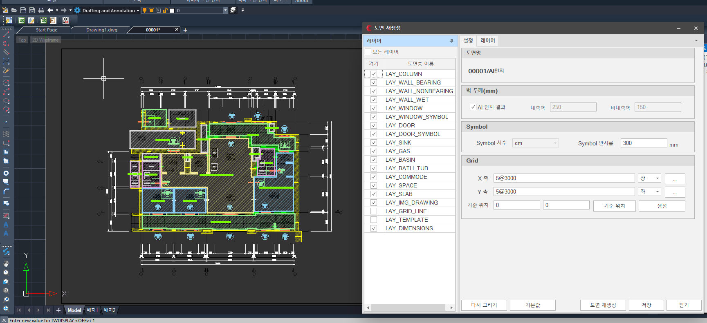
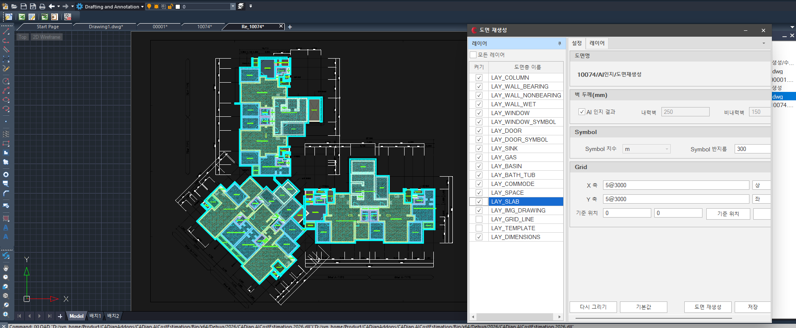
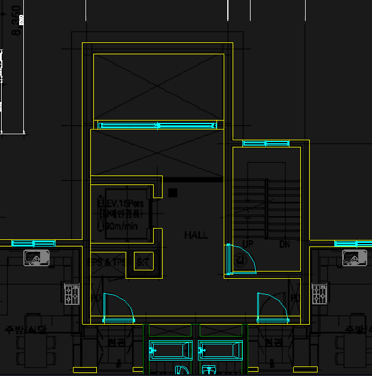
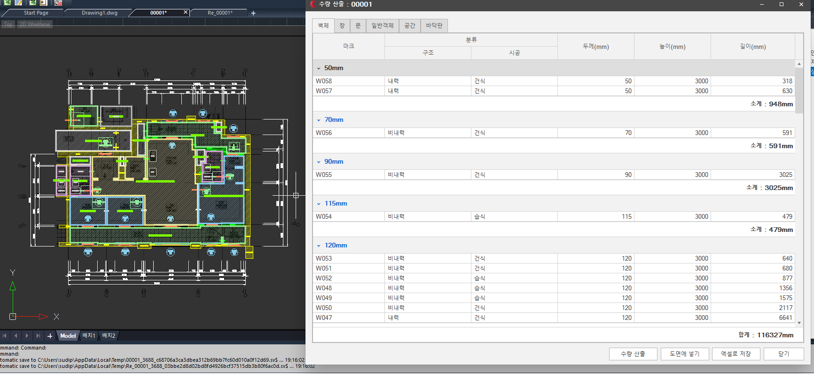
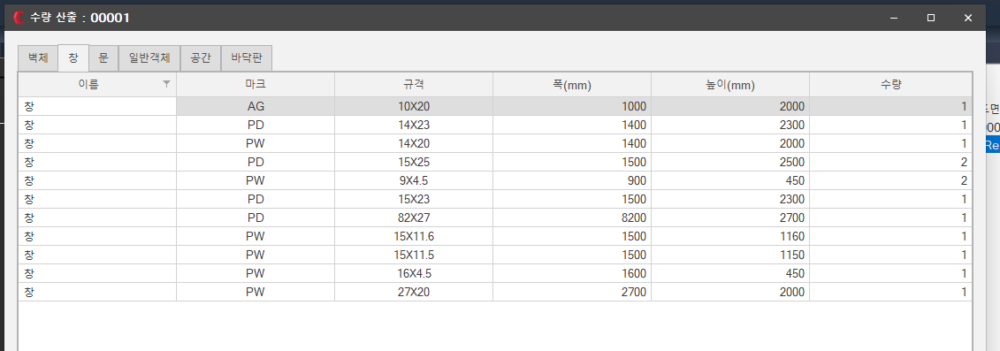
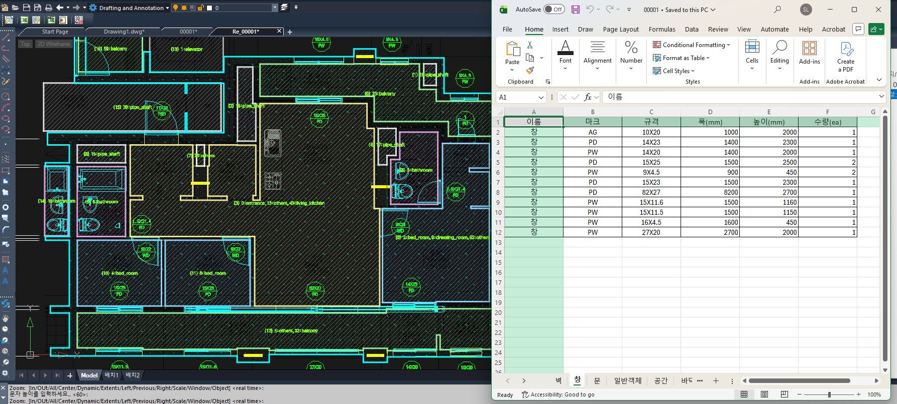
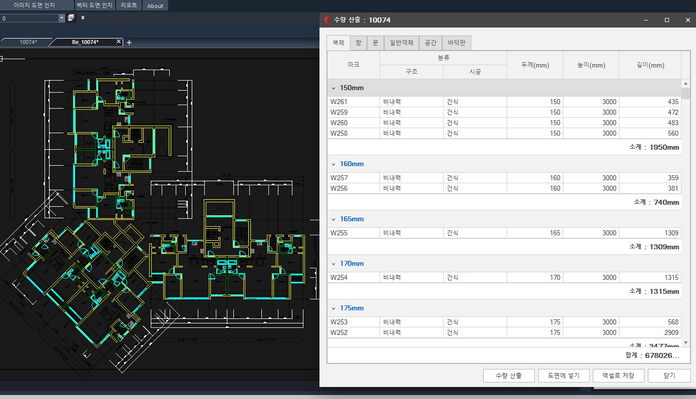
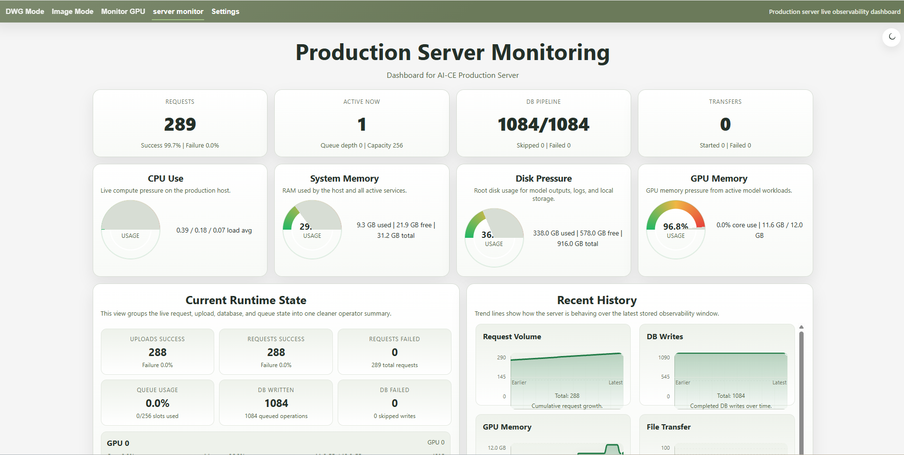

# AI AX Cost Estimation - From Floor-Plan Images to Quantitative Analysis

An add-in for a CAD application that reads a floor-plan image, recognizes what is drawn on it, rebuilds it as CAD layers,
and produces a quantity take-off that an estimator can review. Detection, segmentation and OCR models run behind a service,
and every result is written back into the drawing and exported as a table.

<strong>Main Process</strong>

InputFloor-plan images

ModelsDetection · segmentation · OCR

OutputCAD layers · quantity tables · JSON

ServingFastAPI, batch and API

Operationssystemd · nginx · Redis

MonitoringPrometheus · Grafana

<figure class="figure-small">

<figcaption>The add-in inside the CAD application: a recognized floor plan on the left, and the layers it was rebuilt into on the right.</figcaption>
</figure>

---

## 1. Introduction

Cost estimation starts from drawings, and many of those drawings arrive as images rather than as CAD files. A person has to read every wall,
window, door and room, measure them, and type the quantities into a sheet. That takes days on a large plan and the numbers are easy to get wrong.

This project does that reading automatically. The goal is the chain below: an image goes in, and a reviewable quantity table comes out,
with every recognized item placed back on the drawing so an estimator can check it.

<pre class="mermaid">flowchart LR
    A[Floor-plan image]:::input --> B[AI recognition objects, regions, text]:::process
    B --> C[(Structured result JSON)]:::store
    C --> D[Rebuilt CAD layers]:::agent
    C --> E[Quantity take-off tables and Excel]:::output
</pre>

Input &amp; Data Preprocessing

<h2 id="2-input-and-preprocessing">2. Input and preprocessing</h2>

A drawing is added to a project inside the CAD application, either one at a time or as a batch. Before any model runs, each image is validated,
rescaled and cleaned, which is what keeps small dimension text and thin wall lines readable at model resolution.

<figure class="figure-small">

<figcaption>Drawings are added to a project here, with their scale and floor range, then sent for recognition.</figcaption>
</figure>

<h4>What preprocessing has to solve</h4>
<ul>
<li><strong>Scale varies.</strong> Every drawing is exported at a different size, so results must not depend on the pixel size of the input.</li>
<li><strong>Small text.</strong> Dimensions and room labels are tiny next to the walls, and naive downscaling destroys them.</li>
<li><strong>Noise.</strong> Scans and exports carry speckle, compression artefacts and hatching that confuse edges.</li>
<li><strong>Large sheets.</strong> A block plan does not fit in one pass and has to be processed in parts and reassembled.</li>
</ul>

Model Training &amp; Inference

<h2 id="3-models">3. Models</h2>

Three model families run over the prepared image and their outputs are merged into one structured result.

<pre class="mermaid">flowchart LR
    A[Prepared image]:::input --> D[Detection objects and classes]:::process
    A --> S[Segmentation regions and walls]:::process
    A --> O[OCR dimensions, marks, labels]:::process
    D --> R[(Structured result)]:::store
    S --> R
    O --> R
    R --> V[JSON · visualization · persistence]:::output
</pre>

<table class="component-table">
<thead>
<tr>
<th>Model</th>
<th>What it recovers</th>
<th>Framework</th>
</tr>
</thead>
<tbody>
<tr><td>Detection and classification</td><td>windows, doors, fixtures, columns and their type</td><td>PyTorch</td></tr>
<tr><td>Segmentation</td><td>rooms, slabs and wall regions, plus wall thickness</td><td>PyTorch</td></tr>
<tr><td>OCR</td><td>dimension text, opening marks and room names</td><td>CRNN and Paddle OCR</td></tr>
</tbody>
</table>

The OCR recognizer is a CRNN: a convolutional stack reads the cropped text, a bidirectional sequence layer reads it left to right,
and a CTC head turns that into characters. The diagram below is illustrative and does not expose the deployed configuration.

<pre class="mermaid">flowchart TB
    A[Text crop 1 x 32 x 128]:::input --> B[Convolution + ReLU 32 to 64 to 128 channels]:::process
    B --> C[Height aggregation 32 time steps]:::process
    C --> D[Bidirectional sequence 256 features]:::process
    D --> E[Character projection K class scores]:::process
    E --> F[CTC decoding]:::agent
    F --> G[Decoded text dimensions, marks, labels]:::output
</pre>

---

## 4. Recognition results

Recognized items are written back into the drawing as named layers, so walls, openings, fixtures and spaces can each be shown or hidden.
Wall thickness recovered by the model fills the bearing and non-bearing values used when the drawing is rebuilt.

<figure>

<figcaption>Rebuilding the drawing: the recognized layers, and the AI wall thickness used for bearing and non-bearing walls.</figcaption>
</figure>
<figure>

<figcaption>A multi-unit plan rebuilt from an image, with every recognized class on its own layer.</figcaption>
</figure>

<figure class="figure-small">

<figcaption>A close-up of one core: hall, elevator, stairs, doors and shafts, each recognized as its own object.</figcaption>
</figure>

---

## 5. Quantity take-off

From the recognized drawing the add-in produces quantity tables, grouped by type and by size, with a subtotal per group and a total per sheet.
Walls, windows, doors, general objects, spaces and slabs each get their own tab, and the whole table exports to Excel.

<figure>

<figcaption>Wall take-off: every wall with its mark, bearing or non-bearing classification, thickness, height and length, subtotalled by thickness.</figcaption>
</figure>
<figure>

<figcaption>Window take-off: mark, size, width, height and count for every window on the sheet.</figcaption>
</figure>

<figure>

<figcaption>The annotated drawing beside the same table exported to Excel, ready for the estimator.</figcaption>
</figure>
<figure>

<figcaption>The same take-off on a larger block plan, grouped by thickness with a sheet total.</figcaption>
</figure>

Deployment

<h2 id="6-serving-and-operations">6. Serving and operations</h2>

The models run behind a FastAPI service rather than inside the CAD add-in, so the add-in sends a drawing and receives a structured result.
The service is supervised by systemd, published through a reverse proxy, and uses Redis for shared state such as queue depth and request history.

<pre class="mermaid">flowchart LR
    C[CAD add-in authorized client]:::input --> N[Reverse proxy nginx]:::process
    N --> API[FastAPI service PyTorch inference]:::agent
    MDL[(Approved model artifacts)]:::store --> API
    SD[systemd supervisor]:::tool -.-> API
    API --> RDS[(Redis queue and state)]:::store
    API --> ARC[(Result archives)]:::store
    API --> MET[Metrics endpoint]:::output
    MET --> PRM[Prometheus]:::tool
    PRM --> GRF[Grafana and operator dashboard]:::output
</pre>

<table class="component-table">
<thead>
<tr>
<th>Component</th>
<th>Role</th>
</tr>
</thead>
<tbody>
<tr><td>FastAPI</td><td>request validation, orchestration, result packaging</td></tr>
<tr><td>systemd</td><td>process supervision, restart and recovery</td></tr>
<tr><td>nginx</td><td>reverse proxy in front of the service</td></tr>
<tr><td>Redis</td><td>shared state: queue depth, request outcomes, event history</td></tr>
</tbody>
</table>

---

## 7. Monitoring

A long-running service needs its health to be visible, so request volume, failures, queue usage, database writes, file transfers and GPU memory
are all exported as metrics and shown on a dashboard. Prometheus scrapes the service and Grafana reads it, alongside a custom operator dashboard.

<figure class="figure-small">

<figcaption>The operator dashboard: requests and success rate, queue usage, database writes and transfers, with host and GPU pressure beside them.</figcaption>
</figure>

---

## 8. Summary

The system turns a floor-plan image into a reviewable quantity take-off. Detection, segmentation and OCR models recover objects, regions and text,
the result is written back into the drawing as CAD layers, and quantities are grouped into tables that export to Excel.
The models run behind a supervised FastAPI service with Redis-backed state, and its request, database and host metrics are visible on a live dashboard.

<blockquote>

Public project overview. Infrastructure values are illustrative. Model workflows describe engineering responsibilities without exposing proprietary processing logic.

</blockquote>
