# AX Raster2BOM - From Floor-Plan Images to Quantitative Analysis
<p>An add-in for a CAD application that reads a floor-plan image, recognizes what is drawn on it, rebuilds it as CAD layers,
and produces a quantity take-off that an estimator can review.</p>
<p><strong>Main Goal of the Project</strong></p>
<div class="process-row">
<figure>

<figcaption>Input: a floor-plan image.</figcaption>
</figure>
<span class="arch-arrow" aria-hidden="true">→</span>
<figure>
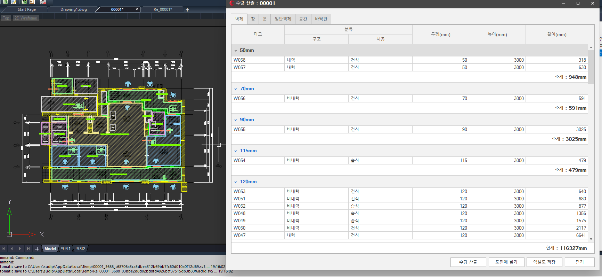
<figcaption>Output: recognized CAD layers and the quantity take-off.</figcaption>
</figure>
</div>

<p><strong>Main Process</strong></p>
<div class="fact-grid">
<div class="fact"><span class="fact-label">Input</span><span class="fact-value">Floor-plan images</span></div>
<div class="fact"><span class="fact-label">Models</span><span class="fact-value">Detection · segmentation · OCR</span></div>
<div class="fact"><span class="fact-label">Output</span><span class="fact-value">CAD layers · quantity tables · JSON</span></div>
<div class="fact"><span class="fact-label">Serving</span><span class="fact-value">FastAPI · on-premises or AWS</span></div>
<div class="fact"><span class="fact-label">Runtime</span><span class="fact-value">PyTorch GPU · ONNX CPU</span></div>
<div class="fact"><span class="fact-label">Database</span><span class="fact-value">MySQL</span></div>
<div class="fact"><span class="fact-label">Operations</span><span class="fact-value">systemd · nginx · Redis</span></div>
<div class="fact"><span class="fact-label">Monitoring</span><span class="fact-value">Prometheus · Grafana</span></div>
</div>
<figure class="figure-small">
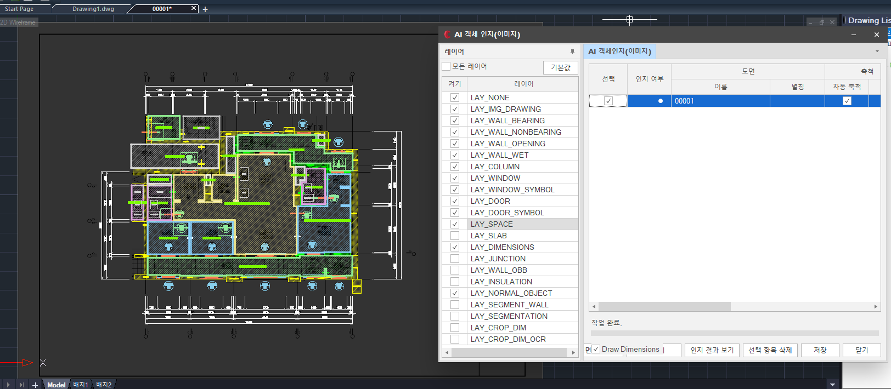
<figcaption>The add-in inside the CAD application: a recognized floor plan on the left, and the layers it was rebuilt into on the right.</figcaption>
</figure>

---

## 1. Introduction
<p>Cost estimation starts from drawings, and many of those drawings arrive as images rather than as CAD files. A person has to read every wall,
window, door and room, measure them, and type the quantities into a sheet. That takes days on a large plan and the numbers are easy to get wrong.</p>
<p>This project does that reading automatically. The picture below is the whole system: a user sends a floor-plan image from the CAD add-in
to one of three deployments, an on-premises Linux server, an AWS instance, or an ONNX CPU build on their own PC. Each one runs the same
AI engine, the detection, segmentation and OCR models plus the rules that turn their output into quantities. Every result is kept in a database,
and three outputs come back.</p>
<pre class="mermaid">flowchart LR
    U[User<br/>CAD add-in]:::input --> P1[On-premises<br/>Linux GPU server]:::agent
    U --> P2[AWS<br/>GPU instance]:::agent
    U --> P3[Own PC<br/>ONNX CPU]:::agent
    P1 --> E1[AI engine<br/>Detection · Segmentation · OCR<br/>+ rules]:::process
    P2 --> E2[AI engine<br/>Detection · Segmentation · OCR<br/>+ rules]:::process
    P3 --> E3[AI engine<br/>Detection · Segmentation · OCR<br/>+ rules]:::process
    E1 --> R[(Structured result)]:::store
    E2 --> R
    E3 --> R
    R --> DB[(MySQL<br/>results database)]:::store
    R --> O1[CAD layers]:::output
    R --> O2[Quantity tables<br/>Excel]:::output
    R --> O3[JSON]:::output
</pre>

<hr />
<div class="part-divider"><span>Input &amp; Data Preprocessing</span></div>

## 2. Input and preprocessing
<p>A drawing is added to a project inside the CAD application, either one at a time or as a batch. Before any model runs, each image is validated,
rescaled and cleaned, which is what keeps small dimension text and thin wall lines readable at model resolution.</p>
<figure class="figure-small">
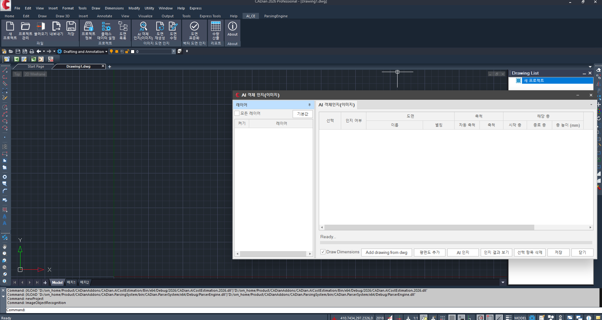
<figcaption>Drawings are added to a project here, with their scale and floor range, then sent for recognition.</figcaption>
</figure>
<div class="callout callout-problem">
<h4>What preprocessing has to solve</h4>
<ul>
<li><strong>Scale varies.</strong> Every drawing is exported at a different size, so results must not depend on the pixel size of the input.</li>
<li><strong>Small text.</strong> Dimensions and room labels are tiny next to the walls, and naive downscaling destroys them.</li>
<li><strong>Noise.</strong> Scans and exports carry speckle, compression artefacts and hatching that confuse edges.</li>
<li><strong>Large sheets.</strong> A block plan does not fit in one pass and has to be processed in parts and reassembled.</li>
</ul>
</div>

<hr />
<div class="part-divider"><span>Model Training &amp; Inference</span></div>

## 3. Models
<p>Three model branches run over the prepared image. Each one recovers a different kind of information, writes its rows into its own
database table, and the three are merged into one structured result.</p>
<table>
<thead>
<tr>
<th>Model</th>
<th>What it recovers</th>
<th>Framework</th>
</tr>
</thead>
<tbody>
<tr><td>Detection and classification</td><td>windows, doors, fixtures, columns and their type</td><td>PyTorch</td></tr>
<tr><td>Segmentation</td><td>rooms, slabs and wall regions, plus wall thickness</td><td>PyTorch</td></tr>
<tr><td>OCR</td><td>dimension text, opening marks and room names</td><td>CRNN and Paddle OCR</td></tr>
</tbody>
</table>
<h3>3.1 Detection branch</h3>
<p>Finds every object on the plan and names its type. Each hit is stored with its class, confidence, angle and corner points.</p>
<pre class="mermaid">flowchart LR
    A[Prepared image]:::input --> M[Detection model<br/>PyTorch]:::process
    M --> W[Objects and classes<br/>windows, doors, fixtures, columns]:::agent
    W --> T[(detected_objects)]:::store
</pre>

<h3>3.2 Segmentation branch</h3>
<p>Recovers regions rather than boxes: rooms, slabs and wall areas, and from the wall areas their thickness. Each region is stored as a polygon.</p>
<pre class="mermaid">flowchart LR
    A[Prepared image]:::input --> M[Segmentation model<br/>PyTorch]:::process
    M --> W[Regions and walls<br/>rooms, slabs, wall thickness]:::agent
    W --> T[(segmentation_results)]:::store
</pre>

<h3>3.3 OCR branch</h3>
<p>Reads the text on the plan: dimension strings, opening marks and room names, each kept in its own table so it can be matched back to the object it labels.</p>
<pre class="mermaid">flowchart LR
    A[Prepared image]:::input --> M[OCR<br/>CRNN · Paddle OCR]:::process
    M --> W[Dimensions, marks, labels]:::agent
    W --> T[(dimension_ocr_results<br/>symbol_ocr_results<br/>space_ocr_results)]:::store
</pre>
<p>The OCR recognizer is a CRNN: a convolutional stack reads the cropped text, a bidirectional sequence layer reads it left to right,
and a CTC head turns that into characters. The diagram below is illustrative and does not expose the deployed configuration.</p>
<pre class="mermaid">flowchart TB
    A[Text crop<br/>1 x 32 x 128]:::input --> B[Convolution + ReLU<br/>32 to 64 to 128 channels]:::process
    B --> C[Height aggregation<br/>32 time steps]:::process
    C --> D[Bidirectional sequence<br/>256 features]:::process
    D --> E[Character projection<br/>K class scores]:::process
    E --> F[CTC decoding]:::agent
    F --> G[Decoded text<br/>dimensions, marks, labels]:::output
</pre>

---

## 4. Results database
<p>Every recognized item is stored in a MySQL database, one table per kind of result, and all of them keyed by the input image.
A row carries who ran it, which image, when, the class, the confidence and the geometry, so a result can be re-opened, compared or audited later.</p>
<div class="figure-row figure-row-small figure-row-equal">
<figure>

<figcaption>The schema: input_images, detected_objects, wall_detections, segmentation_results, background_dimension_regions and the dimension, symbol and space OCR tables. The script on the right links each result table to its input image.</figcaption>
</figure>
<figure>
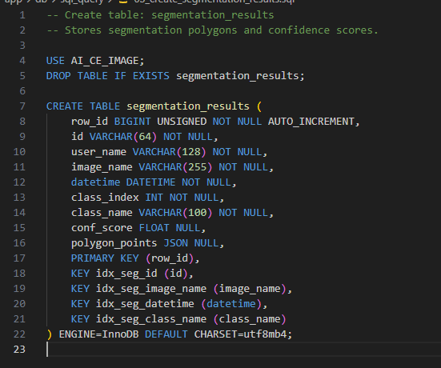
<figcaption>One table definition: segmentation polygons and confidence scores, with indexes on image, time and class so a drawing's results can be fetched quickly.</figcaption>
</figure>
</div>
<figure class="figure-small">
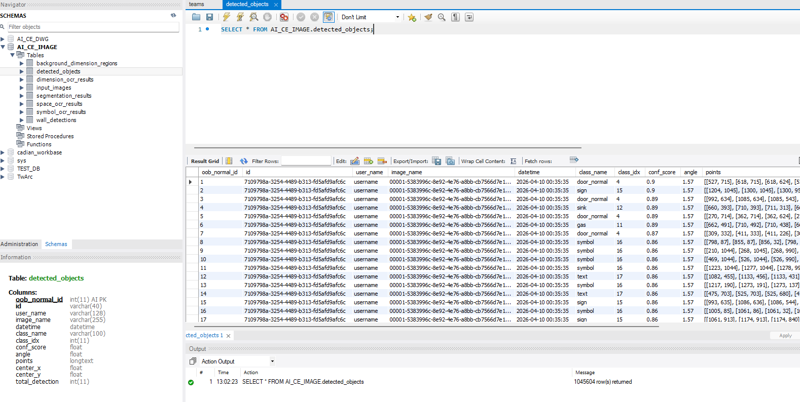
<figcaption>detected_objects in use: over a million rows, one per recognized object, each with its class, confidence, angle and corner points.</figcaption>
</figure>

---

## 5. Recognition results
<p>Recognized items are written back into the drawing as named layers, so walls, openings, fixtures and spaces can each be shown or hidden.
Wall thickness recovered by the model fills the bearing and non-bearing values used when the drawing is rebuilt.</p>
<div class="figure-row figure-row-small figure-row-equal">
<figure>
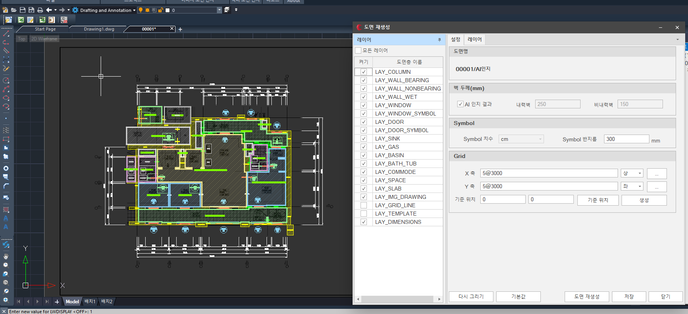
<figcaption>Rebuilding the drawing: the recognized layers, and the AI wall thickness used for bearing and non-bearing walls.</figcaption>
</figure>
<figure>
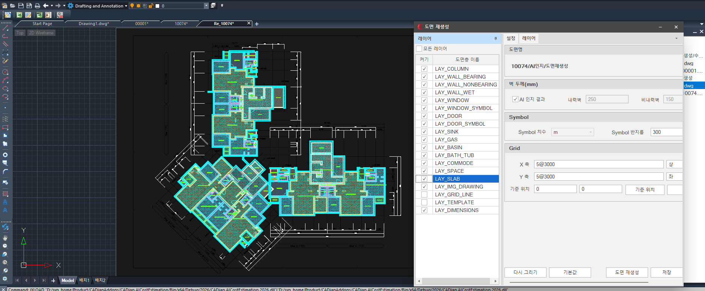
<figcaption>A multi-unit plan rebuilt from an image, with every recognized class on its own layer.</figcaption>
</figure>
</div>
<figure class="figure-small">
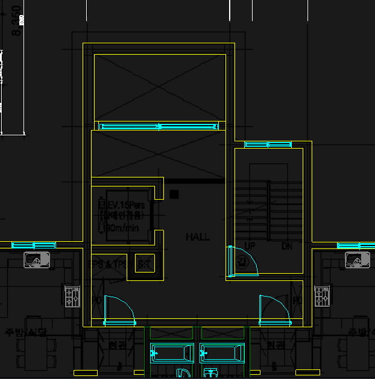
<figcaption>A close-up of one core: hall, elevator, stairs, doors and shafts, each recognized as its own object.</figcaption>
</figure>

---

## 6. Quantity take-off
<p>From the recognized drawing the add-in produces quantity tables, grouped by type and by size, with a subtotal per group and a total per sheet.
Walls, windows, doors, general objects, spaces and slabs each get their own tab, and the whole table exports to Excel.</p>
<div class="figure-row figure-row-small figure-row-equal">
<figure>

<figcaption>Wall take-off: every wall with its mark, bearing or non-bearing classification, thickness, height and length, subtotalled by thickness.</figcaption>
</figure>
<figure>
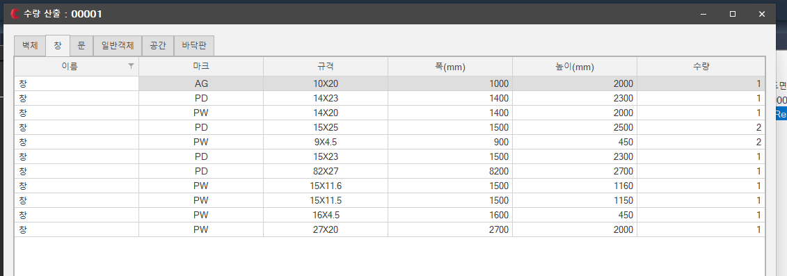
<figcaption>Window take-off: mark, size, width, height and count for every window on the sheet.</figcaption>
</figure>
</div>
<div class="figure-row figure-row-small figure-row-equal">
<figure>

<figcaption>The annotated drawing beside the same table exported to Excel, ready for the estimator.</figcaption>
</figure>
<figure>
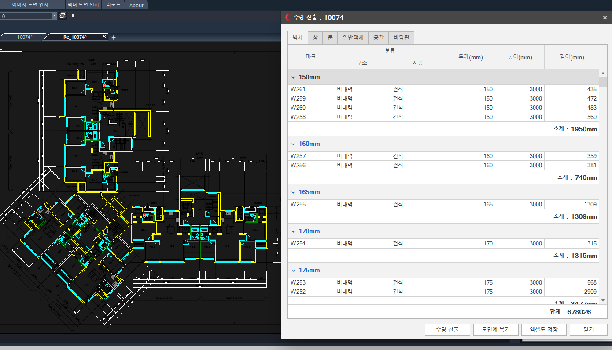
<figcaption>The same take-off on a larger block plan, grouped by thickness with a sheet total.</figcaption>
</figure>
</div>

<hr />
<div class="part-divider"><span>Deployment</span></div>

## 7. Serving and operations
<p>The models never run inside the CAD add-in. The add-in sends a drawing over HTTP and receives a structured result, and that service is
deployed in three ways: on an on-premises Linux GPU server, on AWS, or as an ONNX CPU build for users who want the product on their own PC
without a remote connection. The code below is shortened to show the shape of each part, not the production source.</p>

<h3>7.1 On-premises Linux server</h3>
<p>The main deployment. A FastAPI service receives the drawing over an HTTP connection from the CADian UI, puts the job on a Redis queue,
and a Celery worker runs the three model branches on the GPU. The add-in polls for the result and draws it. Redis manages the traffic,
so a burst of drawings queues up instead of overloading the GPU, and Celery handles the heavy backend work outside the request cycle.</p>
<pre class="mermaid">flowchart LR
    C[CADian UI<br/>HTTP client]:::input --> N[nginx<br/>reverse proxy]:::process
    N --> API[FastAPI<br/>accepts the drawing]:::agent
    API --> Q[(Redis<br/>job queue and state)]:::store
    Q --> W[Celery worker<br/>PyTorch on GPU]:::agent
    W --> DB[(MySQL<br/>results)]:::store
    W --> OUT[Result JSON<br/>drawn in CADian]:::output
    GW[GPU watchdog timer]:::note -.-> SD[systemctl<br/>restart on failure]:::tool
    SD -.-> API
    SD -.-> W
</pre>
<p>The API stays small: it validates the upload, enqueues the work and answers polls. Everything slow happens in the worker.</p>

```python
# app/main.py: the API only accepts the drawing and hands it to a worker.
from fastapi import FastAPI, UploadFile
from celery import Celery

app = FastAPI()
queue = Celery("ax", broker="redis://127.0.0.1:6379/0", backend="redis://127.0.0.1:6379/1")

@app.post("/recognize")
async def recognize(drawing: UploadFile, scale: float):
    path = save_upload(drawing)                      # validated and rescaled on disk
    job = queue.send_task("ax.recognize", args=[path, scale])
    return {"job_id": job.id}                        # the add-in polls this id

@app.get("/result/{job_id}")
def result(job_id: str):
    job = queue.AsyncResult(job_id)
    return {"state": job.state, "result": job.result if job.ready() else None}
```

```python
# worker/tasks.py: one Celery worker per GPU runs the three model branches.
@queue.task(name="ax.recognize")
def recognize(path, scale):
    image = preprocess(path, scale)
    result = merge(detect(image), segment(image), read_text(image))
    store(result)                                    # one MySQL table per branch
    return result.to_json()
```

<p>Both processes are systemd services, so the server never stays down: if the API or the worker exits, systemctl restarts it within seconds,
and both start again after a reboot.</p>

```ini
# /etc/systemd/system/ax-inference.service  (ax-worker.service is the same shape, running celery)
[Unit]
Description=AX Raster2BOM inference API
After=network.target redis.service

[Service]
User=ax
WorkingDirectory=/opt/ax-inference
ExecStart=/opt/ax-inference/.venv/bin/uvicorn app.main:app --host 127.0.0.1 --port 8000
Restart=always
RestartSec=5

[Install]
WantedBy=multi-user.target
```

<p>One failure mode needed its own guard: after some inferences the GPU stayed at 100% even though no job was running. A systemd timer runs a
small watchdog every minute; if the GPU is pinned while the queue is idle, it restarts the services and the GPU is released.</p>

```bash
#!/usr/bin/env bash
# gpu-watchdog.sh: run by a systemd timer every minute.
util=$(nvidia-smi --query-gpu=utilization.gpu --format=csv,noheader,nounits | head -n1)
active=$(redis-cli llen ax:jobs:active)
if [ "$util" -ge 100 ] && [ "$active" -eq 0 ]; then
  systemctl restart ax-worker ax-inference
fi
```

<h3>7.2 AWS deployment</h3>
<p>The same service runs on AWS when a customer cannot host a GPU machine. The API and worker are installed on a GPU EC2 instance exactly as above,
and the model weights live in an S3 bucket, one prefix per approved version. The instance reads the bucket through its instance role, so no
keys are stored on the machine; on start the service pulls the version it is told to use, and rolling to a new model is a change of one variable
and a restart. nginx terminates TLS and the security group only admits the CADian clients.</p>
<pre class="mermaid">flowchart LR
    C[CADian UI]:::input --> N[nginx · TLS<br/>EC2 security group]:::process
    N --> API[FastAPI + Celery<br/>EC2 GPU instance]:::agent
    S3[(S3 bucket<br/>model versions)]:::store --> API
    IAM[Instance role<br/>read-only S3]:::tool -.-> API
    API --> RDS[(Redis)]:::store
    API --> DB[(MySQL)]:::store
    API --> OUT[Result JSON<br/>to the add-in]:::output
</pre>

```python
# model_store.py: pull the approved model version from S3 when the service starts.
import boto3, os

BUCKET = "ax-raster2bom-models"
PREFIX = os.environ["MODEL_VERSION"]                 # e.g. "2026-03/"
s3 = boto3.client("s3")

def pull_models(dest="/opt/ax-inference/models"):
    for obj in s3.list_objects_v2(Bucket=BUCKET, Prefix=PREFIX)["Contents"]:
        target = os.path.join(dest, os.path.basename(obj["Key"]))
        if not os.path.exists(target):
            s3.download_file(BUCKET, obj["Key"], target)
```

```bash
# Publish a new model version, then roll the server to it.
aws s3 sync ./export/2026-03 s3://ax-raster2bom-models/2026-03/
ssh ax-aws 'sudo systemctl set-environment MODEL_VERSION=2026-03/ \
            && sudo systemctl restart ax-inference ax-worker'
```

<h3>7.3 ONNX CPU deployment on the user's PC</h3>
<p>Some users want the product on their own machine with no remote connection. For them the PyTorch models are exported to ONNX and run
under ONNX Runtime on the CPU, inside the add-in's own process: no server, no GPU and no network. It is slower than the GPU service,
but the drawing never leaves the PC.</p>
<pre class="mermaid">flowchart LR
    U[User PC<br/>CADian add-in]:::input --> RT[ONNX Runtime<br/>CPU session]:::agent
    M[(ONNX models<br/>shipped with the add-in)]:::store --> RT
    RT --> R[Structured result]:::process
    R --> L[CAD layers and<br/>quantity tables]:::output
</pre>

```python
# export_onnx.py: one PyTorch model -> one .onnx file, with a dynamic batch and image size.
import torch

model = load_detector("weights/detector.pt").eval()
dummy = torch.zeros(1, 3, 1024, 1024)
torch.onnx.export(
    model, dummy, "export/detector.onnx",
    opset_version=17,
    input_names=["image"], output_names=["boxes", "scores", "classes"],
    dynamic_axes={"image": {0: "batch", 2: "height", 3: "width"}},
)
```

```python
# infer_onnx.py: the same model on the user's CPU, with no PyTorch and no server.
import numpy as np
import onnxruntime as ort

session = ort.InferenceSession("models/detector.onnx", providers=["CPUExecutionProvider"])
image = preprocess(path).astype(np.float32)[None]    # 1 x 3 x H x W
boxes, scores, classes = session.run(None, {"image": image})
```

<table>
<thead>
<tr>
<th>Component</th>
<th>Role</th>
</tr>
</thead>
<tbody>
<tr><td>FastAPI</td><td>request validation, job submission, result polling</td></tr>
<tr><td>Celery</td><td>runs the model branches in a worker, outside the request cycle</td></tr>
<tr><td>Redis</td><td>job queue, traffic control, request outcomes and event history</td></tr>
<tr><td>systemd</td><td>supervises the API and worker, restarts them, runs the GPU watchdog timer</td></tr>
<tr><td>nginx</td><td>reverse proxy and TLS in front of the service</td></tr>
<tr><td>MySQL</td><td>results: detections, segmentations and OCR rows per input image</td></tr>
<tr><td>Amazon S3</td><td>versioned model weights for the AWS deployment</td></tr>
<tr><td>ONNX Runtime</td><td>CPU build of the models for the user's own PC</td></tr>
</tbody>
</table>

---

## 8. Monitoring
<p>A long-running service needs its health to be visible, so request volume, failures, queue usage, database writes, file transfers and GPU memory
are all exported as metrics and shown on a dashboard. Prometheus scrapes the service and Grafana reads it, alongside a custom operator dashboard.</p>
<figure class="figure-small">
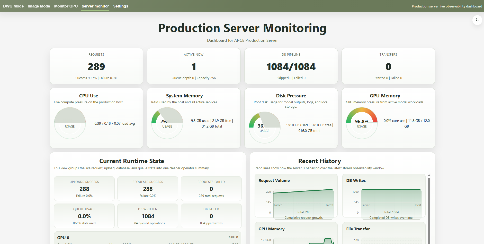
<figcaption>The operator dashboard: requests and success rate, queue usage, database writes and transfers, with host and GPU pressure beside them.</figcaption>
</figure>

---

## 9. Summary
<p>The system turns a floor-plan image into a reviewable quantity take-off. Detection, segmentation and OCR models recover objects, regions and text,
the result is written back into the drawing as CAD layers, and quantities are grouped into tables that export to Excel.
Every result is kept in MySQL. The models run behind a supervised FastAPI service with Redis-backed state, on-premises or on AWS and on GPU or
ONNX CPU, and its request, database and host metrics are visible on a live dashboard.</p>
<blockquote>
<p>Public project overview. Infrastructure values are illustrative. Model workflows describe engineering responsibilities without exposing proprietary processing logic.</p>
</blockquote>
