# AX Raster2BOM - 평면도 이미지에서 수량 산출까지
<p>CAD 프로그램의 애드인이에요. 평면도 이미지를 읽고, 그 안에 그려진 것을 인식하고, CAD Layer로 다시 그리고,
견적 담당자가 검토할 수 있는 수량 산출표를 만들어요.</p>
<p><strong>프로젝트의 목표</strong></p>
<div class="process-row">
<figure>
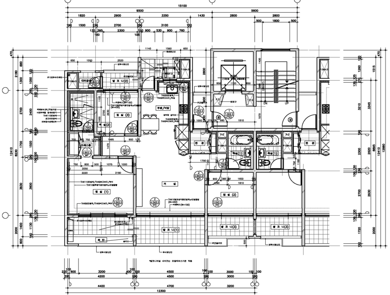
<figcaption>입력: 평면도 이미지.</figcaption>
</figure>
<span class="arch-arrow" aria-hidden="true">→</span>
<figure>
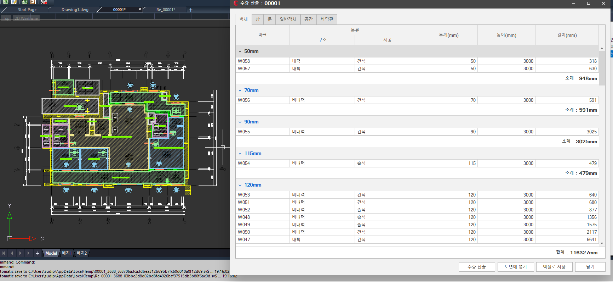
<figcaption>최종 출력: 인식된 CAD Layer와 수량 산출표.</figcaption>
</figure>
</div>

<p><strong>주요 과정</strong></p>
<div class="fact-grid">
<div class="fact"><span class="fact-label">입력</span><span class="fact-value">평면도 이미지</span></div>
<div class="fact"><span class="fact-label">모델</span><span class="fact-value">Detection · Segmentation · OCR</span></div>
<div class="fact"><span class="fact-label">출력</span><span class="fact-value">CAD Layer · 수량표 · JSON</span></div>
<div class="fact"><span class="fact-label">서빙</span><span class="fact-value">FastAPI · 온프레미스 또는 AWS</span></div>
<div class="fact"><span class="fact-label">런타임</span><span class="fact-value">PyTorch GPU · ONNX CPU</span></div>
<div class="fact"><span class="fact-label">데이터베이스</span><span class="fact-value">MySQL</span></div>
<div class="fact"><span class="fact-label">운영</span><span class="fact-value">systemd · nginx · Redis</span></div>
<div class="fact"><span class="fact-label">모니터링</span><span class="fact-value">Prometheus · Grafana</span></div>
</div>
<figure class="figure-small">
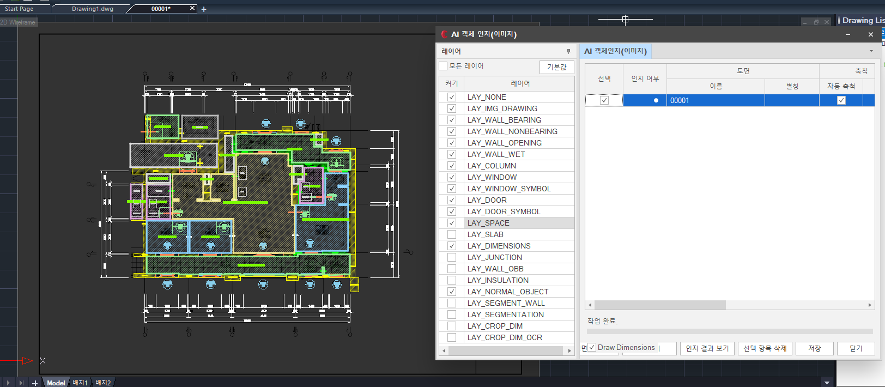
<figcaption>CAD 프로그램 안의 애드인: 왼쪽은 인식된 평면도, 오른쪽은 다시 그려진 Layer 목록이에요.</figcaption>
</figure>

---

## 1. 소개
<p>견적은 도면에서 시작해요. 그런데 많은 도면이 CAD 파일이 아니라 이미지로 와요. 사람이 벽, 창, 문, 방을 하나하나 읽고, 재고,
표에 입력해야 해요. 큰 도면은 며칠이 걸리고, 숫자도 틀리기 쉬워요.</p>
<p>이 프로젝트는 그 일을 자동으로 해요. 아래 그림이 전체 시스템이에요. 사용자가 CAD 애드인에서 평면도 이미지를 보내면,
온프레미스 Linux 서버, AWS 인스턴스, 또는 자기 PC의 ONNX CPU 버전 중 하나가 받아요. 셋 다 같은 AI 엔진을 실행해요.
Detection, Segmentation, OCR 모델과 그 결과를 수량으로 바꾸는 규칙이에요. 모든 결과는 데이터베이스에 저장되고, 세 가지 출력이 돌아와요.</p>
<pre class="mermaid">flowchart LR
    U[사용자<br/>CAD 애드인]:::input --> P1[온프레미스<br/>Linux GPU 서버]:::agent
    U --> P2[AWS<br/>GPU 인스턴스]:::agent
    U --> P3[사용자 PC<br/>ONNX CPU]:::agent
    P1 --> E1[AI 엔진<br/>Detection · Segmentation · OCR<br/>+ 규칙]:::process
    P2 --> E2[AI 엔진<br/>Detection · Segmentation · OCR<br/>+ 규칙]:::process
    P3 --> E3[AI 엔진<br/>Detection · Segmentation · OCR<br/>+ 규칙]:::process
    E1 --> R[(구조화된 결과)]:::store
    E2 --> R
    E3 --> R
    R --> DB[(MySQL<br/>결과 데이터베이스)]:::store
    R --> O1[CAD Layer]:::output
    R --> O2[수량표<br/>Excel]:::output
    R --> O3[JSON]:::output
</pre>

<hr />
<div class="part-divider"><span>입력 및 전처리</span></div>

## 2. 입력과 전처리
<p>CAD 프로그램 안에서 도면을 프로젝트에 추가해요. 한 장씩도 되고, 여러 장을 한 번에 넣을 수도 있어요. 모델을 돌리기 전에
이미지를 검사하고, 크기를 맞추고, 노이즈를 지워요. 그래야 작은 치수 글자와 얇은 벽선이 모델 해상도에서도 읽혀요.</p>
<figure class="figure-small">
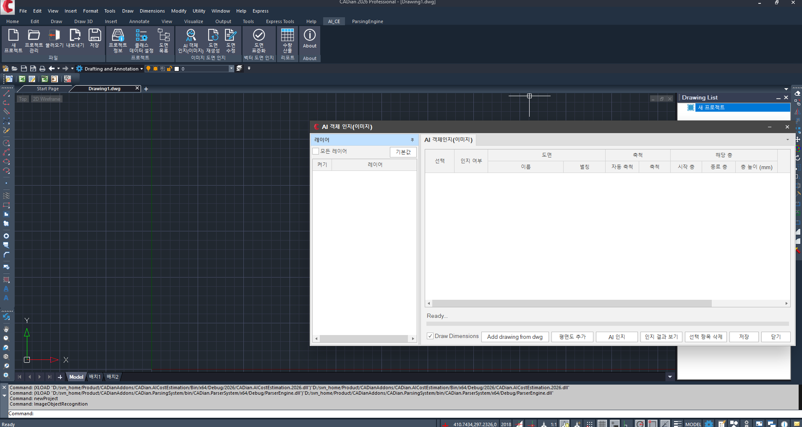
<figcaption>여기서 도면을 프로젝트에 추가하고, 축척과 층 범위를 정한 뒤 인식을 보내요.</figcaption>
</figure>
<div class="callout callout-problem">
<h4>전처리가 해결해야 하는 것</h4>
<ul>
<li><strong>축척이 다 달라요.</strong> 도면마다 다른 크기로 내보내지기 때문에, 결과가 입력의 픽셀 크기에 따라 달라지면 안 돼요.</li>
<li><strong>글자가 작아요.</strong> 치수와 방 이름은 벽에 비해 아주 작아서, 그냥 줄이면 사라져요.</li>
<li><strong>노이즈.</strong> 스캔과 내보내기 과정에서 점, 압축 자국, 해치가 섞여 들어와 선을 헷갈리게 해요.</li>
<li><strong>큰 도면.</strong> 동 전체 평면은 한 번에 들어가지 않아서, 나눠서 처리하고 다시 합쳐요.</li>
</ul>
</div>

<hr />
<div class="part-divider"><span>모델 학습 및 추론</span></div>

## 3. 모델
<p>준비된 이미지 위에서 세 가지 모델이 돌아가요. 각각 다른 정보를 찾고, 자기 데이터베이스 테이블에 저장하고,
마지막에 하나의 구조화된 결과로 합쳐져요.</p>
<table>
<thead>
<tr>
<th>모델</th>
<th>찾는 것</th>
<th>Framework</th>
</tr>
</thead>
<tbody>
<tr><td>Detection과 분류</td><td>창, 문, 기구, 기둥과 그 종류</td><td>PyTorch</td></tr>
<tr><td>Segmentation</td><td>방, 슬래브, 벽 영역과 벽 두께</td><td>PyTorch</td></tr>
<tr><td>OCR</td><td>치수 글자, 개구부 Mark, 방 이름</td><td>CRNN, Paddle OCR</td></tr>
</tbody>
</table>

<h3>3.1 Detection</h3>
<p>도면 위의 객체를 찾고 종류를 정해요. 결과는 class, confidence, 각도, 꼭짓점과 함께 저장돼요.</p>
<pre class="mermaid">flowchart LR
    A[준비된 이미지]:::input --> M[Detection 모델<br/>PyTorch]:::process
    M --> W[객체와 종류<br/>창, 문, 기구, 기둥]:::agent
    W --> T[(detected_objects)]:::store
</pre>

<h3>3.2 Segmentation</h3>
<p>박스가 아니라 영역을 찾아요. 방, 슬래브, 벽 영역을 찾고, 벽 영역에서 벽 두께를 구해요. 각 영역은 polygon으로 저장돼요.</p>
<pre class="mermaid">flowchart LR
    A[준비된 이미지]:::input --> M[Segmentation 모델<br/>PyTorch]:::process
    M --> W[영역과 벽<br/>방, 슬래브, 벽 두께]:::agent
    W --> T[(segmentation_results)]:::store
</pre>

<h3>3.3 OCR</h3>
<p>도면의 글자를 읽어요. 치수, 개구부 Mark, 방 이름이에요. 각각 자기 테이블에 저장해서, 나중에 그 글자가 가리키는 객체와 맞출 수 있어요.</p>
<pre class="mermaid">flowchart LR
    A[준비된 이미지]:::input --> M[OCR<br/>CRNN · Paddle OCR]:::process
    M --> W[치수, Mark, 이름]:::agent
    W --> T[(dimension_ocr_results<br/>symbol_ocr_results<br/>space_ocr_results)]:::store
</pre>
<p>OCR 인식기는 CRNN이에요. Convolution이 잘라낸 글자 이미지를 읽고, 양방향 sequence 층이 왼쪽에서 오른쪽으로 읽고,
CTC가 그것을 글자로 바꿔요. 아래 그림은 설명용이고, 실제 배포 설정은 아니에요.</p>
<pre class="mermaid">flowchart TB
    A[글자 조각<br/>1 x 32 x 128]:::input --> B[Convolution + ReLU<br/>32 → 64 → 128 채널]:::process
    B --> C[높이 방향 합치기<br/>32 time steps]:::process
    C --> D[양방향 sequence<br/>256 features]:::process
    D --> E[글자 점수<br/>K class scores]:::process
    E --> F[CTC decoding]:::agent
    F --> G[읽은 글자<br/>치수, Mark, 이름]:::output
</pre>

---

## 4. 결과 데이터베이스
<p>인식된 모든 항목은 MySQL에 저장돼요. 결과 종류마다 테이블이 하나씩 있고, 전부 입력 이미지에 연결돼요.
한 행에는 누가, 어떤 이미지를, 언제 돌렸는지와 class, confidence, geometry가 들어 있어서 나중에 다시 열어 보고, 비교하고, 검토할 수 있어요.</p>
<div class="figure-row figure-row-small figure-row-equal">
<figure>
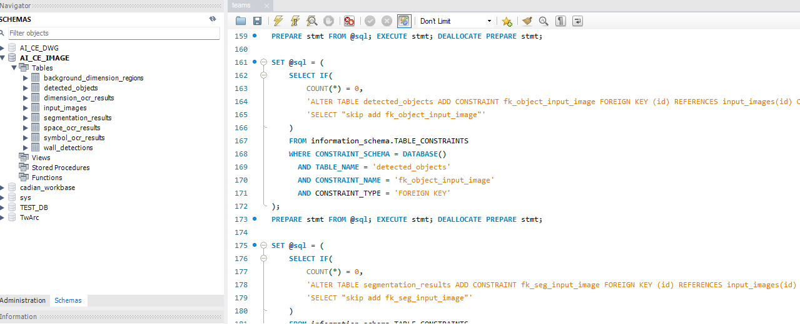
<figcaption>스키마: input_images, detected_objects, wall_detections, segmentation_results, background_dimension_regions, 그리고 치수·기호·공간 OCR 테이블이에요. 오른쪽 스크립트가 각 결과 테이블을 입력 이미지에 연결해요.</figcaption>
</figure>
<figure>
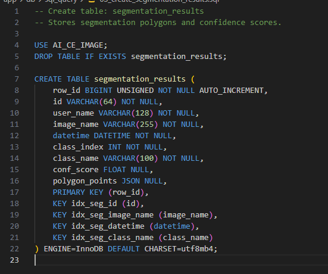
<figcaption>테이블 정의 하나: Segmentation polygon과 confidence를 저장하고, 이미지·시간·class에 index를 둬서 도면 하나의 결과를 빨리 가져와요.</figcaption>
</figure>
</div>
<figure class="figure-small">
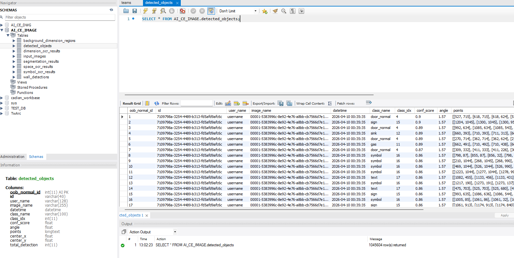
<figcaption>실제 사용 중인 detected_objects: 백만 행이 넘어요. 인식된 객체 하나가 한 행이고, class, confidence, 각도, 꼭짓점이 함께 있어요.</figcaption>
</figure>

---

## 5. 인식 결과
<p>인식된 항목은 이름이 있는 Layer로 도면에 다시 그려져요. 그래서 벽, 개구부, 기구, 공간을 따로 켜고 끌 수 있어요.
모델이 구한 벽 두께는 도면을 다시 그릴 때 내력벽과 비내력벽 값으로 들어가요.</p>
<div class="figure-row figure-row-small figure-row-equal">
<figure>
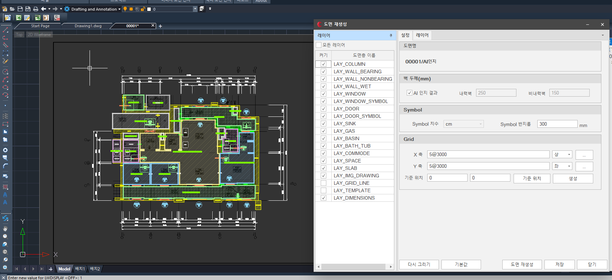
<figcaption>도면 다시 그리기: 인식된 Layer 목록과, 내력벽·비내력벽에 쓰인 AI 벽 두께.</figcaption>
</figure>
<figure>
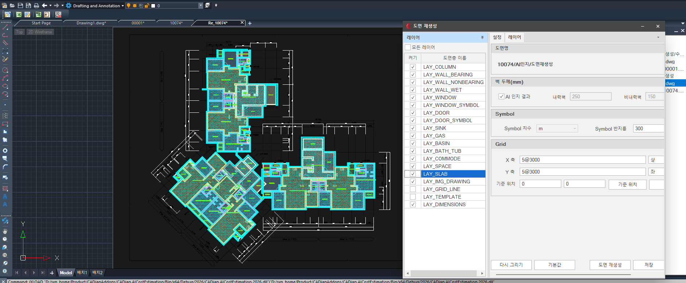
<figcaption>이미지에서 다시 그린 여러 세대 평면도. 인식된 종류마다 Layer가 따로 있어요.</figcaption>
</figure>
</div>
<figure class="figure-small">
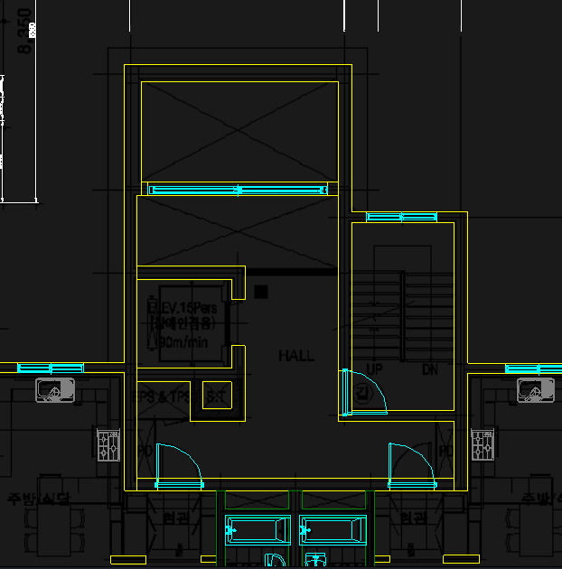
<figcaption>코어 하나를 확대한 모습: 홀, 엘리베이터, 계단, 문, 샤프트가 각각 따로 인식돼요.</figcaption>
</figure>

---

## 6. 최종 출력
<p>인식된 도면에서 애드인이 수량표를 만들어요. 종류와 크기별로 묶고, 그룹별 소계와 도면별 합계가 있어요.
벽, 창, 문, 일반 객체, 공간, 슬래브가 각각 탭이고, 전체 표를 Excel로 내보낼 수 있어요.</p>
<div class="figure-row figure-row-small figure-row-equal">
<figure>

<figcaption>벽 수량: 벽마다 Mark, 내력·비내력, 두께, 높이, 길이가 있고 두께별로 소계가 나와요.</figcaption>
</figure>
<figure>
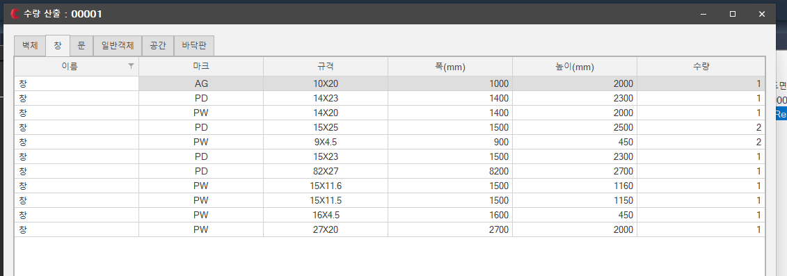
<figcaption>창 수량: 도면의 모든 창에 대해 Mark, 규격, 폭, 높이, 개수.</figcaption>
</figure>
</div>
<div class="figure-row figure-row-small figure-row-equal">
<figure>
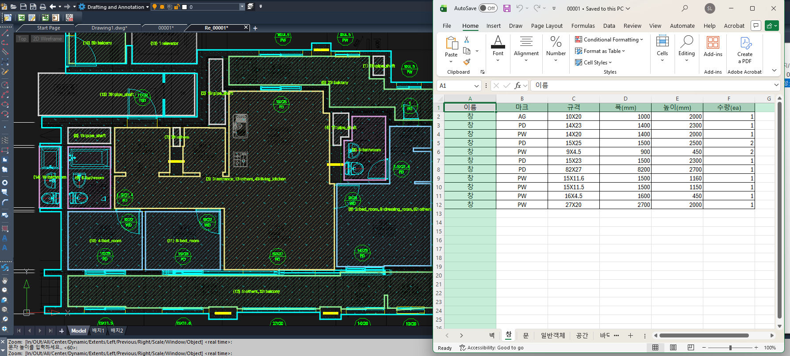
<figcaption>이름이 표시된 도면과, 같은 표를 Excel로 내보낸 모습. 견적 담당자가 바로 쓸 수 있어요.</figcaption>
</figure>
<figure>
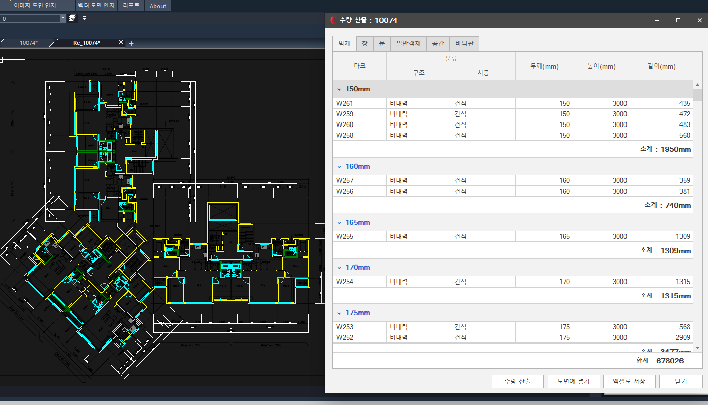
<figcaption>더 큰 동 평면의 같은 수량표. 두께별로 묶이고 도면 합계가 있어요.</figcaption>
</figure>
</div>

<hr />
<div class="part-divider"><span>배포</span></div>

## 7. 서빙과 운영
<p>모델은 CAD 애드인 안에서 돌지 않아요. 애드인이 HTTP로 도면을 보내고 구조화된 결과를 받아요. 이 서비스는 세 가지 방식으로 배포돼요.
온프레미스 Linux GPU 서버, AWS, 그리고 원격 연결 없이 자기 PC에서 쓰고 싶은 사용자를 위한 ONNX CPU 버전이에요.
아래 코드는 각 부분의 모양을 보여 주려고 줄인 것이고, 실제 소스는 아니에요.</p>

<h3>7.1 온프레미스 Linux 서버</h3>
<p>기본 배포예요. FastAPI 서비스가 CADian UI에서 HTTP로 도면을 받고, Redis 큐에 작업을 넣고, Celery worker가 GPU에서 세 모델을 돌려요.
애드인은 결과를 polling해서 도면에 그려요. Redis가 트래픽을 관리해서 도면이 한꺼번에 몰려도 GPU에 다 올라가지 않고 줄을 서요.
Celery는 무거운 백엔드 작업을 요청 밖에서 처리해요.</p>
<pre class="mermaid">flowchart LR
    C[CADian UI<br/>HTTP 클라이언트]:::input --> N[nginx<br/>Reverse proxy]:::process
    N --> API[FastAPI<br/>도면 접수]:::agent
    API --> Q[(Redis<br/>작업 큐와 상태)]:::store
    Q --> W[Celery worker<br/>GPU의 PyTorch]:::agent
    W --> DB[(MySQL<br/>결과)]:::store
    W --> OUT[결과 JSON<br/>CADian에 표시]:::output
    GW[GPU 감시 타이머]:::note -.-> SD[systemctl<br/>실패 시 재시작]:::tool
    SD -.-> API
    SD -.-> W
</pre>
<p>API는 작게 유지해요. 업로드를 검사하고, 작업을 큐에 넣고, polling에 답해요. 느린 일은 전부 worker에서 해요.</p>

```python
# app/main.py: the API only accepts the drawing and hands it to a worker.
from fastapi import FastAPI, UploadFile
from celery import Celery

app = FastAPI()
queue = Celery("ax", broker="redis://127.0.0.1:6379/0", backend="redis://127.0.0.1:6379/1")

@app.post("/recognize")
async def recognize(drawing: UploadFile, scale: float):
    path = save_upload(drawing)                      # validated and rescaled on disk
    job = queue.send_task("ax.recognize", args=[path, scale])
    return {"job_id": job.id}                        # the add-in polls this id

@app.get("/result/{job_id}")
def result(job_id: str):
    job = queue.AsyncResult(job_id)
    return {"state": job.state, "result": job.result if job.ready() else None}
```

```python
# worker/tasks.py: one Celery worker per GPU runs the three model branches.
@queue.task(name="ax.recognize")
def recognize(path, scale):
    image = preprocess(path, scale)
    result = merge(detect(image), segment(image), read_text(image))
    store(result)                                    # one MySQL table per branch
    return result.to_json()
```

<p>두 프로세스 모두 systemd 서비스라서 서버가 멈춘 채로 있지 않아요. API나 worker가 죽으면 systemctl이 몇 초 안에 다시 올리고,
재부팅 뒤에도 다시 시작돼요.</p>

```ini
# /etc/systemd/system/ax-inference.service  (ax-worker.service is the same shape, running celery)
[Unit]
Description=AX Raster2BOM inference API
After=network.target redis.service

[Service]
User=ax
WorkingDirectory=/opt/ax-inference
ExecStart=/opt/ax-inference/.venv/bin/uvicorn app.main:app --host 127.0.0.1 --port 8000
Restart=always
RestartSec=5

[Install]
WantedBy=multi-user.target
```

<p>따로 막아야 했던 문제가 하나 있었어요. 추론이 끝났는데도 GPU 사용률이 100%에 머무는 경우예요. systemd 타이머가 1분마다
작은 감시 스크립트를 돌려요. 큐가 비어 있는데 GPU가 100%면 서비스를 재시작하고, 그러면 GPU가 풀려요.</p>

```bash
#!/usr/bin/env bash
# gpu-watchdog.sh: run by a systemd timer every minute.
util=$(nvidia-smi --query-gpu=utilization.gpu --format=csv,noheader,nounits | head -n1)
active=$(redis-cli llen ax:jobs:active)
if [ "$util" -ge 100 ] && [ "$active" -eq 0 ]; then
  systemctl restart ax-worker ax-inference
fi
```

<h3>7.2 AWS 배포</h3>
<p>고객이 GPU 서버를 둘 수 없을 때는 같은 서비스를 AWS에서 돌려요. API와 worker는 GPU EC2 인스턴스에 위와 똑같이 설치하고,
모델 가중치는 S3 버킷에 승인된 버전별로 둬요. 인스턴스는 instance role로 버킷을 읽어서 서버에 키를 저장하지 않아요.
시작할 때 지정된 버전을 내려받고, 새 모델로 바꾸는 건 변수 하나 바꾸고 재시작하면 돼요. nginx가 TLS를 처리하고,
security group은 CADian 클라이언트만 허용해요.</p>
<pre class="mermaid">flowchart LR
    C[CADian UI]:::input --> N[nginx · TLS<br/>EC2 security group]:::process
    N --> API[FastAPI + Celery<br/>EC2 GPU 인스턴스]:::agent
    S3[(S3 버킷<br/>모델 버전)]:::store --> API
    IAM[Instance role<br/>S3 읽기 전용]:::tool -.-> API
    API --> RDS[(Redis)]:::store
    API --> DB[(MySQL)]:::store
    API --> OUT[결과 JSON<br/>애드인으로]:::output
</pre>

```python
# model_store.py: pull the approved model version from S3 when the service starts.
import boto3, os

BUCKET = "ax-raster2bom-models"
PREFIX = os.environ["MODEL_VERSION"]                 # e.g. "2026-03/"
s3 = boto3.client("s3")

def pull_models(dest="/opt/ax-inference/models"):
    for obj in s3.list_objects_v2(Bucket=BUCKET, Prefix=PREFIX)["Contents"]:
        target = os.path.join(dest, os.path.basename(obj["Key"]))
        if not os.path.exists(target):
            s3.download_file(BUCKET, obj["Key"], target)
```

```bash
# Publish a new model version, then roll the server to it.
aws s3 sync ./export/2026-03 s3://ax-raster2bom-models/2026-03/
ssh ax-aws 'sudo systemctl set-environment MODEL_VERSION=2026-03/ \
            && sudo systemctl restart ax-inference ax-worker'
```

<h3>7.3 사용자 PC의 ONNX CPU 배포</h3>
<p>원격 연결 없이 자기 컴퓨터에서 쓰고 싶은 사용자도 있어요. 이 경우 PyTorch 모델을 ONNX로 내보내고, 애드인 프로세스 안에서
ONNX Runtime이 CPU로 돌려요. 서버도, GPU도, 네트워크도 없어요. GPU 서비스보다 느리지만 도면이 PC 밖으로 나가지 않아요.</p>
<pre class="mermaid">flowchart LR
    U[사용자 PC<br/>CADian 애드인]:::input --> RT[ONNX Runtime<br/>CPU session]:::agent
    M[(ONNX 모델<br/>애드인에 포함)]:::store --> RT
    RT --> R[구조화된 결과]:::process
    R --> L[CAD Layer와<br/>수량표]:::output
</pre>

```python
# export_onnx.py: one PyTorch model -> one .onnx file, with a dynamic batch and image size.
import torch

model = load_detector("weights/detector.pt").eval()
dummy = torch.zeros(1, 3, 1024, 1024)
torch.onnx.export(
    model, dummy, "export/detector.onnx",
    opset_version=17,
    input_names=["image"], output_names=["boxes", "scores", "classes"],
    dynamic_axes={"image": {0: "batch", 2: "height", 3: "width"}},
)
```

```python
# infer_onnx.py: the same model on the user's CPU, with no PyTorch and no server.
import numpy as np
import onnxruntime as ort

session = ort.InferenceSession("models/detector.onnx", providers=["CPUExecutionProvider"])
image = preprocess(path).astype(np.float32)[None]    # 1 x 3 x H x W
boxes, scores, classes = session.run(None, {"image": image})
```

<table>
<thead>
<tr>
<th>구성 요소</th>
<th>역할</th>
</tr>
</thead>
<tbody>
<tr><td>FastAPI</td><td>요청 검사, 작업 제출, 결과 polling</td></tr>
<tr><td>Celery</td><td>요청 밖의 worker에서 모델을 실행</td></tr>
<tr><td>Redis</td><td>작업 큐, 트래픽 관리, 요청 결과와 이벤트 기록</td></tr>
<tr><td>systemd</td><td>API와 worker를 관리하고 재시작, GPU 감시 타이머 실행</td></tr>
<tr><td>nginx</td><td>서비스 앞의 Reverse proxy와 TLS</td></tr>
<tr><td>MySQL</td><td>결과: 입력 이미지별 Detection, Segmentation, OCR 행</td></tr>
<tr><td>Amazon S3</td><td>AWS 배포용 모델 가중치, 버전별 보관</td></tr>
<tr><td>ONNX Runtime</td><td>사용자 PC용 CPU 모델 실행</td></tr>
</tbody>
</table>

---

## 8. 모니터링
<p>오래 도는 서비스는 상태가 보여야 해요. 요청 수, 실패, 큐 사용량, DB 쓰기, 파일 전송, GPU 메모리를 전부 지표로 내보내고
대시보드에 보여 줘요. Prometheus가 서비스에서 지표를 수집하고 Grafana가 읽어요. 별도의 운영자 대시보드도 있어요.</p>
<figure class="figure-small">
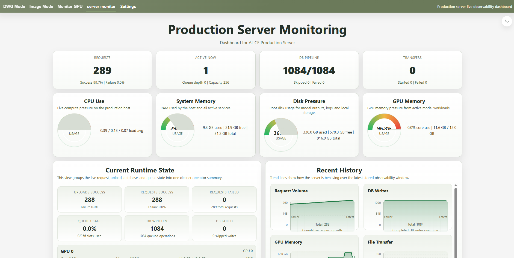
<figcaption>운영자 대시보드: 요청과 성공률, 큐 사용량, DB 쓰기와 전송, 그 옆에 호스트와 GPU 부하.</figcaption>
</figure>

---

## 9. 요약
<p>이 시스템은 평면도 이미지를 검토 가능한 수량 산출표로 바꿔요. Detection, Segmentation, OCR 모델이 객체, 영역, 글자를 찾고,
결과는 CAD Layer로 도면에 다시 그려지고, 수량은 표로 묶여 Excel로 나가요. 모든 결과는 MySQL에 저장돼요.
모델은 systemd가 관리하는 FastAPI 서비스 뒤에서 돌고, 상태는 Redis에 있고, 온프레미스나 AWS에서 GPU로 또는 ONNX CPU로 실행돼요.
요청, DB, 호스트 지표는 실시간 대시보드에서 볼 수 있어요.</p>
<blockquote>
<p>공개용 프로젝트 소개예요. 인프라 값은 예시이고, 모델 워크플로는 독점 처리 로직을 드러내지 않는 선에서 담당 업무를 설명해요.</p>
</blockquote>
