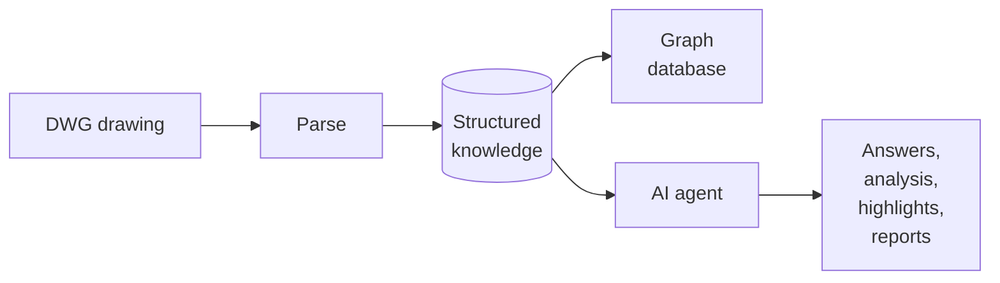
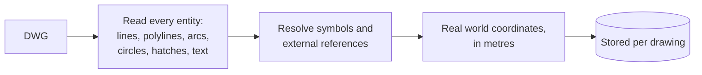
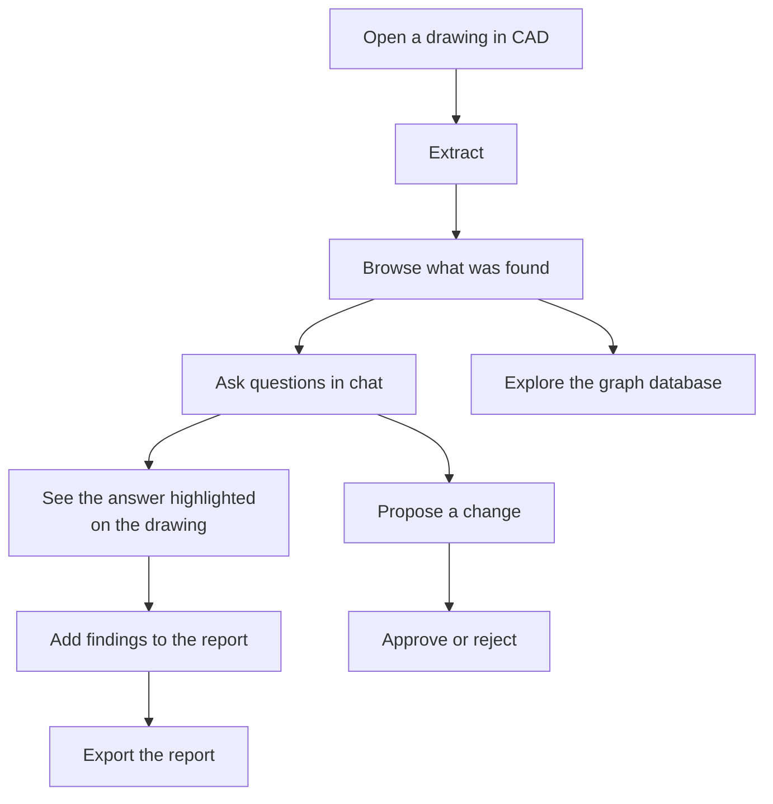
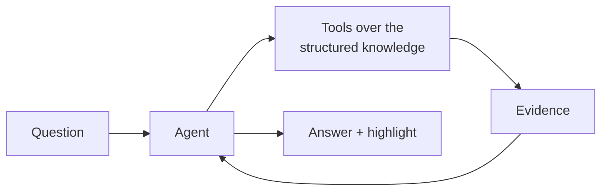
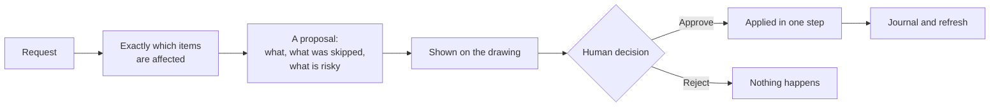
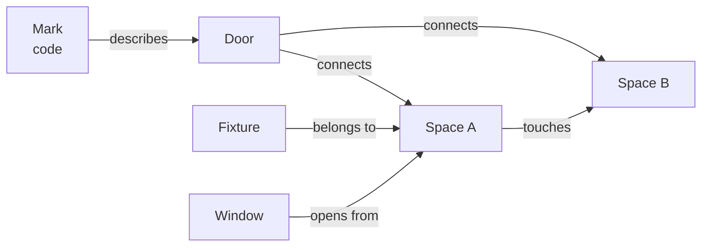

# Agentic CAD Parsing System - Parsing CAD Data

A system that runs inside a CAD application. It reads a DWG drawing, extracts what is in it, organizes the entities and objects,
and answers questions about it. It inspects the whole drawing and prepares reports based on the user's needs and goals.

<!-- **Code files are not available in this repository because of confidentiality** -->

**Main Process**

<div class="fact-grid">
<div class="fact"><span class="fact-label">Input</span><span class="fact-value">Architectural drawings (DWG)</span></div>
<div class="fact"><span class="fact-label">Output</span><span class="fact-value">Structured knowledge · graph · reports</span></div>
<div class="fact"><span class="fact-label">Interface</span><span class="fact-value">Chat agent inside the CAD canvas</span></div>
<div class="fact"><span class="fact-label">Languages</span><span class="fact-value">Korean and English</span></div>
<div class="fact"><span class="fact-label">Safety</span><span class="fact-value">Every change needs human approval</span></div>
<div class="fact"><span class="fact-label">Platform</span><span class="fact-value">C# / .NET, inside the CAD application</span></div>
</div>

<figure class="figure-small">

<figcaption>The system inside the CAD application: the drawing on the left, the entity browser, chat and AI log on the right, and the inspection report window below.</figcaption>
</figure>

---

## 1. Introduction

An architectural drawing contains a lot of information about the building, machinery, piping and HVAC systems, and many other designs.
Understanding such drawings needs a professional. For instance, making a report that lists wall thicknesses and classifies them (as load-bearing or non-load-bearing),
or finding the connections in a piping system, takes a lot of time and effort, and human error cannot be avoided. To minimize such factors we need a system that actually analyzes the
drawings and makes the reports. This project does that, and then puts an AI assistant on top of it, so
that a user can simply analyze and extract the necessary information from complex uploaded drawings.



<!-- <div class="callout callout-problem">
<h4>Three questions shaped every decision</h4>
<ol>
<li><strong>Does it work on a drawing it has never seen?</strong> A system tuned to one file is a demo, not a product.</li>
<li><strong>Can every answer be traced?</strong> An inspection result that cannot be shown on the drawing is an opinion.</li>
<li><strong>Can it be wrong safely?</strong> It works on a customer's drawing, so uncertainty must be a visible state, and nothing may change without a human decision.</li>
</ol>
</div> -->

---

## 2. The problem: a DWG is not a Model or a Raster Image

<p>A DWG file is vector data stored in a closed binary format, which is difficult to read with simple algorithms or systems.
Nothing in it says "this is a bedroom" or "here is a piping system". For instance, see the following images.</p>

<div class="figure-row figure-row-small">
<figure>

<figcaption>DWG sample: a unit floor plan as the CAD canvas draws it.</figcaption>
</figure>
<figure>

<figcaption>Vector data sample: the same file opened as text. The data is binary, so nothing in it can be read directly.</figcaption>
</figure>
</div>


<!-- ======================================================================= -->

<h3>2.1 What the file actually contains</h3>
<pre><code>A floor plan file
├── Primitives      lines, polylines, arcs, circles, hatches
├── Text            names, sizes, notes, titles, legends, revisions
├── Symbols         reusable blocks: a door, a toilet, an entire flat
│   ├── nested      a symbol inside a symbol inside a symbol
│   └── external    geometry that lives in a different file altogether
├── Layers          groupings chosen by whoever drew it
└── Marks           codes that refer to a door or a window
</code></pre>
<figure class="figure-xsmall">

<figcaption>What one item in the file becomes once it is read: a single line with its layer, endpoints, length and bounds. Still no meaning attached.</figcaption>
</figure>


<h3>2.2 Why that is hard</h3>
<div class="callout callout-problem">
<h4>Problems in the raw drawing</h4>
<ul>
<li><strong>No meaning.</strong> The file stores shapes and positions, not what anything is or what belongs to what.</li>
<li><strong>Everything overlaps.</strong> Furniture, hatching, dimensions and notes sit on top of the structure.</li>
<li><strong>Symbols hide their position.</strong> Real coordinates appear only after insertion, rotation, scale and mirroring are resolved. Exploding them destroys their identity.</li>
<li><strong>No standard.</strong> Every office draws and names things differently, often in more than one language.</li>
<li><strong>Repeated units.</strong> The same flat appears many times, mirrored or rotated, with the same names.</li>
<li><strong>Imperfect drawings.</strong> Lines miss by a millimetre, content sits on the wrong layer, labels sit outside what they name.</li>
</ul>
</div>

<h3>2.3 Why the obvious approaches fail</h3>

<div class="table-scroll"><table class="component-table">
<thead>
<tr>
<th>Approach</th>
<th>Why it is not enough</th>
</tr>
</thead>
<tbody>
<tr><td>Explode everything and analyse the shapes</td><td>Symbols lose their meaning, and the data multiplies</td></tr>
<tr><td>Send the file to a language model</td><td>Too large, and no exact geometry or counting</td></tr>
<tr><td>Image recognition on a rendered plan</td><td>Loses coordinates, units and identity</td></tr>
<tr><td>Manual templates per project</td><td>Does not scale; every customer draws differently</td></tr>
</tbody>
</table></div>
<p>The drawings themselves also vary. The system has been run on the range below, from a single flat to a whole block.</p>
<div class="table-scroll"><table class="component-table">
<thead>
<tr>
<th>Drawing</th>
<th>Size</th>
<th>What it contains</th>
<th>Complexity</th>
</tr>
</thead>
<tbody>
<tr><td>Single unit plan (one flat)</td><td>about 6,000 entities</td><td>rooms, doors, fixtures, marks, dimensions</td><td>Low</td></tr>
<tr><td>Multi-unit floor plan</td><td>about 25,000 entities</td><td>about 80 rooms across repeated unit types, mirrored and rotated, plus cores, shafts and stairs</td><td>Medium</td></tr>
<tr><td>Block plan (several buildings on one sheet)</td><td>larger again</td><td>every unit of every building, repeated, with shared site elements</td><td>High</td></tr>
</tbody>
</table></div>

<!-- <div class="table-scroll"><table class="component-table">
<thead>
<tr>
<th>Approach</th>
<th>Why it is not enough</th>
</tr>
</thead>
<tbody>
<tr>
<td>Explode everything and analyse the shapes</td>
<td>Loses the meaning carried by symbols, and multiplies the data</td>
</tr>
<tr>
<td>Send the drawing to a language model</td>
<td>Far too large, and models cannot do exact geometry or counting</td>
</tr>
<tr>
<td>Image recognition on a rendered plan</td>
<td>Loses exact coordinates, units and identity; cannot be traced back</td>
</tr>
<tr>
<td>Manual templates per project</td>
<td>Does not scale, and every customer draws differently</td>
</tr>
</tbody>
</table></div> -->
<!-- <p>The system uses none of these alone. It builds a structured understanding first, and
treats the language model as a reader of that structure rather than of the file.</p> -->
<div class="figure-row figure-row-small figure-row-equal">
<figure>

<figcaption>The drawing as the CAD canvas shows it: lines, text and symbols, with nothing saying what any of them is.</figcaption>
</figure>
<figure>

<figcaption>The same drawing as data: one line entity with its layer, endpoints, length and bounds. Thousands of these make a plan, and none of them says "wall".</figcaption>
</figure>
</div>

---

## 3. Parsing and storage

<div class="callout callout-problem">
<h4>Problems this stage solves</h4>
<ul>
<li>Geometry inside nested and external symbols has no real-world coordinates until every insertion, rotation, scale and mirror is resolved.</li>
<li>Exploding symbols to get coordinates destroys their identity.</li>
<li>Drawings come in different units; later numbers must all mean the same thing.</li>
<li>Every later answer must be traceable to the exact entity in the drawing.</li>
</ul>
</div>

The first stage reads the drawing and writes it down in a form a machine can work
with.



```
Parsing
├── Entities          lines, polylines, arcs, circles, hatches, text
├── Symbols           resolved to the leaf, including nested ones
├── External refs     pulled in and marked with their origin
├── Units             normalised, so every later number is in metres
└── Identity          a stable identifier per drawing and per entity
```

Two decisions mattered.

**Nothing is exploded.** Each piece of geometry keeps a path back to the symbol it
belongs to, so a symbol is still recognisable as itself while its geometry sits in
world coordinates.

**Every fact keeps its origin.** The drawing's own identifier for an entity is
carried through the whole pipeline. That is what later lets any number be pointed at
on screen, and lets a reviewer disagree with one line rather than the whole report.

Parsed drawings are stored, not re-read. A drawing is processed once and the result
is reused for every later question, by the assistant, by the inspection, and by the
graph database.

---

## 4. What the system produces

<div class="callout callout-problem">
<h4>Problems this stage solves</h4>
<ul>
<li>Spaces, objects, openings and marks must be recognised and linked to each other, not just listed.</li>
<li>A cleanly recovered result and an approximated one must not look the same to the user.</li>
<li>Every item needs the drawing entities behind it, so the assistant can show its evidence.</li>
</ul>
</div>

### 4.1 Structured knowledge

```
For one drawing
├── Spaces           name, kind, area, confidence, evidence
├── Objects          kind, position, the space it belongs to, evidence
├── Openings         doors and windows, with sizes and the source of each size
├── Marks            official codes and the openings they describe
├── Relations        opening to spaces, space to space, space to its structure
├── Inventory        what the drawing is made of, and how much of each
└── Provenance       for every item, the exact drawing entities behind it
```

**Provenance is the feature.** Every space, area, size and finding keeps a link back
to the drawing. That is what allows the assistant to highlight its own evidence.

**Confidence is explicit.** A result that was recovered cleanly and one that was
approximated are not presented as the same thing, and anything judged on top of an
approximate result inherits that lower confidence.

<figure>

<figcaption>What the system recovered, drawn over the plan: room and wall masks in their class colours, with the assistant explaining what was highlighted.</figcaption>
</figure>

### 4.2 From a user's point of view




### 4.3 Capability inventory

```
Capabilities
├── Reading
│   ├── full extraction with stable identity
│   ├── symbol resolution to real world coordinates
│   ├── external references included
│   └── unit handling, so every result is in metres
├── Understanding
│   ├── spaces of every kind, including service and utility spaces
│   ├── objects: doors, windows, sanitary fixtures, kitchen fittings, furniture
│   ├── marks matched to the openings they describe
│   └── relations between spaces, openings and structure
├── Asking
│   ├── find, count and measure anything the system knows about
│   ├── walk the relations
│   ├── answer in the language of the question
│   └── show every answer on the drawing
├── Inspecting
│   ├── a rule set over spaces and their contents
│   ├── a result state per rule per space, including "cannot be judged"
│   └── findings collected into an editable report
├── Reporting
│   ├── one document per drawing, Korean and English together
│   ├── content added straight from the conversation
│   └── export to office formats
└── Changing (always proposed, never automatic)
    ├── create, edit, delete and reorganise drawing content
    ├── move or copy content between groupings
    └── a full journal of everything applied
```

---

## 5. Why an AI agent

<div class="callout callout-problem">
<h4>Problems this section addresses</h4>
<ul>
<li>A fixed set of reports only answers the questions someone thought of in advance.</li>
<li>Real users ask sideways questions that combine finding, counting, measuring and relating.</li>
<li>A language model cannot be trusted with exact geometry, counting, or a file far larger than its context.</li>
</ul>
</div>

Real users ask sideways questions:

- *Which bathrooms have no ventilation?*
- *Make a table of the structure around this kitchen, with lengths.*
- *How many doors of this code are in the drawing, and where?*
- *Is anything missing in the balconies?*
- *Put that in the report, in both languages.*

An agent turns an open question into a short chain of exact lookups and explains the
result. It is not asked to understand the drawing. It is asked to understand the
*question*, and then to use tools that already understand the drawing.




### 5.1 Why not simply give the model the file

| | Model reads the drawing | Model reads the structured knowledge |
|---|---|---|
| Size | far beyond a usable context | a small, relevant slice |
| Exactness | approximate, unstable | exact, repeatable |
| Cost | pays again for every question | processed once, reused |
| Traceability | none | every value carries its origin |
| Reliability | varies per model and per run | the numbers do not depend on the model |

The deterministic work is done deterministically. The model is used for language,
intent and composition, which is what it is actually good at.

### 5.2 What the agent can reach

The assistant works through a small, named set of tools. The names are what a user
sees in the activity log:

| Tool | What the user gets |
|---|---|
| `find` | the items that match a description |
| `count` | how many, with the same filters |
| `measure` | sizes, clear widths, distances, with the source of each number |
| `relate` | how spaces, openings and structure connect |
| `highlight` | the answer shown on the drawing |
| `inspection` | findings written into the report |
| `modify` | a proposed change, never an applied one |
| `create_block` | a new symbol built from a selection |
| `data_scanner` | a raw sweep for anything the structured view missed |

What each tool accepts, and the shape of what it returns, are part of the product
and are not described here.

---

## 6. The agent harness

<div class="callout callout-problem">
<h4>Problems this section addresses</h4>
<ul>
<li>A model on its own retries silently, drifts out of scope, and loses track of long sessions.</li>
<li>Numbers must not change with the model that happens to be configured.</li>
<li>Cost, timing and failures have to be visible, or an agent cannot be debugged.</li>
<li>Some drawings may not leave the building, so a self-hosted model must be an option.</li>
</ul>
</div>

The model is a small part of an agent. The harness is the rest, and it decides
whether the thing survives real use.

```
Harness
├── Conversation control
│   ├── a working budget per question, and a clear stop
│   ├── partial answers that say what is still missing
│   └── no silent retry of a question already answered
├── Grounding
│   ├── every claim carries the drawing evidence behind it
│   ├── the highlight shows exactly what the answer talked about
│   └── anything that cannot be grounded is reported as unknown
├── Scope discipline
│   ├── "only these" means only these
│   └── a narrowing word in the question narrows the result
├── Context strategy
│   ├── the drawing is introduced once, not repeated
│   ├── tool results are reasoned over as they came back
│   └── history is managed so long sessions stay coherent
├── Determinism
│   ├── the same question twice returns the same numbers
│   └── numbers never depend on which model is configured
├── Idempotence
│   └── repeating an action does not duplicate its result
├── Bilingual operation
│   ├── answers in the language of the question
│   └── report content stored in both languages at once
├── Cost and observability
│   ├── tokens and estimated cost shown per answer
│   ├── every tool call traced with timing and outcome
│   └── failures surfaced as information, not as crashes
├── Model flexibility
│   ├── hosted frontier models
│   └── a self-hosted model for drawings that may not leave the building
└── Safety
    ├── proposal and approval are separate steps
    ├── nothing is written without an explicit human click
    └── everything applied is journalled
```

When an answer is wrong, the trace shows whether the agent asked the wrong question
or a tool returned the wrong thing. That single distinction is most of debugging an
agent system.

---

## 7. Interaction and safety

<div class="callout callout-problem">
<h4>Problems this section addresses</h4>
<ul>
<li>An answer that cannot be seen on the drawing is hard to trust.</li>
<li>Evidence drawn on the canvas must never alter the customer's file.</li>
<li>Changing a drawing is irreversible, so it must be slow, explicit and reviewable.</li>
</ul>
</div>

### 7.1 Showing the work

Results are drawn directly on the CAD canvas without altering the drawing: evidence
appears as temporary graphics that disappear when cleared. Spaces can be shown as
outlines or filled with a see-through mask, so a space reads as an area while the
plan stays readable underneath.

<figure class="figure-placeholder">
<div class="placeholder-box"><span>Image</span></div>
<figcaption>A space shown with the see-through mask on the canvas, with its evidence outlined.</figcaption>
</figure>

### 7.2 Changing a drawing

This is the only irreversible thing the system can do, so it is deliberately slow.



The approval is a button, not a typed word. The assistant cannot propose and apply
in the same breath, and the outcome of the click is fed back, so it knows what
actually happened rather than what it suggested.

<figure class="figure-placeholder">
<div class="placeholder-box"><span>Image</span></div>
<figcaption>A proposed change shown on the drawing, waiting for the approve or reject decision.</figcaption>
</figure>

---

## 8. Reliability engineering

<div class="callout callout-problem">
<h4>Problems this section addresses</h4>
<ul>
<li>Correctness on one drawing is luck; it has to be proven on drawings the system was not developed against.</li>
<li>Benchmarks that leak names, identifiers or numbers can be gamed.</li>
<li>A fix for one case can quietly damage twenty others.</li>
</ul>
</div>

```
Quality approach
├── Benchmarks that cannot be gamed
│   ├── no name, identifier or number appears in a test prompt
│   ├── expected results are relations the drawing itself defines
│   ├── every test is run on unrelated drawings, in both languages
│   └── "nothing found" is a correct answer when it is true
├── Staged scope
│   ├── stage one: reading, classifying, counting, relating, grouping
│   └── later stages do not start until stage one passes everywhere
├── Fast measurement
│   ├── the heavy stages can be run outside CAD on exported drawings
│   └── a change can be measured in seconds instead of a manual session
└── Regression discipline
    ├── every result compared before and after a change
    ├── spatial checks that results do not collide with each other
    └── the same drawing re-tested in different units and rotated
```

A concrete example of what this catches: a change meant to improve one result
quietly altered twenty others. The before-and-after comparison showed it in one run.
Without that discipline, the improvement would have shipped with the damage attached.

---

## 9. Results

<div class="callout callout-result">
<h4>Measured on an unseen test plan</h4>
<ul>
<li>Roughly 25,000 entities read and resolved.</li>
<li>66 spaces recovered across six repeated unit types; the large majority cleanly, the rest reported as approximate rather than presented as exact.</li>
<li>Identical results in millimetres, in inches, and with the plan rotated.</li>
<li>The same question returns the same numbers across runs and models, in Korean and in English.</li>
</ul>
</div>

| Measure | Outcome |
|---|---|
| Entities in a test plan | roughly 25,000 |
| Spaces recovered in it | 66, across six repeated unit types |
| Quality | the large majority recovered cleanly; the rest reported as approximate rather than presented as exact |
| Language coverage | Korean and English, across both test sets |
| Independence | identical results in millimetres, in inches, and with the plan rotated |
| Integrity | results checked against each other on every change |
| Repeatability | the same question returns the same numbers across runs and models |

### 9.1 Visual results

<div class="figure-row">
<figure>

<figcaption>Wall inspection: the assistant adds a wall polygon summary to the report, written in Korean and English.</figcaption>
</figure>
<figure>

<figcaption>Door inspection: every door with its code, size and the rooms it connects, and the matching doors highlighted on the drawing.</figcaption>
</figure>
</div>
<figure>

<figcaption>A follow-up question on another drawing: only the Bedroom 1 spaces are highlighted, with the area of each listed in the chat.</figcaption>
</figure>

### 9.2 Demonstrations

Demonstrations cover:

- A question asked and answered end to end, with the evidence highlighted.
- A full inspection run, from extraction to exported report.
- A proposed change, reviewed and approved.

---

## 10. Inspection and reporting

<div class="callout callout-problem">
<h4>Problems this section addresses</h4>
<ul>
<li>Rules have to be judged per space, and some cannot be judged on a given drawing at all.</li>
<li>A pass/fail-only tool hides the cases a reviewer most needs to see.</li>
<li>Findings must become an editable, bilingual document with the evidence attached.</li>
</ul>
</div>

The inspection layer asks whether each space contains what it must contain.

```
Inspection
├── Rule set        requirements on a kind of space and its contents
├── Result states   pass, fail, warning, review required,
│                   insufficient data, not applicable, not evaluated
├── Evidence        the drawing entities behind every judgement
├── Confidence      inherited from how well the result itself was recovered
└── Report
    ├── one document per drawing
    ├── Korean and English stored together
    ├── content added directly from the conversation
    ├── editable: update, replace, remove, retitle
    └── exported to office formats
```

The states that are neither pass nor fail matter most. A rule that cannot be judged
on this drawing says so. That is the difference between a tool a reviewer trusts and
one they stop reading.


---

## 11. Graph database

<div class="callout callout-problem">
<h4>Problems this section addresses</h4>
<ul>
<li>A drawing is a web of things that refer to each other, not a list; questions about it are relational.</li>
<li>In tables, every new relational question is another join; the schema has to be reshaped for each new relation type.</li>
<li>A relation that cannot be traced back to the drawing is just an assertion.</li>
</ul>
</div>

A mark describes a door, a door joins two spaces, a space touches another space, a
fixture belongs to a space. Storing that as a graph lets a question be answered by
walking from one thing to the next, instead of scanning everything each time.



### 11.1 What is in it

```
Graph database
├── Nodes       one per meaningful thing: space, opening, mark, fixture,
│               and the structural pieces around a space
│   ├── class   what kind of thing it is
│   ├── origin  the drawing entity it was built from
│   └── values  its own properties, such as a code or a size
├── Edges       directed, named relations between two nodes
│   └── evidence   why the relation exists, kept on the edge itself
└── One graph per drawing, saved and reloaded by drawing identity
```

**Edges carry their evidence.** A relation is not an assertion, it is a claim with a
reason attached. That makes the graph auditable: any connection can be questioned
and traced back to the drawing.

### 11.2 What it is used for

| Use | What it gives |
|---|---|
| Exploration | a window listing every node with its class, origin and how many connections it has |
| Visualisation | a selected node drawn with its direct connections, so the local picture is immediate |
| Linking to the drawing | selecting a node highlights it and its connections on the CAD canvas |
| Answering | the assistant walks the graph to answer questions about how things connect |
| Inspection | rules are evaluated over relations, not only over positions |
| Persistence | the graph is stored per drawing, so a reopened file brings its relations back |

<figure class="figure-placeholder">
<div class="placeholder-box"><span>Image</span></div>
<figcaption>The graph database view: a selected node with its direct connections, linked back to the canvas.</figcaption>
</figure>

### 11.3 Why a graph rather than tables

Questions in this domain are relational by nature: *which spaces does this door
join*, *what opens off this corridor*, *which spaces have no opening at all*, *what
surrounds this space*. In a table these are joins that grow with every new question.
As a graph they are short walks, and new relation types can be added without
reshaping what is already stored.

---

## 12. Technology and skills

| Area | What this project demanded |
|---|---|
| Language and platform | C#, .NET, Windows desktop application development |
| CAD integration | commercial CAD add-on development, drawing database access, non-destructive on-canvas rendering, document and transaction handling |
| Computational geometry | spatial computation on unstructured drawing data, independence from unit and orientation |
| Data engineering | structured storage per drawing, content-based identity, vector search for free text, change journalling |
| Graph modelling | node and edge design, evidence-carrying relations, persistence, visualisation, traversal for question answering |
| AI engineering | tool-calling agents, multi-round control, grounding and evidence, prompt and configuration design, token and cost accounting, model routing |
| Model operations | hosted frontier models and a self-hosted model server for private data |
| Natural language | Korean and English throughout |
| Documents | bilingual document generation and export |
| Product thinking | confidence as a first-class output, approval gates, traceability, staged delivery |
| Quality engineering | drawing-independent benchmarks, offline measurement harness, regression comparison on every change |

---

## 13. How the work was run

```
Working method
├── One problem at a time, measured before and after
├── Every change verified on more than one drawing
├── Nothing accepted because it looked right in one screenshot
├── Configuration kept in one place, so behaviour is tunable
├── Documentation written alongside, in plain language
└── Scope held: a fix that improves one case and damages another is not a fix
```

---

## 14. Roadmap

- **Recognition without names.** Classify drawing content by what it is, so a file
  with meaningless naming still works.
- **Drawing back into the file.** The system proposes changes today; the next stage
  is generating new geometry to resolve what the inspection found.
- **Learning across projects.** Each drawing read makes the next one easier.
- **Wider rule sets.** Customer-specific and regulation-specific checks on top of
  the same structured knowledge.
- **Richer graph.** More relation types, and queries that span several drawings.

---

## 15. Summary

<div class="callout callout-note">
<h4>In one paragraph</h4>
<p>I built a system that reads an architectural drawing the way a person does: it parses the raw geometry, resolves the symbols, works out what the drawing is made of, records how everything connects as a graph, and lets an AI assistant answer questions about the result with evidence attached to every number. It states its confidence, it shows its work on the drawing, and it never changes a customer's file without a human decision.</p>
</div>

The hard part was not the AI. It was making the drawing understandable enough that
the AI never has to guess.
