# Agentic CAD Parsing System - Parsing CAD Data

A system that runs inside a CAD application. It reads a DWG drawing, extracts what is in it, organizes the entities and objects,
and answers questions about it. It inspects the whole drawing and prepares reports based on the user's needs and goals.

<!-- **Code files are not available in this repository because of confidentiality** -->

**Main Process**

InputArchitectural drawings (DWG)

OutputStructured knowledge · graph · reports

InterfaceChat agent inside the CAD canvas

LanguagesKorean and English

SafetyEvery change needs human approval

PlatformC# / .NET, inside the CAD application

<figure class="figure-small">
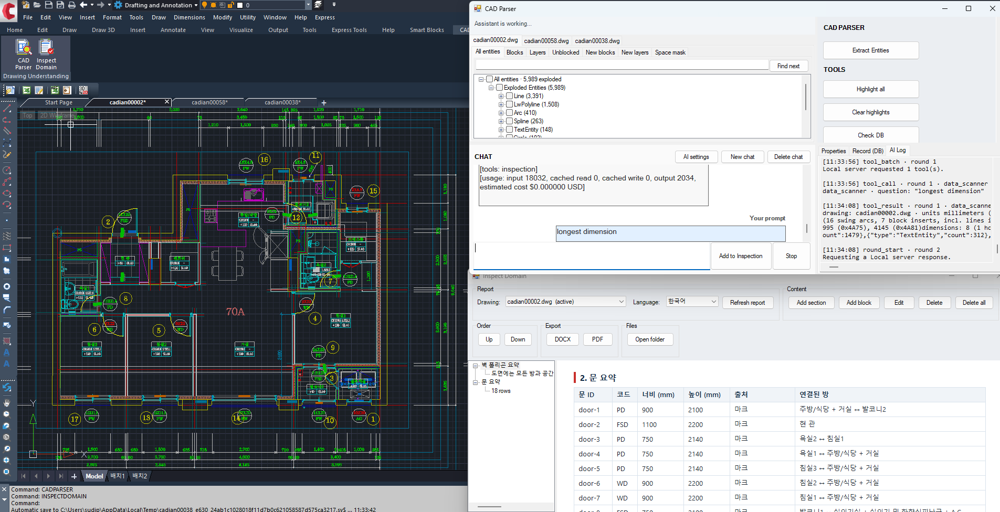
<figcaption>The system inside the CAD application: the drawing on the left, the entity browser, chat and AI log on the right, and the inspection report window below.</figcaption>
</figure>

---

## 1. Introduction

An architectural drawing contains a lot of information about the building, machinery, piping and HVAC systems, and many other designs.
Understanding such drawings needs a professional. For instance, making a report that lists wall thicknesses and classifies them (as load-bearing or non-load-bearing),
or finding the connections in a piping system, takes a lot of time and effort, and human error cannot be avoided. To minimize such factors we need a system that actually analyzes the
drawings and makes the reports. This project does that, and then puts an AI assistant on top of it, so
that a user can simply analyze and extract the necessary information from complex uploaded drawings.

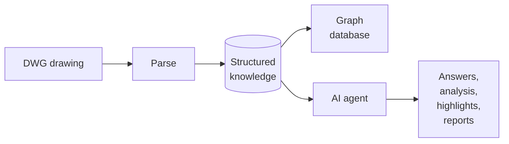

<!-- 

<h4>Three questions shaped every decision</h4>
<ol>
<li><strong>Does it work on a drawing it has never seen?</strong> A system tuned to one file is a demo, not a product.</li>
<li><strong>Can every answer be traced?</strong> An inspection result that cannot be shown on the drawing is an opinion.</li>
<li><strong>Can it be wrong safely?</strong> It works on a customer's drawing, so uncertainty must be a visible state, and nothing may change without a human decision.</li>
</ol>

 -->

---

Data Extraction

## 2. The problem: a DWG is not a Model or a Raster Image

A DWG file is vector data stored in a closed binary format, which is difficult to read with simple algorithms or systems.
Nothing in it says "this is a bedroom" or "here is a piping system". For instance, see the following images.

<figure>
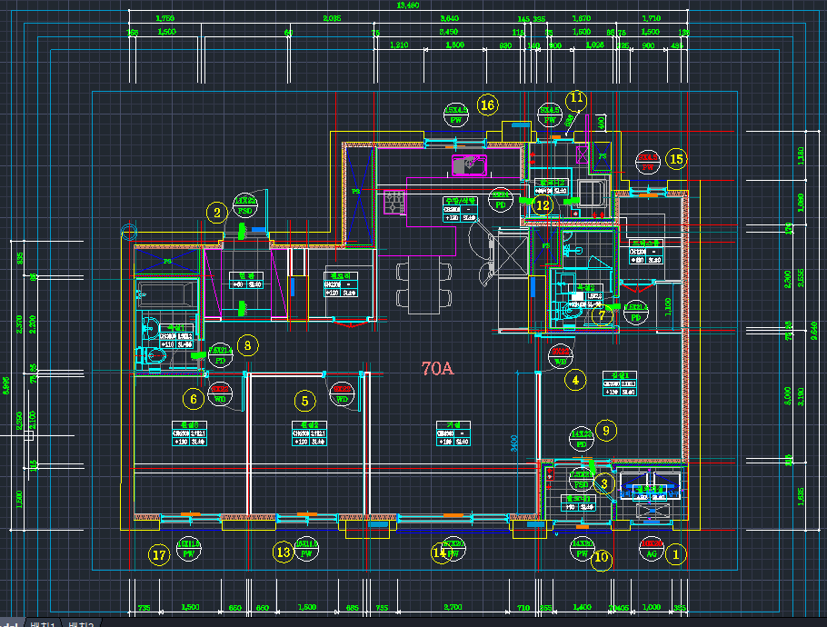
<figcaption>DWG sample: a unit floor plan as the CAD canvas draws it.</figcaption>
</figure>
<figure>
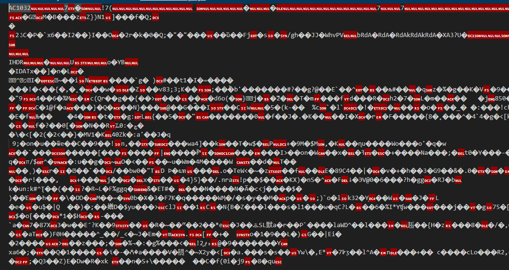
<figcaption>Vector data sample: the same file opened as text. The data is binary, so nothing in it can be read directly.</figcaption>
</figure>

<!-- ======================================================================= -->

<h3>2.1 What the file actually contains</h3>
<pre><code>A floor plan file
├── Primitives      lines, polylines, arcs, circles, hatches
├── Text            names, sizes, notes, titles, legends, revisions
├── Symbols         reusable blocks: a door, a toilet, an entire flat
│   ├── nested      a symbol inside a symbol inside a symbol
│   └── external    geometry that lives in a different file altogether
├── Layers          groupings chosen by whoever drew it
└── Marks           codes that refer to a door or a window
</code></pre>
<figure class="figure-xsmall">
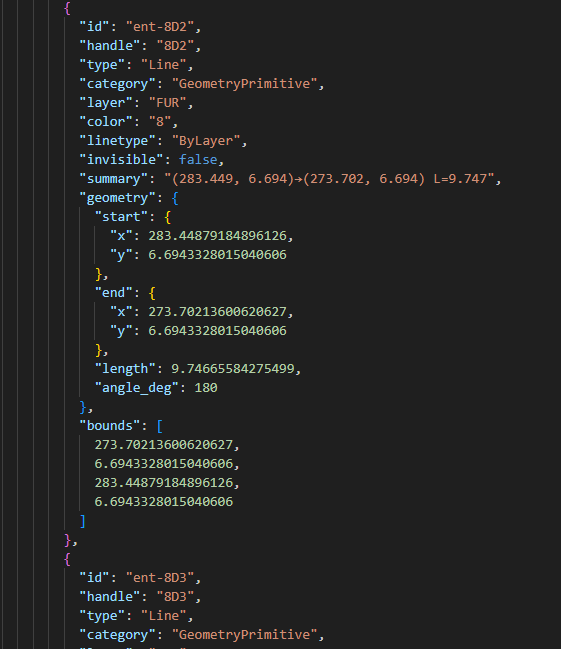
<figcaption>What one item in the file becomes once it is read: a single line with its layer, endpoints, length and bounds. Still no meaning attached.</figcaption>
</figure>

<h3>2.2 Why that is hard</h3>

<h4>Problems in the raw drawing</h4>
<ul>
<li><strong>No meaning.</strong> The file stores shapes and positions, not what anything is or what belongs to what.</li>
<li><strong>Everything overlaps.</strong> Furniture, hatching, dimensions and notes sit on top of the structure.</li>
<li><strong>Symbols hide their position.</strong> Real coordinates appear only after insertion, rotation, scale and mirroring are resolved. Exploding them destroys their identity.</li>
<li><strong>No standard.</strong> Every office draws and names things differently, often in more than one language.</li>
<li><strong>Repeated units.</strong> The same flat appears many times, mirrored or rotated, with the same names.</li>
<li><strong>Imperfect drawings.</strong> Lines miss by a millimetre, content sits on the wrong layer, labels sit outside what they name.</li>
</ul>

<h3>2.3 Why the obvious approaches fail</h3>

<table class="component-table">
<thead>
<tr>
<th>Approach</th>
<th>Why it is not enough</th>
</tr>
</thead>
<tbody>
<tr><td>Explode everything and analyse the shapes</td><td>Symbols lose their meaning, and the data multiplies</td></tr>
<tr><td>Send the file to a language model</td><td>Too large, and no exact geometry or counting</td></tr>
<tr><td>Image recognition on a rendered plan</td><td>Loses coordinates, units and identity</td></tr>
<tr><td>Manual templates per project</td><td>Does not scale; every customer draws differently</td></tr>
</tbody>
</table>

For instance, analyzing different floor plans gives a different number of entities. See the following table.

<table class="component-table">
<thead>
<tr>
<th>Drawing</th>
<th>Size</th>
<th>What it contains</th>
<th>Complexity</th>
</tr>
</thead>
<tbody>
<tr><td>Single unit plan (one flat)</td><td>about 6,000 entities</td><td>rooms, doors, fixtures, marks, dimensions</td><td>Low</td></tr>
<tr><td>Multi-unit floor plan</td><td>about 25,000 entities</td><td>about 80 rooms across repeated unit types, mirrored and rotated, plus cores, shafts and stairs</td><td>Medium</td></tr>
<tr><td>Block plan (several buildings on one sheet)</td><td>larger again</td><td>every unit of every building, repeated, with shared site elements</td><td>High</td></tr>
</tbody>
</table>

<!-- 
<table class="component-table">
<thead>
<tr>
<th>Approach</th>
<th>Why it is not enough</th>
</tr>
</thead>
<tbody>
<tr>
<td>Explode everything and analyse the shapes</td>
<td>Loses the meaning carried by symbols, and multiplies the data</td>
</tr>
<tr>
<td>Send the drawing to a language model</td>
<td>Far too large, and models cannot do exact geometry or counting</td>
</tr>
<tr>
<td>Image recognition on a rendered plan</td>
<td>Loses exact coordinates, units and identity; cannot be traced back</td>
</tr>
<tr>
<td>Manual templates per project</td>
<td>Does not scale, and every customer draws differently</td>
</tr>
</tbody>
</table>
 -->
<!-- 
The system uses none of these alone. It builds a structured understanding first, and
treats the language model as a reader of that structure rather than of the file.
 -->

<figure>
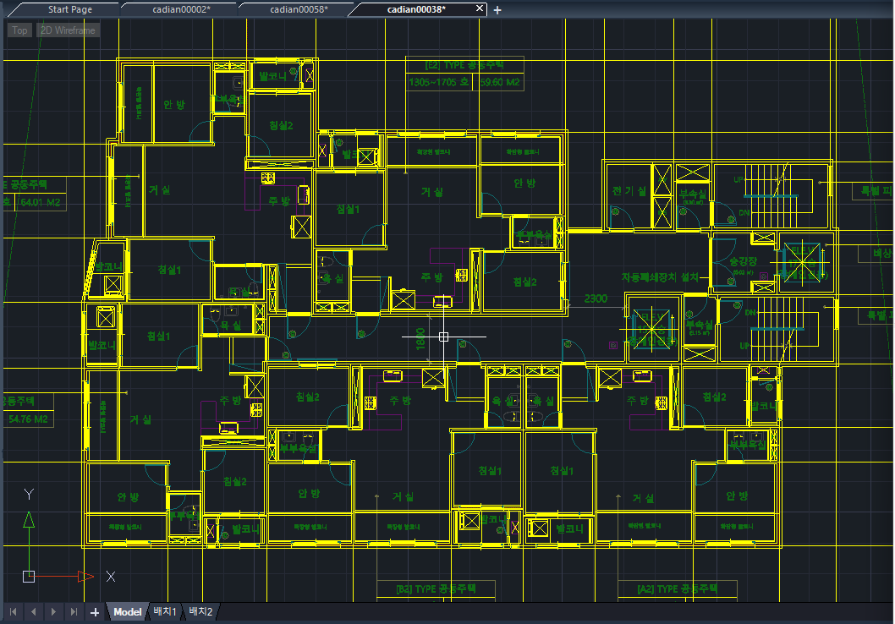
<figcaption>The drawing as the CAD canvas shows it: lines, text and symbols, with nothing saying what any of them is.</figcaption>
</figure>
<figure>

<figcaption>The same drawing as data: one line entity with its layer, endpoints, length and bounds. Thousands of these make a plan, and none of them says "wall".</figcaption>
</figure>

---

## 3. Parsing and storage

<!-- 

<h4>Problems this stage solves</h4>
<ul>
<li>Geometry inside nested and external symbols has no real-world coordinates until every insertion, rotation, scale and mirror is resolved.</li>
<li>Exploding symbols to get coordinates destroys their identity.</li>
<li>Drawings come in different units; later numbers must all mean the same thing.</li>
<li>Every later answer must be traceable to the exact entity in the drawing.</li>
</ul>

 -->

This stage does two things: it parses the drawing, and it stores the result in a database.
Every entity is read, symbols and external references are resolved to real-world coordinates, and each entity is saved with a stable identifier so it can be found again later.

<pre class="mermaid">flowchart LR
    A[DWG]:::input --> B[Read every entity: lines, polylines, arcs, circles, hatches, text]:::process
    B --> C[Resolve symbols and external references]:::process
    C --> D[Real world coordinates, in metres]:::process
    D --> E[(Stored per drawing)]:::store
</pre>
<pre><code>Parsing
├── Entities          lines, polylines, arcs, circles, hatches, text
├── Symbols           resolved to the leaf, including nested ones
├── External refs     pulled in and marked with their origin
├── Units             normalised, so every later number is in metres
└── Identity          a stable identifier per drawing and per entity
</code></pre>

An example of what is stored in the database:

<figure class="figure-short">
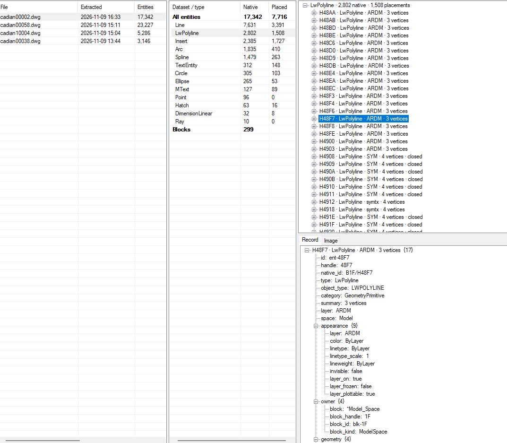
<figcaption>The database browser. Left: parsed drawings and their entity counts. Middle: how many entities of each type. Right: the polylines on one layer, and the full record of one of them with its id, layer, appearance, owner block and geometry.</figcaption>
</figure>

<!-- 
Two decisions mattered.

<strong>Nothing is exploded.</strong> Each piece of geometry keeps a path back to the symbol it
belongs to, so a symbol is still recognisable as itself while its geometry sits in
world coordinates.

<strong>Every fact keeps its origin.</strong> The drawing's own identifier for an entity is
carried through the whole pipeline. That is what later lets any number be pointed at
on screen, and lets a reviewer disagree with one line rather than the whole report.

Parsed drawings are stored, not re-read. A drawing is processed once and the result
is reused for every later question, by the assistant, by the inspection, and by the
graph database.
 -->

---

## 4. Semantic Relationships

Once the entities are parsed and stored, the next step is to find what they mean: which lines form a space, which form a wall,
and how spaces, walls, doors and marks relate to each other. The result is stored in a graph database.

<h3>4.1 Semantic Relation Search</h3>
<pre class="mermaid">flowchart LR
    A[Input DWG drawing]:::input --> B[Entity parsing and database]:::process
    B --> C[Semantic search: spaces, walls, openings]:::process
    C --> D[(Graph database)]:::store
    D --> E[Output answers, highlights, reports]:::output
</pre>
<h4>4.1.1 Finding polygons for spaces</h4>

Each space is found as a closed polygon on the plan and stored with its name, its area and the drawing entities behind it.

<h4>4.1.2 Finding walls and boundaries</h4>

Wall polygons are found with their thickness and length, and each space is linked to the walls that bound it.

<figure>
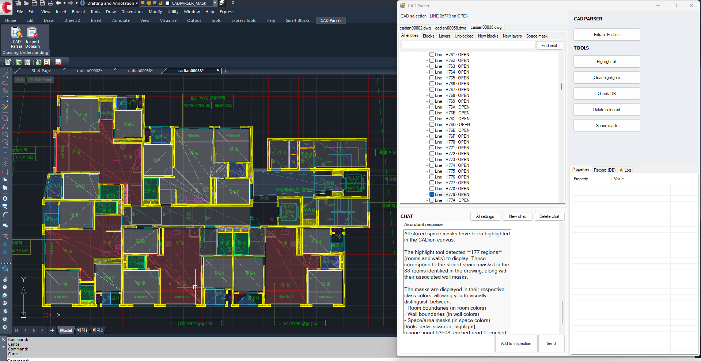
<figcaption>Spaces: the room and wall masks found in a drawing, drawn over the plan in their class colours.</figcaption>
</figure>
<figure>
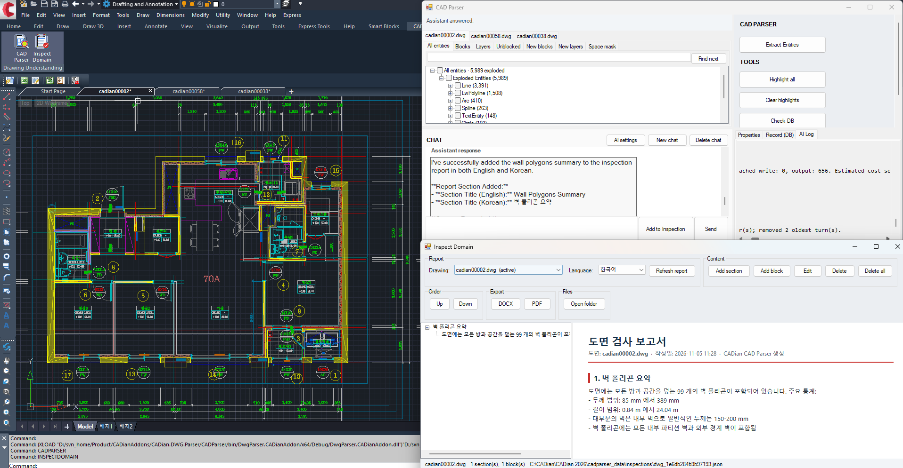
<figcaption>Walls: the wall polygons found in a drawing, summarised with their count, thickness range and length range.</figcaption>
</figure>

<h3>4.2 Relationship Search</h3>

The recovered items are connected in an ontology: Room, Wall, WallLine, Door, Window, Fixture and Mark, with relations such as
hasWall, hasDoor, hasWindow, adjacent, sharesWall and markedBy. Questions about the drawing are answered by walking these relations.

<figure class="figure-small">
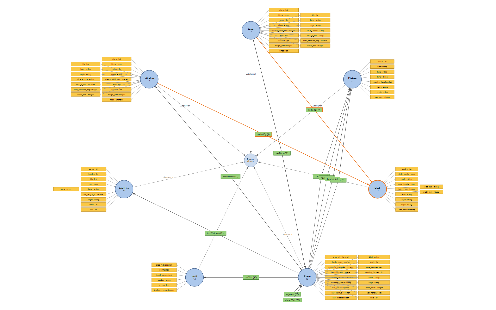
<figcaption>The ontology behind the graph database: each class with its properties, and the relations that connect them.</figcaption>
</figure>

---

Agentic System

## 5. Why an AI agent

Users ask open questions such as <em>Which bathrooms have no ventilation?</em>, <em>How many doors of this code are there, and where?</em>
or <em>Put that in the report, in both languages.</em>

The agent does not read the drawing. It reads the question, calls the tools below, and the tools read the structured knowledge.
The answer comes back with its evidence highlighted on the drawing.

<pre class="mermaid">flowchart LR
    U[Question]:::input --> M[Agent]:::agent
    M --> T[Tools over the structured knowledge]:::process
    T --> O[Evidence]:::store
    O --> M
    M --> A[Answer + highlight]:::output
</pre>

<h3>5.1 Why not simply give the model the file</h3>

<table class="component-table">
<thead>
<tr>
<th></th>
<th>Model reads the file</th>
<th>Model reads the structured knowledge</th>
</tr>
</thead>
<tbody>
<tr><td>Size</td><td>too large for the model</td><td>a small, relevant slice</td></tr>
<tr><td>Exactness</td><td>approximate</td><td>exact and repeatable</td></tr>
<tr><td>Traceability</td><td>none</td><td>every value points back to the drawing</td></tr>
</tbody>
</table>

Geometry and counting are done by code. The model is used for language and intent, which is what it is good at.

<h3>5.2 What the agent can reach</h3>

The agent works through a small set of named tools. The tree below shows each tool call and what it gives back.

<pre class="mermaid">%%{init: {"flowchart": {"nodeSpacing": 10, "rankSpacing": 70}}}%%
flowchart LR
    A[AI agent]:::agent --> T[Tool calls]:::process
    T --> Q[Query]:::group
    Q --> find[find items matching a description]:::tool
    Q --> count[count how many]:::tool
    Q --> measure[measure sizes and distances, with source]:::tool
    Q --> relate[relate how spaces, openings and walls connect]:::tool
    T --> S[Show]:::group
    S --> highlight[highlight the answer drawn on the canvas]:::tool
    T --> R[Report]:::group
    R --> inspection[inspection findings written into the report]:::tool
    T --> C[Change]:::group
    C --> draw[draw new geometry added to the drawing]:::tool
    C --> modify[modify a proposed change to existing items]:::tool
    C --> delete[delete removes the selected items]:::tool
    C --> create_block[create_block a new symbol from a selection]:::tool
    C -.-> AP[every change needs human approval]:::note
    T --> X[Raw data]:::group
    X --> data_scanner[data_scanner a sweep of all entities]:::tool
</pre>

What each tool accepts and returns is part of the product and is not described here.

---

## 6. The agent harness

The model is only a small part of the agent. The harness around it runs each question: it sets a budget, keeps the context small,
checks that every claim is backed by drawing evidence, records cost and timing, and keeps a proposed change separate from applying it.

<pre class="mermaid">flowchart LR
    Q[Question]:::input --> B[Budget and scope for this question]:::process
    B --> L[Agent loop tool call, result, reason]:::agent
    L --> G{Backed by drawing evidence?}:::decision
    G -- yes --> A[Answer + highlight]:::output
    G -- no --> U[Reported as unknown]:::note
    L --> T[(Trace: tool calls, timing, tokens, cost)]:::store
    M[Hosted or self-hosted model]:::tool -.-> L
</pre>
<ul>
<li><strong>Grounded.</strong> Every claim carries the drawing entities behind it. What cannot be grounded is reported as unknown.</li>
<li><strong>Deterministic.</strong> Numbers come from code, so the same question gives the same numbers on any model.</li>
<li><strong>Observable.</strong> Every tool call is traced with its timing and outcome, and the cost is shown per answer.</li>
<li><strong>Bilingual.</strong> Answers follow the language of the question, and report content is stored in Korean and English.</li>
</ul>

---

## 7. Interaction and safety

The system shows its work on the drawing and never changes the file on its own.

<ul>
<li><strong>Evidence is temporary.</strong> Answers are drawn on the CAD canvas as highlights and see-through masks that disappear when cleared. The drawing itself is not altered.</li>
<li><strong>Changes are proposals.</strong> A change is first shown on the drawing and applied only after a person clicks approve.</li>
<li><strong>Everything is journalled.</strong> Each applied change is recorded, and the outcome is fed back to the agent.</li>
</ul>
<pre class="mermaid">flowchart LR
    A[Change request]:::input --> P[Proposal shown on the drawing]:::process
    P --> D{Human decision}:::decision
    D -- Approve --> F[Applied and journalled]:::store
    D -- Reject --> N[Nothing happens]:::note
</pre>

---

## 8. Results

<h4>Measured on an unseen test plan</h4>
<ul>
<li>Roughly 25,000 entities read and resolved.</li>
<li>66 spaces recovered across six repeated unit types; the large majority cleanly, the rest reported as approximate rather than presented as exact.</li>
<li>Identical results in millimetres, in inches, and with the plan rotated.</li>
<li>The same question returns the same numbers across runs and models, in Korean and in English.</li>
</ul>

<figure>
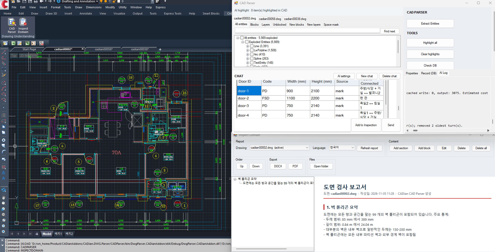
<figcaption>Door inspection: every door with its code, size and the rooms it connects, highlighted on the drawing.</figcaption>
</figure>
<figure>
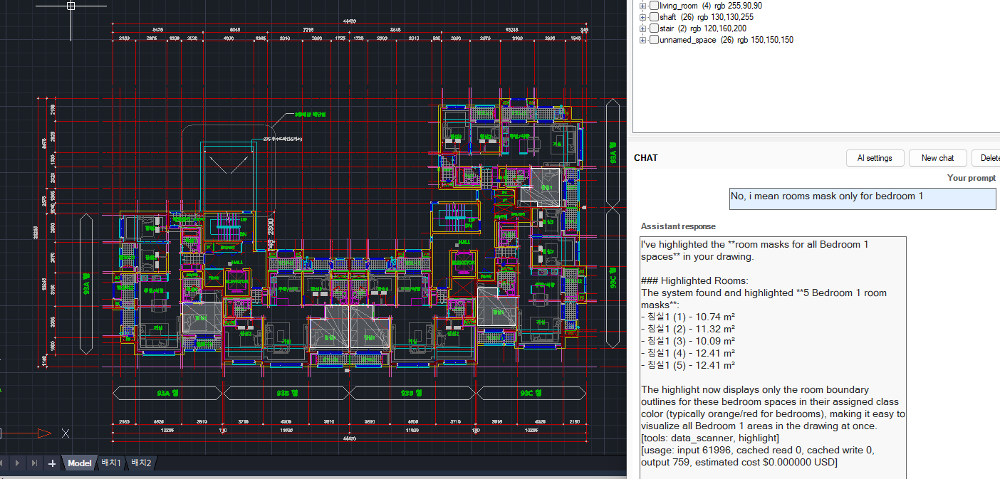
<figcaption>A follow-up question on another drawing: only the Bedroom 1 spaces are highlighted, with the area of each.</figcaption>
</figure>

<figure>

<figcaption>Wall inspection: a wall polygon summary added to the report, in Korean and English.</figcaption>
</figure>
<figure>
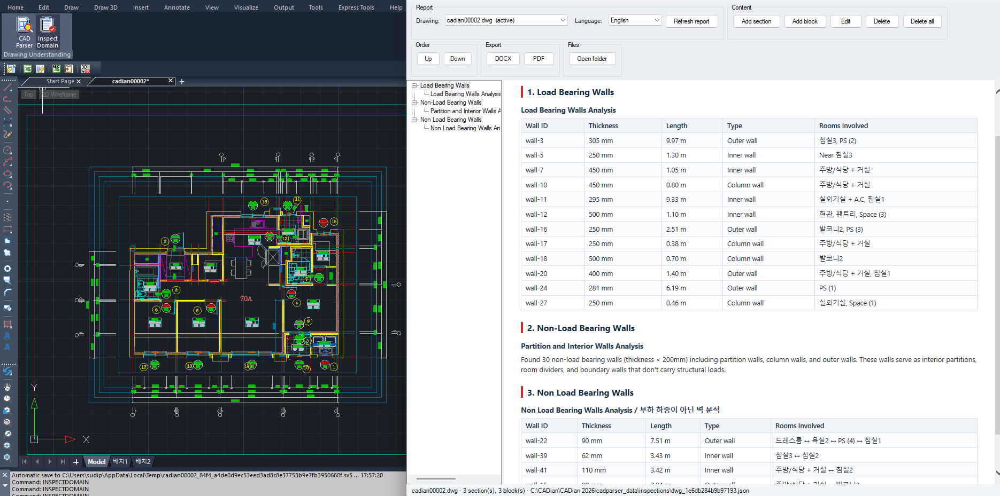
<figcaption>Wall classification: the report lists load-bearing and non-load-bearing walls with their thickness, length, type and the rooms involved, and highlights them on the drawing.</figcaption>
</figure>

---

## 9. Graph database foundation

Everything the system recovers is stored as a graph, one per drawing. Each node is a thing on the plan, such as a Room, Wall, Door, Window, Fixture or Mark,
with its properties and the drawing entity it came from. Each edge is a named relation such as hasWall, hasDoor, adjacent or markedBy.
Questions about how things connect are answered by walking this graph, and selecting a node highlights it on the CAD canvas.

<pre class="mermaid">graph LR
    M[Mark code]:::input -- describes --> D[Door]:::process
    D -- connects --> R1[Space A]:::store
    D -- connects --> R2[Space B]:::store
    R1 -- touches --> R2
    F[Fixture]:::agent -- belongs to --> R1
    W[Window]:::process -- opens from --> R1
</pre>

<figure>
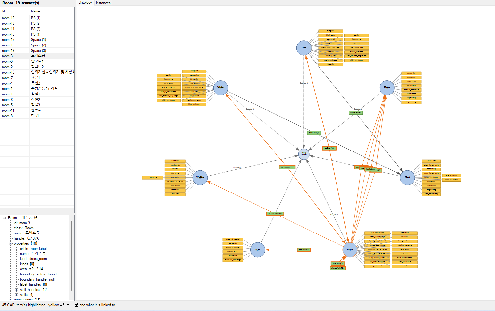
<figcaption>Ontology view for one drawing: the Room class has 19 instances. Selecting a room lists its properties and highlights it and its connections in CAD.</figcaption>
</figure>
<figure>
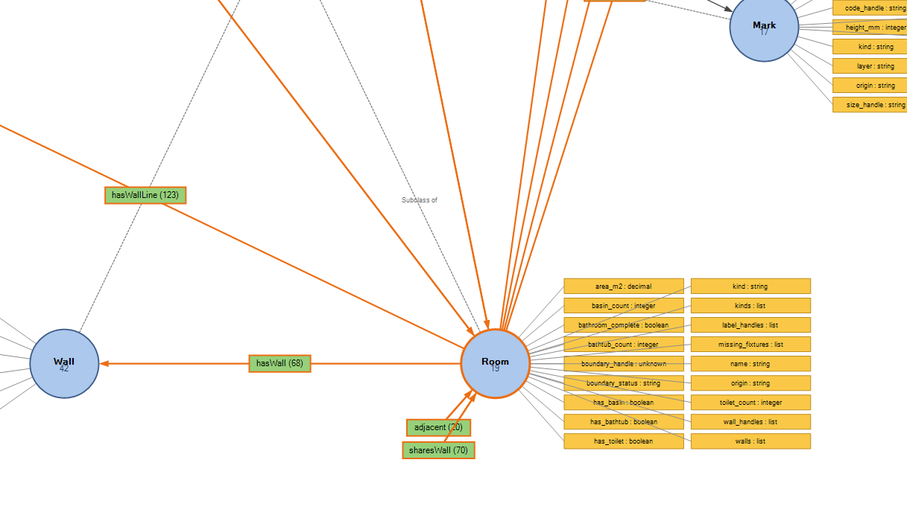
<figcaption>Relations around Room: hasWall, hasWallLine, adjacent and sharesWall, each with its count in this drawing.</figcaption>
</figure>

<figure class="figure-small">
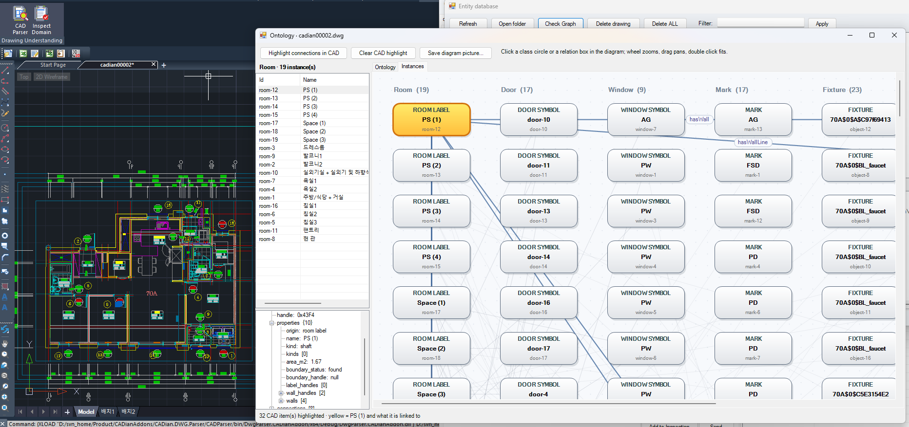
<figcaption>Instances view: every room, door, window, mark and fixture of the drawing as a node, with the relations drawn between them. The selected room is highlighted on the canvas.</figcaption>
</figure>

---

## 10. Summary

The system reads a DWG drawing, parses every entity into a database, recovers spaces, walls, openings and marks, and stores their relations in a graph.
An AI agent then answers questions, inspects the drawing and writes bilingual reports through a small set of tools, with every answer highlighted on the drawing as evidence.
Nothing in the drawing changes without human approval.
The project is in development and is tested on real residential drawings, from a single flat to a whole block.

