# Agentic CAD Parsing System - CAD Data Parsing

CAD 프로그램 안에서 실행되는 시스템이에요. DWG 도면을 읽고, 그 안의 Entity와 객체를 추출해 정리하고, 도면에 대한 질문에 답해요.
도면 전체를 검사하고, 사용자의 목적에 맞는 보고서를 만들어요.

<strong>주요 과정</strong>

입력건축 도면 (DWG)

출력구조화된 지식 · Graph · 보고서

인터페이스CAD 캔버스 안의 Chat Agent

언어한국어, 영어

안전모든 변경은 사람이 승인

플랫폼C# / .NET, CAD 프로그램 내부

<figure class="figure-small">
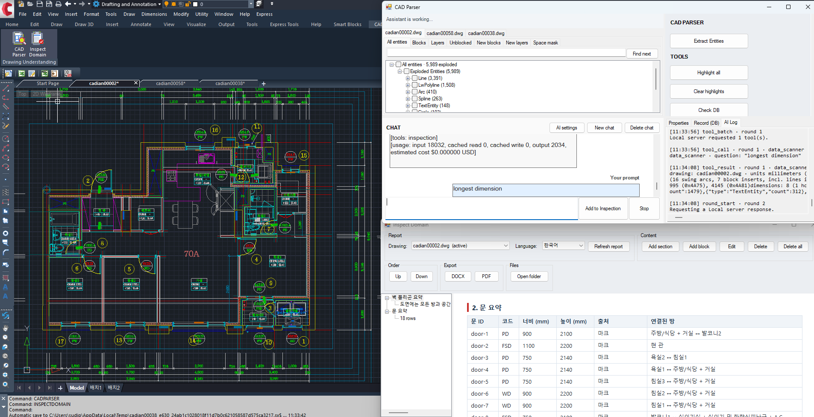
<figcaption>CAD 프로그램 안에서 실행되는 시스템: 왼쪽은 도면, 오른쪽은 Entity 브라우저·Chat·AI Log, 아래는 검사 보고서 창이에요.</figcaption>
</figure>

---

## 1. 소개

건축 도면에는 건물, 설비, 배관, HVAC 등 많은 정보가 담겨 있어요. 이런 도면을 이해하려면 전문가가 필요해요.
예를 들어 벽 두께를 정리하고 내력벽과 비내력벽으로 분류한 보고서를 만들거나, 배관의 연결을 찾는 일은 시간과 노력이 많이 들고, 사람의 실수도 피하기 어려워요.
그래서 도면을 직접 분석하고 보고서를 만들어 주는 시스템이 필요해요. 이 프로젝트가 그 일을 하고, 그 위에 AI Assistant를 올려서
사용자가 복잡한 도면에서 필요한 정보를 쉽게 뽑아낼 수 있게 해요.

<pre class="mermaid">flowchart LR
    A[DWG 도면]:::input --> B[Parsing]:::process
    B --> C[(구조화된 지식)]:::store
    C --> D[Graph Database]:::store
    C --> E[AI Agent]:::agent
    E --> F[답변, 분석, 하이라이트, 보고서]:::output
</pre>

데이터 추출

<h2 id="2-문제">2. 문제: DWG는 Model도 Raster Image도 아니다</h2>

DWG 파일은 닫힌 Binary 형식으로 저장된 Vector 데이터라서, 간단한 알고리즘으로는 읽기 어려워요.
파일 어디에도 "여기는 침실", "여기는 배관"이라고 적혀 있지 않아요. 아래 이미지를 보세요.

<figure>
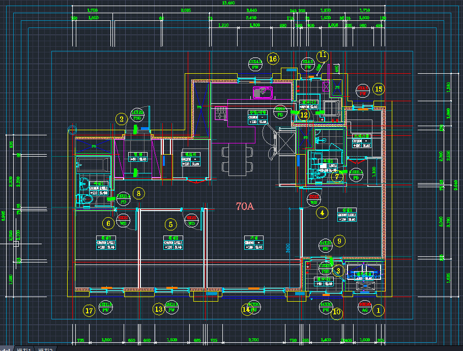
<figcaption>DWG 샘플: CAD 캔버스가 그려 주는 세대 평면도.</figcaption>
</figure>
<figure>
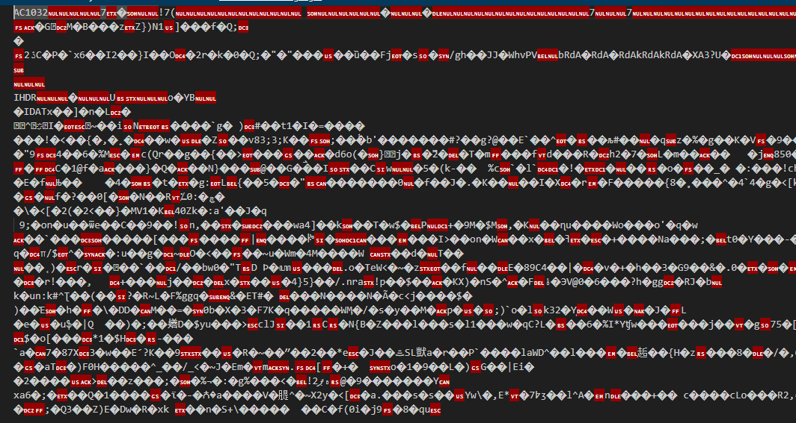
<figcaption>Vector 데이터 샘플: 같은 파일을 텍스트로 연 모습. Binary라서 바로 읽을 수 있는 것이 없어요.</figcaption>
</figure>

<h3>2.1 파일에 실제로 들어 있는 것</h3>
<pre><code>평면도 파일
├── Primitives     선, Polyline, 호, 원, Hatch
├── Text           이름, 치수, 메모, 제목, 범례
├── Symbols        재사용 Block: 문, 변기, 세대 하나
│   ├── nested     Symbol 안의 Symbol
│   └── external   다른 파일에 있는 도형
├── Layers         그린 사람이 정한 묶음
└── Marks          문이나 창을 가리키는 코드
</code></pre>
<figure class="figure-xsmall">
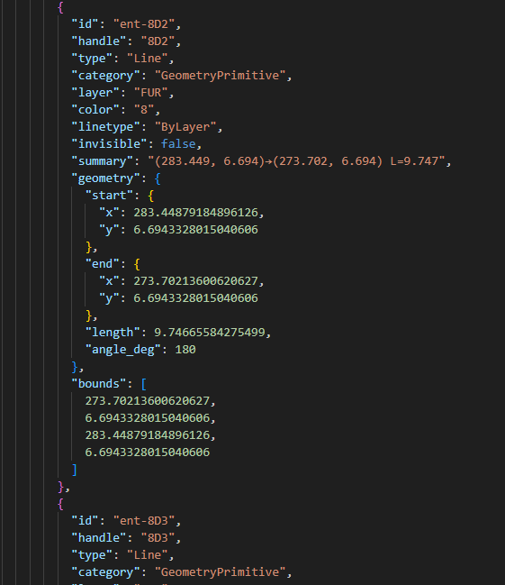
<figcaption>파일 안의 항목 하나를 읽으면 이렇게 돼요: Line 하나의 Layer, 양 끝점, 길이, Bounds. 아직 의미는 없어요.</figcaption>
</figure>

<h3>2.2 왜 어려운가</h3>

<h4>원본 도면의 문제</h4>
<ul>
<li><strong>의미가 없어요.</strong> 파일에는 모양과 위치만 있고, 무엇인지, 무엇에 속하는지는 없어요.</li>
<li><strong>모든 것이 겹쳐요.</strong> 가구, Hatch, 치수, 메모가 구조 위에 겹쳐 있어요.</li>
<li><strong>Symbol은 위치를 숨겨요.</strong> 삽입, 회전, 축척, 반전을 풀어야 실제 좌표가 나와요. Explode하면 정체를 잃어요.</li>
<li><strong>표준이 없어요.</strong> 회사마다 그리는 방식과 이름이 다르고, 언어도 섞여요.</li>
<li><strong>세대가 반복돼요.</strong> 같은 세대가 반전되거나 회전되어 여러 번, 같은 이름으로 나와요.</li>
<li><strong>도면이 완벽하지 않아요.</strong> 선이 1mm 어긋나고, 내용이 엉뚱한 Layer에 있고, 라벨이 대상 밖에 있어요.</li>
</ul>

<h3>2.3 뻔한 방법이 실패하는 이유</h3>

<table class="component-table">
<thead>
<tr>
<th>방법</th>
<th>부족한 이유</th>
</tr>
</thead>
<tbody>
<tr><td>전부 Explode해서 모양 분석</td><td>Symbol의 의미가 사라지고 데이터가 늘어나요</td></tr>
<tr><td>파일을 언어 모델에 바로 입력</td><td>너무 크고, 정확한 기하 계산과 개수 세기가 안 돼요</td></tr>
<tr><td>렌더링한 평면 이미지 인식</td><td>좌표, 단위, 정체를 잃어요</td></tr>
<tr><td>프로젝트마다 수동 템플릿</td><td>확장이 안 되고, 고객마다 그리는 방식이 달라요</td></tr>
</tbody>
</table>

예를 들어 평면도마다 Entity 수가 크게 달라요. 아래 표를 보세요.

<table class="component-table">
<thead>
<tr>
<th>도면</th>
<th>크기</th>
<th>포함 내용</th>
<th>복잡도</th>
</tr>
</thead>
<tbody>
<tr><td>단일 세대 평면 (세대 하나)</td><td>약 6,000 Entity</td><td>방, 문, 기구, Mark, 치수</td><td>낮음</td></tr>
<tr><td>여러 세대 층 평면</td><td>약 25,000 Entity</td><td>반복되는 세대 유형에 걸친 약 80개의 방, 반전과 회전 포함, 코어, Shaft, 계단</td><td>중간</td></tr>
<tr><td>블록 평면 (한 장에 여러 동)</td><td>더 큼</td><td>모든 동의 모든 세대가 반복되고, 공용 요소 포함</td><td>높음</td></tr>
</tbody>
</table>

<figure>
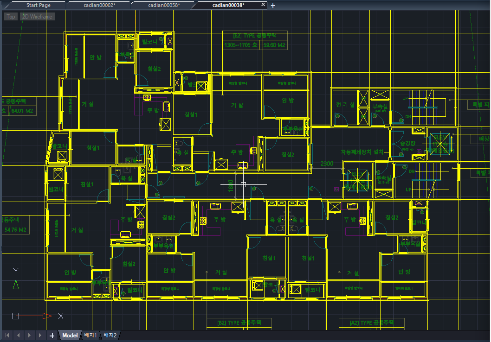
<figcaption>CAD 캔버스가 보여 주는 도면: 선, 텍스트, 기호뿐이고, 무엇인지 말해 주는 정보는 없어요.</figcaption>
</figure>
<figure>

<figcaption>같은 도면을 데이터로 본 모습: Line Entity 하나의 Layer, 양 끝점, 길이, Bounds. 이런 것이 수천 개 모여 평면이 되지만, 어느 것도 "벽"이라고 말하지 않아요.</figcaption>
</figure>

---

## 3. Parsing과 저장

이 단계는 두 가지를 해요. 도면을 Parsing하고, 결과를 Database에 저장해요.
모든 Entity를 읽고, Symbol과 외부 참조를 실제 좌표로 풀고, 각 Entity를 나중에 다시 찾을 수 있도록 고유 ID와 함께 저장해요.

<pre class="mermaid">flowchart LR
    A[DWG]:::input --> B[모든 Entity 읽기: 선, Polyline, 호, 원, Hatch, Text]:::process
    B --> C[Symbol과 외부 참조 풀기]:::process
    C --> D[실제 좌표, 미터 단위]:::process
    D --> E[(도면별 저장)]:::store
</pre>
<pre><code>Parsing
├── Entities        선, Polyline, 호, 원, Hatch, Text
├── Symbols         중첩된 것까지 끝까지 풀기
├── External refs   가져와서 출처 표시
├── Units           미터로 통일
└── Identity        도면별, Entity별 고유 ID
</code></pre>

Database에 저장된 예:

<figure class="figure-short">
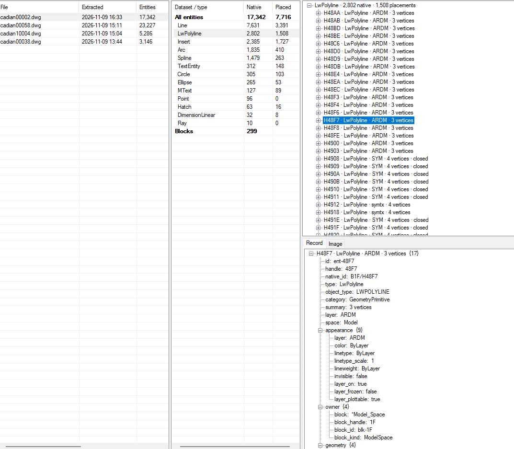
<figcaption>Database 브라우저. 왼쪽: Parsing한 도면과 Entity 수. 가운데: 종류별 Entity 수. 오른쪽: 한 Layer의 Polyline 목록과, 그중 하나의 전체 Record인 id, Layer, 외형, 소속 Block, Geometry.</figcaption>
</figure>

---

## 4. 의미 관계

Entity를 Parsing해 저장한 다음에는 의미를 찾아요. 어떤 선들이 공간을 이루고, 어떤 선들이 벽인지,
그리고 공간, 벽, 문, Mark가 서로 어떻게 연결되는지요. 결과는 Graph Database에 저장해요.

<h3>4.1 Semantic Relation Search</h3>
<pre class="mermaid">flowchart LR
    A[입력 DWG 도면]:::input --> B[Entity Parsing과 Database]:::process
    B --> C[Semantic Search: 공간, 벽, 개구부]:::process
    C --> D[(Graph Database)]:::store
    D --> E[출력 답변, 하이라이트, 보고서]:::output
</pre>
<h4>4.1.1 공간 Polygon 찾기</h4>

각 공간을 평면 위의 닫힌 Polygon으로 찾아, 이름, 면적, 근거가 되는 도면 Entity와 함께 저장해요.

<h4>4.1.2 벽과 경계 찾기</h4>

벽 Polygon을 두께와 길이와 함께 찾고, 각 공간을 그 공간을 둘러싼 벽과 연결해요.

<figure>
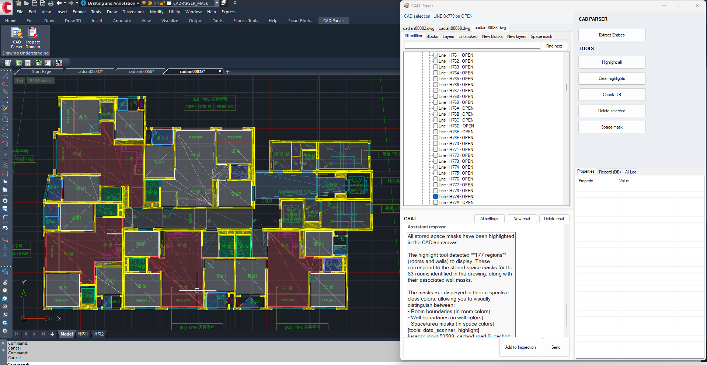
<figcaption>공간: 도면에서 찾은 Room과 Wall Mask를 클래스 색으로 평면 위에 그린 모습.</figcaption>
</figure>
<figure>
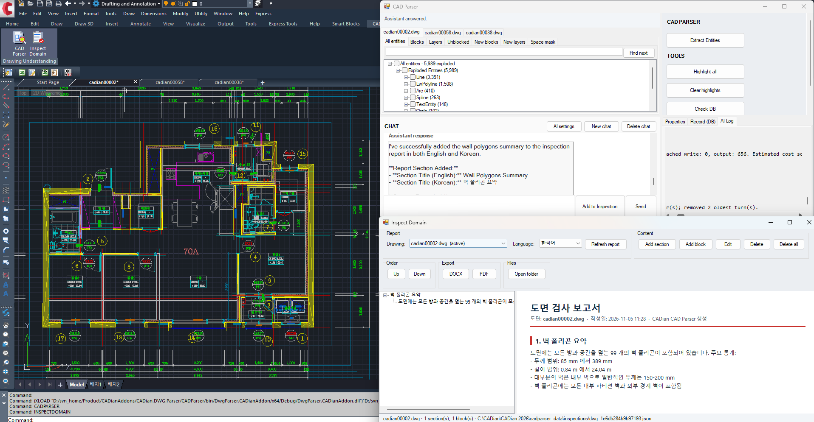
<figcaption>벽: 도면에서 찾은 Wall Polygon의 개수, 두께 범위, 길이 범위 요약.</figcaption>
</figure>

<h3>4.2 Relationship Search</h3>

찾아낸 항목을 Ontology로 연결해요. Room, Wall, WallLine, Door, Window, Fixture, Mark 클래스와
hasWall, hasDoor, hasWindow, adjacent, sharesWall, markedBy 같은 관계예요. 도면에 대한 질문은 이 관계를 따라가며 답해요.

<figure class="figure-small">
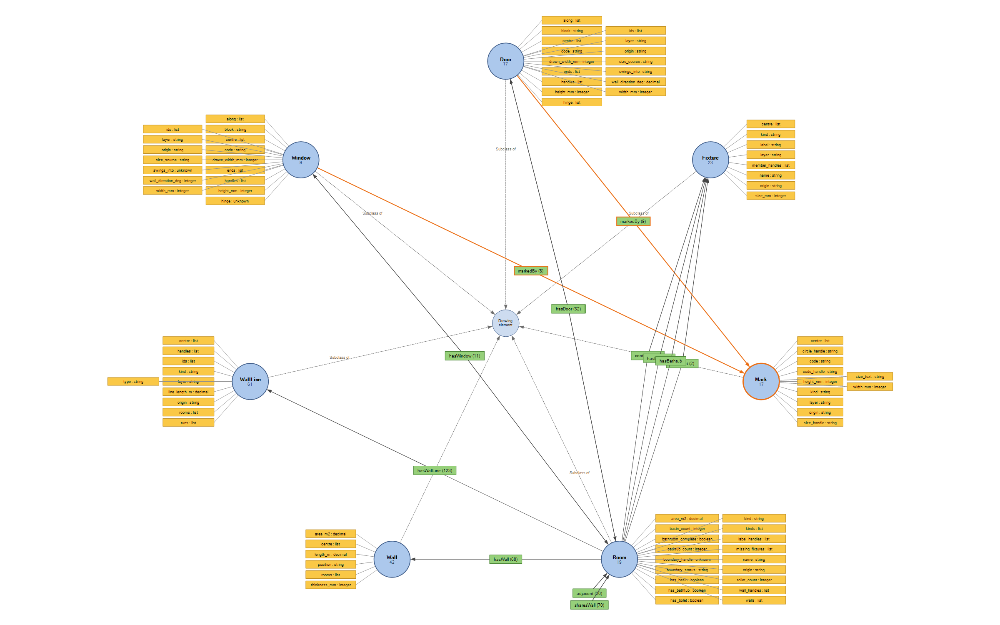
<figcaption>Graph Database 뒤에 있는 Ontology: 각 클래스의 속성과, 클래스를 잇는 관계.</figcaption>
</figure>

Agentic System

<h2 id="5-왜-ai-agent인가">5. 왜 AI Agent인가</h2>

사용자는 <em>환기가 없는 욕실은 어디야?</em>, <em>이 코드의 문은 몇 개이고 어디에 있어?</em>,
<em>그걸 두 언어로 보고서에 넣어 줘</em> 같은 열린 질문을 해요.

Agent는 도면을 직접 읽지 않아요. 질문을 읽고, 아래 Tool을 호출하고, Tool이 구조화된 지식을 읽어요.
답은 근거가 도면 위에 하이라이트된 채로 돌아와요.

<pre class="mermaid">flowchart LR
    U[질문]:::input --> M[Agent]:::agent
    M --> T[구조화된 지식 위의 Tool]:::process
    T --> O[근거]:::store
    O --> M
    M --> A[답변 + 하이라이트]:::output
</pre>

<h3>5.1 왜 모델에 파일을 그냥 주지 않는가</h3>

<table class="component-table">
<thead>
<tr>
<th></th>
<th>모델이 파일을 읽을 때</th>
<th>모델이 구조화된 지식을 읽을 때</th>
</tr>
</thead>
<tbody>
<tr><td>크기</td><td>모델에 너무 큼</td><td>작고 관련 있는 조각</td></tr>
<tr><td>정확성</td><td>근사치</td><td>정확하고 반복 가능</td></tr>
<tr><td>추적성</td><td>없음</td><td>모든 값이 도면을 가리킴</td></tr>
</tbody>
</table>

기하 계산과 개수 세기는 코드가 해요. 모델은 잘하는 일인 언어와 의도 파악에만 써요.

<h3>5.2 Agent가 쓸 수 있는 것</h3>

Agent는 이름이 정해진 작은 Tool 집합으로 일해요. 아래 트리는 각 Tool 호출과 그것이 돌려주는 결과예요.

<pre class="mermaid">%%{init: {"flowchart": {"nodeSpacing": 10, "rankSpacing": 70}}}%%
flowchart LR
    A[AI Agent]:::agent --> T[Tool 호출]:::process
    T --> Q[Query]:::group
    Q --> find[find 설명에 맞는 항목]:::tool
    Q --> count[count 개수]:::tool
    Q --> measure[measure 크기와 거리, 출처 포함]:::tool
    Q --> relate[relate 공간, 개구부, 벽의 연결]:::tool
    T --> S[Show]:::group
    S --> highlight[highlight 캔버스에 답 그리기]:::tool
    T --> R[Report]:::group
    R --> inspection[inspection 보고서에 판정 기록]:::tool
    T --> C[Change]:::group
    C --> draw[draw 새 도형 추가]:::tool
    C --> modify[modify 기존 항목 변경 제안]:::tool
    C --> delete[delete 선택 항목 삭제]:::tool
    C --> create_block[create_block 선택 영역으로 새 Symbol]:::tool
    C -.-> AP[모든 변경은 사람의 승인 필요]:::note
    T --> X[Raw data]:::group
    X --> data_scanner[data_scanner 모든 Entity 훑기]:::tool
</pre>

각 Tool의 입력과 출력은 제품의 일부라서 여기서는 설명하지 않아요.

---

## 6. Agent Harness

모델은 Agent의 작은 부분이에요. 주변의 Harness가 질문마다 예산을 정하고, Context를 작게 유지하고,
모든 주장이 도면 근거로 뒷받침되는지 확인하고, 비용과 시간을 기록하고, 변경 제안과 적용을 분리해요.

<pre class="mermaid">flowchart LR
    Q[질문]:::input --> B[질문별 예산과 범위]:::process
    B --> L[Agent Loop Tool 호출, 결과, 추론]:::agent
    L --> G{도면 근거가 있는가?}:::decision
    G -- 예 --> A[답변 + 하이라이트]:::output
    G -- 아니오 --> U[알 수 없음으로 보고]:::note
    L --> T[(Trace: Tool 호출, 시간, Token, 비용)]:::store
    M[Hosted 또는 Self-hosted 모델]:::tool -.-> L
</pre>
<ul>
<li><strong>근거 기반.</strong> 모든 주장에 근거가 되는 도면 Entity가 붙어요. 근거가 없으면 알 수 없음으로 보고해요.</li>
<li><strong>결정적.</strong> 숫자는 코드가 계산하므로, 어떤 모델이든 같은 질문에 같은 숫자가 나와요.</li>
<li><strong>관측 가능.</strong> 모든 Tool 호출의 시간과 결과를 기록하고, 답마다 비용을 보여 줘요.</li>
<li><strong>이중 언어.</strong> 질문한 언어로 답하고, 보고서 내용은 한국어와 영어로 함께 저장해요.</li>
</ul>

---

## 7. 상호작용과 안전

시스템은 작업 과정을 도면 위에 보여 주고, 파일을 스스로 바꾸지 않아요.

<ul>
<li><strong>근거는 임시예요.</strong> 답은 CAD 캔버스 위에 하이라이트와 반투명 Mask로 그려지고, 지우면 사라져요. 도면 자체는 바뀌지 않아요.</li>
<li><strong>변경은 제안이에요.</strong> 변경은 먼저 도면 위에 표시되고, 사람이 승인 버튼을 눌러야 적용돼요.</li>
<li><strong>모두 기록돼요.</strong> 적용된 변경은 기록되고, 결과는 Agent에게 다시 전달돼요.</li>
</ul>
<pre class="mermaid">flowchart LR
    A[변경 요청]:::input --> P[도면 위에 제안 표시]:::process
    P --> D{사람의 결정}:::decision
    D -- 승인 --> F[적용 및 기록]:::store
    D -- 거부 --> N[아무 일도 없음]:::note
</pre>

---

## 8. 결과

<h4>처음 보는 테스트 평면에서 측정</h4>
<ul>
<li>약 25,000개의 Entity를 읽고 풀었어요.</li>
<li>반복되는 6개 세대 유형에서 66개 공간을 복원했어요. 대부분은 깨끗하게, 나머지는 정확한 값이 아니라 근사치로 보고했어요.</li>
<li>mm, inch, 회전된 평면에서 모두 같은 결과가 나왔어요.</li>
<li>같은 질문은 실행과 모델이 달라도, 한국어든 영어든 같은 숫자를 돌려줘요.</li>
</ul>

<figure>
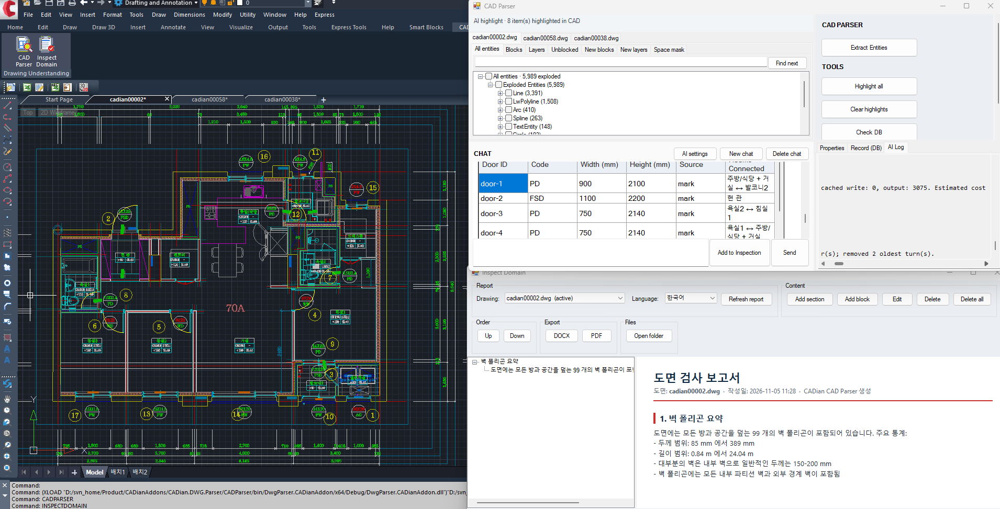
<figcaption>문 검사: 모든 문의 코드, 크기, 연결된 방을 정리하고 도면에 하이라이트해요.</figcaption>
</figure>
<figure>
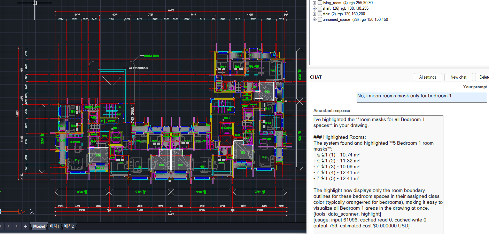
<figcaption>다른 도면에서의 후속 질문: 침실1 공간만 하이라이트하고 각 면적을 보여 줘요.</figcaption>
</figure>

<figure>

<figcaption>벽 검사: Wall Polygon 요약을 한국어와 영어로 보고서에 추가해요.</figcaption>
</figure>
<figure>
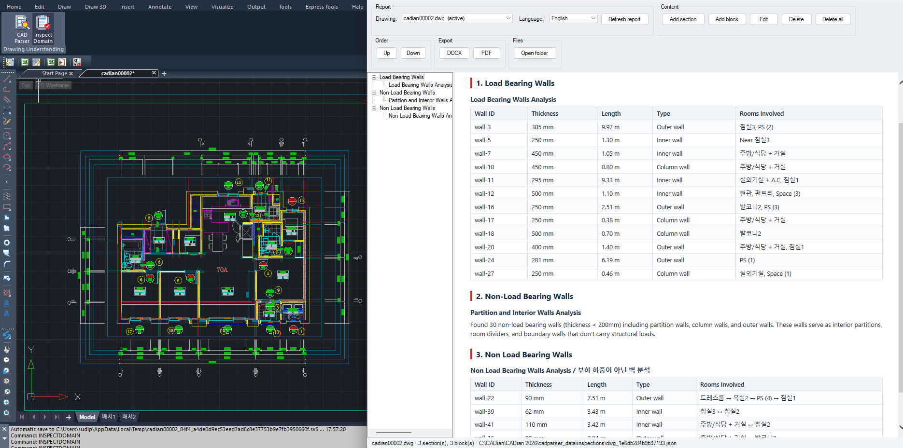
<figcaption>벽 분류: 보고서가 내력벽과 비내력벽을 두께, 길이, 종류, 관련 방과 함께 정리하고, 해당 벽을 도면에 하이라이트해요.</figcaption>
</figure>

---

## 9. Graph Database 기반

시스템이 찾아낸 모든 것은 도면마다 하나의 Graph로 저장돼요. 각 Node는 Room, Wall, Door, Window, Fixture, Mark 같은 평면 위의 사물이고,
속성과 출처가 되는 도면 Entity를 가져요. 각 Edge는 hasWall, hasDoor, adjacent, markedBy 같은 이름 있는 관계예요.
연결에 대한 질문은 이 Graph를 따라가며 답하고, Node를 선택하면 CAD 캔버스에 하이라이트돼요.

<pre class="mermaid">graph LR
    M[Mark 코드]:::input -- 설명 --> D[Door]:::process
    D -- 연결 --> R1[공간 A]:::store
    D -- 연결 --> R2[공간 B]:::store
    R1 -- 접함 --> R2
    F[Fixture]:::agent -- 소속 --> R1
    W[Window]:::process -- 열림 --> R1
</pre>

<figure>
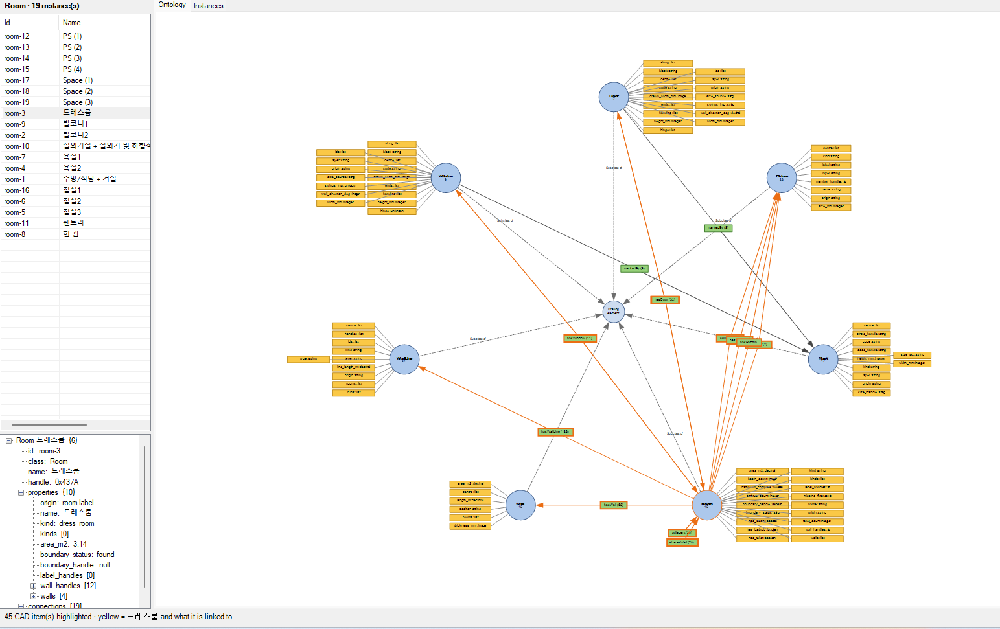
<figcaption>한 도면의 Ontology 뷰: Room 클래스에 19개 Instance가 있어요. 방을 선택하면 속성이 나오고, 그 방과 연결된 것이 CAD에 하이라이트돼요.</figcaption>
</figure>
<figure>
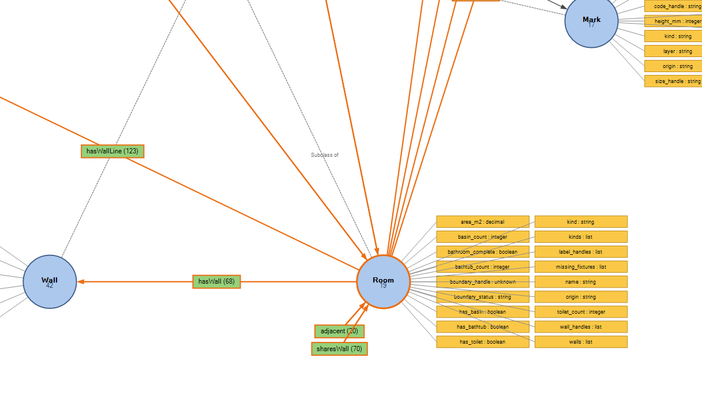
<figcaption>Room 주변의 관계: hasWall, hasWallLine, adjacent, sharesWall과 이 도면에서의 개수.</figcaption>
</figure>

<figure class="figure-small">
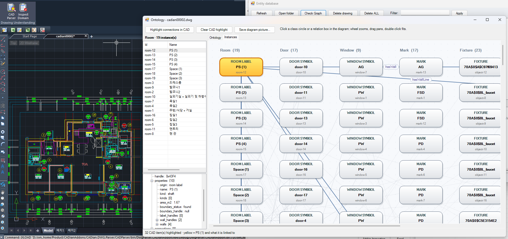
<figcaption>Instances 뷰: 도면의 모든 방, 문, 창, Mark, Fixture를 Node로 보여 주고, 그 사이의 관계를 그려요. 선택한 방은 캔버스에 하이라이트돼요.</figcaption>
</figure>

---

## 10. 요약

이 시스템은 DWG 도면을 읽어 모든 Entity를 Database에 Parsing하고, 공간, 벽, 개구부, Mark를 복원해 그 관계를 Graph에 저장해요.
그 위에서 AI Agent가 작은 Tool 집합으로 질문에 답하고, 도면을 검사하고, 이중 언어 보고서를 쓰며, 모든 답은 도면 위에 근거로 하이라이트돼요.
사람의 승인 없이는 도면의 어떤 것도 바뀌지 않아요.
이 프로젝트는 개발 중이며, 세대 하나부터 블록 전체까지 실제 주거 도면으로 테스트하고 있어요.

