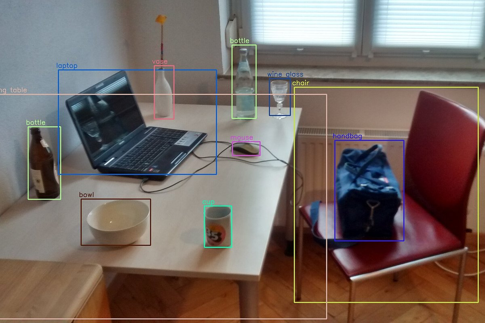

# Computer Vision / ML - Detection, Segmentation and Classification

Computer-vision and machine-learning projects for real image and video tasks: finding objects, outlining regions, naming what is in a picture, and reasoning about what the camera sees. Each project is a trained model with its data pipeline, evaluation and inference code.

<strong>Keywords</strong>

TasksDetection · segmentation · classification

DataImages and video

FrameworksPyTorch · OpenCV

OutputTrained models + inference scripts

<figure class="figure-small">

<figcaption>Object detection: every object on the desk found and named by a detector. Photo: (MTheiler), CC BY-SA 4.0, via Wikimedia Commons.</figcaption>
</figure>

---

## 1. Introduction

Most of my applied work starts with a camera or a scanned image and a question about it: what is here, where is it, and what kind is it. This collection holds the models that answer those questions on real data: detectors that draw boxes, segmenters that outline regions pixel by pixel, classifiers that name the picture, and the training, evaluation and inference code around each of them.

---

## 2. Goal

<h4>Goal</h4>
<ul>
<li>Train detection, segmentation and classification models on real, imperfect image data and measure them on held-out sets.</li>
<li>Keep the full pipeline for each model: data preparation, training, evaluation and inference, so a result can be reproduced.</li>
<li>Package inference so a model can be called from a service or another program, not only from a notebook.</li>
</ul>

---

## 3. Code and details on GitHub

The main project and its technical details are uploaded to GitHub, so please refer to the repository to understand the work in detail.

<a href="https://github.com/Laudarisd/Machine-Learning-Projects" target="_blank" rel="noopener noreferrer">GitHub: https://github.com/Laudarisd/Machine-Learning-Projects</a>

