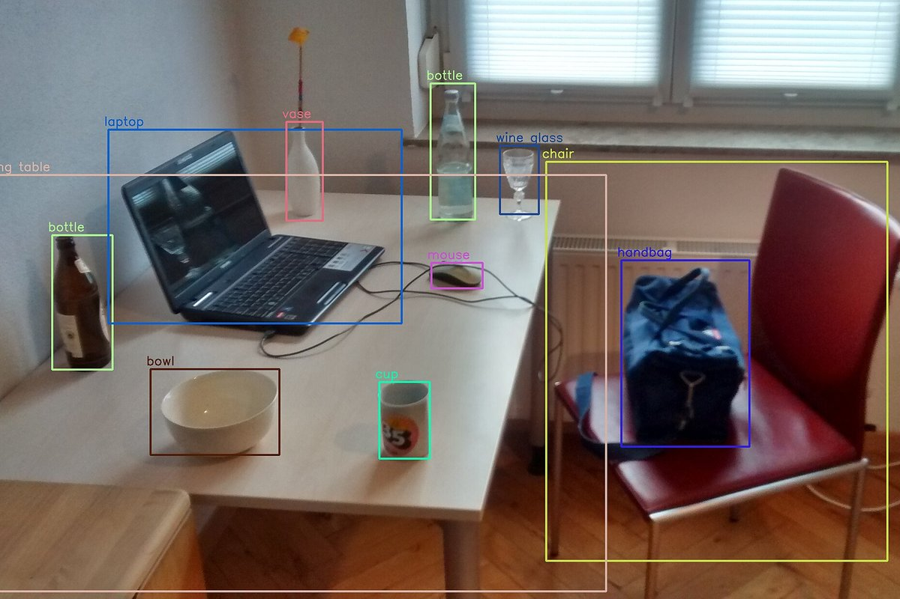

# Computer Vision / ML - Detection, Segmentation, Classification

실제 이미지와 영상 작업을 위한 Computer Vision과 Machine Learning 프로젝트예요. 객체를 찾고, 영역을 그리고, 사진에 무엇이 있는지 이름을 붙이고, 카메라가 보는 것을 추론해요. 프로젝트마다 학습된 모델과 데이터 파이프라인, 평가, 추론 코드가 있어요.

<strong>키워드</strong>

과제Detection · Segmentation · Classification

데이터이미지와 영상

FrameworkPyTorch · OpenCV

출력학습된 모델 + 추론 스크립트

<figure class="figure-small">

<figcaption>Object Detection: 책상 위의 모든 객체를 Detector가 찾아서 이름을 붙인 모습이에요. 사진: (MTheiler), CC BY-SA 4.0, Wikimedia Commons.</figcaption>
</figure>

---

## 1. 소개

제가 한 응용 작업 대부분은 카메라나 스캔 이미지에서, 그리고 그에 대한 질문에서 시작해요. 여기 무엇이 있는지, 어디에 있는지, 어떤 종류인지요. 이 모음에는 그 질문에 실제 데이터로 답하는 모델들이 있어요. 박스를 그리는 Detector, 픽셀 단위로 영역을 그리는 Segmenter, 사진에 이름을 붙이는 Classifier, 그리고 각각의 학습·평가·추론 코드예요.

---

## 2. 목표

<h4>목표</h4>
<ul>
<li>실제의, 완벽하지 않은 이미지 데이터로 Detection, Segmentation, Classification 모델을 학습하고 따로 둔 데이터로 측정해요.</li>
<li>모델마다 데이터 준비, 학습, 평가, 추론까지 전체 파이프라인을 남겨서 결과를 다시 만들 수 있게 해요.</li>
<li>노트북에서만이 아니라 서비스나 다른 프로그램에서 모델을 부를 수 있게 추론을 패키징해요.</li>
</ul>

---

## 3. 코드와 자세한 내용은 GitHub에

메인 프로젝트와 기술적인 세부 내용은 GitHub에 올려 두었어요. 작업을 자세히 이해하시려면 저장소를 참고해 주세요.

<a href="https://github.com/Laudarisd/Machine-Learning-Projects" target="_blank" rel="noopener noreferrer">GitHub: https://github.com/Laudarisd/Machine-Learning-Projects</a>

