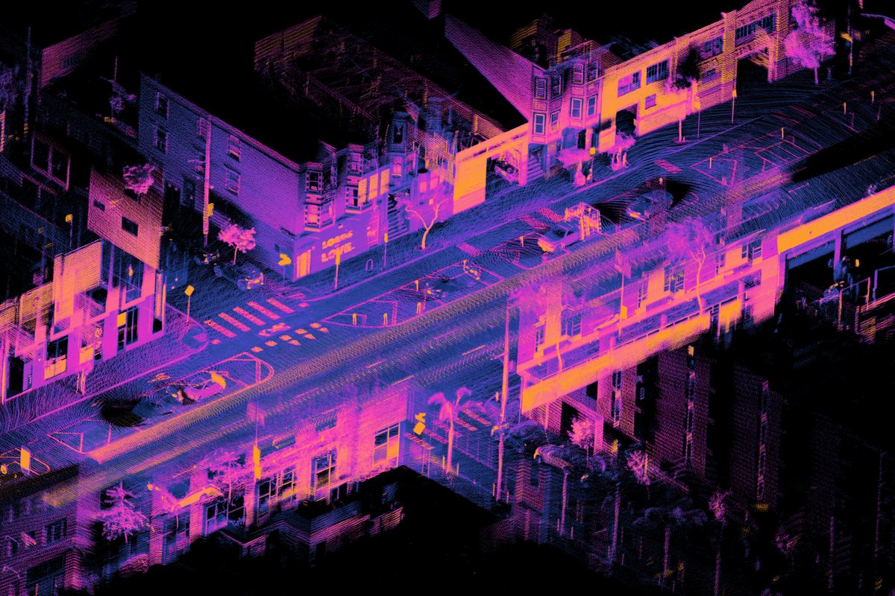

# Digital Twin - Floorplan 재구성과 Spatial Intelligence

실제 공간의 디지털 모델을 만들고, 그 안의 실제 자산과 연결된 채로 유지해요. 스캔과 이미지에서 평면도를 재구성하고, 그 안에 객체를 놓고, 결과에 대한 공간 질문에 답해요.

<strong>키워드</strong>

분야Digital Twin · Spatial AI

입력스캔 · Point Cloud · 평면도 이미지

출력자산이 연결된 재구성 평면도

언어Python

<figure class="figure-small">

<figcaption>LiDAR Point Cloud예요. 수백만 개의 측정점을 Digital Twin이 다시 벽, 바닥, 객체로 바꿔요. 사진: Daniel L. Lu, CC BY 4.0, Wikimedia Commons.</figcaption>
</figure>

---

## 1. 소개

Digital Twin은 실제 건물과 맞을 때만 쓸모가 있어요. 그 시작은 기하예요. 스캔, Point Cloud, 평면도 이미지에서 벽, 방, 개구부를 깨끗하고 잴 수 있는 도형으로 되살리는 일이요. 그 기하 위에 자산이 올라가요. 하나하나 실제 대상과 묶여 있어서, 사람이 건물을 걸어 다니며 확인해야 할 것을 모델이 답해요. 이 방에 뭐가 있는지, 저 문에서 얼마나 떨어져 있는지, 지난달 이후 뭐가 바뀌었는지요.

---

## 2. 목표

<h4>목표</h4>
<ul>
<li>스캔, Point Cloud, 래스터 평면도 이미지에서 평면도를 깨끗한 기하로 재구성해요.</li>
<li>실제 자산을 모델 안의 위치와 연결해서 Twin이 실제 공간과 같이 움직이게 해요.</li>
<li>거리, 인접, 방 안의 물건 같은 공간 질문에 손이 아니라 코드로 답해요.</li>
</ul>

---

## 3. 코드와 자세한 내용은 GitHub에

메인 프로젝트와 기술적인 세부 내용은 GitHub에 올려 두었어요. 작업을 자세히 이해하시려면 저장소를 참고해 주세요.

<a href="https://github.com/Laudarisd/digital-twin-and-spatial-ai" target="_blank" rel="noopener noreferrer">GitHub: https://github.com/Laudarisd/digital-twin-and-spatial-ai</a>

