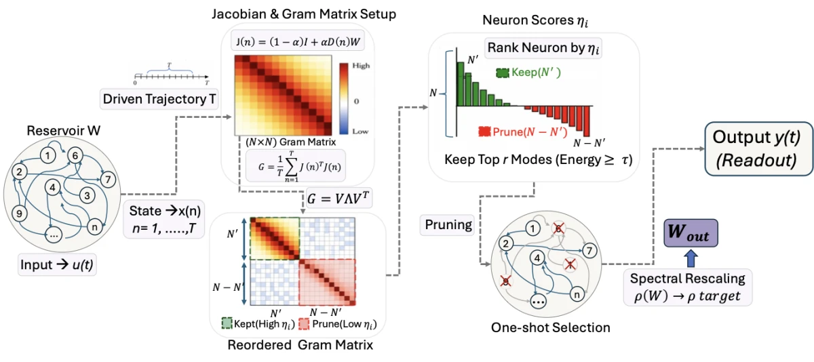

# Rethinking Reservoir Pruning: A Dynamical Perspective for Echo State Networks

A research paper on making echo state networks smaller without breaking them. Instead of ranking reservoir neurons by weight size or by graph statistics, the method looks at the dynamics the reservoir actually produces on its input, scores every neuron by how much of that dynamics passes through it, and removes the rest in one shot.

<strong>Keywords</strong>

DomainReservoir computing · echo state networks

IdeaPrune by the reservoir's dynamics, not by weights

ScoringJacobian Gram matrix along the driven trajectory

SelectionOne shot: keep the top N′ neurons, rescale, retrain the readout

OutputPaper and code

<figure class="figure-small">

<figcaption>The method. The reservoir is driven along a trajectory, a Gram matrix of its Jacobians scores every neuron, the top-scoring neurons are kept in one shot, the pruned reservoir is spectrally rescaled, and only the readout is retrained.</figcaption>
</figure>

---

## 1. Introduction

An echo state network is a large reservoir of fixed, randomly connected neurons with a single trained readout. The reservoir is usually far bigger than the task needs, and most of its neurons contribute little, but existing pruning rules decide which ones to drop from static properties such as weight magnitude or connectivity. Those properties say nothing about what the reservoir does once an input drives it. This paper takes the dynamical view: drive the reservoir along a trajectory, form the Jacobian at each step, and build a Gram matrix over the trajectory. Its leading modes are the directions in which the reservoir's state actually moves. Each neuron gets a score from how much it participates in those modes, the top N′ neurons are kept in a single pass, the pruned reservoir's spectral radius is rescaled back to its target, and only the readout is retrained.

---

## 2. Goal

<h4>Goal</h4>
<ul>
<li>Score reservoir neurons by their role in the reservoir's dynamics on real inputs rather than by weight size or graph statistics.</li>
<li>Prune in one shot, with no iterative retraining of the reservoir, and keep the echo state property through spectral rescaling.</li>
<li>Show how far a reservoir can be shrunk before readout accuracy drops, against the usual magnitude-based baselines.</li>
</ul>

---

## 3. Code and details on GitHub

The main project and its technical details are uploaded to GitHub, so please refer to the repository to understand the work in detail.

<a href="https://github.com/Laudarisd/dmp_esn" target="_blank" rel="noopener noreferrer">GitHub: https://github.com/Laudarisd/dmp_esn</a>

