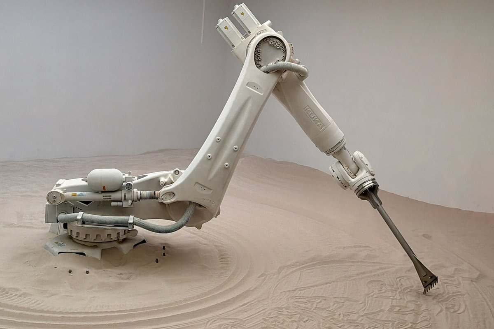

# DMP - Reservoir Computing과 Dynamical Movement Primitives

로봇에게 동작을 가르치는 연구예요. 시연한 동작을 안정된 동역학계로 저장하는 Dynamical Movement Primitives(DMP)를 Echo State Network로 구동하고, 기여하지 않는 네트워크 부분을 잘라내는 Pruning 방법을 다뤄요.

<strong>키워드</strong>

분야로봇 동작 학습

방법DMP + Echo State Network

연구Centrality 기반 Network Pruning

출력논문과 코드

<figure class="figure-small">

<figcaption>동작을 재현하는 산업용 로봇 팔이에요. DMP가 저장했다가 새 목표와 속도로 다시 재생하는 종류의 동작이에요. 사진: Oleg Yunakov, CC BY-SA 4.0, Wikimedia Commons.</figcaption>
</figure>

---

## 1. 소개

DMP는 시연한 동작 하나를 항상 목표로 수렴하는 미분방정식으로 바꿔요. 그래서 같은 동작을 새 목표로, 새 속도로, 망가지지 않게 다시 재생할 수 있어요. 그 방정식의 형태 항은 학습해야 하는데, 이 연구에서는 Echo State Network가 그 학습을 해요. 고정된 무작위 뉴런의 Reservoir에 학습된 Readout 하나가 있는 구조예요. Reservoir는 크고 뉴런 대부분이 중복이라서, 연구의 두 번째 부분은 Centrality로 뉴런을 잘라내고 동작이 나빠지기 전까지 얼마나 뺄 수 있는지 재요.

---

## 2. 목표

<h4>목표</h4>
<ul>
<li>시연한 로봇 동작을 DMP로 배우고, 새 목표와 시간으로 안정적으로 재현해요.</li>
<li>DMP의 함수 근사기로 Echo State Network를 쓰고, 그 크기가 정확도에 어떻게 영향을 주는지 봐요.</li>
<li>노드 Centrality로 Reservoir를 Pruning 하고, 네트워크 크기와 동작 오차 사이의 트레이드오프를 숫자로 재요.</li>
</ul>

---

## 3. 코드와 자세한 내용은 GitHub에

메인 프로젝트와 기술적인 세부 내용은 GitHub에 올려 두었어요. 작업을 자세히 이해하시려면 저장소를 참고해 주세요.

<a href="https://github.com/Laudarisd/dmp_esn" target="_blank" rel="noopener noreferrer">GitHub: https://github.com/Laudarisd/dmp_esn</a>

