# Green Energy Analytics - From Generation Data to Forecasts and Anomaly Alerts
<p>An energy data analysis project built around the chain that every green-energy plant shares: wind turbines and solar panels generate power,
batteries store it, and consumers draw it. The sensor and meter data from that chain was collected on an AWS data server, extracted into MongoDB,
and refreshed by Apache Airflow. On top of it sit three models: a Random Forest and a LightGBM model that forecast electricity demand up to 30 days ahead,
and a multivariate LSTM autoencoder that flags anomalous inverter behaviour. The anomaly model is served through a Flask API.</p>
<p><strong>Main Process</strong></p>
<div class="fact-grid">
<div class="fact"><span class="fact-label">Energy chain</span><span class="fact-value">Wind · Solar → Storage → Consumers</span></div>
<div class="fact"><span class="fact-label">Data platform</span><span class="fact-value">AWS data server · MongoDB · Apache Airflow</span></div>
<div class="fact"><span class="fact-label">Forecasting data</span><span class="fact-value">Daily demand, 2014–2018 (MWh)</span></div>
<div class="fact"><span class="fact-label">Anomaly data</span><span class="fact-value">Inverter log + weather, hourly</span></div>
<div class="fact"><span class="fact-label">Models</span><span class="fact-value">Random Forest · LightGBM · LSTM autoencoder</span></div>
<div class="fact"><span class="fact-label">Thresholds</span><span class="fact-value">Static (mean + 3σ) and rolling dynamic</span></div>
<div class="fact"><span class="fact-label">Serving</span><span class="fact-value">Flask API · Airflow schedule</span></div>
<div class="fact"><span class="fact-label">Stack</span><span class="fact-value">pandas · scikit-learn · LightGBM · TensorFlow/Keras</span></div>
</div>
<figure class="figure-small">
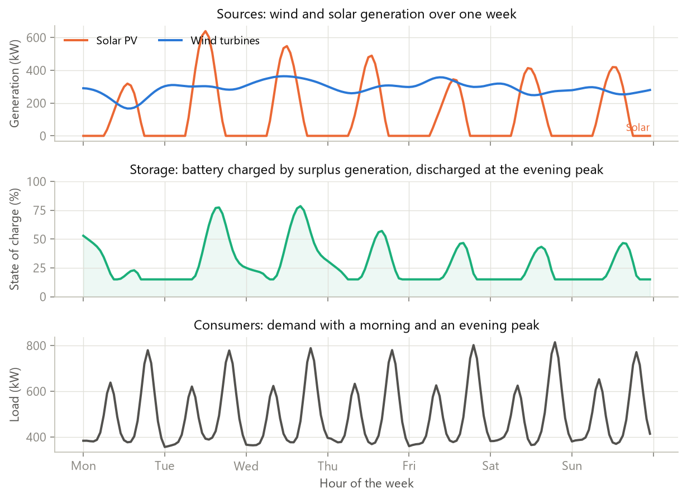
<figcaption>The energy chain over one week: generation from wind and solar, the battery charging on surplus and discharging at the evening peak, and the consumer load with its two daily peaks.</figcaption>
</figure>

---

## 1. Introduction
<div class="figure-row figure-row-small figure-row-equal">
<figure>

<figcaption>Wind turbines, southern California. Photo: Erik Wilde, CC BY-SA 2.0, via Wikimedia Commons.</figcaption>
</figure>
<figure>
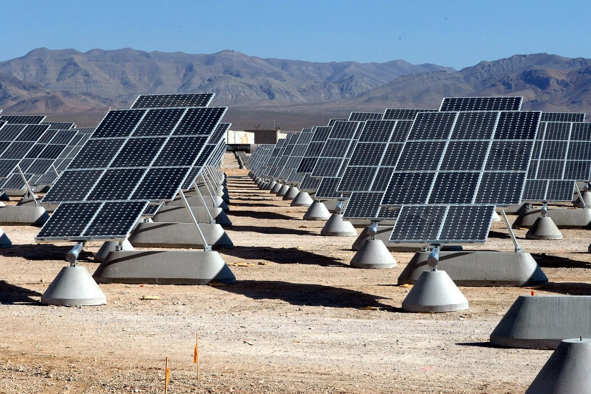
<figcaption>Solar panels, Nellis Air Force Base. Photo: U.S. Air Force, public domain, via Wikimedia Commons.</figcaption>
</figure>
</div>
<p>A green-energy plant is a chain. Wind turbines and solar panels generate power that depends on the weather hour by hour; batteries absorb the surplus
and give it back when generation drops; consumers draw a load with its own daily and weekly rhythm. Two questions matter to the operator:
how much demand to expect over the coming days, and whether any part of the plant is behaving abnormally right now.</p>
<p>The picture below is the whole system. Sensors along the chain feed a data platform, the platform feeds three models, and the models return
forecasts and anomaly alerts to the operator.</p>
<pre class="mermaid">flowchart LR
    W[Wind turbines]:::input --> INV[Inverters]:::process
    S[Solar PV]:::input --> INV
    INV --> B[(Storage<br/>batteries)]:::store
    B --> G[Grid]:::process
    G --> C[Consumers]:::output
    INV -. sensor logs .-> D[(Data platform<br/>AWS · MongoDB · Airflow)]:::store
    C -. meter data .-> D
    D --> M1[Demand forecasting<br/>Random Forest · LightGBM]:::agent
    D --> M2[Anomaly detection<br/>LSTM autoencoder]:::agent
    M1 --> O1[Forecast<br/>1 to 30 days ahead]:::output
    M2 --> O2[Anomaly alerts<br/>global and local]:::output
</pre>

<hr />
<div class="part-divider"><span>Input &amp; Data Platform</span></div>

## 2. Data platform
<p>The raw data was large: hourly inverter logs and weather records for every inverter, and years of daily demand. It lived on an AWS data server.
An extraction job pulled it into MongoDB, where each inverter hour is one document, and Apache Airflow ran the daily DAG: extract the new hours,
clean and merge them with the weather, write the features, score the models, and publish the results. Airflow retried failed tasks and kept the run history,
so a missing day of data showed up as a red task rather than as a silent gap.</p>
<pre class="mermaid">flowchart LR
    A[(AWS data server<br/>inverter logs · meters · weather)]:::store --> E[Extract<br/>new hours]:::process
    E --> M[(MongoDB<br/>one document per inverter hour)]:::store
    M --> T[Clean and merge<br/>with weather]:::process
    T --> F[Feature tables<br/>lags · rolling means]:::process
    F --> S1[Score forecast<br/>models]:::agent
    F --> S2[Score anomaly<br/>model]:::agent
    S1 --> P[Publish<br/>forecasts and alerts]:::output
    S2 --> P
    AF[Apache Airflow<br/>daily DAG, retries, history]:::tool -.-> E
    AF -.-> T
    AF -.-> S1
    AF -.-> S2
</pre>
<p>The extraction kept the raw records as they came and added only the keys the later steps query on: the inverter number and the hour.</p>

```python
# extract.py: pull the hours that are not yet in MongoDB.
from pymongo import MongoClient, UpdateOne

db = MongoClient(MONGO_URI)["energy"]

def load_hours(rows):
    ops = [UpdateOne({"invno": r["invno"], "datetimeAt": r["datetimeAt"]}, {"$set": r}, upsert=True) for r in rows]
    db.inverter_hours.bulk_write(ops, ordered=False)      # idempotent: a re-run does not duplicate
```

```python
# dags/energy_daily.py: the Airflow DAG that runs the pipeline every morning.
from airflow import DAG
from airflow.operators.python import PythonOperator
from datetime import datetime, timedelta

with DAG("energy_daily", start_date=datetime(2021, 12, 1), schedule="0 5 * * *",
         default_args={"retries": 2, "retry_delay": timedelta(minutes=10)}, catchup=False) as dag:
    extract  = PythonOperator(task_id="extract_new_hours", python_callable=extract_new_hours)
    merge    = PythonOperator(task_id="merge_weather",     python_callable=merge_weather)
    features = PythonOperator(task_id="build_features",   python_callable=build_features)
    forecast = PythonOperator(task_id="score_forecast",   python_callable=score_forecast)
    anomaly  = PythonOperator(task_id="score_anomaly",    python_callable=score_anomaly)
    publish  = PythonOperator(task_id="publish",          python_callable=publish)
    extract >> merge >> features >> [forecast, anomaly] >> publish
```

## 3. Input data
<p>Two datasets feed the models. For forecasting, the daily electricity demand of Spain from 2014 to 2018, in MWh. For anomaly detection,
hourly solar inverter logs merged with weather records.</p>
<figure class="figure-small">
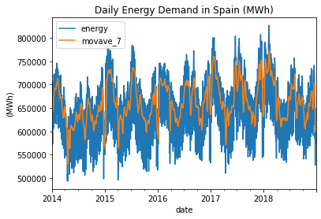
<figcaption>Daily energy demand in MWh, 2014–2018, with its 7-day moving average.</figcaption>
</figure>
<p>Inverter logs (<code>invno</code>, <code>dckw</code>, <code>ackw</code>, <code>dayTotal</code>) and weather records (<code>wind_spd</code>, <code>temp</code>, <code>pres</code>)
are merged on their hourly timestamp into one table, missing values are filled with zero, and numeric columns are downcast, which cut the memory footprint by 58 %.</p>

```python
inv = pd.read_csv("./data/inverterLog.csv").drop(columns=["mcno"])
weather = pd.read_csv("./data/weather_data.csv")
df = pd.merge(inv, weather, how="outer", on="datetimeAt")
df["datetimeAt"] = pd.to_datetime(df["datetimeAt"], format="%Y-%m-%d %H:%M:%S")
df.fillna(0, inplace=True)
df.to_csv("./combined.csv", index=False)
```

<div class="figure-row">
<figure>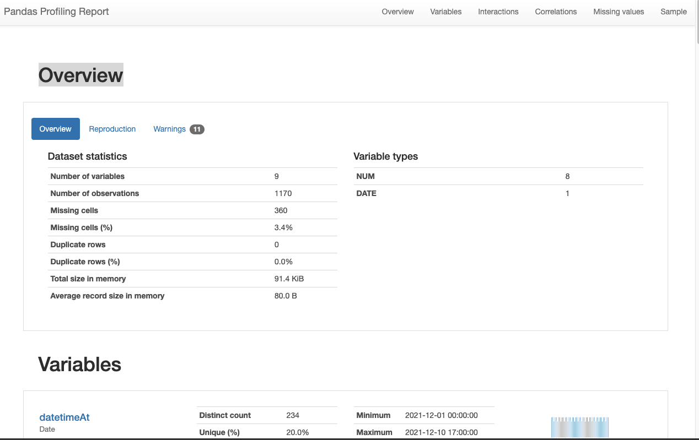<figcaption>Profiling overview of the merged inverter and weather table: variables, observations, missing cells.</figcaption></figure>
<figure>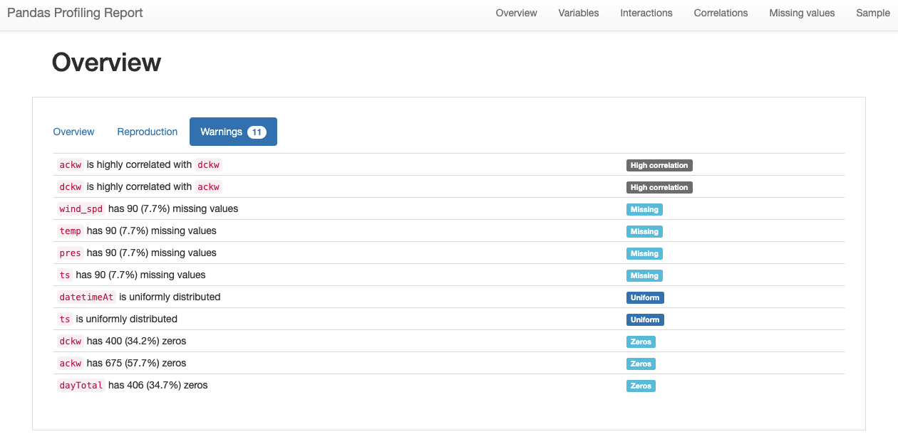<figcaption>Warnings: highly correlated and zero-heavy variables.</figcaption></figure>
</div>

<div class="callout callout-problem">
<h4>What the data forced</h4>
<ul>
<li>Daily demand carries three overlapping structures at once: weekly and quarterly seasonality, a slow upward trend, and volatility that changes with the season.</li>
<li>Demand depends strongly on weather, so a model must be judged on a held-out period rather than on how well it fits the past.</li>
<li>Public green-energy data is scarce and depends heavily on weather, so inverter logs and weather records had to be merged into one hourly dataset first.</li>
<li>Several inverter metrics and weather variables move together; an anomaly in one of them is only meaningful against the others.</li>
</ul>
</div>

<hr />
<div class="part-divider"><span>Models</span></div>

## 4. Demand forecasting
<p>The forecasting work follows a full cycle: exploratory analysis, feature engineering, model building with time-series cross-validation,
residual analysis, and multi-period forecasting. Two models were built on the same features: a Random Forest, which is the one in the public notebook,
and a LightGBM model.</p>

<h3>4.1 Exploratory analysis</h3>
<p>The demand distribution has negative skew and kurtosis below 3, and a Shapiro–Wilk test rejects normality (p = 2.5 × 10⁻¹⁰). Rolling percentiles and
the coefficient of variation by month show that short-term volatility changes with the season, while a 365-day rolling standard deviation is comparatively stable.</p>
<div class="figure-row">
<figure>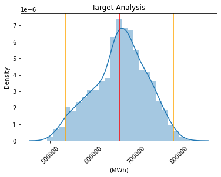<figcaption>Distribution of daily demand: left-skewed and platykurtic.</figcaption></figure>
<figure>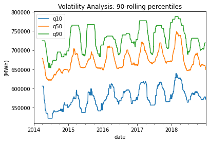<figcaption>Volatility analysis: 90-day rolling percentiles.</figcaption></figure>
</div>
<div class="figure-row">
<figure>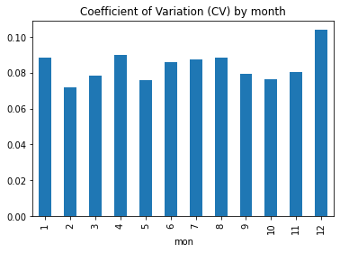<figcaption>Coefficient of variation by month.</figcaption></figure>
<figure>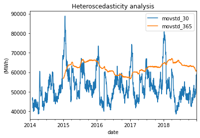<figcaption>Heteroscedasticity: 30-day versus 365-day moving standard deviation.</figcaption></figure>
</div>
<p>Moving averages, quarterly and weekday box plots, and a regression on monthly totals show two clear seasonal patterns (quarters and weekdays,
with lower demand at weekends) and a positive, slightly damped trend consistent with economic recovery over the period.</p>
<div class="figure-row">
<figure>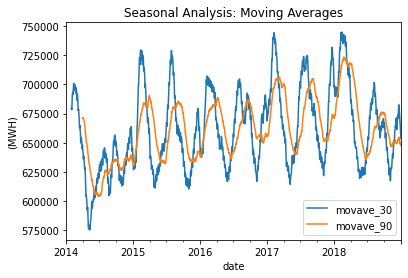<figcaption>Seasonal analysis: 30-day and 90-day moving averages.</figcaption></figure>
<figure>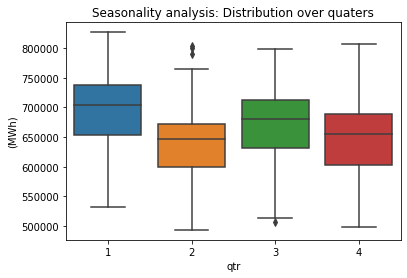<figcaption>Distribution over quarters.</figcaption></figure>
</div>
<div class="figure-row">
<figure>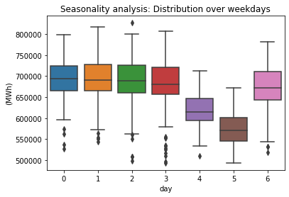<figcaption>Distribution over weekdays (0 is Monday).</figcaption></figure>
<figure>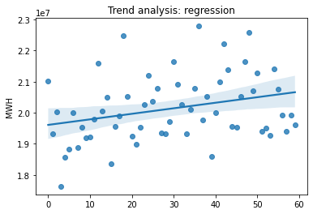<figcaption>Trend analysis: regression on monthly totals.</figcaption></figure>
</div>
<figure class="figure-small">
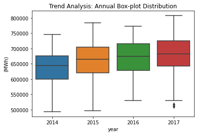
<figcaption>Trend analysis: annual distribution of daily demand.</figcaption>
</figure>

<h3>4.2 Feature engineering</h3>
<p>The target is standardised demand. Features are built automatically so they can absorb seasonality, trend, and changing volatility:
lagged values (<code>feat_ar1</code> … <code>feat_ar30</code>), rolling means (7, 14, 30 days), and 30 forward targets (<code>target_t1</code> … <code>target_t30</code>)
so one model can forecast every horizon at once.</p>

```python
features, targets = [], []
for lag in range(1, 31):
    data[f"feat_ar{lag}"] = data["target"].shift(lag)
    features.append(f"feat_ar{lag}")
for w in (7, 14, 30):
    data[f"feat_movave{w}"] = data["target"].shift(1).rolling(w).mean()
    features.append(f"feat_movave{w}")
for t in range(1, 31):
    data[f"target_t{t}"] = data["target"].shift(-t)
    targets.append(f"target_t{t}")
```

<div class="figure-row">
<figure>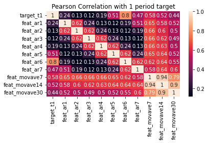<figcaption>Pearson correlation of lag and rolling-mean features with the 1-day-ahead target.</figcaption></figure>
<figure>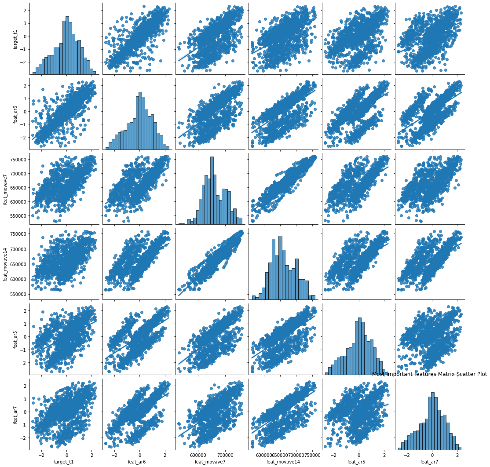<figcaption>Scatter matrix of the most correlated features; AR6 and the 7-day moving average are strongly linear with the target.</figcaption></figure>
</div>

<h3>4.3 Random Forest</h3>
<p>Data from 2014–2016 trains the model and 2016–2017 is held out. A linear regression sets the baseline (train RMSE 0.319, test RMSE 0.315 on the
standardised target). A Random Forest is then tuned with a time-series split of three folds, each training on at most two years.</p>
<pre class="mermaid">flowchart LR
    D[Daily demand<br/>2014 to 2018]:::input --> F[Features<br/>30 lags · 3 rolling means]:::process
    F --> CV[Time-series split<br/>3 folds, 2-year window]:::process
    CV --> RF[Random Forest<br/>500 trees, depth 10]:::agent
    RF --> H[30 targets<br/>1 to 30 days ahead]:::output
</pre>
<figure class="figure-small">
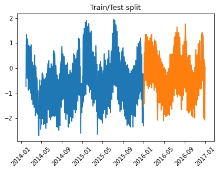
<figcaption>Train/test split of the standardised target.</figcaption>
</figure>
<div class="figure-row">
<figure>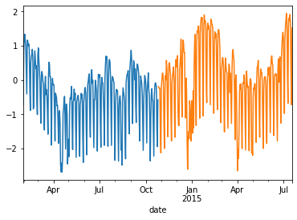<figcaption>Time-series split, fold 1: 268 train / 266 validation days.</figcaption></figure>
<figure>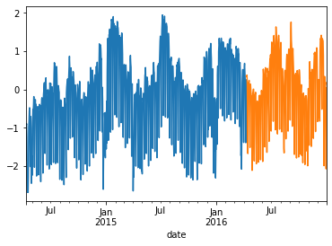<figcaption>Fold 3: 730 train / 266 validation days.</figcaption></figure>
</div>

```python
from sklearn.ensemble import RandomForestRegressor
from sklearn.model_selection import TimeSeriesSplit, ParameterGrid

splits = TimeSeriesSplit(n_splits=3, max_train_size=365 * 2)
grid = ParameterGrid({"n_estimators": [100, 500], "max_depth": [5, 10], "max_features": [20, 59], "random_state": [123]})
for params in grid:
    for train_idx, val_idx in splits.split(X_train):
        model = RandomForestRegressor().set_params(**params).fit(X_train.iloc[train_idx], y_train.iloc[train_idx])
        # keep the parameters with the lowest validation RMSE
```

<div class="callout callout-result">
<h4>Selected model</h4>
<ul>
<li>500 trees, maximum depth 10, all 59 features considered at each split.</li>
<li>Best fold: train RMSE 0.017, validation RMSE 0.458 (standardised units).</li>
<li>Feature importance is dominated by recent lags (AR5, AR13, AR27) and the 7-day moving average.</li>
</ul>
</div>
<figure class="figure-small">
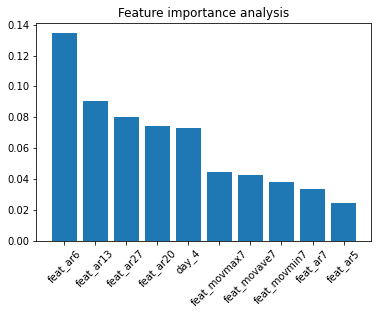
<figcaption>Feature importance of the tuned Random Forest.</figcaption>
</figure>

<h3>4.4 LightGBM</h3>
<p>The same feature table was also fitted with LightGBM, a gradient-boosted tree model that trains far faster than a forest of 500 trees on wide lag tables
and handles the calendar and weather columns natively. It was trained with the same time-series split and early stopping on the validation fold.</p>

```python
# lightgbm_forecast.py: one model per horizon, early-stopped on the time-series validation fold.
import lightgbm as lgb

params = {"objective": "regression", "learning_rate": 0.03, "num_leaves": 31,
          "feature_fraction": 0.8, "bagging_fraction": 0.8, "bagging_freq": 1, "verbose": -1}
models = {}
for t in range(1, 31):
    train = lgb.Dataset(X_train, y_train[f"target_t{t}"])
    valid = lgb.Dataset(X_valid, y_valid[f"target_t{t}"])
    models[t] = lgb.train(params, train, num_boost_round=3000, valid_sets=[valid],
                          callbacks=[lgb.early_stopping(100), lgb.log_evaluation(0)])
```

<div class="figure-row">
<figure>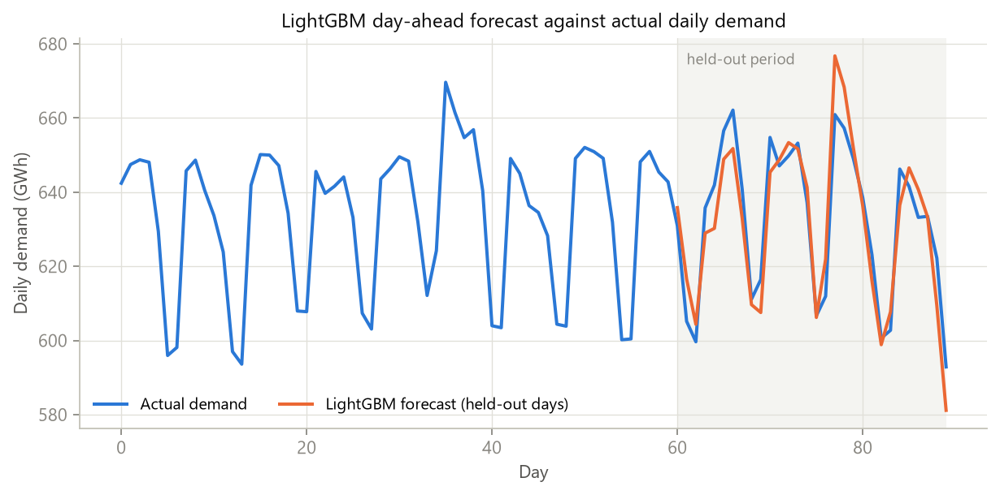<figcaption>Day-ahead forecast against actual demand on a held-out period.</figcaption></figure>
<figure>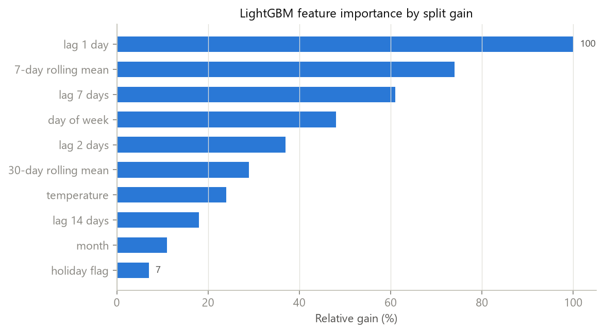<figcaption>Feature importance by split gain: the recent lag and the 7-day rolling mean dominate, as in the Random Forest.</figcaption></figure>
</div>

## 5. Anomaly detection
<p>Anomaly detection finds unusual behaviour in a dataset. For time series it can be approached with statistical methods (clustering, wavelet transforms,
autoregressive models) or with machine learning, in supervised or unsupervised form. This work applies an unsupervised LSTM autoencoder to the merged
inverter and weather data: the model learns to reconstruct normal hours, and an hour it cannot reconstruct is an anomaly.</p>
<pre class="mermaid">flowchart TB
    D[(MongoDB<br/>inverter hours + weather)]:::store --> W[Windows of all metrics<br/>1, 7 or 30 time steps]:::process
    W --> ENC[Encoder LSTM<br/>16-unit latent state]:::agent
    ENC --> DEC[Decoder LSTM<br/>+ TimeDistributed Dense]:::agent
    DEC --> ERR[Reconstruction error<br/>per metric and mean]:::process
    ERR --> TH{Above static or<br/>dynamic threshold?}:::decision
    TH -- yes --> AL[Global and local<br/>anomalies]:::output
    TH -- no --> OK[Normal hour]:::note
</pre>

<h3>5.1 Exploratory analysis</h3>
<p>A pandas-profiling report gives the overview, warnings, missing-value map, and three correlation matrices in one pass.</p>
<ul>
<li><strong>Pearson's r</strong> measures linear correlation between two variables.</li>
<li><strong>Spearman's ρ</strong> measures monotonic correlation and so catches non-linear monotonic relationships.</li>
<li><strong>Phik (φk)</strong> works across categorical, ordinal, and interval variables, captures non-linear dependency, and reduces to Pearson for bivariate normal input.</li>
</ul>
<div class="figure-row">
<figure>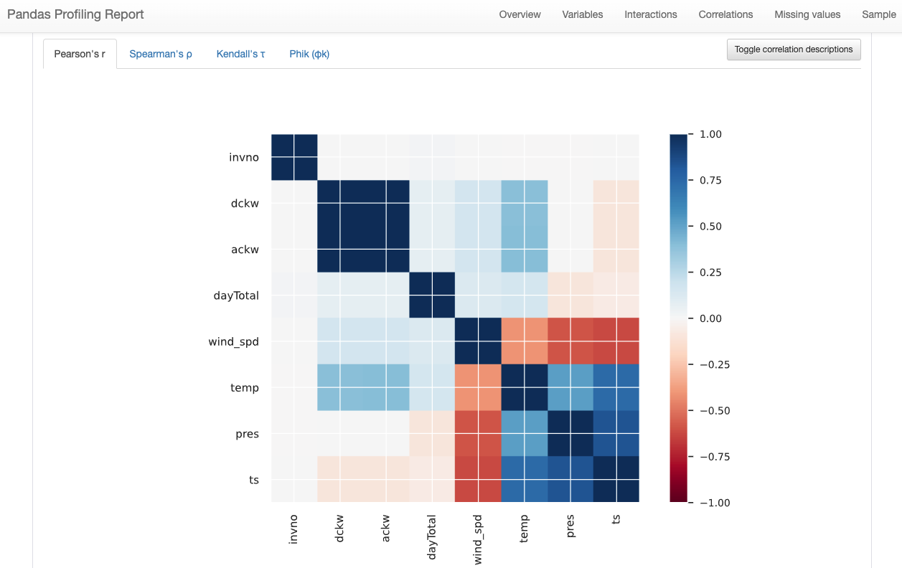<figcaption>Pearson's correlation.</figcaption></figure>
<figure>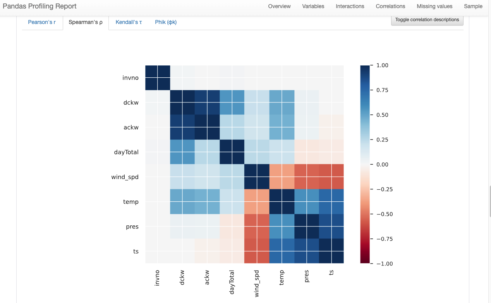<figcaption>Spearman's correlation.</figcaption></figure>
</div>
<div class="figure-row">
<figure>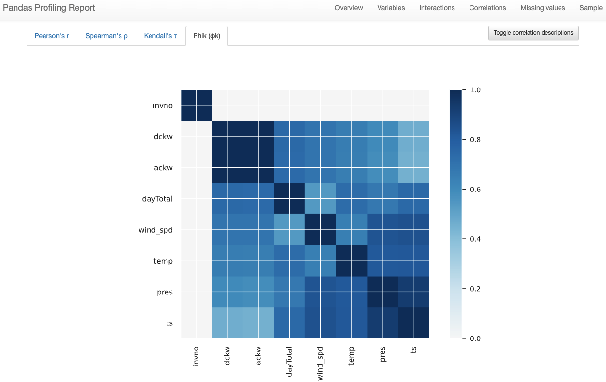<figcaption>Phik correlation.</figcaption></figure>
<figure>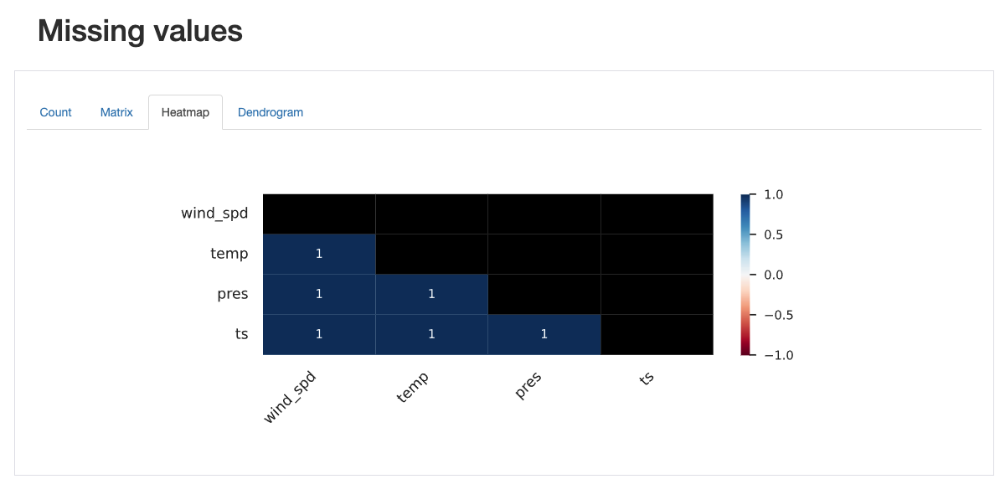<figcaption>Missing values by variable.</figcaption></figure>
</div>

<h3>5.2 Feature selection</h3>
<p><code>invno</code> and <code>ts</code> are dropped as identifiers, and <code>ackw</code> is dropped because AC power follows directly from DC power at the inverter.
Spearman's correlation shows <code>dckw</code>, <code>dayTotal</code>, <code>wind_spd</code>, and <code>temp</code> moving together; <code>pres</code> is kept for testing.</p>
<table>
<thead>
<tr><th>Item</th><th>Value</th></tr>
</thead>
<tbody>
<tr><td>Features</td><td><code>datetimeAt</code>, <code>dckw</code>, <code>ackw</code>, <code>dayTotal</code>, <code>wind_spd</code>, <code>temp</code>, <code>pres</code></td></tr>
<tr><td>Train shape</td><td>(819, 6)</td></tr>
<tr><td>Test shape</td><td>(351, 6)</td></tr>
<tr><td>Time steps</td><td>1, 7, or 30</td></tr>
<tr><td>Points to predict</td><td>1, 2, or 3 steps ahead</td></tr>
</tbody>
</table>

```python
def Data():
    dataset = pd.read_csv("./combined.csv").fillna(0)
    dataset = dataset.drop(columns=["invno", "ts"])
    return dataset.set_index("datetimeAt")
```

<h3>5.3 Model</h3>
<p>An LSTM is a recurrent network with forget, input, and output gates, which makes it a natural fit for sequential data. Forecasting one metric with an
LSTM alone cannot give a global view across all metrics, so an autoencoder is added: the encoder compresses a window of all features into a 16-unit state,
<code>RepeatVector</code> expands it back to the window length, and a decoder LSTM with a time-distributed dense layer reconstructs every feature.</p>
<figure class="figure-small">
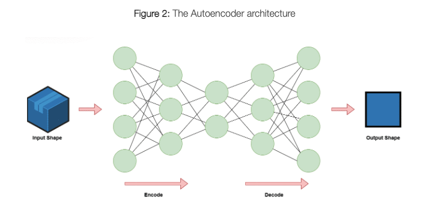
<figcaption>The autoencoder architecture.</figcaption>
</figure>

```python
def build_model(self):
    self.model = Sequential()
    self.model.add(LSTM(units=16, input_shape=(self.X_train.shape[1], self.X_train.shape[2])))
    self.model.add(RepeatVector(n=self.X_train.shape[1]))
    self.model.add(LSTM(units=16, return_sequences=True))
    self.model.add(TimeDistributed(Dense(self.X_train.shape[2])))
    self.model.compile(optimizer=tf.keras.optimizers.Adam(learning_rate=0.005), loss="mse")

def fit_model(self, epochs, batch_size):
    self.history = self.model.fit(self.X_train, self.Y_train, epochs=epochs, batch_size=batch_size,
                                  validation_split=0.1, shuffle=False)
```

<p>All chosen features are used as metrics, the model predicts three data points ahead, and <code>shuffle=False</code> keeps the order of time steps.
Mean squared error gives the smoothest training.</p>

<h3>5.4 Training and reconstruction error</h3>
<div class="figure-row">
<figure>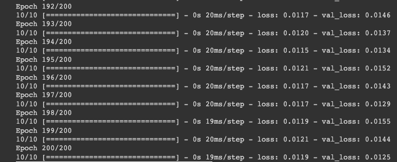<figcaption>Training log: loss and validation loss over the final epochs of 200.</figcaption></figure>
<figure>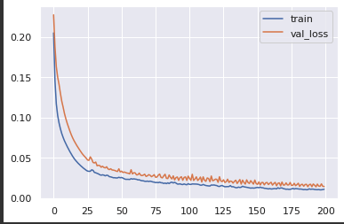<figcaption>Training and validation loss.</figcaption></figure>
</div>
<figure class="figure-small">
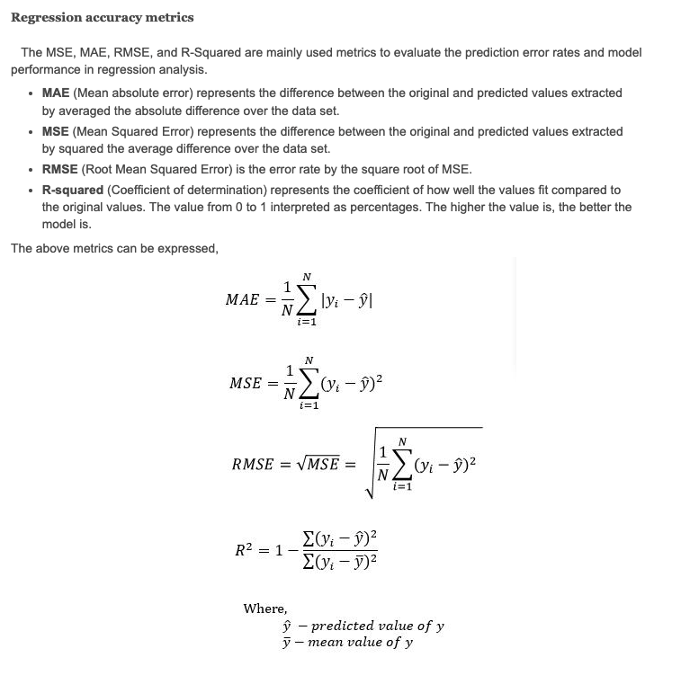
<figcaption>Error metrics used to evaluate reconstruction.</figcaption>
</figure>
<div class="figure-row">
<figure>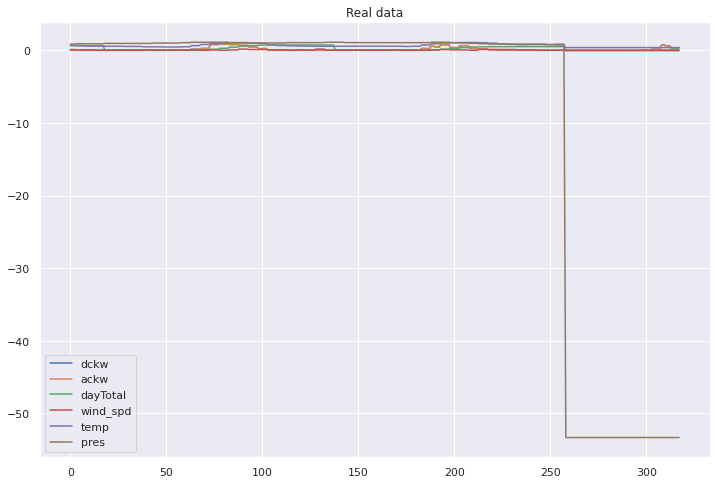<figcaption>Real test data.</figcaption></figure>
<figure>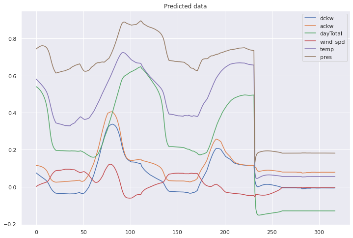<figcaption>Reconstructed data.</figcaption></figure>
</div>

<h3>5.5 Thresholds</h3>
<p>Anything above a threshold is an anomaly. Two kinds are used together, because a single fixed threshold either misses slow drifts or floods the operator with alerts.</p>
<p><strong>Static threshold.</strong> The mean of the training MAE plus three standard deviations.</p>

```python
pred_error_threshold = np.mean(train_pred_errors) + 3 * np.std(train_pred_errors)
```

<p><strong>Dynamic threshold.</strong> A rolling window with its own standard-deviation coefficient, chosen empirically on the training data only
(window 40, coefficient 5 for ARIMA, 6 for CNN and LSTM).</p>

```python
train_pred_errors_windowed = pd.Series(train_pred_errors).rolling(window=window, min_periods=1)
train_dynamic_threshold = train_pred_errors_windowed.mean() + std_coef * train_pred_errors_windowed.std()

valid_pred_errors_windowed = pd.Series(valid_pred_errors).rolling(window=window, min_periods=1)
valid_dynamic_threshold = valid_pred_errors_windowed.mean() + std_coef * valid_pred_errors_windowed.std()
```

<figure class="figure-small">
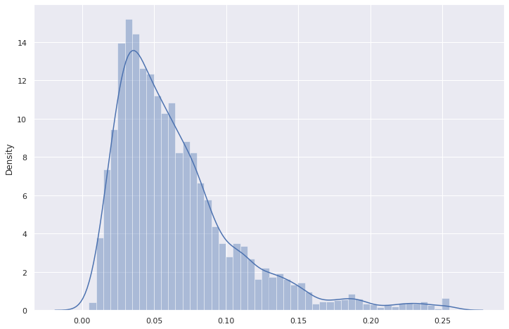
<figcaption>Distribution of reconstruction loss on the training data.</figcaption>
</figure>
<div class="figure-row">
<figure>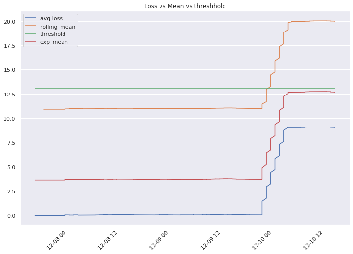<figcaption>Mean loss with the static threshold (green), rolling-mean threshold (orange), and exponential-mean threshold (red).</figcaption></figure>
<figure>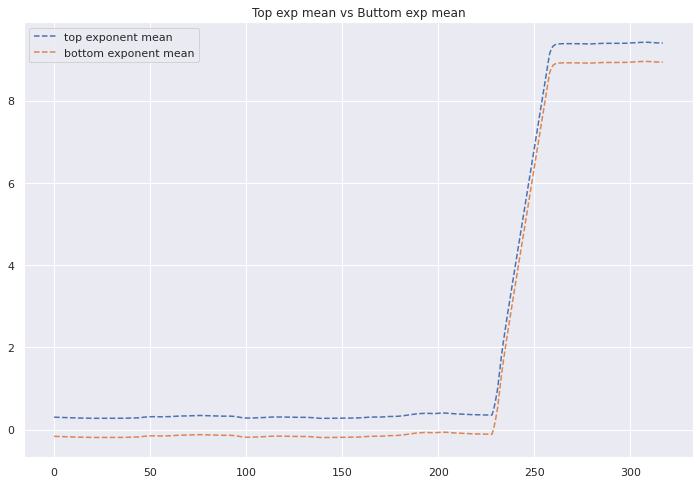<figcaption>Top versus bottom exponential mean.</figcaption></figure>
</div>
<p>A moving average smooths short-term fluctuation to show longer-term structure; the window length trades smoothing against responsiveness.</p>
<div class="figure-row">
<figure>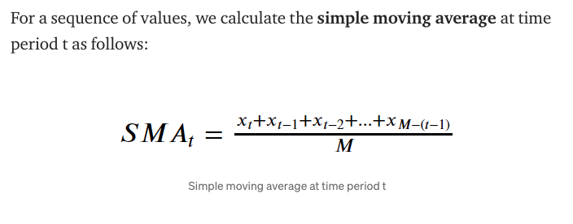<figcaption>Simple moving average.</figcaption></figure>
<figure>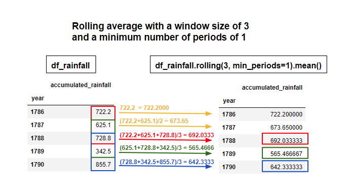<figcaption>Rolling average with a window of 3.</figcaption></figure>
</div>

<h3>5.6 Global and local anomalies</h3>
<p>A <strong>global anomaly</strong> fires when the mean loss over all metrics crosses the lower (dynamic) threshold. A <strong>local anomaly</strong> fires when a
single metric's loss crosses its own, higher threshold. Reporting them separately tells an operator whether one metric or the whole plant is misbehaving.</p>

```text
                        loss    rolling_mean  exp_mean   threshold   global_anomaly
datetimeAt
2021-12-07 19:00:00  0.255701     11.056723   3.800142   12.986072   False
2021-12-07 20:00:00  0.254932     11.091915   3.799565   12.986072   False
2021-12-07 20:00:00  0.254157     11.066023   3.798895   12.986072   False
```

```python
is_global_anomaly_exp_mean = abs(mean_exp - loss_mean_vec) > threshold_mean_exp + num_of_std * std
for index, metric in enumerate(self.data.columns):
    threshold = self.train_loss_mean[index] + num_of_std * self.train_loss_std[index]
    is_anomaly = self.test_loss[:, index] > threshold
    # global anomalies are collected from the exponential-mean test,
    # local anomalies from the per-metric threshold
```

<div class="figure-row">
<figure>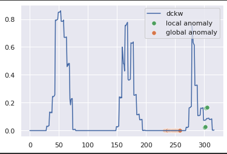<figcaption>DC power (<code>dckw</code>) with local (green) and global (orange) anomalies.</figcaption></figure>
<figure>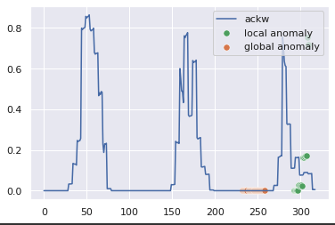<figcaption>AC power (<code>ackw</code>).</figcaption></figure>
</div>
<div class="figure-row">
<figure>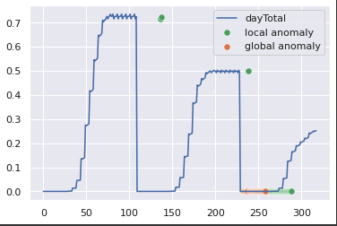<figcaption>Daily total yield.</figcaption></figure>
<figure>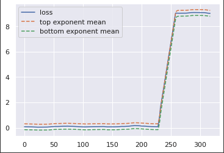<figcaption>Loss against the top and bottom exponential means.</figcaption></figure>
</div>

<hr />
<div class="part-divider"><span>Results</span></div>

## 6. Results

<h3>6.1 Forecast accuracy</h3>
<p>Mean absolute percentage error (MAPE) is used because it is easy to communicate. One-day-ahead Random Forest forecasts on the test year track the actual series closely,
and the residuals are centred on zero with a few large negative outliers on exceptionally cold days.</p>
<div class="figure-row">
<figure>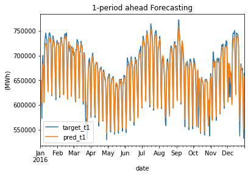<figcaption>1-period-ahead forecast against actual demand on the test year.</figcaption></figure>
<figure>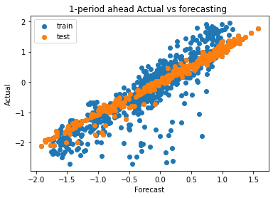<figcaption>Actual versus forecast, train and test.</figcaption></figure>
</div>
<div class="figure-row">
<figure>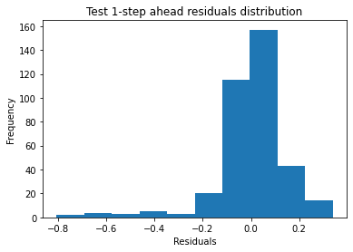<figcaption>Test residual distribution.</figcaption></figure>
<figure>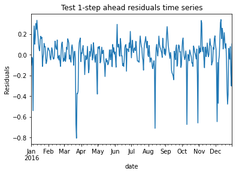<figcaption>Test residuals over time.</figcaption></figure>
</div>
<figure class="figure-small">
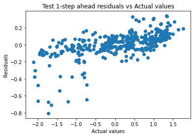
<figcaption>Residuals against actual values: larger errors occur at the low end of demand.</figcaption>
</figure>
<p>A new Random Forest with the tuned parameters is fitted on the two most recent years and used to forecast 1, 7, 14, and 30 days ahead.
Error grows with horizon but stays modest, and the scatter of actual against forecast widens mainly at extreme values.</p>
<div class="callout callout-result">
<h4>Random Forest test MAPE by horizon</h4>
<ul>
<li>1 day ahead: 1.13 %</li>
<li>7 days ahead: 1.39 %</li>
<li>14 days ahead: 1.57 %</li>
<li>30 days ahead: 1.73 %</li>
</ul>
</div>
<figure class="figure-small">
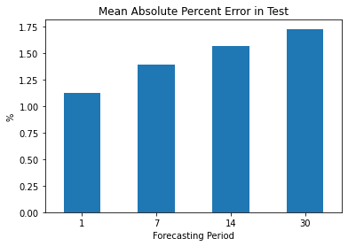
<figcaption>Mean absolute percentage error on the test year by forecasting horizon.</figcaption>
</figure>
<div class="figure-row">
<figure>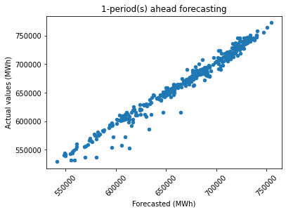<figcaption>1 day ahead.</figcaption></figure>
<figure>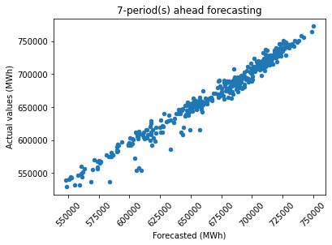<figcaption>7 days ahead.</figcaption></figure>
</div>
<div class="figure-row">
<figure>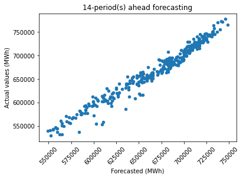<figcaption>14 days ahead.</figcaption></figure>
<figure><figcaption>30 days ahead.</figcaption></figure>
</div>
<figure class="figure-small">

<figcaption>30-day-ahead forecast (red) over the actual 2016 series.</figcaption>
</figure>

<h3>6.2 Detected anomalies</h3>
<div class="figure-row">
<figure><figcaption>Anomalous DC power outputs with a simple LSTM and general loss.</figcaption></figure>
<figure><figcaption>Loss against the static threshold.</figcaption></figure>
</div>

```text
Indices of anomaly samples:  (array([147, 192]),)
##################### Details of anomaly ###################
[{'Datetime': Timestamp('2021-12-02 16:00:00'), 'dckw': 4.213291015625, 'invno': 1},
 {'Datetime': Timestamp('2021-12-02 06:00:00'), 'dckw': 0.0,             'invno': 4}]
```

<div class="figure-row">
<figure><figcaption>Anomalies on DC power with the static threshold: too many, so the threshold needs tuning.</figcaption></figure>
<figure><figcaption>The DC power series used for detection.</figcaption></figure>
</div>
<div class="callout callout-result">
<h4>Findings</h4>
<ul>
<li>The autoencoder reconstructs normal inverter behaviour closely; the reconstruction error separates two clear events on 2 December 2021 (inverter 1 at 16:00, inverter 4 at 06:00).</li>
<li>The static mean-plus-3σ threshold alone over-flags on this data; the dynamic rolling threshold is what makes global anomalies usable.</li>
<li>Reporting local and global anomalies separately tells an operator whether one metric or the whole plant is misbehaving.</li>
</ul>
</div>

<hr />
<div class="part-divider"><span>Deployment</span></div>

## 7. Deployment
<p>The pipeline ran on the daily Airflow schedule described in section 2: new hours in, features rebuilt, both model families scored, results published.
The anomaly model was also exposed as a small Flask service so that a CSV of recent hours could be scored on demand: it loads the trained autoencoder,
scales and reshapes the rows for the LSTM, scores each row by mean absolute reconstruction error against the threshold, and returns the anomalies as JSON.</p>
<pre class="mermaid">flowchart LR
    AF[Airflow<br/>daily run]:::tool --> M[(MongoDB<br/>features)]:::store
    M --> SC[Scoring job<br/>forecast + anomaly]:::agent
    SC --> R[(Results<br/>forecasts · alerts)]:::store
    R --> DB2[Dashboard]:::output
    OP[Operator<br/>CSV of recent hours]:::input --> API[Flask API<br/>anomaly_model.h5]:::agent
    API --> J[Anomalies<br/>as JSON]:::output
</pre>

```python
app = flask.Flask(__name__)
model = load_model("./model/anomaly_model.h5")

@app.route("/", methods=["POST"])
def submit():
    df = read_uploaded_csv(flask.request.files["data_file"])
    X = scaler.transform(df).reshape(-1, 1, df.shape[1])
    preds = model.predict(X).reshape(len(df), -1)
    loss = np.mean(np.abs(X.reshape(len(df), -1) - preds), axis=1)
    hits = [{"Anomaly": True, "Value": float(l), "datetime": str(i)} for i, l in zip(df.index, loss) if l > THRESHOLD]
    return flask.jsonify({"Analysis": hits or [{"Anomaly": "No Anomalies Detected"}]})
```

<p>Planned next steps at the time were reading directly from the database inside the API, scoring the live stream rather than uploads, and hardening the service.</p>

---

## 8. Summary
<p>The project follows energy from where it is generated to where it is used, and turns the data from that chain into two things an operator can act on:
a demand forecast up to 30 days ahead, and anomaly alerts for the inverters. The data came off an AWS server into MongoDB on an Airflow schedule.
A Random Forest reached a test MAPE of 1.13 % one day ahead and 1.73 % thirty days ahead, with LightGBM trained on the same features;
a multivariate LSTM autoencoder with static and dynamic thresholds separated two clear inverter events in the test week. The anomaly model is served through a Flask API.</p>

## 9. Repository
<p>The forecasting and anomaly-detection notebooks are public in the Data-Science repository:</p>
<ul>
<li><a href="https://github.com/Laudarisd/Data-Science/tree/main/Project-3.Energy_Data_Analysis">Project-3 · Energy data analysis</a>: Random Forest demand forecasting notebook and the LSTM anomaly-detection copy.</li>
<li><a href="https://github.com/Laudarisd/Data-Science/tree/main/Project-4.Anomaly_Detection/1.LSTM_AutoEncoder">Project-4 · LSTM autoencoder anomaly detection</a>: <code>explore_data.ipynb</code>, <code>lstm_anomaly.py</code> (the <code>AutoEncoder</code> class), and <code>app.py</code> (Flask service).</li>
</ul>
<blockquote>
<p>Public project overview. The data platform and LightGBM sections are written up from memory; their original files were not kept.</p>
</blockquote>
