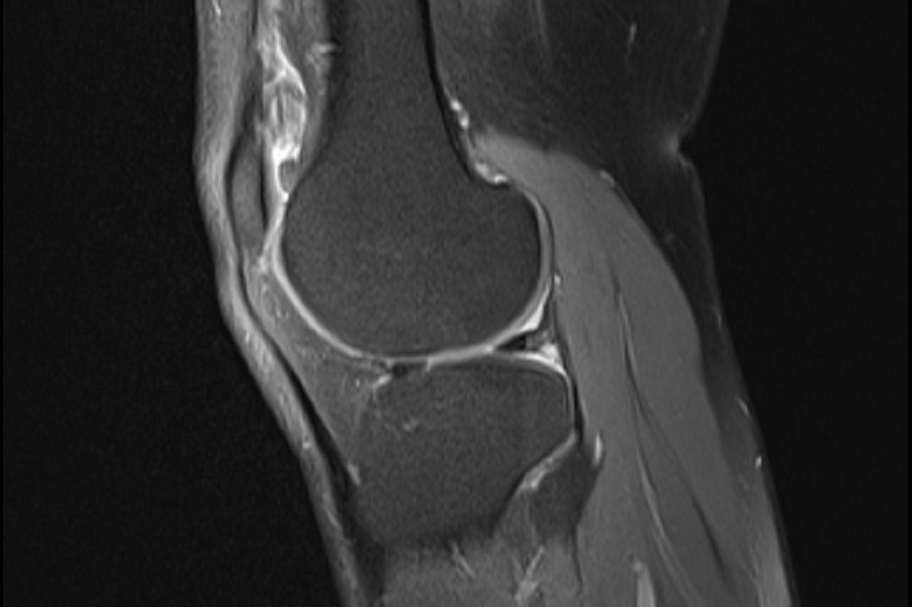
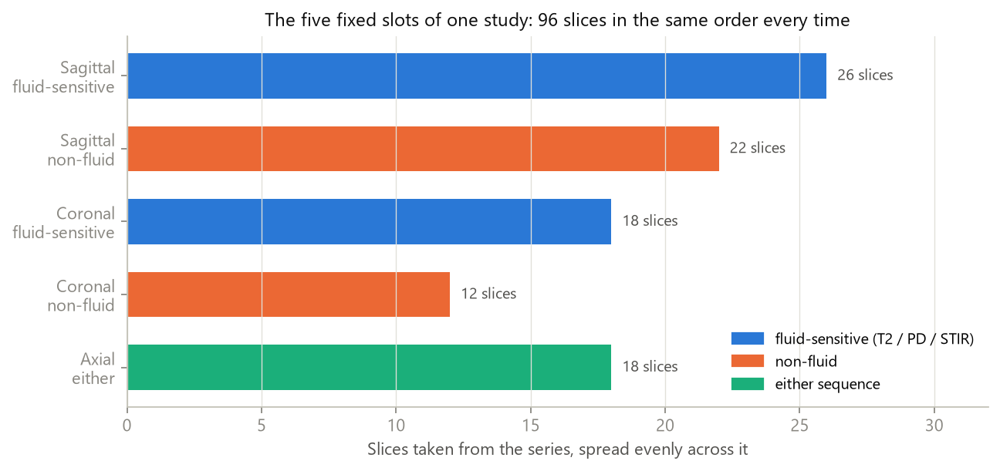
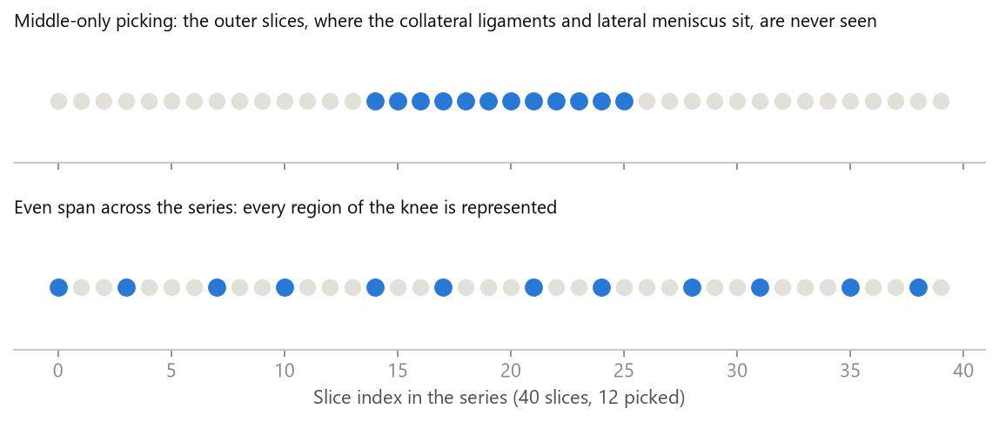
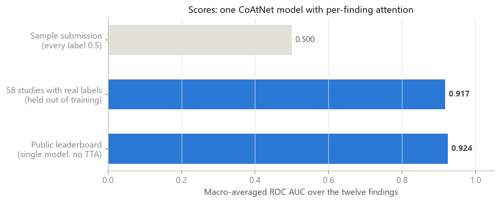

# Knee Abnormality Detection - Twelve MRI Findings with One CoAtNet Model
<p>A solution for the RSNA Knee Abnormality Detection competition on Kaggle: one CoAtNet model reads a knee MRI study, DICOM series in three planes,
and scores twelve clinically important findings at once. 0.924 macro-averaged ROC AUC on the public leaderboard, single model, no ensembling or test-time augmentation.</p>
<p><strong>Keywords</strong></p>
<div class="fact-grid">
<div class="fact"><span class="fact-label">Host</span><span class="fact-value">RSNA · Kaggle code competition</span></div>
<div class="fact"><span class="fact-label">Task</span><span class="fact-value">12 findings per knee MRI study</span></div>
<div class="fact"><span class="fact-label">Data</span><span class="fact-value">4,407 studies · 820k DICOM files · 570 GB</span></div>
<div class="fact"><span class="fact-label">Model</span><span class="fact-value">CoAtNet 384 px, per-finding attention</span></div>
<div class="fact"><span class="fact-label">Result</span><span class="fact-value">0.924 public macro-AUC, single model</span></div>
<div class="fact"><span class="fact-label">Limits</span><span class="fact-value">Notebook only · no internet · ≤ 9 h GPU</span></div>
</div>
<figure class="figure-small">

<figcaption>A sagittal knee MRI slice. The model reads slices like this from three planes and scores twelve findings on the whole study. Photo: Ptrump16, CC BY-SA 4.0, via Wikimedia Commons.</figcaption>
</figure>

---

## 1. Introduction
<p>The knee is the most imaged joint, and one MRI study can hold a dozen different problems: ligament tears, meniscal damage, cartilage loss, fractures, effusion.
Radiologists are scarce and do not always agree, so the competition asks for a model that scores every finding at once. It is also the first RSNA challenge
that pairs every study with its radiology report, so the report can teach the model during training even though it is not available at test time.</p>
<table>
<thead>
<tr><th>Label</th><th>Finding</th><th>Label</th><th>Finding</th></tr>
</thead>
<tbody>
<tr><td><code>ACL</code></td><td>Anterior cruciate ligament injury</td><td><code>PF OA</code></td><td>Patellofemoral osteoarthritis</td></tr>
<tr><td><code>MCL</code></td><td>Medial collateral ligament injury</td><td><code>Effusion</code></td><td>Joint effusion</td></tr>
<tr><td><code>Medial Meniscus</code></td><td>Medial meniscus tear</td><td><code>Synovitis</code></td><td>Inflammation of the joint lining</td></tr>
<tr><td><code>Lateral Meniscus</code></td><td>Lateral meniscus tear</td><td><code>Baker's</code></td><td>Baker's cyst</td></tr>
<tr><td><code>Medial OA</code></td><td>Medial tibiofemoral osteoarthritis</td><td><code>Contusion</code></td><td>Bone bruise</td></tr>
<tr><td><code>Lateral OA</code></td><td>Lateral tibiofemoral osteoarthritis</td><td><code>Fracture</code></td><td>Fracture</td></tr>
</tbody>
</table>
<p>Submissions are scored by the macro-averaged ROC AUC over the twelve labels, and they run as Kaggle notebooks: at most nine hours on one GPU, with internet disabled.</p>

---

## 2. Goal
<div class="callout callout-goal">
<h4>Goal</h4>
<ul>
<li>Score all twelve findings from one model and one forward pass per study.</li>
<li>Handle the real data as it comes: mixed DICOM transfer syntaxes, varying slice counts and resolutions, several scanner sites.</li>
<li>Stay inside the competition limits of a single notebook, no internet and nine GPU hours, with no ensembling.</li>
</ul>
</div>

---

## 3. Approach
<div class="callout callout-problem">
<h4>What made it hard</h4>
<ul>
<li>4,407 studies, but structured labels for only 58 of them; every other study arrives with a free-text report and nothing more.</li>
<li>No two studies look alike: several series in different planes, a varying number of series, and a varying number of slices per series, yet the network needs a fixed-size input.</li>
<li>The twelve findings are split across sequence types: fluid-sensitive sequences show swelling, effusion and acute injury; the others show anatomy and cartilage.</li>
<li>Half a million slices in several transfer syntaxes have to be read fast enough to infer within nine hours.</li>
</ul>
</div>
<pre class="mermaid">flowchart LR
    S[(Study<br/>DICOM series, 3 planes)]:::store --> F[Five fixed slots<br/>plane · sequence · count]:::process
    F --> C[Crop 140 mm box<br/>resize to 384 px]:::process
    C --> W[42 three-slice windows]:::process
    W --> B[CoAtNet backbone]:::agent
    B --> A[Attention head<br/>per finding ×12]:::agent
    A --> O[12 probabilities<br/>per study]:::output
</pre>

<h3>3.1 Labels from the radiology reports</h3>
<p>Only 58 studies carry structured labels, so the labels behind the model were made by reading each free-text report with a language model and turning it into
twelve probabilities rather than twelve yes/no answers. A report that says a tear is <em>suspected</em> becomes a value near 0.8, not a 1, which is a fairer target
than forcing a hedged sentence into a hard label. That gives 4,349 studies to train on. The 58 real-labelled studies are never trained on; they are the honest check.</p>

<h3>3.2 A fixed input from studies that are all shaped differently</h3>
<p>Each study fills five fixed slots, always in the same order, into one slice stack. Some slots prefer a fluid-sensitive series and some do not, because the findings
are split across both kinds. A slot with no matching series stays zeros and is masked out, so the model skips it instead of being fed something misleading.</p>
<figure class="figure-small">

<figcaption>The five slots and how many slices each takes: 96 slices per study, in the same order every time.</figcaption>
</figure>

```python
# Five fixed slots per study: (plane, prefer fluid-sensitive, slice count).
# A missing slot stays zeros and is masked out so the model skips it.
SLOTS = [
    ("Sagittal",  1, 26),   # fluid-sensitive sagittal (T2 / PD / STIR): swelling, effusion, acute injury
    ("Sagittal",  0, 22),   # non-fluid sagittal: anatomy and cartilage
    ("Coronal",   1, 18),
    ("Coronal",   0, 12),
    ("Axial",    -1, 18),   # axial, either sequence
]
```

<p>Within a series, slices are taken evenly across the stack rather than from the middle: the collateral ligaments and the lateral meniscus sit in the outer slices,
and cutting them was measurably costing accuracy on exactly those findings. Every slice is cropped to a 140 mm box using the pixel spacing from the DICOM header
and then resized, so a knee fills the same fraction of the frame whether the scan was acquired at 0.3 or 0.5 mm per pixel.</p>
<figure class="figure-small">

<figcaption>Middle-only picking misses the outer slices; an even span keeps every region of the knee in the stack.</figcaption>
</figure>

```python
# Even span across the series (not the middle): the periphery holds the collateral
# ligaments and the lateral meniscus.
n = len(files)
lo, hi = int(n * 0.02), int(n * 0.98) - 1
picks = np.linspace(lo, hi, k).round().astype(int)

# Crop a fixed 140 mm box using the DICOM pixel spacing, then resize, so scale carries
# no information the model has to learn.
cpx = int(round(CROP_MM / pixel_spacing))          # CROP_MM = 140.0
a = a[y0:y0 + cpx, x0:x0 + cpx]
a = cv2.resize(a, (IMG, IMG), interpolation=cv2.INTER_AREA)
```

<h3>3.3 How the model reads the stack</h3>
<p>Three neighbouring slices go into the three channels of one image, so the network sees a little of what lies above and below the middle slice: most of the benefit
of a 3D model at the cost of a 2D one. Each three-slice window passes through a CoAtNet backbone at 384 pixels, and the 42 windows of a study are combined by an
attention layer with separate weights for each of the twelve findings. That is the part that matters most: a cruciate tear may be visible on two sagittal slices
while osteoarthritis is spread across many coronal ones, and per-finding attention lets each finding draw on the slices that actually show it.</p>

<h3>3.4 Running it inside the limits</h3>
<p>Inference runs in half precision and retries a study in full precision if it fails, so no study is ever dropped. The backbone is loaded from attached weights
rather than downloaded, and a fast DICOM reader decodes the common uncompressed little-endian sequences directly, falling back to pydicom for anything unusual.</p>

```python
# Scored run: verify the exact checkpoint, require a GPU, keep internet off.
assert torch.cuda.is_available(), "this scored pipeline requires CUDA"
assert sha256(weights) == "7e5315dad125b99fc65b340b3de41de628e9be51ff5835355dd61c86472244ef"
```

---

## 4. Results
<figure class="figure-small">

<figcaption>Macro-averaged ROC AUC: the all-0.5 sample submission, the 58 held-out studies with real labels, and the public leaderboard.</figcaption>
</figure>
<div class="callout callout-result">
<h4>Outcome</h4>
<ul>
<li><strong>0.924 macro-averaged ROC AUC</strong> on the public leaderboard from a single model, no ensembling, no test-time augmentation.</li>
<li><strong>0.9167 macro-AUC</strong> on the 58 studies that carry real structured labels and were held out of training entirely.</li>
<li>Labels for the other 4,349 studies came from their radiology reports as soft probabilities, not hard 0/1 targets.</li>
<li>One CoAtNet model over a fixed five-slot stack, per-finding attention across 42 windows per study, inside the nine-hour offline notebook limit.</li>
</ul>
</div>

---

## 5. Code and details on Kaggle
<p>The main project and its technical details are uploaded to Kaggle, so please refer to the notebook to understand the work in detail.</p>
<ul>
<li><a href="https://www.kaggle.com/code/laudari/notebook247d4dbb42" target="_blank" rel="noopener noreferrer">Inference notebook</a>: loads the weights and writes the submission.</li>
<li><a href="https://www.kaggle.com/competitions/rsna-knee-abnormality-detection" target="_blank" rel="noopener noreferrer">Competition page</a>: data, evaluation and timeline.</li>
<li><a href="https://www.kaggle.com/datasets/dreaddevelopment/raptor-knee-widedense" target="_blank" rel="noopener noreferrer">Model weights</a>: the trained checkpoint the notebook loads.</li>
</ul>
