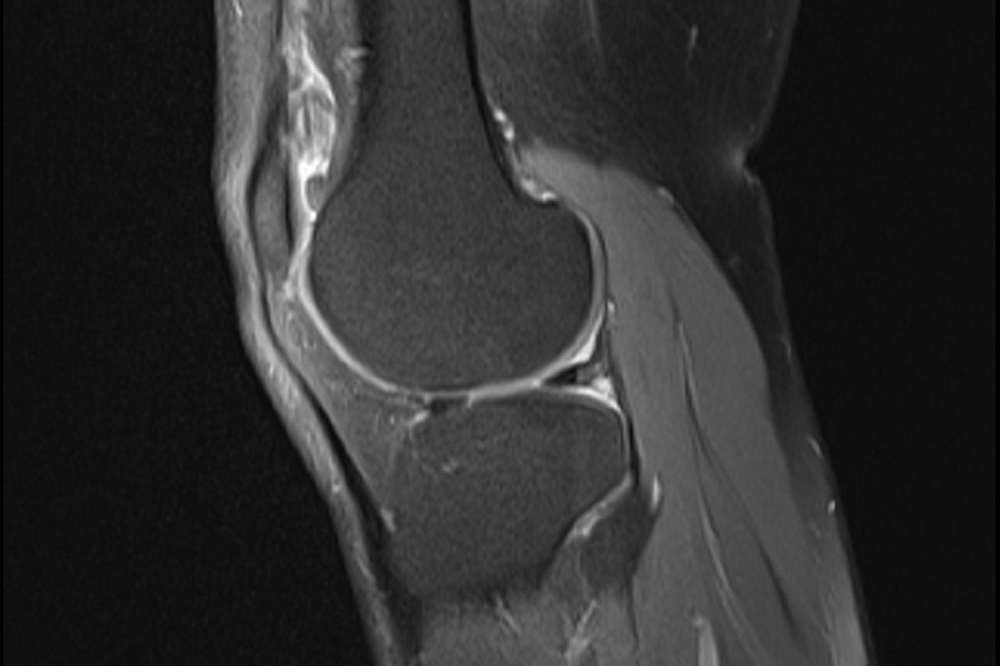
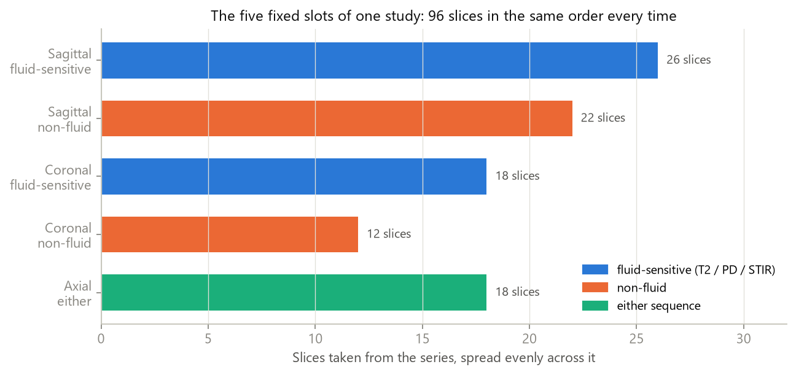
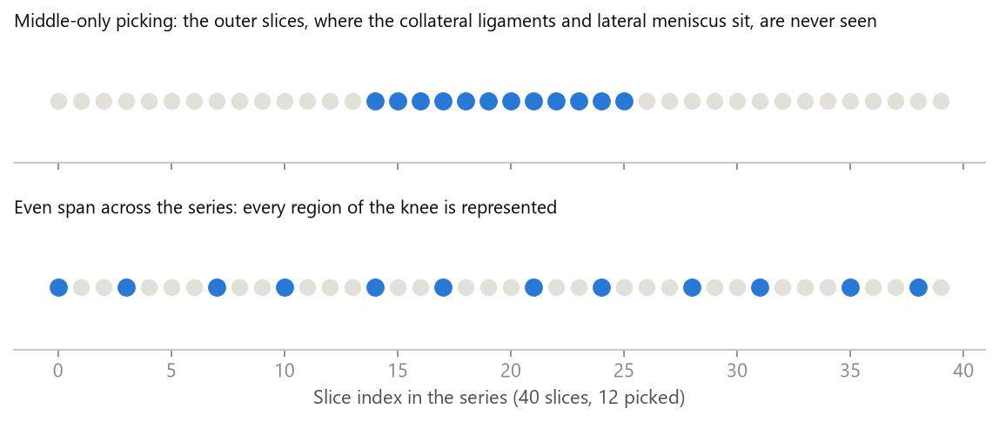
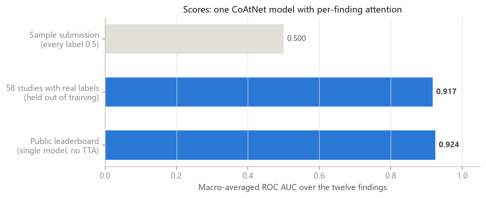

# 무릎 이상 탐지 - CoAtNet 모델 하나로 MRI 소견 12가지
<p>Kaggle의 RSNA 무릎 이상 탐지 대회 솔루션이에요. CoAtNet 모델 하나가 무릎 MRI 검사, 세 평면의 DICOM 시리즈를 읽고 임상적으로 중요한 소견 12가지를 한 번에 점수화해요.
Public Leaderboard 매크로 ROC AUC 0.924, 단일 모델, 앙상블과 TTA 없이요.</p>
<p><strong>키워드</strong></p>
<div class="fact-grid">
<div class="fact"><span class="fact-label">주최</span><span class="fact-value">RSNA · Kaggle 코드 대회</span></div>
<div class="fact"><span class="fact-label">과제</span><span class="fact-value">무릎 MRI 검사당 소견 12가지</span></div>
<div class="fact"><span class="fact-label">데이터</span><span class="fact-value">검사 4,407건 · DICOM 82만 파일 · 570 GB</span></div>
<div class="fact"><span class="fact-label">모델</span><span class="fact-value">CoAtNet 384 px, 소견별 Attention</span></div>
<div class="fact"><span class="fact-label">결과</span><span class="fact-value">Public 매크로 AUC 0.924, 단일 모델</span></div>
<div class="fact"><span class="fact-label">제한</span><span class="fact-value">노트북만 · 인터넷 없음 · GPU 9시간 이하</span></div>
</div>
<figure class="figure-small">

<figcaption>시상면 무릎 MRI 슬라이스예요. 모델은 이런 슬라이스를 세 평면에서 읽고 검사 전체에 대해 12가지 소견을 점수화해요. 사진: Ptrump16, CC BY-SA 4.0, Wikimedia Commons.</figcaption>
</figure>

---

## 1. 소개
<p>무릎은 가장 많이 촬영하는 관절이고, MRI 검사 하나에 다른 문제가 열두 가지씩 들어 있을 수 있어요. 인대 파열, 반월상연골 손상, 연골 소실, 골절, 삼출이요.
영상의학과 의사는 부족하고 판독이 늘 일치하지도 않아서, 대회는 모든 소견을 한 번에 점수화하는 모델을 요구해요. 또 모든 검사에 판독문이 붙어 있는 첫 RSNA 대회라서,
테스트 때는 없지만 학습 때는 판독문이 모델을 가르칠 수 있어요.</p>
<table>
<thead>
<tr><th>라벨</th><th>소견</th><th>라벨</th><th>소견</th></tr>
</thead>
<tbody>
<tr><td><code>ACL</code></td><td>전방십자인대 손상</td><td><code>PF OA</code></td><td>슬개대퇴 골관절염</td></tr>
<tr><td><code>MCL</code></td><td>내측측부인대 손상</td><td><code>Effusion</code></td><td>관절 삼출</td></tr>
<tr><td><code>Medial Meniscus</code></td><td>내측 반월상연골 파열</td><td><code>Synovitis</code></td><td>활막염</td></tr>
<tr><td><code>Lateral Meniscus</code></td><td>외측 반월상연골 파열</td><td><code>Baker's</code></td><td>베이커 낭종</td></tr>
<tr><td><code>Medial OA</code></td><td>내측 경대퇴 골관절염</td><td><code>Contusion</code></td><td>골 타박</td></tr>
<tr><td><code>Lateral OA</code></td><td>외측 경대퇴 골관절염</td><td><code>Fracture</code></td><td>골절</td></tr>
</tbody>
</table>
<p>제출은 12개 라벨의 매크로 평균 ROC AUC로 채점돼요. Kaggle 노트북으로 실행되고, GPU 한 장으로 최대 9시간, 인터넷은 꺼져 있어요.</p>

---

## 2. 목표
<div class="callout callout-goal">
<h4>목표</h4>
<ul>
<li>검사마다 모델 하나, 순전파 한 번으로 소견 12가지를 모두 점수화해요.</li>
<li>실제 데이터를 오는 그대로 다뤄요. 섞인 DICOM 전송 구문, 다른 슬라이스 수와 해상도, 여러 촬영 기관이요.</li>
<li>노트북 하나, 인터넷 없음, GPU 9시간이라는 대회 제한 안에서, 앙상블 없이 해요.</li>
</ul>
</div>

---

## 3. 접근
<div class="callout callout-problem">
<h4>어려웠던 점</h4>
<ul>
<li>검사는 4,407건인데 구조화된 라벨은 58건뿐이에요. 나머지는 자유 형식 판독문만 있어요.</li>
<li>같은 모양의 검사가 없어요. 평면이 다른 시리즈가 여러 개이고, 시리즈 수도 시리즈당 슬라이스 수도 제각각인데, 네트워크는 고정 크기 입력이 필요해요.</li>
<li>12가지 소견이 시퀀스 종류에 따라 나뉘어요. 액체 민감 시퀀스는 부종, 삼출, 급성 손상을 보여 주고, 나머지는 해부 구조와 연골을 보여 줘요.</li>
<li>여러 전송 구문의 슬라이스 50만 장을 9시간 안에 추론할 만큼 빠르게 읽어야 해요.</li>
</ul>
</div>
<pre class="mermaid">flowchart LR
    S[(검사<br/>DICOM 시리즈, 3평면)]:::store --> F[고정 슬롯 5개<br/>평면 · 시퀀스 · 개수]:::process
    F --> C[140 mm 박스 크롭<br/>384 px로 리사이즈]:::process
    C --> W[3슬라이스 윈도 42개]:::process
    W --> B[CoAtNet Backbone]:::agent
    B --> A[소견별 Attention<br/>Head ×12]:::agent
    A --> O[검사당<br/>확률 12개]:::output
</pre>

<h3>3.1 판독문에서 만든 라벨</h3>
<p>구조화된 라벨은 58건뿐이라서, 모델 뒤의 라벨은 판독문을 언어 모델로 읽어서 만들었어요. 예/아니오 12개가 아니라 확률 12개로요. 파열이 <em>의심된다</em>고 쓴
판독문은 1이 아니라 0.8 근처가 돼요. 애매한 문장을 억지로 하드 라벨로 만드는 것보다 공정한 목표예요. 그렇게 학습에 쓸 검사 4,349건이 생겨요.
진짜 라벨이 있는 58건은 학습에 쓰지 않고 정직한 확인용으로 남겨요.</p>

<h3>3.2 모양이 다 다른 검사에서 고정 입력 만들기</h3>
<p>검사마다 고정 슬롯 5개를 항상 같은 순서로 채워서 슬라이스 스택 하나를 만들어요. 액체 민감 시리즈를 우선하는 슬롯과 아닌 슬롯이 있어요. 소견이 두 종류에
나뉘어 있기 때문이에요. 맞는 시리즈가 없는 슬롯은 0으로 두고 마스크해서, 모델이 엉뚱한 걸 보는 대신 건너뛰게 해요.</p>
<figure class="figure-small">

<figcaption>슬롯 5개와 각각 가져오는 슬라이스 수예요. 검사당 96장을 항상 같은 순서로요.</figcaption>
</figure>

```python
# Five fixed slots per study: (plane, prefer fluid-sensitive, slice count).
# A missing slot stays zeros and is masked out so the model skips it.
SLOTS = [
    ("Sagittal",  1, 26),   # fluid-sensitive sagittal (T2 / PD / STIR): swelling, effusion, acute injury
    ("Sagittal",  0, 22),   # non-fluid sagittal: anatomy and cartilage
    ("Coronal",   1, 18),
    ("Coronal",   0, 12),
    ("Axial",    -1, 18),   # axial, either sequence
]
```

<p>시리즈 안에서는 가운데가 아니라 전체에 고르게 퍼뜨려서 슬라이스를 골라요. 측부인대와 외측 반월상연골은 바깥쪽 슬라이스에 있어서, 그걸 잘라내면 바로 그 소견의
정확도가 눈에 띄게 떨어졌어요. 슬라이스마다 DICOM 헤더의 픽셀 간격으로 140 mm 박스를 잘라낸 뒤 리사이즈해요. 그래서 픽셀당 0.3 mm든 0.5 mm든 무릎이 화면의 같은 비율을 차지해요.</p>
<figure class="figure-small">

<figcaption>가운데만 고르면 바깥 슬라이스를 놓쳐요. 고르게 퍼뜨리면 무릎의 모든 부위가 스택에 들어가요.</figcaption>
</figure>

```python
# Even span across the series (not the middle): the periphery holds the collateral
# ligaments and the lateral meniscus.
n = len(files)
lo, hi = int(n * 0.02), int(n * 0.98) - 1
picks = np.linspace(lo, hi, k).round().astype(int)

# Crop a fixed 140 mm box using the DICOM pixel spacing, then resize, so scale carries
# no information the model has to learn.
cpx = int(round(CROP_MM / pixel_spacing))          # CROP_MM = 140.0
a = a[y0:y0 + cpx, x0:x0 + cpx]
a = cv2.resize(a, (IMG, IMG), interpolation=cv2.INTER_AREA)
```

<h3>3.3 모델이 스택을 읽는 방법</h3>
<p>이웃한 슬라이스 3장을 이미지 하나의 3채널에 넣어요. 그래서 네트워크가 가운데 슬라이스의 위아래를 조금씩 같이 봐요. 2D 모델의 비용으로 3D 모델 이점의 대부분을 얻는 거예요.
3슬라이스 윈도마다 384픽셀 CoAtNet Backbone을 지나고, 검사 하나의 윈도 42개는 소견 12가지마다 가중치가 따로 있는 Attention 층으로 합쳐져요. 이게 제일 중요한 부분이에요.
십자인대 파열은 시상면 두 장에 보이고 골관절염은 관상면 여러 장에 퍼져 있을 수 있는데, 소견별 Attention은 소견마다 실제로 그걸 보여 주는 슬라이스를 쓰게 해 줘요.</p>

<h3>3.4 제한 안에서 돌리기</h3>
<p>추론은 반정밀도로 돌고, 실패하면 그 검사만 전정밀도로 다시 시도해요. 그래서 빠지는 검사가 없어요. Backbone은 내려받지 않고 첨부한 가중치에서 불러오고,
빠른 DICOM 리더가 흔한 비압축 Little Endian 시퀀스를 바로 디코딩하고, 특이한 건 pydicom으로 넘겨요.</p>

```python
# Scored run: verify the exact checkpoint, require a GPU, keep internet off.
assert torch.cuda.is_available(), "this scored pipeline requires CUDA"
assert sha256(weights) == "7e5315dad125b99fc65b340b3de41de628e9be51ff5835355dd61c86472244ef"
```

---

## 4. 결과
<figure class="figure-small">

<figcaption>매크로 평균 ROC AUC예요. 전부 0.5인 샘플 제출, 학습에서 뺀 진짜 라벨 58건, 그리고 Public Leaderboard.</figcaption>
</figure>
<div class="callout callout-result">
<h4>결과</h4>
<ul>
<li>Public Leaderboard <strong>매크로 평균 ROC AUC 0.924</strong>. 단일 모델, 앙상블 없음, TTA 없음.</li>
<li>학습에서 완전히 뺀 진짜 라벨 58건에서 <strong>매크로 AUC 0.9167</strong>.</li>
<li>나머지 4,349건의 라벨은 판독문에서 만든 소프트 확률이고, 하드 0/1 목표가 아니에요.</li>
<li>고정 슬롯 5개 스택 위의 CoAtNet 모델 하나, 검사당 윈도 42개에 소견별 Attention, 9시간 오프라인 노트북 제한 안에서요.</li>
</ul>
</div>

---

## 5. 코드와 자세한 내용은 Kaggle에
<p>메인 프로젝트와 기술적인 세부 내용은 Kaggle에 올려 두었어요. 작업을 자세히 이해하시려면 노트북을 참고해 주세요.</p>
<ul>
<li><a href="https://www.kaggle.com/code/laudari/notebook247d4dbb42" target="_blank" rel="noopener noreferrer">추론 노트북</a>: 가중치를 불러와 제출 파일을 써요.</li>
<li><a href="https://www.kaggle.com/competitions/rsna-knee-abnormality-detection" target="_blank" rel="noopener noreferrer">대회 페이지</a>: 데이터, 평가, 일정.</li>
<li><a href="https://www.kaggle.com/datasets/dreaddevelopment/raptor-knee-widedense" target="_blank" rel="noopener noreferrer">모델 가중치</a>: 노트북이 불러오는 학습된 체크포인트.</li>
</ul>
