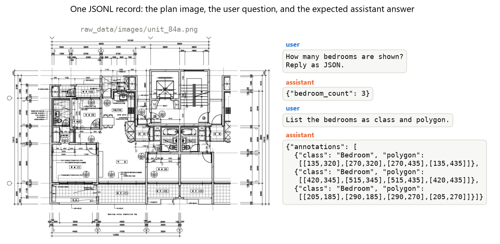
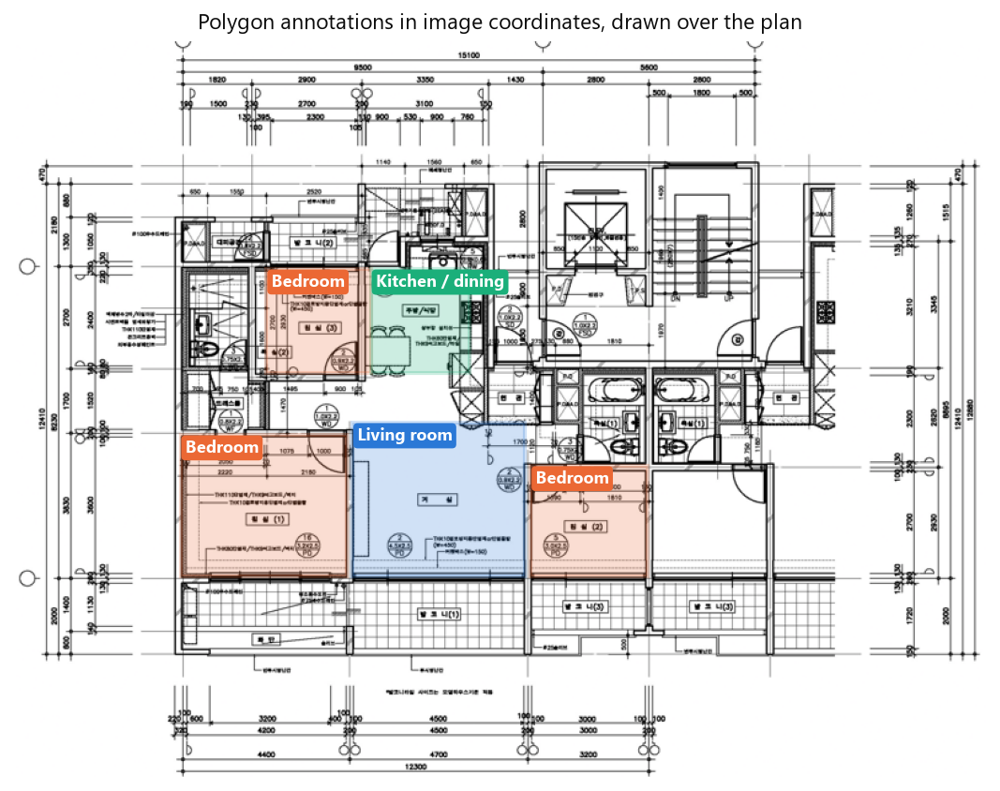
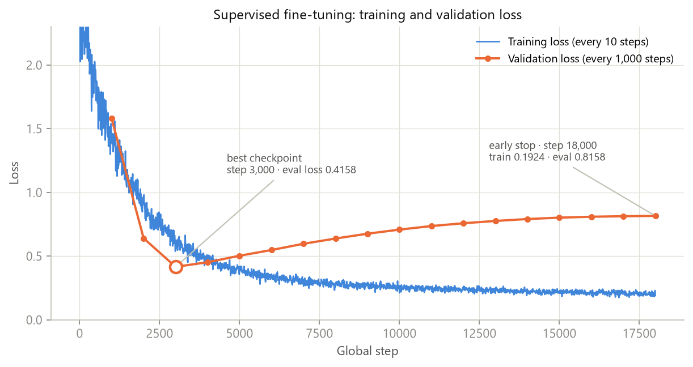
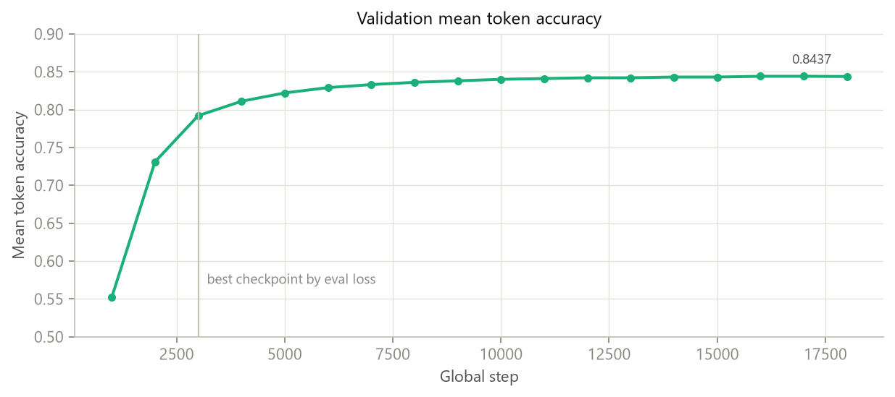
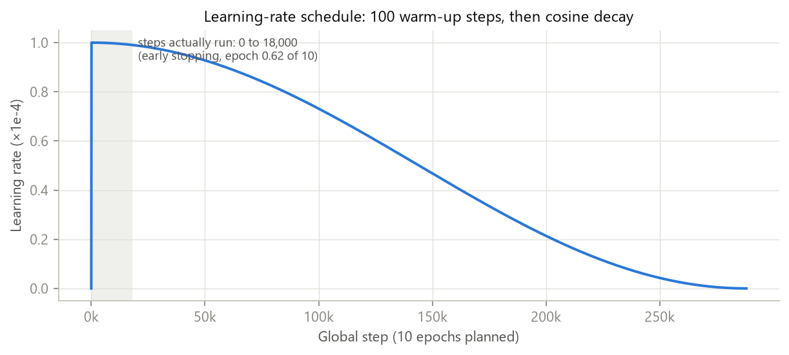

# Fine-Tuning a Vision-Language Model for Floor-Plan Understanding
<p>Qwen3.5-9B, a 9-billion-parameter vision-language model, fine-tuned with QLoRA so that it can look at an architectural floor-plan image and answer
questions about it as structured JSON: which rooms and objects are present, how many of each, where the X-junctions are, and the polygon of every
object in image coordinates. The model reads plans; it does not draw new ones.</p>
<p><strong>Main Process</strong></p>
<div class="fact-grid">
<div class="fact"><span class="fact-label">Base model</span><span class="fact-value">Qwen3.5-9B (VLM)</span></div>
<div class="fact"><span class="fact-label">Method</span><span class="fact-value">QLoRA: 4-bit base + LoRA r16</span></div>
<div class="fact"><span class="fact-label">Data</span><span class="fact-value">1,037,246 train · 238,685 val (JSONL)</span></div>
<div class="fact"><span class="fact-label">Tasks</span><span class="fact-value">Rooms · counts · junctions · polygons</span></div>
<div class="fact"><span class="fact-label">Stack</span><span class="fact-value">Unsloth · TRL · PEFT · PyTorch</span></div>
<div class="fact"><span class="fact-label">Training</span><span class="fact-value">3 GPUs, Accelerate, bf16</span></div>
<div class="fact"><span class="fact-label">Best checkpoint</span><span class="fact-value">step 3,000 · eval loss 0.4158</span></div>
<div class="fact"><span class="fact-label">Output</span><span class="fact-value">Merged model + JSON / overlay inference</span></div>
</div>
<figure class="figure-small">

<figcaption>One training record: a floor-plan image, the user's question, and the assistant's expected answer as JSON.</figcaption>
</figure>

---

## 1. Introduction
<p>A floor plan is a picture that carries structured facts: rooms with names, openings with sizes, fixtures with positions. Software that works on
plans needs those facts as data, not as prose. A general vision-language model can describe a plan in words, but it has never seen architectural
drawings in volume, it answers inconsistently, and it does not return the counts, classes and coordinates a program can use.</p>
<div class="callout callout-problem">
<h4>Problems this project addresses</h4>
<ul>
<li>A pretrained VLM answers questions about floor plans inconsistently and in free prose.</li>
<li>Answers must be machine-readable: counts, classes and polygon coordinates as valid JSON.</li>
<li>A 9B model cannot be fully fine-tuned on workstation GPUs; only a small set of parameters can be trained.</li>
<li>Over a million examples have to be fed through an image processor fast enough to keep three GPUs busy.</li>
<li>Checkpoints, evaluation and the final merged model must be reproducible from one script.</li>
</ul>
</div>
<p>The answer is supervised fine-tuning on floor-plan question-answer pairs, with a parameter-efficient method so that the whole thing fits on a
small multi-GPU box. The pipeline below is what the repository does end to end.</p>
<pre class="mermaid">flowchart LR
    R[(Floor-plan images<br/>+ LabelMe JSON)]:::store --> G[generate_data.py<br/>questions and answers]:::process
    G --> J[(JSONL<br/>train · val)]:::store
    J --> P[Resize, cache,<br/>chat template]:::process
    P --> M[Qwen3.5-9B 4-bit<br/>+ LoRA r16]:::agent
    M --> T[SFTTrainer<br/>eval every 1k steps]:::process
    T --> B[(Best checkpoint<br/>by eval loss)]:::store
    B --> MG[Merge adapter<br/>into base]:::process
    MG --> I[inference.py<br/>JSON answer · overlay]:::output
</pre>

<hr />
<div class="part-divider"><span>Dataset</span></div>

## 2. Dataset
<p>Every example is a chat: a user turn with one image and one question, and an assistant turn with the expected answer. The source material is a set
of floor-plan images, each with a LabelMe-style JSON file whose <code>shapes</code> list holds a label and the polygon points of every object.
<code>generate_data.py</code> turns each annotated plan into many question-answer records: a room list, a count per class, comparisons between classes,
junction questions and polygon requests. That is how one annotated image becomes dozens of training lines, and how the set reaches a million records.</p>

<h3>2.1 Size and split</h3>
<table>
<thead>
<tr><th>Item</th><th>Value</th><th>Why</th></tr>
</thead>
<tbody>
<tr><td>Training records</td><td>1,037,246 lines in <code>vlm_train.jsonl</code></td><td>Many questions per plan, so the model sees each plan from several angles.</td></tr>
<tr><td>Validation records</td><td>238,685 lines in <code>vlm_val.jsonl</code>; 20 % (47,737) used per evaluation</td><td>A full pass over 239k records every 1,000 steps would cost more than the training between evaluations.</td></tr>
<tr><td>Split</td><td>By source image, deterministic seed</td><td>Questions about the same plan are near-duplicates; splitting by record would leak plans into validation.</td></tr>
<tr><td>Answer formats</td><td>Short text, or JSON with counts, classes, polygons</td><td>JSON is what the calling software needs; the format is part of what the model learns.</td></tr>
<tr><td>Image size</td><td>Longest side capped at 1,024 px</td><td>Vision tokens grow with image area; 1,024 px keeps a plan readable within the 1,024-token sequence budget.</td></tr>
</tbody>
</table>

<h3>2.2 Record format</h3>
<p>Each line is one JSON object with a <code>messages</code> array. The plan below is a real unit plan; the two records are the question types asked about it.</p>

```json
{"messages":[
  {"role":"user","content":[
    {"type":"image","image":"raw_data/images/unit_84a.png"},
    {"type":"text","text":"How many bedrooms are shown? Reply as JSON."}
  ]},
  {"role":"assistant","content":[
    {"type":"text","text":"{\"bedroom_count\":3}"}
  ]}
]}
```

```json
{"messages":[
  {"role":"user","content":[
    {"type":"image","image":"raw_data/images/unit_84a.png"},
    {"type":"text","text":"List the bedrooms as class and polygon."}
  ]},
  {"role":"assistant","content":[
    {"type":"text","text":"{\"annotations\":[{\"class\":\"Bedroom\",\"polygon\":[[135,320],[270,320],[270,435],[135,435]]},{\"class\":\"Bedroom\",\"polygon\":[[420,345],[515,345],[515,435],[420,435]]},{\"class\":\"Bedroom\",\"polygon\":[[205,185],[290,185],[290,270],[205,270]]}]}"}
  ]}
]}
```

<figure class="figure-small">

<figcaption>The polygons of the second record, drawn over the plan in image coordinates. Bedrooms in orange, living room in blue, kitchen in green.</figcaption>
</figure>

<h3>2.3 Source annotation</h3>
<p>The LabelMe-style file for a plan is the single source of truth; questions, counts and polygons are all derived from it, so a label fixed once is fixed in every record.</p>

```json
{"imagePath": "unit_84a.png", "imageWidth": 791, "imageHeight": 599,
 "shapes": [
   {"label": "Bedroom", "shape_type": "polygon", "points": [[135,320],[270,320],[270,435],[135,435]]},
   {"label": "Door",    "shape_type": "polygon", "points": [[268,352],[286,352],[286,370],[268,370]]},
   {"label": "Window",  "shape_type": "polygon", "points": [[150,432],[250,432],[250,440],[150,440]]}
 ]}
```

<div class="callout callout-note">
<h4>What the data preparation checks</h4>
<ul>
<li>Every referenced image exists and opens; a missing file would crash a worker mid-epoch.</li>
<li>Polygon coordinates are image pixels, class names are one spelling, and JSON answers are valid JSON.</li>
<li>Near-duplicate plans are kept on one side of the split.</li>
<li>Malformed records, empty labels, duplicates and class imbalance are counted before training, because the model learns whatever inconsistency is left in.</li>
</ul>
</div>

<hr />
<div class="part-divider"><span>Method</span></div>

## 3. Method
<p>Full fine-tuning of a 9B model needs the weights, their gradients and two optimizer moments in memory: on the order of 16 bytes per parameter,
well over 100 GB. The training box has three GPUs with a fraction of that. Every choice below exists to fit the job on that hardware
without giving up the vision layers.</p>
<table>
<thead>
<tr><th>Choice</th><th>What it is</th><th>Why it was used here</th></tr>
</thead>
<tbody>
<tr><td>Qwen3.5-9B</td><td>A dense decoder VLM with a vision encoder and a language model</td><td>Strong document and diagram reading out of the box, local weights, a size that fits one GPU in 4-bit with room for activations. A 32B variant was tried but did not fit the same budget.</td></tr>
<tr><td>PEFT</td><td>Train a small set of added parameters, keep the base frozen</td><td>Removes the optimizer state for 9B weights; the trainable set is a few tens of millions of parameters.</td></tr>
<tr><td>LoRA, rank 16, alpha 32</td><td>Low-rank update matrices on the linear projections</td><td>Rank 16 is enough capacity for a new output format and domain; alpha at 2× rank keeps the update scale stable. Dropout 0.05 against overfitting a million near-duplicate questions.</td></tr>
<tr><td><code>target_modules="all-linear"</code></td><td>Adapters on every linear layer, vision and language, attention and MLP</td><td>The vision side has never seen plans, so adapting only the language projections leaves the hard part frozen.</td></tr>
<tr><td>4-bit base (QLoRA)</td><td>Frozen base weights stored in 4-bit NF4, dequantised per layer on the fly</td><td>Cuts the base from 18 GB to under 6 GB, which is what makes batch 4 at 1,024 px possible per GPU.</td></tr>
<tr><td>Unsloth</td><td>Fused kernels and patched vision-model loading</td><td>Faster forward and backward passes and lower activation memory than stock Transformers for the same model.</td></tr>
<tr><td>Gradient checkpointing</td><td>Recompute activations in the backward pass</td><td>Trades compute for memory; without it, 1,024-token sequences with image tokens do not fit at batch 4.</td></tr>
<tr><td>TRL SFTTrainer</td><td>Supervised fine-tuning loop with evaluation, checkpoints and callbacks</td><td>Periodic eval, best-model tracking, early stopping and resume come built in; only the collator is custom.</td></tr>
</tbody>
</table>
<pre class="mermaid">flowchart LR
    B[Qwen3.5-9B<br/>frozen, 4-bit NF4]:::tool --> V[Vision encoder<br/>+ LoRA]:::process
    B --> L[Language model<br/>+ LoRA]:::process
    V --> O[Trainable: LoRA A·B on all linear layers<br/>r=16, α=32, dropout 0.05]:::agent
    L --> O
    O --> C[(Adapter checkpoint<br/>every 1,000 steps)]:::store
    C --> M[Merged model<br/>base + best adapter]:::output
</pre>

<h3>3.1 Configuration</h3>
<table>
<thead>
<tr><th>Setting</th><th>Value</th><th>Why</th></tr>
</thead>
<tbody>
<tr><td>Per-device batch, train / eval</td><td>4 / 4</td><td>The largest that fits with 1,024-px images and gradient checkpointing.</td></tr>
<tr><td>Gradient accumulation</td><td>3</td><td>Effective batch 4 × 3 × 3 GPUs = 36 records per optimizer step.</td></tr>
<tr><td>Learning rate</td><td>1e-4, cosine, 100 warm-up steps</td><td>A standard LoRA rate; warm-up protects the fresh adapters from the first noisy gradients, cosine lets the end of training settle.</td></tr>
<tr><td>Epoch limit</td><td>10</td><td>An upper bound; early stopping decides the real length.</td></tr>
<tr><td>Image longest side / sequence</td><td>1,024 px / 1,024 tokens</td><td>Enough resolution for dimension text and thin walls, within memory.</td></tr>
<tr><td>Precision</td><td>bf16 where supported</td><td>No loss scaling needed and the same range as fp32.</td></tr>
<tr><td>Evaluate and save</td><td>Every 1,000 steps, keep 2 checkpoints</td><td>Frequent enough to catch the minimum of the validation loss; two checkpoints keep the disk bounded.</td></tr>
<tr><td>Best model</td><td><code>eval_loss</code>, lower is better</td><td>The only metric available on every evaluation; task metrics come after training.</td></tr>
<tr><td>Early stopping</td><td>Patience 15 evaluations, threshold 1e-4</td><td>Stops a run that has stopped improving without a person watching it.</td></tr>
<tr><td>Data loading</td><td>8 workers, pinned memory, persistent</td><td>Image decoding is the bottleneck, not the GPU; the cache and workers keep the GPUs fed.</td></tr>
<tr><td>Logging</td><td>TensorBoard every 10 steps, <code>training.log</code>, <code>run_summary.json</code></td><td>Curves during the run; a summary file after it.</td></tr>
</tbody>
</table>

<hr />
<div class="part-divider"><span>Training Pipeline</span></div>

## 4. Training pipeline
<p>The stages below are the main script, <code>train_qwen35_vlm_unsloth.py</code>, with the configuration values repeated in place so the page reads as a walkthrough.</p>

<h3>4.1 Configuration and data</h3>

```python
import torch
from datasets import load_dataset
from peft import PeftModel
from transformers import AutoModelForImageTextToText, EarlyStoppingCallback
from trl import SFTConfig, SFTTrainer
from unsloth import FastVisionModel

MODEL_DIR, OUTPUT_DIR = Path("models/Qwen3.5-9B"), Path("outputs/qwen35-floorplan-lora")
TRAIN_FILE, VAL_FILE = Path("train_data/vlm_train.jsonl"), Path("train_data/vlm_val.jsonl")
TRAIN_PERCENTAGE, VALIDATION_PERCENTAGE = 100, 20
NUM_TRAIN_EPOCHS, LEARNING_RATE = 10, 1e-4
PER_DEVICE_TRAIN_BATCH_SIZE, PER_DEVICE_EVAL_BATCH_SIZE, GRADIENT_ACCUMULATION_STEPS = 4, 4, 3
MAX_IMAGE_SIDE, MAX_SEQ_LENGTH, LOAD_IN_4BIT, SEED = 1024, 1024, True, 42

dataset = load_dataset("json", data_files={"train": str(TRAIN_FILE), "validation": str(VAL_FILE)})

def limit_dataset_by_percentage(split, percentage):
    n = max(1, int(len(split) * percentage / 100.0))
    return split.shuffle(seed=SEED).select(range(n))          # same subset on every run

train_dataset = limit_dataset_by_percentage(dataset["train"], TRAIN_PERCENTAGE)
val_dataset = limit_dataset_by_percentage(dataset["validation"], VALIDATION_PERCENTAGE)
```

<h3>4.2 Image cache and chat template</h3>
<p>Decoding and resizing a million PNGs every epoch would starve the GPUs, so each image is resized once, written to a cache keyed by the hash of its
path, and read from there on every later pass. The processor then renders the messages with the model's own chat template, so the training text is
byte-for-byte what the model will see at inference.</p>

```python
def resize_and_cache_image(image_path, cache_dir, max_image_side):
    source = Path(image_path)
    cached = cache_dir / (hashlib.md5(str(source.resolve()).encode()).hexdigest() + (source.suffix.lower() or ".jpg"))
    if cached.exists():
        return str(cached)
    image = Image.open(source).convert("RGB")
    longest = max(image.size)
    if longest > max_image_side:                                   # shrink only, never upscale
        scale = max_image_side / longest
        image = image.resize((max(1, int(image.width * scale)), max(1, int(image.height * scale))), Image.Resampling.BICUBIC)
    image.save(cached, quality=95)
    return str(cached)

def preprocess_example(example, processor, cache_dir):
    messages, image_paths = [], []
    for message in example["messages"]:
        content = []
        for item in message["content"]:
            if item["type"] == "image":
                image_paths.append(resize_and_cache_image(item["image"], cache_dir, MAX_IMAGE_SIDE))
                content.append({"type": "image"})
            else:
                content.append({"type": "text", "text": item["text"]})
        messages.append({"role": message["role"], "content": content})
    prompt = processor.apply_chat_template(messages, tokenize=False, add_generation_prompt=False).strip()
    return {"text": prompt, "image_paths": image_paths}

train_dataset = train_dataset.map(lambda r: preprocess_example(r, processor, IMAGE_CACHE_DIR / "train"),
                                  remove_columns=train_dataset.column_names, desc="Preprocessing train")
```

<h3>4.3 Model and adapters</h3>

```python
model, processor = FastVisionModel.from_pretrained(model_name=str(MODEL_DIR), load_in_4bit=LOAD_IN_4BIT)

model = FastVisionModel.get_peft_model(
    model,
    finetune_vision_layers=True,      # the vision side has never seen floor plans
    finetune_language_layers=True,
    finetune_attention_modules=True,
    finetune_mlp_modules=True,
    r=16, lora_alpha=32, lora_dropout=0.05, bias="none",
    target_modules="all-linear",
)
FastVisionModel.for_training(model)
model.config.use_cache = False        # the KV cache is for generation, not for training
```

<h3>4.4 Collator: what the loss is computed on</h3>
<p>The language-model loss must only count the tokens the model is supposed to produce. Padding tokens and the image placeholder tokens are set to
<code>-100</code> so that they are ignored; otherwise the model would spend its capacity learning to predict padding and image markers.</p>

```python
def build_collate_fn(processor, max_seq_length):
    pad_token_id = processor.tokenizer.pad_token_id
    image_token_ids = [processor.tokenizer.convert_tokens_to_ids(t)
                       for t in (processor.tokenizer.special_tokens_map.get(n) for n in ("boi_token", "image_token")) if t]

    def collate_fn(examples):
        texts = [e["text"] for e in examples]
        images = [[Image.open(p).convert("RGB") for p in e["image_paths"]] for e in examples]
        batch = processor(text=texts, images=images, padding=True, truncation=True,
                          max_length=max_seq_length, return_tensors="pt")
        labels = batch["input_ids"].clone()
        labels[labels == pad_token_id] = -100
        for token_id in image_token_ids:
            labels[labels == token_id] = -100
        batch["labels"] = labels
        return batch
    return collate_fn
```

<h3>4.5 Trainer, early stopping, launch</h3>

```python
training_args = SFTConfig(
    output_dir=str(OUTPUT_DIR),
    num_train_epochs=NUM_TRAIN_EPOCHS,
    per_device_train_batch_size=PER_DEVICE_TRAIN_BATCH_SIZE,
    per_device_eval_batch_size=PER_DEVICE_EVAL_BATCH_SIZE,
    gradient_accumulation_steps=GRADIENT_ACCUMULATION_STEPS,
    learning_rate=LEARNING_RATE, lr_scheduler_type="cosine", warmup_steps=100,
    gradient_checkpointing=True, gradient_checkpointing_kwargs={"use_reentrant": False},
    save_strategy="steps", save_steps=1000, eval_strategy="steps", eval_steps=1000, logging_steps=10,
    bf16=torch.cuda.is_bf16_supported(), fp16=not torch.cuda.is_bf16_supported(),
    remove_unused_columns=False, dataset_kwargs={"skip_prepare_dataset": True},
    report_to="tensorboard", save_total_limit=2,
    load_best_model_at_end=True, metric_for_best_model="eval_loss", greater_is_better=False,
    ddp_find_unused_parameters=False,
    dataloader_num_workers=8, dataloader_pin_memory=True, dataloader_persistent_workers=True,
)

trainer = SFTTrainer(
    model=model, args=training_args,
    train_dataset=train_dataset, eval_dataset=val_dataset,
    data_collator=build_collate_fn(processor, MAX_SEQ_LENGTH), processing_class=processor,
    callbacks=[EarlyStoppingCallback(early_stopping_patience=15, early_stopping_threshold=1e-4),
               SaveAliasCallback()],              # keeps best-checkpoint/ and latest/ aliases up to date
)
trainer.train()                                    # or trainer.train(resume_from_checkpoint="outputs/.../checkpoint-3000")
```

```bash
CUDA_VISIBLE_DEVICES=0,1,2 accelerate launch --multi_gpu --num_processes 3 train_qwen35_vlm_unsloth.py
tensorboard --logdir outputs/tensorboard/qwen35-floorplan-lora
```

<h3>4.6 Merge the best adapter</h3>
<p>An adapter on its own needs the base model, PEFT and the right loading code at inference time. Merging the LoRA matrices into the base weights
gives one ordinary Transformers model that <code>AutoModelForImageTextToText.from_pretrained</code> can load anywhere.</p>

```python
base = AutoModelForImageTextToText.from_pretrained(MODEL_DIR, torch_dtype=torch.bfloat16).to("cuda")
merged = PeftModel.from_pretrained(base, OUTPUT_DIR / "best-checkpoint").merge_and_unload()
merged.save_pretrained(OUTPUT_DIR / "merged-best")
processor.save_pretrained(OUTPUT_DIR / "merged-best")
```

<hr />
<div class="part-divider"><span>Results</span></div>

## 5. Training results
<p>The run went to global step 18,000, 0.62 of the first epoch, before early stopping ended it: the validation loss reached its minimum at step 3,000
and then rose for fifteen evaluations in a row while the training loss kept falling. That is the classic shape of a model that has learned the task and
is starting to memorise the training questions, and it is exactly what the patience rule is there to catch.</p>
<figure class="figure-small">

<figcaption>Training loss (every 10 steps) and validation loss (every 1,000 steps). The best checkpoint is the validation minimum at step 3,000; the run was stopped at 18,000 by early stopping.</figcaption>
</figure>
<div class="figure-row figure-row-small figure-row-equal">
<figure>

<figcaption>Validation mean token accuracy: most of the gain comes before the best checkpoint; afterwards it flattens while the loss rises.</figcaption>
</figure>
<figure>

<figcaption>The planned schedule against the steps actually run: early stopping ended training while the rate was still near its peak.</figcaption>
</figure>
</div>
<table>
<thead>
<tr><th>Recorded in <code>run_summary.json</code> / <code>training.log</code></th><th>Value</th></tr>
</thead>
<tbody>
<tr><td>Global steps run</td><td>18,000 (epoch 0.6247 of 10)</td></tr>
<tr><td>Training loss at the end</td><td>0.1924</td></tr>
<tr><td>Best validation loss</td><td>0.4158 at <code>checkpoint-3000</code></td></tr>
<tr><td>Validation loss at the end</td><td>0.8158</td></tr>
<tr><td>Validation mean token accuracy at the end</td><td>0.8437</td></tr>
<tr><td>Selected adapter</td><td><code>best-checkpoint</code> → <code>checkpoint-3000</code></td></tr>
<tr><td>Merged model</td><td><code>outputs/qwen35-floorplan-lora/merged-best</code></td></tr>
</tbody>
</table>
<div class="callout callout-result">
<h4>What the curves say</h4>
<ul>
<li>Three thousand steps, about 108,000 records, were enough to teach the output format and the domain; the rest of the run only fitted the training set better.</li>
<li>Token accuracy keeps creeping up after the loss minimum because the model becomes more confident on the tokens it already gets right; the loss rises because it also becomes more confident on the ones it gets wrong.</li>
<li>Loss and token accuracy are training diagnostics. Whether counts, junctions and polygons are right is checked on held-out plans with <code>inference.py</code>, record by record.</li>
</ul>
</div>

<hr />
<div class="part-divider"><span>Inference</span></div>

## 6. Inference and output
<p>Artifacts live under <code>outputs/qwen35-floorplan-lora/</code>: the intermediate <code>checkpoint-*/</code> adapters with trainer state, the
<code>best-checkpoint/</code> alias, the <code>merged-best/</code> model with its processor, and <code>training.log</code> and <code>run_summary.json</code>.
<code>inference.py</code> takes an image path and a question, formats them with the same chat template as training, generates the answer, and when the
answer contains polygons draws them over the plan and saves the overlay.</p>
<pre class="mermaid">flowchart LR
    I[Floor-plan image<br/>+ question]:::input --> P[Processor<br/>chat template]:::process
    P --> M[merged-best<br/>Qwen3.5-9B + LoRA]:::agent
    M --> J[JSON answer<br/>counts · classes · polygons]:::output
    J --> O[Overlay image<br/>polygons on the plan]:::output
</pre>

```python
from transformers import AutoModelForImageTextToText, AutoProcessor

model_path = "outputs/qwen35-floorplan-lora/merged-best"
processor = AutoProcessor.from_pretrained(model_path)
model = AutoModelForImageTextToText.from_pretrained(model_path, device_map="auto")

messages = [{"role": "user", "content": [{"type": "image", "image": image_path},
                                         {"type": "text", "text": "List the bedrooms as class and polygon."}]}]
prompt = processor.apply_chat_template(messages, tokenize=False, add_generation_prompt=True)
inputs = processor(text=[prompt], images=[[Image.open(image_path).convert("RGB")]], return_tensors="pt").to(model.device)
output = model.generate(**inputs, max_new_tokens=512, do_sample=False)      # greedy: JSON must be exact
answer = processor.batch_decode(output[:, inputs["input_ids"].shape[1]:], skip_special_tokens=True)[0]
draw_polygons(image_path, json.loads(answer)["annotations"], out_path)       # the overlay saved next to the answer
```

<div class="figure-row figure-row-small figure-row-equal">
<figure>

<figcaption>Input: the plan as the model receives it.</figcaption>
</figure>
<figure>

<figcaption>Output: every object the model returned, drawn as a box with its class. Rooms dashed in green, doors orange, windows blue, fixtures violet.</figcaption>
</figure>
</div>

```json
{"objects": [
  {"class": "Bedroom", "bbox": [135, 320, 270, 435]}, {"class": "Bedroom", "bbox": [420, 345, 515, 435]},
  {"class": "Bedroom", "bbox": [205, 185, 290, 270]}, {"class": "Living room", "bbox": [275, 310, 415, 435]},
  {"class": "Kitchen", "bbox": [290, 185, 370, 270]}, {"class": "Bathroom", "bbox": [455, 300, 505, 345]},
  {"class": "Door", "bbox": [268, 350, 286, 372]}, {"class": "Window", "bbox": [150, 432, 250, 441]},
  {"class": "Toilet", "bbox": [474, 314, 492, 332]}, {"class": "Sink", "bbox": [330, 188, 352, 202]}
]}
```
<p>The answer above is shortened to one box per class; the full response lists all 26 objects, and <code>inference.py</code> draws every one of them.</p>

---

## 7. Repository
<p>The training script, data generator and inference script are public: <a href="https://github.com/Laudarisd/finetune-llm-vllm">github.com/Laudarisd/finetune-llm-vllm</a>.
The base weights and the JSONL data are not redistributed; the weights come from the model's own Hugging Face repository under its access terms.</p>
<table>
<thead>
<tr><th>Path</th><th>Purpose</th></tr>
</thead>
<tbody>
<tr><td><code>train.py</code>, <code>train_qwen35_vlm_unsloth.py</code></td><td>Unsloth / TRL supervised fine-tuning pipeline</td></tr>
<tr><td><code>generate_data.py</code></td><td>LabelMe JSON → question-answer JSONL records</td></tr>
<tr><td><code>inference.py</code></td><td>Image + question → JSON answer and polygon overlay</td></tr>
<tr><td><code>config.yaml</code>, <code>finetune_run.sh</code>, <code>tensorboard.sh</code></td><td>Run configuration, launcher, metrics viewer</td></tr>
<tr><td><code>train_data/</code></td><td><code>vlm_train.jsonl</code>, <code>vlm_val.jsonl</code>, <code>image_cache/</code></td></tr>
<tr><td><code>raw_data/images/</code>, <code>raw_data/json/</code></td><td>Floor-plan images and their LabelMe annotations</td></tr>
<tr><td><code>models/Qwen3.5-9B/</code></td><td>Local base model and processor files</td></tr>
<tr><td><code>outputs/qwen35-floorplan-lora/</code></td><td>Checkpoints, best adapter, merged model, logs</td></tr>
</tbody>
</table>
