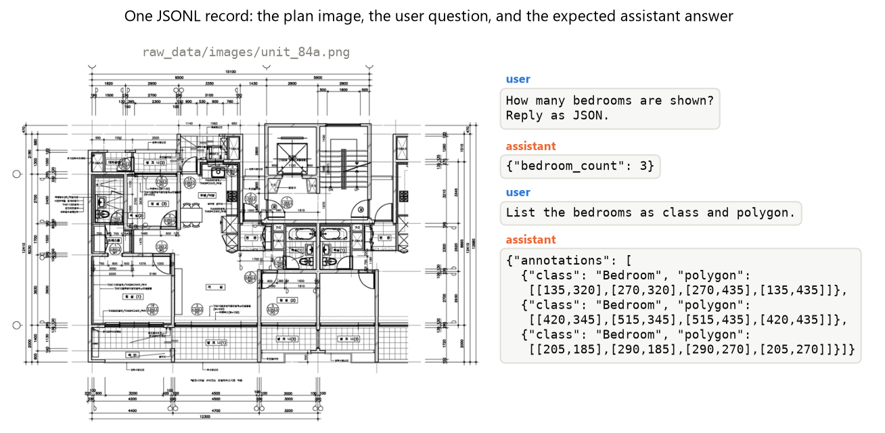
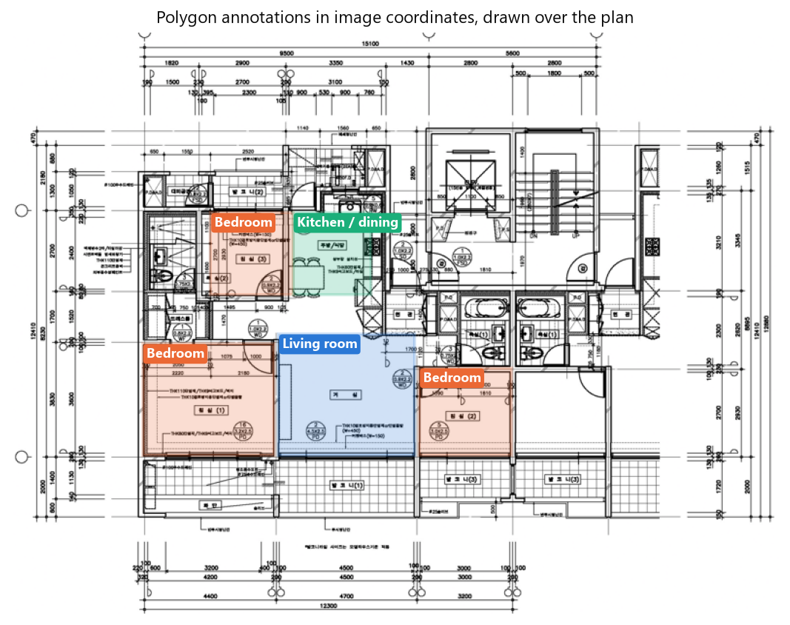
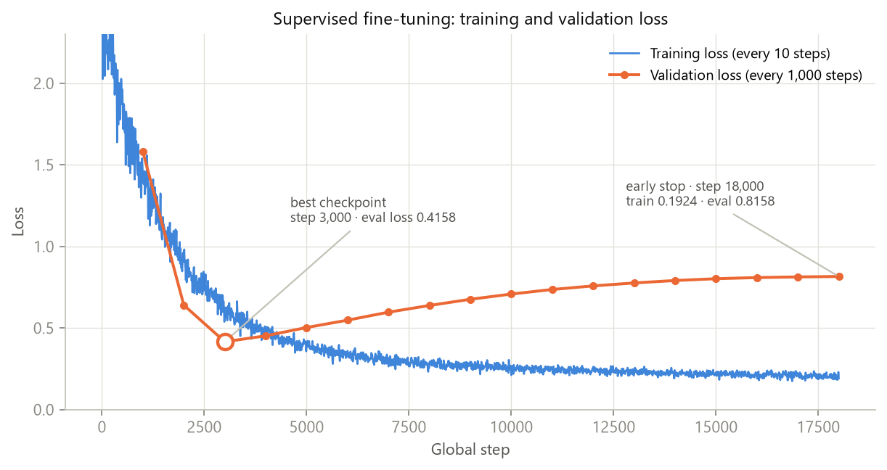
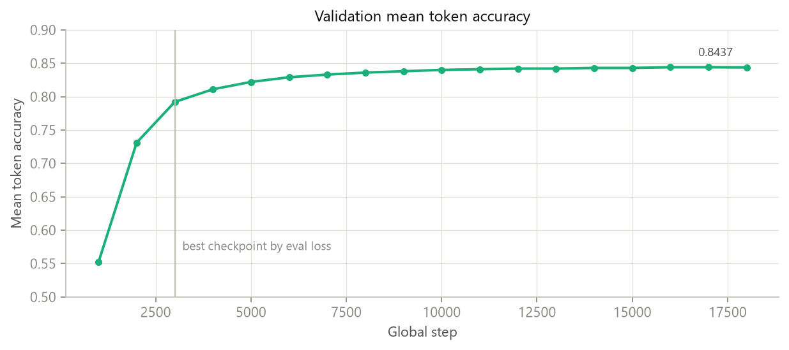
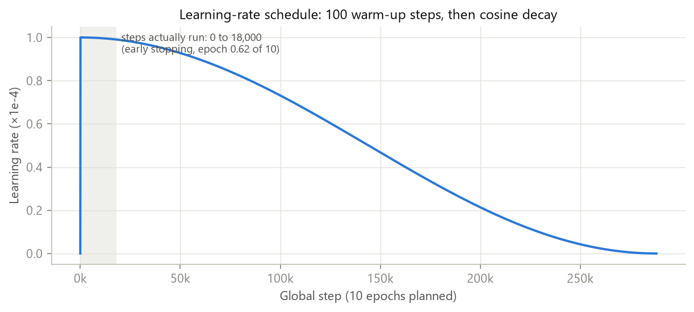
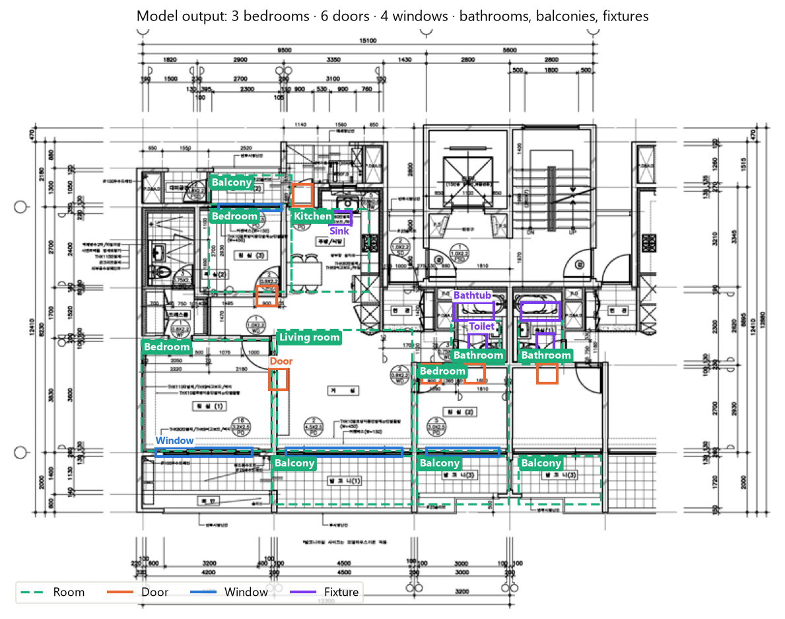

# 평면도를 이해하는 Vision-Language 모델 Fine-Tuning
<p>90억 파라미터 Vision-Language 모델인 Qwen3.5-9B를 QLoRA로 Fine-Tuning 했어요. 건축 평면도 이미지를 보고 질문에 구조화된 JSON으로 답해요.
어떤 방과 객체가 있는지, 각각 몇 개인지, X자 교차점이 어디인지, 그리고 객체마다 이미지 좌표의 폴리곤이 무엇인지요. 이 모델은 평면도를 읽는 모델이지, 새로 그리는 모델은 아니에요.</p>
<p><strong>주요 과정</strong></p>
<div class="fact-grid">
<div class="fact"><span class="fact-label">기본 모델</span><span class="fact-value">Qwen3.5-9B (VLM)</span></div>
<div class="fact"><span class="fact-label">방법</span><span class="fact-value">QLoRA: 4-bit 기본 모델 + LoRA r16</span></div>
<div class="fact"><span class="fact-label">데이터</span><span class="fact-value">학습 1,037,246 · 검증 238,685 (JSONL)</span></div>
<div class="fact"><span class="fact-label">과제</span><span class="fact-value">방 · 개수 · 교차점 · 폴리곤</span></div>
<div class="fact"><span class="fact-label">스택</span><span class="fact-value">Unsloth · TRL · PEFT · PyTorch</span></div>
<div class="fact"><span class="fact-label">학습</span><span class="fact-value">GPU 3장, Accelerate, bf16</span></div>
<div class="fact"><span class="fact-label">최고 체크포인트</span><span class="fact-value">3,000 step · eval loss 0.4158</span></div>
<div class="fact"><span class="fact-label">출력</span><span class="fact-value">병합 모델 + JSON / 오버레이 추론</span></div>
</div>
<figure class="figure-small">

<figcaption>학습 레코드 하나: 평면도 이미지, 사용자의 질문, 그리고 모델이 내야 할 JSON 답이에요.</figcaption>
</figure>

---

## 1. 소개
<p>평면도는 구조화된 사실이 담긴 그림이에요. 이름이 있는 방, 크기가 있는 개구부, 위치가 있는 기구들이요. 평면도를 다루는 소프트웨어는 이 사실을
문장이 아니라 데이터로 받아야 해요. 일반 Vision-Language 모델은 평면도를 말로 설명할 수는 있지만, 건축 도면을 많이 본 적이 없어서 답이 들쭉날쭉하고,
프로그램이 쓸 수 있는 개수, 종류, 좌표를 돌려주지 않아요.</p>
<div class="callout callout-problem">
<h4>이 프로젝트가 해결하는 문제</h4>
<ul>
<li>사전 학습된 VLM은 평면도 질문에 일관성 없이, 자유로운 문장으로 답해요.</li>
<li>답은 기계가 읽을 수 있어야 해요. 개수, 종류, 폴리곤 좌표를 올바른 JSON으로요.</li>
<li>9B 모델은 워크스테이션 GPU로 전체 Fine-Tuning 이 안 돼요. 작은 일부 파라미터만 학습할 수 있어요.</li>
<li>백만 개가 넘는 예제를 GPU 3장이 놀지 않을 만큼 빠르게 이미지 프로세서에 넣어야 해요.</li>
<li>체크포인트, 평가, 최종 병합 모델이 스크립트 하나로 재현돼야 해요.</li>
</ul>
</div>
<p>답은 평면도 질문·답 쌍으로 하는 지도 Fine-Tuning 이에요. 파라미터 효율적인 방법을 써서 작은 다중 GPU 장비에 전부 들어가게 했어요.
아래 그림이 저장소가 처음부터 끝까지 하는 일이에요.</p>
<pre class="mermaid">flowchart LR
    R[(평면도 이미지<br/>+ LabelMe JSON)]:::store --> G[generate_data.py<br/>질문과 답 생성]:::process
    G --> J[(JSONL<br/>학습 · 검증)]:::store
    J --> P[리사이즈, 캐시,<br/>채팅 템플릿]:::process
    P --> M[Qwen3.5-9B 4-bit<br/>+ LoRA r16]:::agent
    M --> T[SFTTrainer<br/>1,000 step마다 평가]:::process
    T --> B[(eval loss 기준<br/>최고 체크포인트)]:::store
    B --> MG[어댑터를<br/>기본 모델에 병합]:::process
    MG --> I[inference.py<br/>JSON 답 · 오버레이]:::output
</pre>

<hr />
<div class="part-divider"><span>데이터셋</span></div>

## 2. 데이터셋
<p>예제 하나는 대화 하나예요. 사용자 턴에 이미지 한 장과 질문 하나, 어시스턴트 턴에 기대하는 답이 있어요. 원본은 평면도 이미지들과, 이미지마다 붙은
LabelMe 형식의 JSON 파일이에요. JSON의 <code>shapes</code> 목록에 객체마다 라벨과 폴리곤 점이 들어 있어요. <code>generate_data.py</code>가 주석이 달린
평면도 하나를 여러 질문·답 레코드로 바꿔요. 방 목록, 종류별 개수, 종류끼리 비교, 교차점 질문, 폴리곤 요청이요. 그래서 이미지 하나가 수십 줄의 학습 데이터가 되고,
전체가 백만 개를 넘게 돼요.</p>

<h3>2.1 크기와 분할</h3>
<table>
<thead>
<tr><th>항목</th><th>값</th><th>이유</th></tr>
</thead>
<tbody>
<tr><td>학습 레코드</td><td><code>vlm_train.jsonl</code> 1,037,246줄</td><td>평면도 하나에 질문이 여러 개라서, 모델이 같은 도면을 여러 각도에서 봐요.</td></tr>
<tr><td>검증 레코드</td><td><code>vlm_val.jsonl</code> 238,685줄, 평가마다 20 %(47,737개) 사용</td><td>1,000 step마다 239k개를 전부 평가하면 그 사이의 학습보다 평가가 더 오래 걸려요.</td></tr>
<tr><td>분할</td><td>원본 이미지 기준, 고정 seed</td><td>같은 평면도의 질문들은 거의 중복이라서, 레코드 단위로 나누면 도면이 검증 쪽으로 새요.</td></tr>
<tr><td>답 형식</td><td>짧은 텍스트, 또는 개수·종류·폴리곤이 든 JSON</td><td>호출하는 소프트웨어가 JSON을 원해요. 형식도 모델이 배우는 것의 일부예요.</td></tr>
<tr><td>이미지 크기</td><td>긴 변 최대 1,024 px</td><td>Vision 토큰은 이미지 면적에 따라 늘어나요. 1,024 px면 1,024 토큰 예산 안에서 도면이 읽혀요.</td></tr>
</tbody>
</table>

<h3>2.2 레코드 형식</h3>
<p>한 줄이 JSON 객체 하나이고, 안에 <code>messages</code> 배열이 있어요. 아래 평면도는 실제 세대 평면도이고, 두 레코드는 이 도면에 대해 묻는 질문 종류예요.</p>

```json
{"messages":[
  {"role":"user","content":[
    {"type":"image","image":"raw_data/images/unit_84a.png"},
    {"type":"text","text":"How many bedrooms are shown? Reply as JSON."}
  ]},
  {"role":"assistant","content":[
    {"type":"text","text":"{\"bedroom_count\":3}"}
  ]}
]}
```

```json
{"messages":[
  {"role":"user","content":[
    {"type":"image","image":"raw_data/images/unit_84a.png"},
    {"type":"text","text":"List the bedrooms as class and polygon."}
  ]},
  {"role":"assistant","content":[
    {"type":"text","text":"{\"annotations\":[{\"class\":\"Bedroom\",\"polygon\":[[135,320],[270,320],[270,435],[135,435]]},{\"class\":\"Bedroom\",\"polygon\":[[420,345],[515,345],[515,435],[420,435]]},{\"class\":\"Bedroom\",\"polygon\":[[205,185],[290,185],[290,270],[205,270]]}]}"}
  ]}
]}
```

<figure class="figure-small">

<figcaption>두 번째 레코드의 폴리곤을 이미지 좌표로 평면도 위에 그린 모습이에요. 침실은 주황, 거실은 파랑, 주방은 초록이에요.</figcaption>
</figure>

<h3>2.3 원본 주석</h3>
<p>평면도 하나의 LabelMe 형식 파일이 유일한 기준이에요. 질문, 개수, 폴리곤이 전부 여기서 나오기 때문에, 라벨 하나를 고치면 모든 레코드에서 고쳐져요.</p>

```json
{"imagePath": "unit_84a.png", "imageWidth": 791, "imageHeight": 599,
 "shapes": [
   {"label": "Bedroom", "shape_type": "polygon", "points": [[135,320],[270,320],[270,435],[135,435]]},
   {"label": "Door",    "shape_type": "polygon", "points": [[268,352],[286,352],[286,370],[268,370]]},
   {"label": "Window",  "shape_type": "polygon", "points": [[150,432],[250,432],[250,440],[150,440]]}
 ]}
```

<div class="callout callout-note">
<h4>데이터 준비에서 확인하는 것</h4>
<ul>
<li>참조된 이미지가 전부 있고 열리는지요. 파일 하나가 없으면 에폭 중간에 워커가 죽어요.</li>
<li>폴리곤 좌표는 이미지 픽셀이고, 종류 이름은 한 가지 표기이고, JSON 답은 올바른 JSON인지요.</li>
<li>거의 같은 평면도는 분할의 한쪽에만 두는지요.</li>
<li>깨진 레코드, 빈 라벨, 중복, 종류 불균형을 학습 전에 세어요. 남겨 두면 모델이 그 불일치를 그대로 배워요.</li>
</ul>
</div>

<hr />
<div class="part-divider"><span>방법</span></div>

## 3. 방법
<p>9B 모델을 전체 Fine-Tuning 하려면 가중치, 그 기울기, 옵티마이저 모멘트 두 개가 메모리에 있어야 해요. 파라미터당 16바이트쯤이라 100 GB를 훌쩍 넘어요.
학습 장비는 GPU 3장이고 그 몇 분의 일밖에 없어요. 아래의 선택은 전부, Vision 층을 포기하지 않으면서 이 장비에 작업을 맞추기 위한 거예요.</p>
<table>
<thead>
<tr><th>선택</th><th>무엇인가</th><th>왜 썼나</th></tr>
</thead>
<tbody>
<tr><td>Qwen3.5-9B</td><td>Vision 인코더와 언어 모델이 있는 Dense 디코더 VLM</td><td>문서와 도면 읽기가 기본적으로 강하고, 로컬 가중치가 있고, 4-bit로 GPU 한 장에 들어가면서 활성화 메모리 여유가 있어요. 32B 버전도 써 봤지만 같은 예산에 들어가지 않았어요.</td></tr>
<tr><td>PEFT</td><td>추가한 작은 파라미터만 학습하고 기본 모델은 고정</td><td>9B 가중치의 옵티마이저 상태가 없어져요. 학습하는 양은 수천만 파라미터예요.</td></tr>
<tr><td>LoRA, rank 16, alpha 32</td><td>선형 투영에 붙이는 저랭크 갱신 행렬</td><td>새 출력 형식과 도메인을 배우기에 rank 16이면 충분해요. alpha를 rank의 2배로 두면 갱신 크기가 안정적이에요. dropout 0.05는 거의 중복인 백만 개 질문에 과적합하지 않게 해요.</td></tr>
<tr><td><code>target_modules="all-linear"</code></td><td>Vision과 언어, attention과 MLP의 모든 선형 층에 어댑터</td><td>Vision 쪽은 평면도를 본 적이 없어요. 언어 투영만 바꾸면 어려운 부분이 고정된 채로 남아요.</td></tr>
<tr><td>4-bit 기본 모델 (QLoRA)</td><td>고정된 기본 가중치를 4-bit NF4로 저장하고 층마다 그때그때 복원</td><td>기본 모델이 18 GB에서 6 GB 아래로 줄어요. 그래서 GPU당 1,024 px에 batch 4가 가능해요.</td></tr>
<tr><td>Unsloth</td><td>결합된 커널과 패치된 Vision 모델 로딩</td><td>같은 모델에서 순전파와 역전파가 더 빠르고 활성화 메모리가 기본 Transformers보다 적어요.</td></tr>
<tr><td>Gradient checkpointing</td><td>역전파 때 활성화를 다시 계산</td><td>계산을 더 하고 메모리를 아껴요. 이게 없으면 이미지 토큰이 든 1,024 토큰 시퀀스가 batch 4에 안 들어가요.</td></tr>
<tr><td>TRL SFTTrainer</td><td>평가, 체크포인트, 콜백이 있는 지도 Fine-Tuning 루프</td><td>주기적 평가, 최고 모델 추적, 조기 종료, 재개가 기본으로 있어요. 직접 만든 건 collator뿐이에요.</td></tr>
</tbody>
</table>
<pre class="mermaid">flowchart LR
    B[Qwen3.5-9B<br/>고정, 4-bit NF4]:::tool --> V[Vision 인코더<br/>+ LoRA]:::process
    B --> L[언어 모델<br/>+ LoRA]:::process
    V --> O[학습 대상: 모든 선형 층의 LoRA A·B<br/>r=16, α=32, dropout 0.05]:::agent
    L --> O
    O --> C[(어댑터 체크포인트<br/>1,000 step마다)]:::store
    C --> M[병합 모델<br/>기본 + 최고 어댑터]:::output
</pre>

<h3>3.1 설정</h3>
<table>
<thead>
<tr><th>설정</th><th>값</th><th>이유</th></tr>
</thead>
<tbody>
<tr><td>장치당 batch, 학습 / 평가</td><td>4 / 4</td><td>1,024 px 이미지와 gradient checkpointing으로 들어가는 최대값이에요.</td></tr>
<tr><td>Gradient accumulation</td><td>3</td><td>실질 batch는 4 × 3 × GPU 3장 = 옵티마이저 step당 36개예요.</td></tr>
<tr><td>학습률</td><td>1e-4, cosine, warm-up 100 step</td><td>LoRA의 표준 학습률이에요. warm-up은 새 어댑터를 초반의 거친 기울기에서 보호하고, cosine은 학습 끝을 차분하게 해요.</td></tr>
<tr><td>에폭 상한</td><td>10</td><td>상한일 뿐이에요. 실제 길이는 조기 종료가 정해요.</td></tr>
<tr><td>이미지 긴 변 / 시퀀스</td><td>1,024 px / 1,024 토큰</td><td>치수 글자와 얇은 벽이 보일 만큼의 해상도를, 메모리 안에서요.</td></tr>
<tr><td>정밀도</td><td>지원되면 bf16</td><td>loss scaling이 필요 없고 fp32와 같은 범위예요.</td></tr>
<tr><td>평가와 저장</td><td>1,000 step마다, 체크포인트 2개 유지</td><td>검증 loss의 최저점을 놓치지 않을 만큼 자주요. 체크포인트 2개면 디스크가 넘치지 않아요.</td></tr>
<tr><td>최고 모델 기준</td><td><code>eval_loss</code>, 낮을수록 좋음</td><td>평가마다 얻을 수 있는 유일한 지표예요. 과제 지표는 학습 뒤에 봐요.</td></tr>
<tr><td>조기 종료</td><td>patience 15회 평가, 기준 1e-4</td><td>사람이 지켜보지 않아도, 더 좋아지지 않는 학습을 멈춰요.</td></tr>
<tr><td>데이터 로딩</td><td>워커 8개, pinned memory, persistent</td><td>병목은 GPU가 아니라 이미지 디코딩이에요. 캐시와 워커가 GPU를 계속 먹여요.</td></tr>
<tr><td>로깅</td><td>10 step마다 TensorBoard, <code>training.log</code>, <code>run_summary.json</code></td><td>학습 중에는 곡선, 끝난 뒤에는 요약 파일이에요.</td></tr>
</tbody>
</table>

<hr />
<div class="part-divider"><span>학습 파이프라인</span></div>

## 4. 학습 파이프라인
<p>아래 단계는 메인 스크립트 <code>train_qwen35_vlm_unsloth.py</code>예요. 설정값을 그 자리에 다시 적어서 페이지만 읽어도 흐름이 보이게 했어요.</p>

<h3>4.1 설정과 데이터</h3>

```python
import torch
from datasets import load_dataset
from peft import PeftModel
from transformers import AutoModelForImageTextToText, EarlyStoppingCallback
from trl import SFTConfig, SFTTrainer
from unsloth import FastVisionModel

MODEL_DIR, OUTPUT_DIR = Path("models/Qwen3.5-9B"), Path("outputs/qwen35-floorplan-lora")
TRAIN_FILE, VAL_FILE = Path("train_data/vlm_train.jsonl"), Path("train_data/vlm_val.jsonl")
TRAIN_PERCENTAGE, VALIDATION_PERCENTAGE = 100, 20
NUM_TRAIN_EPOCHS, LEARNING_RATE = 10, 1e-4
PER_DEVICE_TRAIN_BATCH_SIZE, PER_DEVICE_EVAL_BATCH_SIZE, GRADIENT_ACCUMULATION_STEPS = 4, 4, 3
MAX_IMAGE_SIDE, MAX_SEQ_LENGTH, LOAD_IN_4BIT, SEED = 1024, 1024, True, 42

dataset = load_dataset("json", data_files={"train": str(TRAIN_FILE), "validation": str(VAL_FILE)})

def limit_dataset_by_percentage(split, percentage):
    n = max(1, int(len(split) * percentage / 100.0))
    return split.shuffle(seed=SEED).select(range(n))          # same subset on every run

train_dataset = limit_dataset_by_percentage(dataset["train"], TRAIN_PERCENTAGE)
val_dataset = limit_dataset_by_percentage(dataset["validation"], VALIDATION_PERCENTAGE)
```

<h3>4.2 이미지 캐시와 채팅 템플릿</h3>
<p>백만 장의 PNG를 에폭마다 디코딩하고 리사이즈하면 GPU가 굶어요. 그래서 이미지마다 한 번만 리사이즈해서 경로의 해시를 키로 캐시에 쓰고,
그 뒤로는 거기서 읽어요. 프로세서는 모델 자체의 채팅 템플릿으로 메시지를 렌더링해요. 그래서 학습 텍스트가 추론 때 모델이 볼 것과 바이트 단위로 같아요.</p>

```python
def resize_and_cache_image(image_path, cache_dir, max_image_side):
    source = Path(image_path)
    cached = cache_dir / (hashlib.md5(str(source.resolve()).encode()).hexdigest() + (source.suffix.lower() or ".jpg"))
    if cached.exists():
        return str(cached)
    image = Image.open(source).convert("RGB")
    longest = max(image.size)
    if longest > max_image_side:                                   # shrink only, never upscale
        scale = max_image_side / longest
        image = image.resize((max(1, int(image.width * scale)), max(1, int(image.height * scale))), Image.Resampling.BICUBIC)
    image.save(cached, quality=95)
    return str(cached)

def preprocess_example(example, processor, cache_dir):
    messages, image_paths = [], []
    for message in example["messages"]:
        content = []
        for item in message["content"]:
            if item["type"] == "image":
                image_paths.append(resize_and_cache_image(item["image"], cache_dir, MAX_IMAGE_SIDE))
                content.append({"type": "image"})
            else:
                content.append({"type": "text", "text": item["text"]})
        messages.append({"role": message["role"], "content": content})
    prompt = processor.apply_chat_template(messages, tokenize=False, add_generation_prompt=False).strip()
    return {"text": prompt, "image_paths": image_paths}

train_dataset = train_dataset.map(lambda r: preprocess_example(r, processor, IMAGE_CACHE_DIR / "train"),
                                  remove_columns=train_dataset.column_names, desc="Preprocessing train")
```

<h3>4.3 모델과 어댑터</h3>

```python
model, processor = FastVisionModel.from_pretrained(model_name=str(MODEL_DIR), load_in_4bit=LOAD_IN_4BIT)

model = FastVisionModel.get_peft_model(
    model,
    finetune_vision_layers=True,      # the vision side has never seen floor plans
    finetune_language_layers=True,
    finetune_attention_modules=True,
    finetune_mlp_modules=True,
    r=16, lora_alpha=32, lora_dropout=0.05, bias="none",
    target_modules="all-linear",
)
FastVisionModel.for_training(model)
model.config.use_cache = False        # the KV cache is for generation, not for training
```

<h3>4.4 Collator: loss를 어디에 계산하나</h3>
<p>언어 모델 loss는 모델이 실제로 내야 하는 토큰에만 계산해야 해요. 패딩 토큰과 이미지 자리 표시 토큰은 <code>-100</code>으로 두어서 무시해요.
안 그러면 모델이 패딩과 이미지 표시를 예측하는 데 용량을 써 버려요.</p>

```python
def build_collate_fn(processor, max_seq_length):
    pad_token_id = processor.tokenizer.pad_token_id
    image_token_ids = [processor.tokenizer.convert_tokens_to_ids(t)
                       for t in (processor.tokenizer.special_tokens_map.get(n) for n in ("boi_token", "image_token")) if t]

    def collate_fn(examples):
        texts = [e["text"] for e in examples]
        images = [[Image.open(p).convert("RGB") for p in e["image_paths"]] for e in examples]
        batch = processor(text=texts, images=images, padding=True, truncation=True,
                          max_length=max_seq_length, return_tensors="pt")
        labels = batch["input_ids"].clone()
        labels[labels == pad_token_id] = -100
        for token_id in image_token_ids:
            labels[labels == token_id] = -100
        batch["labels"] = labels
        return batch
    return collate_fn
```

<h3>4.5 Trainer, 조기 종료, 실행</h3>

```python
training_args = SFTConfig(
    output_dir=str(OUTPUT_DIR),
    num_train_epochs=NUM_TRAIN_EPOCHS,
    per_device_train_batch_size=PER_DEVICE_TRAIN_BATCH_SIZE,
    per_device_eval_batch_size=PER_DEVICE_EVAL_BATCH_SIZE,
    gradient_accumulation_steps=GRADIENT_ACCUMULATION_STEPS,
    learning_rate=LEARNING_RATE, lr_scheduler_type="cosine", warmup_steps=100,
    gradient_checkpointing=True, gradient_checkpointing_kwargs={"use_reentrant": False},
    save_strategy="steps", save_steps=1000, eval_strategy="steps", eval_steps=1000, logging_steps=10,
    bf16=torch.cuda.is_bf16_supported(), fp16=not torch.cuda.is_bf16_supported(),
    remove_unused_columns=False, dataset_kwargs={"skip_prepare_dataset": True},
    report_to="tensorboard", save_total_limit=2,
    load_best_model_at_end=True, metric_for_best_model="eval_loss", greater_is_better=False,
    ddp_find_unused_parameters=False,
    dataloader_num_workers=8, dataloader_pin_memory=True, dataloader_persistent_workers=True,
)

trainer = SFTTrainer(
    model=model, args=training_args,
    train_dataset=train_dataset, eval_dataset=val_dataset,
    data_collator=build_collate_fn(processor, MAX_SEQ_LENGTH), processing_class=processor,
    callbacks=[EarlyStoppingCallback(early_stopping_patience=15, early_stopping_threshold=1e-4),
               SaveAliasCallback()],              # keeps best-checkpoint/ and latest/ aliases up to date
)
trainer.train()                                    # or trainer.train(resume_from_checkpoint="outputs/.../checkpoint-3000")
```

```bash
CUDA_VISIBLE_DEVICES=0,1,2 accelerate launch --multi_gpu --num_processes 3 train_qwen35_vlm_unsloth.py
tensorboard --logdir outputs/tensorboard/qwen35-floorplan-lora
```

<h3>4.6 최고 어댑터 병합</h3>
<p>어댑터만 있으면 추론할 때 기본 모델, PEFT, 맞는 로딩 코드가 따로 필요해요. LoRA 행렬을 기본 가중치에 병합하면
<code>AutoModelForImageTextToText.from_pretrained</code>로 어디서든 불러오는 보통의 Transformers 모델 하나가 돼요.</p>

```python
base = AutoModelForImageTextToText.from_pretrained(MODEL_DIR, torch_dtype=torch.bfloat16).to("cuda")
merged = PeftModel.from_pretrained(base, OUTPUT_DIR / "best-checkpoint").merge_and_unload()
merged.save_pretrained(OUTPUT_DIR / "merged-best")
processor.save_pretrained(OUTPUT_DIR / "merged-best")
```

<hr />
<div class="part-divider"><span>결과</span></div>

## 5. 학습 결과
<p>학습은 전역 18,000 step, 첫 에폭의 0.62 지점까지 갔고, 거기서 조기 종료가 끝냈어요. 검증 loss는 3,000 step에서 최저가 된 뒤, 학습 loss는 계속
내려가는데도 열다섯 번의 평가 내내 올라갔어요. 과제는 배웠고 이제 학습 질문을 외우기 시작하는 모델의 전형적인 모양이고, patience 규칙이 잡으라고 있는 게 바로 이거예요.</p>
<figure class="figure-small">

<figcaption>학습 loss(10 step마다)와 검증 loss(1,000 step마다)예요. 최고 체크포인트는 검증 최저점인 3,000 step이고, 18,000 step에서 조기 종료로 멈췄어요.</figcaption>
</figure>
<div class="figure-row figure-row-small figure-row-equal">
<figure>

<figcaption>검증 평균 토큰 정확도예요. 대부분의 향상은 최고 체크포인트 전에 나오고, 그 뒤로는 loss가 오르는 동안 평평해져요.</figcaption>
</figure>
<figure>

<figcaption>계획된 스케줄과 실제로 돌린 step이에요. 학습률이 아직 최고값 근처일 때 조기 종료가 학습을 끝냈어요.</figcaption>
</figure>
</div>
<table>
<thead>
<tr><th><code>run_summary.json</code> / <code>training.log</code>에 기록된 값</th><th>값</th></tr>
</thead>
<tbody>
<tr><td>돌린 전역 step</td><td>18,000 (10 에폭 중 0.6247)</td></tr>
<tr><td>마지막 학습 loss</td><td>0.1924</td></tr>
<tr><td>최저 검증 loss</td><td><code>checkpoint-3000</code>에서 0.4158</td></tr>
<tr><td>마지막 검증 loss</td><td>0.8158</td></tr>
<tr><td>마지막 검증 평균 토큰 정확도</td><td>0.8437</td></tr>
<tr><td>선택된 어댑터</td><td><code>best-checkpoint</code> → <code>checkpoint-3000</code></td></tr>
<tr><td>병합 모델</td><td><code>outputs/qwen35-floorplan-lora/merged-best</code></td></tr>
</tbody>
</table>
<div class="callout callout-result">
<h4>곡선이 말해 주는 것</h4>
<ul>
<li>3,000 step, 약 108,000개 레코드면 출력 형식과 도메인을 가르치기에 충분했어요. 나머지는 학습 데이터에만 더 맞춘 거예요.</li>
<li>loss 최저점 뒤에도 토큰 정확도가 조금씩 오르는 건, 이미 맞히는 토큰에 더 확신을 갖기 때문이에요. loss가 오르는 건 틀리는 토큰에도 더 확신을 갖기 때문이고요.</li>
<li>loss와 토큰 정확도는 학습 진단용이에요. 개수, 교차점, 폴리곤이 맞는지는 <code>inference.py</code>로 처음 보는 평면도에서 레코드 하나씩 확인해요.</li>
</ul>
</div>

<hr />
<div class="part-divider"><span>추론</span></div>

## 6. 추론과 출력
<p>산출물은 <code>outputs/qwen35-floorplan-lora/</code> 아래에 있어요. 학습 상태가 든 중간 <code>checkpoint-*/</code> 어댑터, <code>best-checkpoint/</code> 별칭,
프로세서가 함께 있는 <code>merged-best/</code> 모델, 그리고 <code>training.log</code>와 <code>run_summary.json</code>이요.
<code>inference.py</code>는 이미지 경로와 질문을 받아서, 학습 때와 같은 채팅 템플릿으로 포맷하고, 답을 생성하고, 답에 폴리곤이 있으면 평면도 위에 그려서 오버레이로 저장해요.</p>
<pre class="mermaid">flowchart LR
    I[평면도 이미지<br/>+ 질문]:::input --> P[프로세서<br/>채팅 템플릿]:::process
    P --> M[merged-best<br/>Qwen3.5-9B + LoRA]:::agent
    M --> J[JSON 답<br/>개수 · 종류 · 폴리곤]:::output
    J --> O[오버레이 이미지<br/>평면도 위의 폴리곤]:::output
</pre>

```python
from transformers import AutoModelForImageTextToText, AutoProcessor

model_path = "outputs/qwen35-floorplan-lora/merged-best"
processor = AutoProcessor.from_pretrained(model_path)
model = AutoModelForImageTextToText.from_pretrained(model_path, device_map="auto")

messages = [{"role": "user", "content": [{"type": "image", "image": image_path},
                                         {"type": "text", "text": "List the bedrooms as class and polygon."}]}]
prompt = processor.apply_chat_template(messages, tokenize=False, add_generation_prompt=True)
inputs = processor(text=[prompt], images=[[Image.open(image_path).convert("RGB")]], return_tensors="pt").to(model.device)
output = model.generate(**inputs, max_new_tokens=512, do_sample=False)      # greedy: JSON must be exact
answer = processor.batch_decode(output[:, inputs["input_ids"].shape[1]:], skip_special_tokens=True)[0]
draw_polygons(image_path, json.loads(answer)["annotations"], out_path)       # the overlay saved next to the answer
```

<div class="figure-row figure-row-small figure-row-equal">
<figure>

<figcaption>입력: 모델이 받는 그대로의 평면도예요.</figcaption>
</figure>
<figure>

<figcaption>출력: 모델이 돌려준 모든 객체를 박스와 종류로 그린 모습이에요. 방은 초록 점선, 문은 주황, 창은 파랑, 기구는 보라예요.</figcaption>
</figure>
</div>

```json
{"objects": [
  {"class": "Bedroom", "bbox": [135, 320, 270, 435]}, {"class": "Bedroom", "bbox": [420, 345, 515, 435]},
  {"class": "Bedroom", "bbox": [205, 185, 290, 270]}, {"class": "Living room", "bbox": [275, 310, 415, 435]},
  {"class": "Kitchen", "bbox": [290, 185, 370, 270]}, {"class": "Bathroom", "bbox": [455, 300, 505, 345]},
  {"class": "Door", "bbox": [268, 350, 286, 372]}, {"class": "Window", "bbox": [150, 432, 250, 441]},
  {"class": "Toilet", "bbox": [474, 314, 492, 332]}, {"class": "Sink", "bbox": [330, 188, 352, 202]}
]}
```
<p>위 답은 종류마다 박스 하나로 줄인 거예요. 실제 응답에는 26개 객체가 전부 들어 있고, <code>inference.py</code>가 그걸 다 그려요.</p>

---

## 7. 저장소
<p>학습 스크립트, 데이터 생성기, 추론 스크립트는 공개돼 있어요: <a href="https://github.com/Laudarisd/finetune-llm-vllm">github.com/Laudarisd/finetune-llm-vllm</a>.
기본 가중치와 JSONL 데이터는 재배포하지 않아요. 가중치는 모델의 Hugging Face 저장소에서 그 접근 조건에 따라 받아요.</p>
<table>
<thead>
<tr><th>경로</th><th>용도</th></tr>
</thead>
<tbody>
<tr><td><code>train.py</code>, <code>train_qwen35_vlm_unsloth.py</code></td><td>Unsloth / TRL 지도 Fine-Tuning 파이프라인</td></tr>
<tr><td><code>generate_data.py</code></td><td>LabelMe JSON → 질문·답 JSONL 레코드</td></tr>
<tr><td><code>inference.py</code></td><td>이미지 + 질문 → JSON 답과 폴리곤 오버레이</td></tr>
<tr><td><code>config.yaml</code>, <code>finetune_run.sh</code>, <code>tensorboard.sh</code></td><td>실행 설정, 런처, 지표 뷰어</td></tr>
<tr><td><code>train_data/</code></td><td><code>vlm_train.jsonl</code>, <code>vlm_val.jsonl</code>, <code>image_cache/</code></td></tr>
<tr><td><code>raw_data/images/</code>, <code>raw_data/json/</code></td><td>평면도 이미지와 LabelMe 주석</td></tr>
<tr><td><code>models/Qwen3.5-9B/</code></td><td>로컬 기본 모델과 프로세서 파일</td></tr>
<tr><td><code>outputs/qwen35-floorplan-lora/</code></td><td>체크포인트, 최고 어댑터, 병합 모델, 로그</td></tr>
</tbody>
</table>
