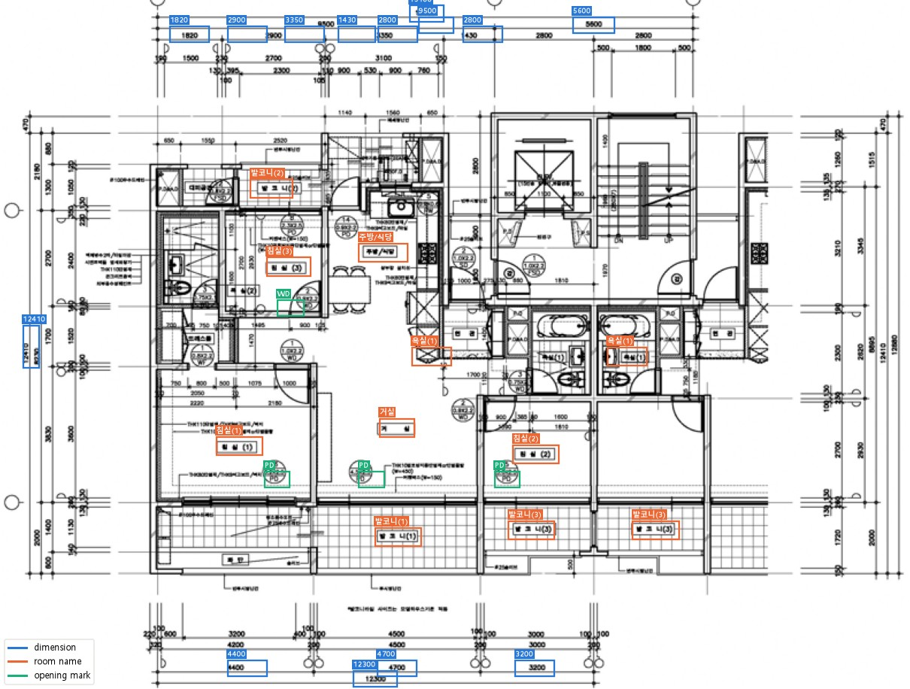

# OCR - Reading Text out of Images and Documents

Training and deploying OCR models that find text in an image and read it: printed and handwritten, on documents, forms and technical drawings. The work covers text detection, text recognition, and serving the result as structured output.

<strong>Keywords</strong>

TaskText detection + recognition

InputsScans · photos · drawings

ModelsCRNN · Paddle OCR

OutputText with positions, as JSON

<figure class="figure-small">

<figcaption>OCR on an architectural drawing: dimension strings along the edges, room names inside the rooms and opening marks, each found and read with its position on the plan.</figcaption>
</figure>

---

## 1. Introduction

OCR is two problems in a row. First the model has to find where the text is, which on a drawing or a form means separating small, rotated labels from the lines around them. Then it has to read each piece, which means recognising characters it may never have seen in that font or that hand. This project trains both halves, evaluates them on real documents, and serves them so other software can ask for the text and get it back with its position.

---

## 2. Goal

<h4>Goal</h4>
<ul>
<li>Detect text regions reliably on cluttered inputs such as forms and technical drawings, not only clean pages.</li>
<li>Recognise printed and handwritten text, including digits, units and domain labels, with a measured character accuracy.</li>
<li>Return every result with its position so the text can be placed back on the source, and expose it through a service.</li>
</ul>

---

## 3. Code and details on GitHub

The main project and its technical details are uploaded to GitHub, so please refer to the repository to understand the work in detail.

<a href="https://github.com/Laudarisd/Machine-Learning-Projects" target="_blank" rel="noopener noreferrer">GitHub: https://github.com/Laudarisd/Machine-Learning-Projects</a>

