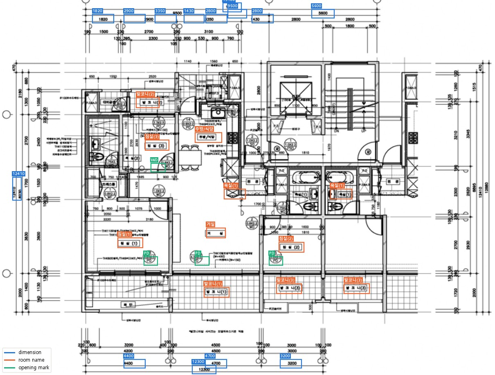

# OCR - 이미지와 문서에서 글자 읽기

이미지 안의 글자를 찾아서 읽는 OCR 모델을 학습하고 배포해요. 인쇄 글자와 손글씨, 문서와 양식과 기술 도면이요. 글자 탐지, 글자 인식, 그리고 결과를 구조화된 출력으로 서빙하는 것까지 다뤄요.

<strong>키워드</strong>

과제글자 탐지 + 인식

입력스캔 · 사진 · 도면

모델CRNN · Paddle OCR

출력위치가 있는 글자, JSON

<figure class="figure-small">

<figcaption>건축 도면의 OCR이에요. 가장자리의 치수 문자열, 방 안의 방 이름, 개구부 기호를 찾아서 읽고, 도면 위의 위치와 함께 돌려줘요.</figcaption>
</figure>

---

## 1. 소개

OCR은 문제 두 개가 이어진 거예요. 먼저 글자가 어디 있는지 찾아야 해요. 도면이나 양식에서는 작고 기울어진 라벨을 주변 선에서 떼어 내는 일이에요. 그다음 조각마다 읽어야 해요. 그 글꼴이나 그 손글씨로는 본 적 없는 글자를 알아보는 일이에요. 이 프로젝트는 두 절반을 다 학습하고, 실제 문서로 평가하고, 다른 소프트웨어가 글자를 요청하면 위치와 함께 돌려받도록 서빙해요.

---

## 2. 목표

<h4>목표</h4>
<ul>
<li>깨끗한 페이지만이 아니라 양식과 기술 도면처럼 복잡한 입력에서도 글자 영역을 안정적으로 찾아요.</li>
<li>숫자, 단위, 분야 라벨을 포함한 인쇄 글자와 손글씨를, 측정된 글자 정확도로 인식해요.</li>
<li>모든 결과를 위치와 함께 돌려줘서 원본 위에 다시 놓을 수 있게 하고, 서비스로 열어 둬요.</li>
</ul>

---

## 3. 코드와 자세한 내용은 GitHub에

메인 프로젝트와 기술적인 세부 내용은 GitHub에 올려 두었어요. 작업을 자세히 이해하시려면 저장소를 참고해 주세요.

<a href="https://github.com/Laudarisd/Machine-Learning-Projects" target="_blank" rel="noopener noreferrer">GitHub: https://github.com/Laudarisd/Machine-Learning-Projects</a>

