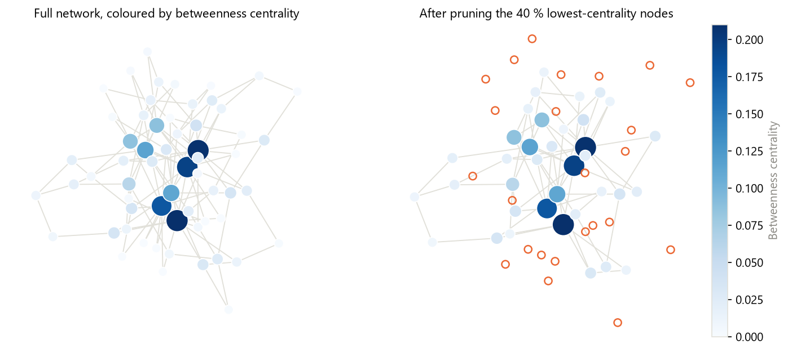

# Research - Centrality-Aware Pruning, Augmentation and Reproducible Experiments

A set of research experiments on making learning systems smaller and more reliable: pruning networks by the graph centrality of their nodes, augmentation methods that make training data go further, and the tooling that keeps every experiment reproducible from one command.

<strong>Keywords</strong>

TopicsPruning · augmentation · graph analysis

MethodCentrality-aware pruning

ToolingSeeded, configured, logged runs

OutputPapers, plots and code

<figure class="figure-small">

<figcaption>Centrality-aware pruning: nodes are ranked by betweenness centrality and the least central 40 % are removed while the backbone of the network stays intact.</figcaption>
</figure>

---

## 1. Introduction

A trained network is a graph, and graph theory has good tools for saying which nodes matter. Centrality-aware pruning uses them: each node is scored by how much of the network's traffic passes through it, and the lowest-scoring nodes are removed first. The experiments measure how far that can go before accuracy drops, and compare it against magnitude-based pruning. Alongside it sit augmentation studies, where the question is how much synthetic variation helps on small datasets, and a small experiment harness so that every run has a seed, a config file and a log and can be repeated exactly.

---

## 2. Goal

<h4>Goal</h4>
<ul>
<li>Prune networks by graph centrality and measure the size-versus-accuracy curve against standard magnitude pruning.</li>
<li>Evaluate augmentation methods on small datasets and report which ones help, by how much, and when they hurt.</li>
<li>Make every experiment reproducible: one command, one config, one seed, one log.</li>
</ul>

---

## 3. Code and details on GitHub

The main project and its technical details are uploaded to GitHub, so please refer to the repository to understand the work in detail.

<a href="https://github.com/Laudarisd/research" target="_blank" rel="noopener noreferrer">GitHub: https://github.com/Laudarisd/research</a>

