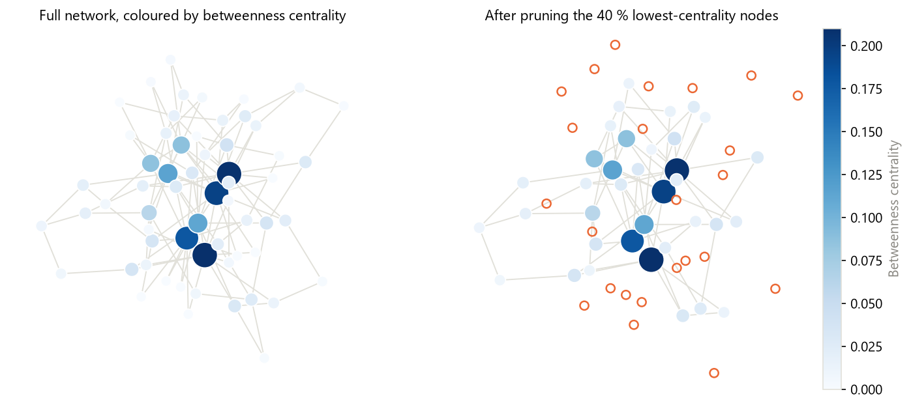

# Research - Centrality 기반 Pruning, Augmentation, 재현 가능한 실험

학습 시스템을 더 작고 더 믿을 수 있게 만드는 연구 실험 모음이에요. 노드의 Graph Centrality로 네트워크를 Pruning 하는 방법, 학습 데이터를 더 멀리 쓰게 하는 Augmentation 기법, 그리고 모든 실험을 명령 하나로 다시 만들 수 있게 하는 도구예요.

<strong>키워드</strong>

주제Pruning · Augmentation · Graph 분석

방법Centrality 기반 Pruning

도구Seed, 설정, 로그가 있는 실행

출력논문, 그래프, 코드

<figure class="figure-small">

<figcaption>Centrality 기반 Pruning이에요. 노드를 Betweenness Centrality로 순위 매기고, 가장 덜 중심적인 40 %를 제거해도 네트워크의 뼈대는 그대로예요.</figcaption>
</figure>

---

## 1. 소개

학습된 네트워크는 그래프이고, 그래프 이론에는 어떤 노드가 중요한지 말해 주는 좋은 도구가 있어요. Centrality 기반 Pruning은 그걸 써요. 노드마다 네트워크의 흐름이 얼마나 그 노드를 지나는지로 점수를 매기고, 점수가 낮은 노드부터 제거해요. 실험은 정확도가 떨어지기 전까지 얼마나 갈 수 있는지 재고, 크기 기반 Pruning과 비교해요. 그 옆에는 작은 데이터셋에서 인공적인 변형이 얼마나 도움이 되는지 묻는 Augmentation 연구가 있고, 모든 실행에 Seed와 설정 파일과 로그가 있어서 똑같이 반복할 수 있게 하는 작은 실험 도구가 있어요.

---

## 2. 목표

<h4>목표</h4>
<ul>
<li>Graph Centrality로 네트워크를 Pruning 하고, 크기 대 정확도 곡선을 표준 크기 기반 Pruning과 비교해요.</li>
<li>작은 데이터셋에서 Augmentation 기법을 평가하고, 어떤 것이 얼마나 돕는지, 언제 해가 되는지 보고해요.</li>
<li>모든 실험을 재현 가능하게 해요. 명령 하나, 설정 하나, Seed 하나, 로그 하나예요.</li>
</ul>

---

## 3. 코드와 자세한 내용은 GitHub에

메인 프로젝트와 기술적인 세부 내용은 GitHub에 올려 두었어요. 작업을 자세히 이해하시려면 저장소를 참고해 주세요.

<a href="https://github.com/Laudarisd/research" target="_blank" rel="noopener noreferrer">GitHub: https://github.com/Laudarisd/research</a>

