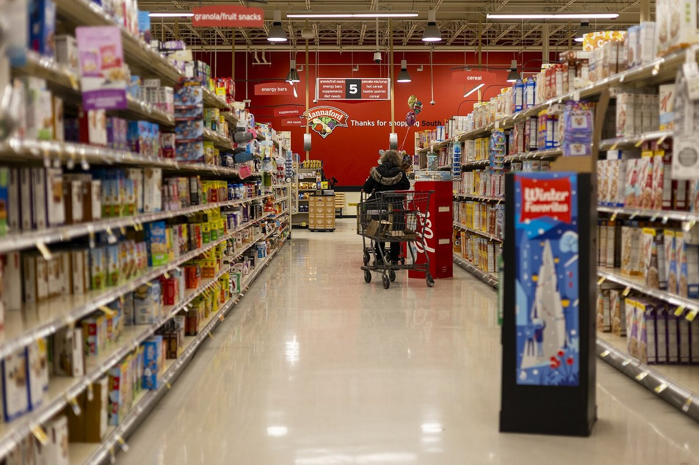

# Smart Retail AI - Computer Vision for Real-Time Store Analytics

Computer-vision prototypes for retail spaces: cameras that count people, follow movement through the aisles and watch shelf stock, with the models served behind REST endpoints so a dashboard or a store system can read the numbers as they happen.

<strong>Keywords</strong>

DomainRetail analytics

SignalsPeople counts · movement · shelf state

ServingREST inference services

LatencyReal time, per camera frame

<figure class="figure-small">

<figcaption>A store aisle is the input: shelves to watch, people to count, and movement to follow, all from one camera. Photo: Tessa Bury, CC BY 4.0, via Wikimedia Commons.</figcaption>
</figure>

---

## 1. Introduction

A store already has cameras; what it lacks is the numbers. How many people came in this hour, where did they slow down, which shelf ran empty and when. These prototypes put detection and tracking models on the camera feeds to produce those numbers continuously, and wrap each model in a small REST service so the result is one HTTP call away for whatever system needs it.

---

## 2. Goal

<h4>Goal</h4>
<ul>
<li>Count and track people in a store from ordinary camera feeds, in real time.</li>
<li>Detect shelf state such as empty slots so restocking can be triggered by the picture rather than by a walk-through.</li>
<li>Serve every model as a REST endpoint with a stable schema, so analytics and store systems integrate without touching the model code.</li>
</ul>

---

## 3. Code and details on GitHub

The main project and its technical details are uploaded to GitHub, so please refer to the repository to understand the work in detail.

<a href="https://github.com/Laudarisd" target="_blank" rel="noopener noreferrer">GitHub: https://github.com/Laudarisd</a>

