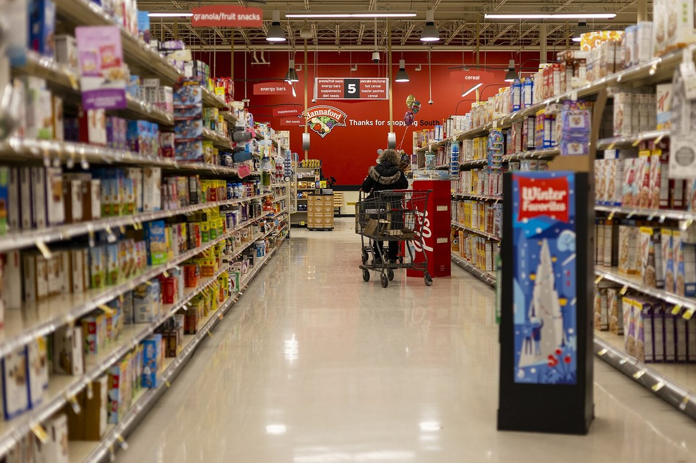

# Smart Retail AI - 실시간 매장 분석을 위한 Computer Vision

매장을 위한 Computer Vision 프로토타입이에요. 카메라로 사람을 세고, 통로에서의 움직임을 따라가고, 진열대 재고를 지켜봐요. 모델은 REST 엔드포인트 뒤에서 서빙되어서 대시보드나 매장 시스템이 숫자를 실시간으로 읽어요.

<strong>키워드</strong>

분야리테일 분석

신호사람 수 · 움직임 · 진열대 상태

서빙REST 추론 서비스

지연실시간, 카메라 프레임 단위

<figure class="figure-small">

<figcaption>매장 통로가 입력이에요. 지켜볼 진열대, 셀 사람, 따라갈 움직임이 카메라 하나에 다 있어요. 사진: Tessa Bury, CC BY 4.0, Wikimedia Commons.</figcaption>
</figure>

---

## 1. 소개

매장에는 이미 카메라가 있어요. 없는 건 숫자예요. 이번 시간에 몇 명이 들어왔는지, 어디서 느려졌는지, 어느 진열대가 언제 비었는지요. 이 프로토타입은 카메라 영상에 Detection과 Tracking 모델을 올려서 그 숫자를 계속 만들고, 모델마다 작은 REST 서비스로 감싸서 필요한 시스템이 HTTP 호출 한 번으로 결과를 받게 해요.

---

## 2. 목표

<h4>목표</h4>
<ul>
<li>보통의 카메라 영상으로 매장 안의 사람을 실시간으로 세고 따라가요.</li>
<li>빈 칸 같은 진열대 상태를 찾아서, 돌아다니며 확인하는 대신 화면으로 재입고를 시작하게 해요.</li>
<li>모델마다 안정된 스키마의 REST 엔드포인트로 서빙해서, 분석과 매장 시스템이 모델 코드를 건드리지 않고 붙게 해요.</li>
</ul>

---

## 3. 코드와 자세한 내용은 GitHub에

메인 프로젝트와 기술적인 세부 내용은 GitHub에 올려 두었어요. 작업을 자세히 이해하시려면 저장소를 참고해 주세요.

<a href="https://github.com/Laudarisd" target="_blank" rel="noopener noreferrer">GitHub: https://github.com/Laudarisd</a>

