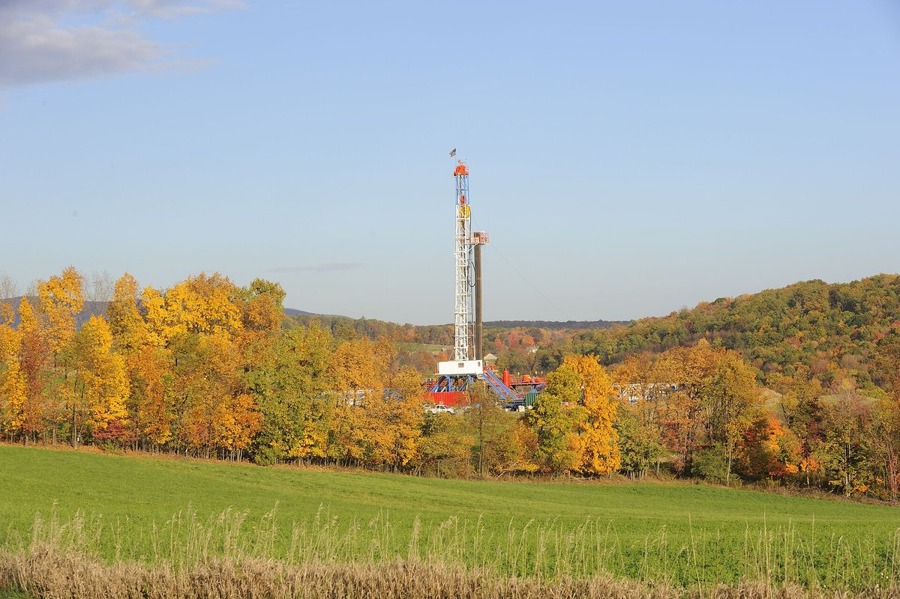
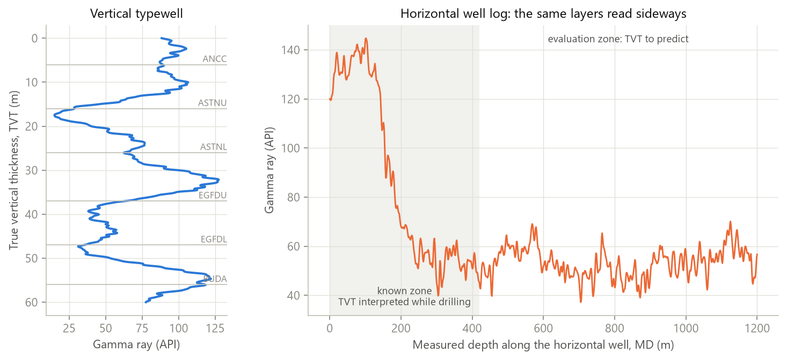
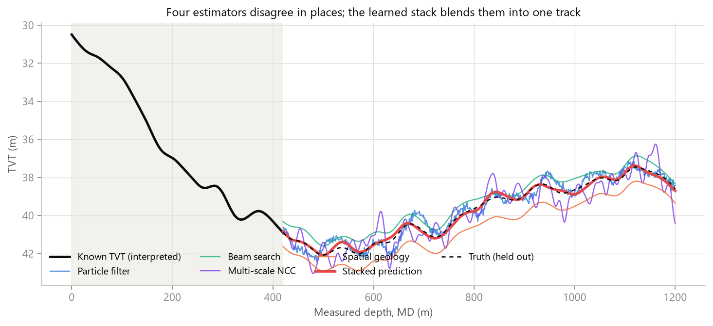

# Wellbore Geology Prediction - Where a Horizontal Well Sits in the Rock
<p>A geosteering model that places a horizontal well inside the subsurface. It reads the gamma-ray log along the drilled path, matches it against a vertical
reference well, and predicts the true vertical thickness (TVT) at every point, so the position of the bit in the rock layers is known where it was never measured.</p>
<p><strong>Keywords</strong></p>
<div class="fact-grid">
<div class="fact"><span class="fact-label">Domain</span><span class="fact-value">Geosteering · subsurface geology</span></div>
<div class="fact"><span class="fact-label">Task</span><span class="fact-value">Predict TVT along a horizontal well</span></div>
<div class="fact"><span class="fact-label">Inputs</span><span class="fact-value">Gamma-ray log + vertical typewell</span></div>
<div class="fact"><span class="fact-label">Estimators</span><span class="fact-value">Particle filter · beam search · NCC · spatial KNN</span></div>
<div class="fact"><span class="fact-label">Model</span><span class="fact-value">LightGBM + CatBoost, Ridge blend</span></div>
<div class="fact"><span class="fact-label">Validation</span><span class="fact-value">GroupKFold by well · RMSE on TVT</span></div>
</div>
<figure class="figure-small">

<figcaption>A horizontal drilling rig. The bit below it has to stay inside a rock layer a few metres thick that nobody can see. Photo: Meredithw, CC BY-SA 3.0, via Wikimedia Commons.</figcaption>
</figure>

---

## 1. Introduction
<p>Geosteering is keeping a drill bit inside a thin target layer while drilling sideways through it. The driller cannot see the rock; what they have is a gamma-ray
curve, which rises and falls with the clay content, and a nearby vertical well, the <strong>typewell</strong>, where the same layers were logged top to bottom.
Reading the two together tells you how far above or below a reference layer the bit sits. Part of each path is interpreted while drilling and carries a known TVT;
the model predicts the rest.</p>
<figure class="figure-small">

<figcaption>The two inputs. Left: the vertical typewell, gamma ray against TVT, with the six formation tops. Right: the same layers read sideways along the drilled path; TVT is known in the shaded zone and has to be predicted beyond it.</figcaption>
</figure>
<table>
<thead>
<tr><th>File</th><th>Contents</th></tr>
</thead>
<tbody>
<tr><td><code>&lt;well&gt;__horizontal_well.csv</code></td><td>The drilled path: measured depth <code>MD</code>, position <code>X Y Z</code>, gamma ray <code>GR</code>, a partly-known <code>TVT_input</code>, and the formation tops at each point</td></tr>
<tr><td><code>&lt;well&gt;__typewell.csv</code></td><td>The vertical reference log for that well: <code>TVT</code> against <code>GR</code>, top to bottom</td></tr>
</tbody>
</table>

---

## 2. Goal
<div class="callout callout-goal">
<h4>Goal</h4>
<ul>
<li>Predict the true vertical thickness at every point of a horizontal well from its gamma-ray log and a reference typewell.</li>
<li>Combine physics-style estimators with a learned stack so the result is both explainable and accurate.</li>
<li>Validate by well, never by row, so the reported error is what a new well would see.</li>
</ul>
</div>

---

## 3. Approach
<div class="callout callout-problem">
<h4>What made it hard</h4>
<ul>
<li>The reference log is vertical and the drilled path is nearly horizontal, so the two are never sampled the same way and have to be aligned by shape, not by depth.</li>
<li>Gamma-ray values drift and scale differently between a well and its typewell, so a raw comparison misleads until it is calibrated.</li>
<li>The known part of a path can be short and the part to predict long, so the estimate has to extrapolate without a hard anchor.</li>
<li>The rock dips and its layers thicken and thin across the field, so geometry from one well only partly transfers to the next.</li>
</ul>
</div>
<p>No single estimator is reliable on its own: each is strong on some wells and weak on others. Four independent families each answer the same question a different
way, and a model learns how to combine them per well.</p>
<pre class="mermaid">flowchart LR
    H[Horizontal well log<br/>MD · XYZ · GR · formations]:::input --> PF[Particle filter<br/>GR vs typewell]:::process
    T[Vertical typewell<br/>TVT vs GR]:::input --> PF
    H --> BS[Beam search]:::process
    T --> BS
    H --> NC[Multi-scale NCC]:::process
    T --> NC
    H --> SP[Spatial geology<br/>formation planes · dense ANCC]:::process
    PF --> F[(Feature stack<br/>tracks · deltas · GR stats · slopes)]:::store
    BS --> F
    NC --> F
    SP --> F
    F --> G[LightGBM + CatBoost<br/>GroupKFold by well]:::agent
    G --> R[Ridge blend<br/>+ per-well selector]:::agent
    R --> O[Predicted TVT<br/>along the whole path]:::output
</pre>

<h3>3.1 A particle filter along the gamma-ray log</h3>
<p>The core estimator carries a cloud of hypotheses about the bit's vertical position, moves them forward with the well, and reweights them by how well the gamma-ray
reading they imply matches the typewell at that depth. Hypotheses that keep matching survive; the rest are resampled away. The filter is run from many seeds and
the runs are blended by their own likelihood, so a seed that tracked the log well counts for more than one that lost it. The inner loop is compiled with Numba.</p>

```python
for i in range(len(ev)):
    # 1. move every particle forward along measured depth
    rate = MOM * rate + VN * rng.standard_normal(N)
    pos  = pos + rate * dm_step + PN * rng.standard_normal(N)

    # 2. weight by agreement between the observed GR and the typewell
    eg = np.interp(pos - z_v[i], tw_tvt, tw_gr)
    d  = (gr_v[i] - eg) / gs
    w  = w * np.maximum(np.exp(-0.5 * np.minimum(d**2, 600.)), 1e-300)
    w /= w.sum()

    # 3. resample when the cloud collapses onto too few particles
    if 1.0 / (w**2).sum() < 0.5 * N:
        pos, rate = systematic_resample(pos, rate, w)
        w = np.ones(N) / N

    res[i] = float(np.dot(w, pos - z_v[i]))   # weighted TVT estimate
```

<h3>3.2 A beam search through the reference log</h3>
<p>The second estimator treats alignment as a shortest-path problem: each step of the drilled path may move up or down a small amount through the typewell, paying a
cost for disagreeing with the gamma-ray reading and a cost for moving. A stiff, high-move-cost search holds a steady line through noise; a loose one follows every
wiggle. A spread of configurations is run and each is handed to the model separately, so it can prefer the right stiffness per well.</p>

```python
# A spread of beam configs, from conservative to loose: (beam width, move cost, GR scale, smoothing).
BEAMS = [(10, 20.0, 144.0, 2, "cons"), (10, 8.0, 64.0, 2, "loose"), (8, 35.0, 220.0, 1, "vcons"),
         (10, 14.0, 90.0, 5, "sm5"), (20, 4.0, 36.0, 3, "vloose"), (12, 12.0, 100.0, 3, "mid"), (15, 25.0, 180.0, 2, "stiff")]
```

<h3>3.3 Multi-scale template matching</h3>
<p>The third estimator slides the known gamma-ray pattern over the drilled log at three window sizes and scores the overlap with normalised cross-correlation.
Short windows catch sharp local features; long windows lock onto the broad shape. The scales are merged with a softmax over their match scores.</p>

```python
# Normalised cross-correlation at window radii 8, 15, 25; softmax-weighted.
ncc   = Hn @ Cn.T / win          # match every path window against every known window
best  = ncc.argmax(1)            # best-matching known position
score = ncc.max(1)               # how confident that match is
sw    = np.exp(3. * scores); sw /= sw.sum(1, keepdims=True)
ensemble = (tvts * sw).sum(1)    # confidence-weighted blend across scales
```

<h3>3.4 Spatial geology</h3>
<p>The last family ignores the gamma-ray log and uses geometry. Because the field is logged at many wells, the depth of each formation at a new location can be
predicted from its neighbours: a small weighted plane is fitted through the nearest wells by map position, for all six formations at once, and read at the query
point. A well never uses itself. Its disagreement with the log-based estimators is itself a useful feature.</p>

```python
FORMATION_COLS = ['ANCC', 'ASTNU', 'ASTNL', 'EGFDU', 'EGFDL', 'BUDA']

class FormationPlaneKNN:
    def impute(self, xy_q, self_wid=None, k=10):
        dist, idx = self.tree.query(xy_q / self.scale, k=k + 5, workers=-1)
        if self_wid in self.wmap:
            dist = np.where(idx == self.wmap[self_wid], np.inf, dist)      # never the well itself
        coef = np.linalg.solve(A, rhs)                                      # plane a·x + b·y + c per query
        return Xq[:, None] * coef[:, 0, :] + Yq[:, None] * coef[:, 1, :] + coef[:, 2, :], nearest_distance
```

<h3>3.5 Feature stack and model</h3>
<p>Every estimator produces a TVT track. All of them, and the differences between them, become features for LightGBM and CatBoost regressors with a Ridge meta-blend:
the tracks, the template scores, the spatial estimates, gamma-ray rolling statistics, lags and derivatives, path slopes, the affine calibration between log and typewell,
and the per-formation fit error in the known zone. When the independent estimators agree the answer is trusted; when they split, the model learns which to believe
from the well's own shape. A selector also picks a per-well blend of the raw estimators, keyed on how much of the path is unknown and how much vertical range it covers.</p>

```python
class CFG:
    seed = 42
    n_splits = 5
    cv = GroupKFold(n_splits=n_splits)   # never split one well across folds
    metric = root_mean_squared_error     # RMSE on TVT
```

---

## 4. Results
<figure class="figure-small">

<figcaption>Along one well: the known zone anchors the start, the four estimators then disagree in places, and the learned stack blends them into one track close to the held-out truth.</figcaption>
</figure>
<div class="callout callout-result">
<h4>How it is measured</h4>
<ul>
<li><strong>Metric:</strong> root-mean-square error of predicted TVT against the interpreted truth over the evaluation zone.</li>
<li><strong>Validation:</strong> five-fold <code>GroupKFold</code> grouped by well, so the error is measured on wells the model never saw. Rows from one well are highly correlated; splitting by row would make the score look far better than it is.</li>
<li><strong>Design:</strong> four independent estimators blended by a learned model and selected per well, so a mistake by any one of them is caught by the others rather than carried into the answer.</li>
</ul>
</div>
<p>The pipeline runs offline: the training helper and its dependencies install from pre-downloaded wheels, and the Numba kernels are warmed up on a tiny synthetic
well at import so the first real well does not pay the compile cost.</p>

---

## 5. Code and details on Kaggle
<p>The main project and its technical details are uploaded to Kaggle, so please refer to the notebooks to understand the work in detail.</p>
<p><a href="https://www.kaggle.com/laudari" target="_blank" rel="noopener noreferrer">Kaggle: https://www.kaggle.com/laudari</a></p>
