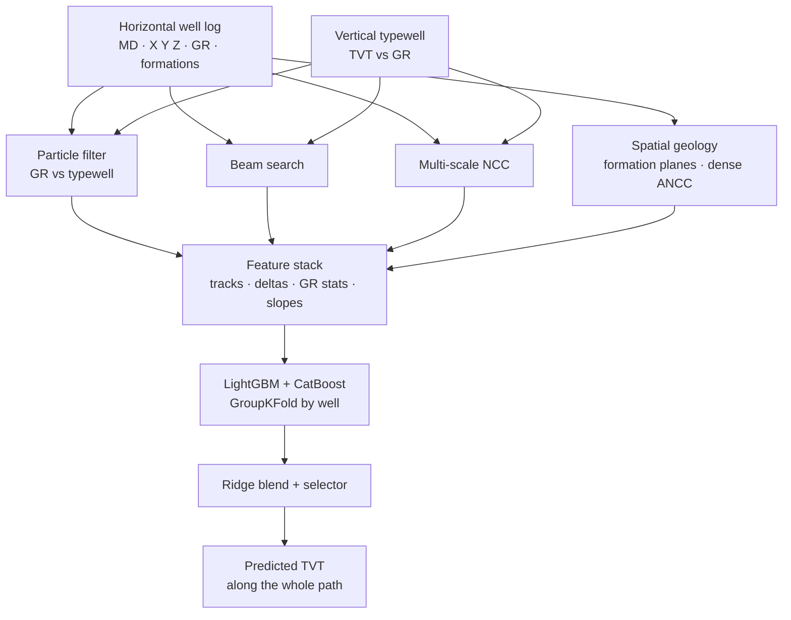

# Wellbore Geology Prediction

> A geosteering model that places a horizontal well inside the subsurface. It reads the gamma-ray log recorded along the drilled path, matches it against a vertical reference well, and predicts the true vertical thickness (TVT) at every point, so the position of the bit inside the rock layers is known where it was never measured.

<div class="fact-grid">
<div class="fact"><span class="fact-label">Domain</span><span class="fact-value">Geosteering · subsurface geology</span></div>
<div class="fact"><span class="fact-label">Task</span><span class="fact-value">Predict TVT along a horizontal well</span></div>
<div class="fact"><span class="fact-label">Inputs</span><span class="fact-value">Horizontal-well log + a vertical typewell</span></div>
<div class="fact"><span class="fact-label">Signal</span><span class="fact-value">Gamma-ray curve, well geometry, 6 formations</span></div>
<div class="fact"><span class="fact-label">Method</span><span class="fact-value">Physics-style ensemble + gradient-boosting stack</span></div>
<div class="fact"><span class="fact-label">Validation</span><span class="fact-value">Grouped by well · RMSE on TVT</span></div>
</div>

## 1. Overview

<div class="callout callout-problem">
<h4>Problems this work addresses</h4>
<ul>
<li>A horizontal well has to stay inside a thin target rock layer, often only a few metres thick, over hundreds of metres of drilling. Drift out of it and the well stops producing.</li>
<li>The drill measures its own path, but not which layer it is in. That has to be inferred from the gamma-ray log the tool records as it goes.</li>
<li>Only part of a well is interpreted while drilling; the rest has no known vertical position and must be filled in.</li>
<li>No two wells are shaped the same, the rock dips and changes thickness between wells, and the gamma-ray reading drifts from tool to tool, so a single rule does not transfer.</li>
</ul>
</div>

Geosteering is the act of keeping a drill bit inside a target rock layer while drilling sideways through it. The driller cannot see the rock. What they have is a gamma-ray curve, which rises and falls with the clay content of the rock, and a nearby vertical well, the **typewell**, where the same layers were logged top to bottom. Reading the two together tells you how far above or below a reference layer the bit currently sits.

I built a model that does that reading automatically. For each well it predicts the **true vertical thickness (TVT)** at every point along the drilled path: the vertical distance from the bit up to a geological reference, which is what tells you which layer the bit is in. Part of each path is already interpreted and carries a known TVT; the model predicts the rest.

## 2. The data

<div class="callout callout-problem">
<h4>Problems in the data</h4>
<ul>
<li>The reference log is vertical and the drilled path is nearly horizontal, so the two are never sampled the same way and have to be aligned by shape, not by depth.</li>
<li>Gamma-ray values drift and scale differently between a well and its typewell, so a raw comparison is misleading until it is calibrated.</li>
<li>The known part of a path can be short, and the part to predict can be long, so the estimate has to extrapolate without a hard anchor.</li>
<li>The rock dips and its layers thicken and thin across the field, so geometry from one well only partly transfers to the next.</li>
</ul>
</div>

Each well is two tables:

| File | Contents |
|---|---|
| `<well>__horizontal_well.csv` | The drilled path: measured depth `MD`, position `X` `Y` `Z`, the gamma-ray reading `GR`, a partly-known `TVT_input`, and the formation tops at each point |
| `<well>__typewell.csv` | The vertical reference log for that well: `TVT` against `GR`, top to bottom |

Along the horizontal path, the rows where `TVT_input` is filled in are the **known zone**; the rows where it is blank are the **evaluation zone** the model predicts. Six formations are tracked through the field:

```python
# CFG and the six formations the field is split into.
class CFG:
    seed = 42
    n_splits = 5
    cv = GroupKFold(n_splits=n_splits)   # never split one well across folds
    metric = root_mean_squared_error     # RMSE on TVT

FORMATION_COLS = ['ANCC', 'ASTNU', 'ASTNL', 'EGFDU', 'EGFDL', 'BUDA']
```

Grouping the cross-validation by well matters: rows from one well are highly correlated, so letting the same well appear in both the training and the validation fold would make the score look far better than it is.

## 3. How the position is estimated

No single estimator is reliable on its own: each is strong on some wells and weak on others. I run four independent families of estimator, each one a different way of answering the same question, and then let a model learn how to combine them per well.

### 3.1 A particle filter along the gamma-ray log

The core estimator is a particle filter. It carries a cloud of hypotheses about the bit's vertical position, moves them forward with the well, and reweights them by how well the gamma-ray reading they imply matches the typewell at that depth. Hypotheses that keep matching survive; the rest are resampled away.

```python
def run_particle_filter(hw, tw, n_particles=500, seed=42):
    tw_s   = tw.sort_values('TVT')
    tw_tvt = tw_s['TVT'].values.astype(float)
    tw_gr  = tw_s['GR'].fillna(tw_s['GR'].mean()).values.astype(float)

    kn = hw[hw['TVT_input'].notna()]   # known zone anchors the start
    ev = hw[hw['TVT_input'].isna()]    # evaluation zone to predict
    if len(ev) == 0:
        return hw['TVT_input'].values.astype(float).copy(), 0.0

    # Gamma-ray noise is estimated from the known zone, then bounded.
    tw_at_k = np.interp(kn['TVT_input'].values, tw_tvt, tw_gr)
    gs = float(np.clip(np.nanstd(kn['GR'].fillna(0).values - tw_at_k), 10., 60.))

    rng  = np.random.default_rng(seed)
    pos  = last_tvt + last_Z + 4.5 * rng.standard_normal(N)   # particle cloud
    rate = ir + 0.01 * rng.standard_normal(N)                 # vertical rate
    w    = np.ones(N) / N

    for i in range(len(ev)):
        # 1. move every particle forward along measured depth
        rate = MOM * rate + VN * rng.standard_normal(N)
        pos  = pos + rate * dm_step + PN * rng.standard_normal(N)

        # 2. weight by agreement between the observed GR and the typewell
        eg = np.interp(pos - z_v[i], tw_tvt, tw_gr)
        d  = (gr_v[i] - eg) / gs
        w  = w * np.maximum(np.exp(-0.5 * np.minimum(d**2, 600.)), 1e-300)
        w /= w.sum()

        # 3. resample when the cloud collapses onto too few particles
        if 1.0 / (w**2).sum() < 0.5 * N:
            pos, rate = systematic_resample(pos, rate, w)
            w = np.ones(N) / N

        res[i] = float(np.dot(w, pos - z_v[i]))   # weighted TVT estimate
```

The filter is run many times from different seeds, and the runs are blended by their own likelihood, so a seed that tracked the log well counts for more than one that lost it:

```python
# Likelihood-weighted blend over seeds, at several softness scales.
weights = np.exp((liks - liks.max()) / scale)
weights /= weights.sum()
blended = (weights[:, None] * np.stack(preds, 0)).sum(0)
```

The whole inner loop is compiled with Numba, because it runs over every evaluation point of every well many times. Two variants are kept: one that tracks absolute position and one that tracks the vertical rate against the well geometry, and both are fed to the model as separate opinions.

### 3.2 A beam search through the reference log

The second estimator treats alignment as a shortest-path problem. Each step of the drilled path can move up or down by a small amount through the typewell, paying a cost for disagreeing with the gamma-ray reading and a cost for moving. A beam search keeps the best few running paths and extends them, which gives a clean, monotone-ish track that the noisy particle filter sometimes lacks.

```python
# A spread of beam configs, from conservative to loose, blended together.
BEAMS = [
    (10, 20.0, 144.0, 2, "cons"),    # (beam width, move cost, GR scale, smoothing)
    (10,  8.0,  64.0, 2, "loose"),
    ( 8, 35.0, 220.0, 1, "vcons"),
    (10, 14.0,  90.0, 5, "sm5"),
    (20,  4.0,  36.0, 3, "vloose"),
    (12, 12.0, 100.0, 3, "mid"),
    (15, 25.0, 180.0, 2, "stiff"),
]
```

A stiff, high move-cost search holds a steady line through noise; a loose one follows every wiggle. Running a spread of them and averaging turns one brittle choice into a stable signal, and each config is also handed to the model separately so it can prefer the right stiffness per well.

### 3.3 Multi-scale template matching

The third estimator slides the known gamma-ray pattern over the drilled log at three window sizes and scores the overlap with normalised cross-correlation. Short windows catch sharp local features; long windows lock onto the broad shape. The three scales are merged with a softmax over their match scores, so the most confident scale leads.

```python
# Normalised cross-correlation at window radii 8, 15, 25; softmax-weighted.
ncc   = Hn @ Cn.T / win          # match every path window against every known window
best  = ncc.argmax(1)            # best-matching known position
score = ncc.max(1)               # how confident that match is
sw    = np.exp(3. * scores); sw /= sw.sum(1, keepdims=True)
ensemble = (tvts * sw).sum(1)    # confidence-weighted blend across scales
```

### 3.4 Spatial geology: formation planes and dense ANCC

The last family ignores the gamma-ray log and uses geometry instead. Because the field is logged at many wells, the depth of each formation at a new location can be predicted from its neighbours. I fit a small local plane through the nearest wells by their map position and read the formation off it, and separately run an inverse-distance interpolation over a dense set of the ANCC marker.

```python
class FormationPlaneKNN:
    def impute(self, xy_q, self_wid=None, k=10):
        # Nearest wells by map position (a well never uses itself).
        dist, idx = self.tree.query(xy_q / self.scale, k=k + 5, workers=-1)
        if self_wid in self.wmap:
            dist = np.where(idx == self.wmap[self_wid], np.inf, dist)

        # Weighted least-squares plane  f(x, y) = a·x + b·y + c  through the neighbours,
        # solved for all six formations at once, then evaluated at the query point.
        coef = np.linalg.solve(A, rhs)           # per-query plane coefficients
        pred = Xq[:, None] * coef[:, 0, :] + Yq[:, None] * coef[:, 1, :] + coef[:, 2, :]
        return pred, nearest_distance
```

This gives a geology-only estimate of TVT that holds up where the gamma-ray match is ambiguous, and its disagreement with the log-based estimators is itself a useful feature.

## 4. Feature stack and model

Each estimator above produces a TVT track. Rather than pick one, I turn all of them, and the differences between them, into features for a gradient-boosting model: the particle-filter and beam tracks, the template matches and their scores, the spatial formation and dense-marker estimates, gamma-ray rolling statistics, lags and derivatives, path slopes, affine calibration between the log and the typewell, and per-formation fit error in the known zone. The disagreements matter as much as the values: when the independent estimators converge, the answer is trusted; when they split, the model learns which to believe from the well's own shape.

A **selector** picks a per-well blend of the raw estimators before the model ever runs, keyed on how much of the path is unknown and how much vertical range it covers:

```python
def selector_well_code(hw):
    eval_mask = hw['TVT_input'].isna().to_numpy()
    n_eval = float(eval_mask.sum())
    z_eval = hw.loc[eval_mask, 'Z'].values
    z_span = float(np.nanmax(z_eval) - np.nanmin(z_eval)) if len(z_eval) else 0.0
    # Bin the well, then look up the blend that works best for that kind of well.
    code    = int(n_eval > N_EVAL_THRESHOLD) + 2 * np.searchsorted(Z_SPAN_THRESHOLDS, z_span)
    variant = SELECTOR_BIN_VARIANTS.get(code, SELECTOR_GLOBAL_VARIANT)
    return code, variant
```

The models themselves are **LightGBM** and **CatBoost** regressors with a **Ridge** meta-blend, trained under `GroupKFold` so no well is ever split across folds, and orchestrated with the `koolbox` training helper. Their outputs are combined with a final blend into one TVT prediction per point.

## 5. Pipeline



## 6. Technology stack

| Area | Tools |
|---|---|
| Core | Python, NumPy, pandas |
| Signal and geometry | SciPy (`cKDTree`, `savgol_filter`), Numba JIT |
| Estimators | Particle filter, beam search, normalised cross-correlation, spatial KNN planes |
| Models | LightGBM, CatBoost, scikit-learn (`Ridge`, `GroupKFold`, RMSE), koolbox |
| Compute | joblib parallelism, half-/single-precision Numba kernels |

## 7. Running offline

The pipeline is packaged to run with no internet access. The training helper and its dependencies are downloaded once into a local folder and installed from there, and the Numba kernels are warmed up on a tiny synthetic well at import so the first real well does not pay the compile cost.

```python
# Install from pre-downloaded wheels, no network.
pip install --no-index --find-links /path/to/wheels koolbox

# Warm up the JIT kernels before the real run.
_pf_ancc(_md, _z, _gr, _gg, 45., 0.1, 20., 50., 0., 8, ...)
_beam_jit(np.random.randn(30), np.random.randn(50), 25, 8, 15., 100.)
```

## 8. Evaluation

<div class="callout callout-result">
<h4>How it is measured</h4>
<ul>
<li><strong>Metric:</strong> root-mean-square error of predicted TVT against the interpreted truth, averaged over the evaluation zone.</li>
<li><strong>Validation:</strong> <code>GroupKFold</code> with five folds grouped by well, so the error is measured on wells the model never saw in training.</li>
<li><strong>Design rationale:</strong> four independent estimators are blended by a learned model and selected per well, so a mistake by any one of them is caught by the others rather than carried into the answer.</li>
</ul>
</div>

Reporting the error well by well, rather than row by row, keeps the number honest: a long well with many correlated points cannot flatter the score, and a well where every estimator struggles is visible instead of hidden.

## 9. Links

- [My Kaggle](https://www.kaggle.com/laudari): my profile and notebooks for this and other geoscience and machine-learning work.
