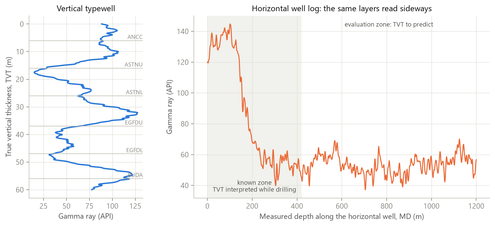
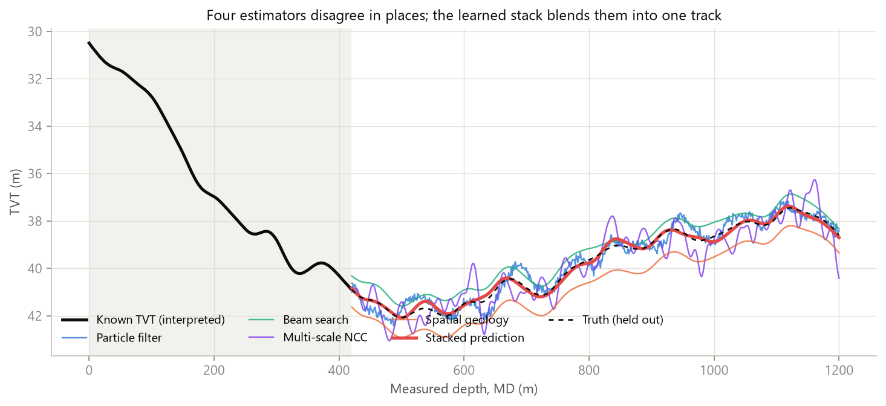

# 시추공 지질 예측 - 수평정이 암층 어디에 있는지
<p>수평정을 지하 안에 놓는 지오스티어링 모델이에요. 시추 경로를 따라 감마선 로그를 읽고, 수직 기준정과 맞추고, 모든 지점에서 진수직두께(TVT)를 예측해요.
그래서 한 번도 측정하지 않은 곳에서도 비트가 암층 어디에 있는지 알 수 있어요.</p>
<p><strong>키워드</strong></p>
<div class="fact-grid">
<div class="fact"><span class="fact-label">분야</span><span class="fact-value">지오스티어링 · 지하 지질</span></div>
<div class="fact"><span class="fact-label">과제</span><span class="fact-value">수평정을 따라 TVT 예측</span></div>
<div class="fact"><span class="fact-label">입력</span><span class="fact-value">감마선 로그 + 수직 기준정</span></div>
<div class="fact"><span class="fact-label">추정기</span><span class="fact-value">Particle Filter · Beam Search · NCC · Spatial KNN</span></div>
<div class="fact"><span class="fact-label">모델</span><span class="fact-value">LightGBM + CatBoost, Ridge 블렌드</span></div>
<div class="fact"><span class="fact-label">검증</span><span class="fact-value">정(well) 단위 GroupKFold · TVT RMSE</span></div>
</div>
<figure class="figure-small">

<figcaption>수평 시추 리그예요. 그 아래의 비트는 아무도 볼 수 없는 몇 미터 두께의 암층 안에 머물러야 해요. 사진: Meredithw, CC BY-SA 3.0, Wikimedia Commons.</figcaption>
</figure>

---

## 1. 소개
<p>지오스티어링은 옆으로 뚫고 가는 동안 드릴 비트를 얇은 목표 지층 안에 유지하는 일이에요. 시추하는 사람은 암석을 볼 수 없어요. 있는 건 점토 함량에 따라 오르내리는
감마선 곡선과, 같은 지층을 위에서 아래로 기록한 근처의 수직정, 즉 <strong>기준정(typewell)</strong>이에요. 둘을 같이 읽으면 비트가 기준 지층보다 얼마나 위나 아래에 있는지
알 수 있어요. 경로의 일부는 시추 중에 해석되어 TVT를 알고 있고, 모델은 나머지를 예측해요.</p>
<figure class="figure-small">

<figcaption>두 입력이에요. 왼쪽은 수직 기준정, TVT에 대한 감마선과 지층 경계 여섯 개. 오른쪽은 같은 지층을 시추 경로를 따라 옆으로 읽은 것이에요. 음영 구간은 TVT를 알고, 그 너머는 예측해야 해요.</figcaption>
</figure>
<table>
<thead>
<tr><th>파일</th><th>내용</th></tr>
</thead>
<tbody>
<tr><td><code>&lt;well&gt;__horizontal_well.csv</code></td><td>시추 경로: 측정 심도 <code>MD</code>, 위치 <code>X Y Z</code>, 감마선 <code>GR</code>, 일부만 있는 <code>TVT_input</code>, 지점마다의 지층 경계</td></tr>
<tr><td><code>&lt;well&gt;__typewell.csv</code></td><td>그 정의 수직 기준 로그: <code>GR</code>에 대한 <code>TVT</code>, 위에서 아래로</td></tr>
</tbody>
</table>

---

## 2. 목표
<div class="callout callout-goal">
<h4>목표</h4>
<ul>
<li>감마선 로그와 기준 수직정으로 수평정의 모든 지점에서 진수직두께를 예측해요.</li>
<li>물리 기반 추정기와 학습된 스택을 결합해서 설명 가능하면서도 정확한 결과를 내요.</li>
<li>행이 아니라 정 단위로 검증해서, 보고하는 오차가 새 정에서 볼 오차가 되게 해요.</li>
</ul>
</div>

---

## 3. 접근
<div class="callout callout-problem">
<h4>어려웠던 점</h4>
<ul>
<li>기준 로그는 수직이고 시추 경로는 거의 수평이라서, 둘은 같은 방식으로 샘플링되지 않아요. 깊이가 아니라 모양으로 맞춰야 해요.</li>
<li>감마선 값이 정과 기준정 사이에 다르게 드리프트하고 스케일이 달라서, 보정 전에는 그대로 비교하면 틀려요.</li>
<li>아는 구간은 짧고 예측할 구간은 길 수 있어서, 단단한 기준 없이 외삽해야 해요.</li>
<li>암석은 기울어 있고 지층은 지역에 따라 두꺼워지고 얇아져서, 한 정의 기하가 다음 정에 일부만 옮겨 가요.</li>
</ul>
</div>
<p>추정기 하나만으로는 믿을 수 없어요. 각각 어떤 정에서는 강하고 어떤 정에서는 약해요. 독립적인 네 계열이 같은 질문에 서로 다른 방법으로 답하고,
모델이 정마다 그걸 어떻게 합칠지 배워요.</p>
<pre class="mermaid">flowchart LR
    H[수평정 로그<br/>MD · XYZ · GR · 지층]:::input --> PF[Particle Filter<br/>GR 대 기준정]:::process
    T[수직 기준정<br/>TVT 대 GR]:::input --> PF
    H --> BS[Beam Search]:::process
    T --> BS
    H --> NC[다중 스케일 NCC]:::process
    T --> NC
    H --> SP[공간 지질<br/>지층 평면 · 조밀 ANCC]:::process
    PF --> F[(특징 스택<br/>트랙 · 차이 · GR 통계 · 기울기)]:::store
    BS --> F
    NC --> F
    SP --> F
    F --> G[LightGBM + CatBoost<br/>정 단위 GroupKFold]:::agent
    G --> R[Ridge 블렌드<br/>+ 정별 선택기]:::agent
    R --> O[경로 전체의<br/>예측 TVT]:::output
</pre>

<h3>3.1 감마선 로그를 따라가는 Particle Filter</h3>
<p>핵심 추정기는 비트의 수직 위치에 대한 가설 구름을 들고, 정을 따라 앞으로 옮기고, 각 가설이 뜻하는 감마선 값이 그 깊이의 기준정과 얼마나 맞는지로 가중치를 다시 매겨요.
계속 맞는 가설은 살아남고 나머지는 리샘플링으로 사라져요. 필터는 여러 Seed로 돌리고, 각 실행의 우도로 섞어요. 로그를 잘 따라간 Seed가 놓친 Seed보다 더 많이 반영돼요.
안쪽 루프는 Numba로 컴파일했어요.</p>

```python
for i in range(len(ev)):
    # 1. move every particle forward along measured depth
    rate = MOM * rate + VN * rng.standard_normal(N)
    pos  = pos + rate * dm_step + PN * rng.standard_normal(N)

    # 2. weight by agreement between the observed GR and the typewell
    eg = np.interp(pos - z_v[i], tw_tvt, tw_gr)
    d  = (gr_v[i] - eg) / gs
    w  = w * np.maximum(np.exp(-0.5 * np.minimum(d**2, 600.)), 1e-300)
    w /= w.sum()

    # 3. resample when the cloud collapses onto too few particles
    if 1.0 / (w**2).sum() < 0.5 * N:
        pos, rate = systematic_resample(pos, rate, w)
        w = np.ones(N) / N

    res[i] = float(np.dot(w, pos - z_v[i]))   # weighted TVT estimate
```

<h3>3.2 기준 로그를 지나는 Beam Search</h3>
<p>두 번째 추정기는 정렬을 최단 경로 문제로 봐요. 시추 경로의 각 단계는 기준정 안에서 조금 위나 아래로 움직일 수 있고, 감마선 값과 다른 만큼, 움직인 만큼 비용을 내요.
이동 비용이 큰 뻣뻣한 탐색은 노이즈 속에서 안정된 선을 유지하고, 느슨한 탐색은 작은 흔들림까지 따라가요. 여러 설정을 돌리고 각각 모델에 따로 넘겨서, 정마다 맞는 뻣뻣함을 고르게 해요.</p>

```python
# A spread of beam configs, from conservative to loose: (beam width, move cost, GR scale, smoothing).
BEAMS = [(10, 20.0, 144.0, 2, "cons"), (10, 8.0, 64.0, 2, "loose"), (8, 35.0, 220.0, 1, "vcons"),
         (10, 14.0, 90.0, 5, "sm5"), (20, 4.0, 36.0, 3, "vloose"), (12, 12.0, 100.0, 3, "mid"), (15, 25.0, 180.0, 2, "stiff")]
```

<h3>3.3 다중 스케일 템플릿 매칭</h3>
<p>세 번째 추정기는 아는 감마선 패턴을 시추 로그 위로 세 가지 윈도 크기로 밀면서 정규화 상호상관으로 겹침을 점수 매겨요. 짧은 윈도는 날카로운 국소 특징을 잡고,
긴 윈도는 넓은 모양에 고정돼요. 스케일들은 매칭 점수의 Softmax로 합쳐요.</p>

```python
# Normalised cross-correlation at window radii 8, 15, 25; softmax-weighted.
ncc   = Hn @ Cn.T / win          # match every path window against every known window
best  = ncc.argmax(1)            # best-matching known position
score = ncc.max(1)               # how confident that match is
sw    = np.exp(3. * scores); sw /= sw.sum(1, keepdims=True)
ensemble = (tvts * sw).sum(1)    # confidence-weighted blend across scales
```

<h3>3.4 공간 지질</h3>
<p>마지막 계열은 감마선 로그를 무시하고 기하를 써요. 이 지역은 여러 정에서 로그가 있어서, 새 위치의 지층 깊이를 이웃에서 예측할 수 있어요. 지도 위치로 가장 가까운 정들을
지나는 작은 가중 평면을 여섯 지층에 대해 한 번에 맞추고, 질문 지점에서 읽어요. 정은 절대 자기 자신을 쓰지 않아요. 로그 기반 추정기와의 불일치 자체가 유용한 특징이에요.</p>

```python
FORMATION_COLS = ['ANCC', 'ASTNU', 'ASTNL', 'EGFDU', 'EGFDL', 'BUDA']

class FormationPlaneKNN:
    def impute(self, xy_q, self_wid=None, k=10):
        dist, idx = self.tree.query(xy_q / self.scale, k=k + 5, workers=-1)
        if self_wid in self.wmap:
            dist = np.where(idx == self.wmap[self_wid], np.inf, dist)      # never the well itself
        coef = np.linalg.solve(A, rhs)                                      # plane a·x + b·y + c per query
        return Xq[:, None] * coef[:, 0, :] + Yq[:, None] * coef[:, 1, :] + coef[:, 2, :], nearest_distance
```

<h3>3.5 특징 스택과 모델</h3>
<p>추정기마다 TVT 트랙을 내요. 그 전부와 그들 사이의 차이가 LightGBM과 CatBoost 회귀 모델과 Ridge 메타 블렌드의 특징이 돼요. 트랙, 템플릿 점수, 공간 추정값, 감마선 이동 통계,
지연과 미분, 경로 기울기, 로그와 기준정 사이의 Affine 보정, 아는 구간의 지층별 맞춤 오차요. 독립적인 추정기들이 일치하면 답을 믿고, 갈리면 모델이 정의 모양에서 무엇을 믿을지 배워요.
선택기는 경로의 얼마가 미지인지, 수직 범위가 얼마나 되는지를 기준으로 정마다 원시 추정기의 블렌드도 골라요.</p>

```python
class CFG:
    seed = 42
    n_splits = 5
    cv = GroupKFold(n_splits=n_splits)   # never split one well across folds
    metric = root_mean_squared_error     # RMSE on TVT
```

---

## 4. 결과
<figure class="figure-small">

<figcaption>정 하나를 따라서요. 아는 구간이 시작을 고정하고, 네 추정기가 곳곳에서 갈리고, 학습된 스택이 그걸 숨겨 둔 진실에 가까운 트랙 하나로 합쳐요.</figcaption>
</figure>
<div class="callout callout-result">
<h4>측정 방법</h4>
<ul>
<li><strong>지표:</strong> 평가 구간에서 예측 TVT와 해석된 진실 사이의 RMSE.</li>
<li><strong>검증:</strong> 정 단위로 묶은 5-fold <code>GroupKFold</code>. 모델이 한 번도 보지 않은 정에서 오차를 재요. 한 정의 행들은 서로 강하게 상관돼 있어서, 행 단위로 나누면 점수가 실제보다 훨씬 좋아 보여요.</li>
<li><strong>설계:</strong> 독립적인 추정기 넷을 학습된 모델이 섞고 정마다 선택하니까, 하나의 실수가 답으로 넘어가지 않고 다른 것들이 잡아요.</li>
</ul>
</div>
<p>파이프라인은 오프라인으로 돌아요. 학습 도구와 의존성은 미리 받은 wheel에서 설치하고, Numba 커널은 import 때 작은 합성 정으로 미리 데워서 첫 실제 정이 컴파일 비용을 내지 않게 해요.</p>

---

## 5. 코드와 자세한 내용은 Kaggle에
<p>메인 프로젝트와 기술적인 세부 내용은 Kaggle에 올려 두었어요. 작업을 자세히 이해하시려면 노트북을 참고해 주세요.</p>
<p><a href="https://www.kaggle.com/laudari" target="_blank" rel="noopener noreferrer">Kaggle: https://www.kaggle.com/laudari</a></p>
